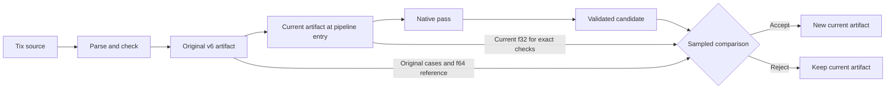

# Tix on IR Workbench

IR Workbench began with Typed, a statically typed language compiled to 32-bit RISC-V. Its framework represents programs as versioned intermediate representation artifacts and checks optimization candidates before accepting them. Tix exercises this machinery with a different kind of program. A Tix function defines tensors through indexed expressions and ordered reductions. Its observable result is a shaped array of floating-point values, so a useful optimizer needs to distinguish bitwise preservation from numerical agreement.

Stage 1 built a compiler front end, two interpreter modes, and two checked transformations. Inlining preserves the order of scalar arithmetic and uses bitwise comparison. Blocking a sum deliberately changes the grouping of additions and uses a tolerance against the original program evaluated in f64. The independently evaluated implementation was revision `d25be76`.

## The language

Tix uses single-assignment index notation. An input parameter has an f32 element type and an affine shape, such as `f32[M, K]` or `f32[H - 2, W]`. Each assignment names a new tensor and lists its output indices. Its right-hand side computes one element from earlier tensors, scalar operations and reductions. Subscripts can contain affine expressions over index variables. A reduction binds its own indices, and a function returns one tensor by name. The following corpus function expresses a matrix product. [Matmul source](../../../../../../corpus/tensor/matmul/main.tix)

```text
fn matmul(a: f32[M, K], b: f32[K, N]): f32[M, N] {
  y[i, j] = sum(k) a[i, k] * b[k, j];
  return y;
}
```

In this example, the plain reads of `i` and `j` give the output axes extents `M` and `N`. The two reads at index `k` both give it extent `K`. Conflicting symbolic extents at plain reads are source errors. An annotation supplies the extent of an output index that has no plain witness. The convolution uses this rule for both spatial indices. Its read of the input uses `h + dy` and `xout + dx`, while the kernel gives `dy` and `dx` plain witnesses. A reduction index needs a plain witness of its own. [Source checker](../../../../../../src/tensor/check.ts#L102), [convolution source](../../../../../../corpus/tensor/conv2d/main.tix)

The lexer tracks line and column, and the parser handles ordinary arithmetic precedence and left associativity. Reductions consume their bodies to the enclosing delimiter. In `sum(d) x[i, d] / D`, division happens for every term. In `(sum(d) x[i, d]) / D`, it happens once on the sum. The distinction can survive f32 rounding, and a language test exercises both spellings on the same input. The parser also distinguishes a two-argument `max` intrinsic from a reduction binder list. [Parser](../../../../../../src/tensor/parse.ts#L88), [language tests](../../../../../../tests/tensor/language.test.mjs#L34)

The checker normalizes affine shapes and subscripts. At compile time it finds an order in which parameter axes can determine the shape names one at a time. At a call, the interpreter uses those witnesses to solve for concrete nonnegative integer shape values and checks that all parameter axes agree with them. Source access checks derive a minimum and maximum subscript from the enclosing index extents, then use simple affine nonnegativity rules to establish bounds. These rules cover directly witnessed shapes, offsets, and the convolution's windows. Signatures requiring a simultaneous linear solve and accesses requiring a stronger bounds proof can fail compilation with a location. The public evaluator takes row-major finite values in a `Float32Array` or `Float64Array`, with shapes and element counts that fit the host. [Shape witnesses and access bounds](../../../../../../src/tensor/check.ts#L37), [concrete shape binding](../../../../../../src/tensor/evaluate.ts#L24)

## An indexed intermediate representation

The native IR is an ordered list of tensor definitions per function, with a scalar expression tree for each definition. Each output index has a resolved binder ID and an explicit affine extent. A tensor read names the tensor and gives an affine subscript for each axis. A reduction owns its ordered binders and body, and a blocked sum records its binder and block size. The function stores its parameter signature, shape witnesses, result shape, and the name of the returned tensor. [IR model](../../../../../../src/tensor/model.ts)

This representation puts the information needed by both transformations where they use it. An inliner can substitute one expression tree and compose affine subscripts using binder IDs, which distinguish indices even when their source names shadow one another. A reduction rewrite can change the fold structure while preserving its term expression and iteration domain. Keeping the iteration order explicit also allows the interpreter to execute a checked artifact directly. A source AST would leave name resolution and extent recovery to every consumer. A control-flow graph would introduce branches and temporaries before either of these passes needed them. [IR model](../../../../../../src/tensor/model.ts), [pass implementations](../../../../../../src/tensor/passes.ts)

Tix defines `tensor.module@1` and supplies an adapter for the framework's common IR view. Functions, parameters, statements, and returns appear as entities. Containment, tensor reads, and the return binding appear as relations. Stable entity IDs let the framework identify a removed producer and an updated consumer even when statement positions change. The adapter provides native structural validation and projection. The v6 artifact constructor supplies canonical storage and revision identity. Literal spellings remain strings in the artifact, and runtime buffers belong to evaluation. A compiled `TixProgram` initially has the same artifact as its origin and current revision. Optimization advances the current revision and carries the origin forward. [Tensor adapter](../../../../../../src/tensor/ir.ts#L123), [public API](../../../../../../src/tensor/index.ts#L14)

## Two evaluator modes

`runTix` dispatches to the same interpreter in either precision. It binds the shapes, traverses the tensor definitions in source order, and materializes each statement into a row-major typed array. For a scalar read, it evaluates each affine subscript, checks it against the actual axis, then flattens the coordinate into the array. For reductions, the first listed index is outermost. An empty sum yields positive zero, and an empty max yields negative infinity. [Evaluator](../../../../../../src/tensor/evaluate.ts#L56)

In f32 mode, the interpreter converts input values to f32 storage, applies `Math.fround` to literals, shape values, scalar operations and function results, and rounds after every accumulator update. F64 mode uses the same traversal, JavaScript double arithmetic, and `Float64Array` storage. It retains the values supplied in f64 input buffers and widens f32 inputs. The f64 evaluator runs whichever grouping appears in the supplied artifact. The contract obtains its reference by running it on the original artifact, where every source sum has its specified sequential grouping. Sharing traversal concentrates shape and indexing logic in one place. The independent evaluator cross-check gives separate evidence about that shared logic. [Scalar expressions and reductions](../../../../../../src/tensor/evaluate.ts#L109), [reference selection](../../../../../../src/tensor/meaning.ts#L168)

## The meaning contract

The observation is the output shape and every element of the returned tensor. Each changed candidate goes through the framework's existing synchronous differential helper. Tix supplies the cases, evaluator precision on each side, and comparison function. A counterexample identifies the function, input shapes, pattern, and seed, with the first differing output coordinate and either its f32 bits or numerical discrepancy. [Tensor comparison and evidence](../../../../../../src/tensor/meaning.ts#L115), [framework differential runner](../../../../../../src/framework/contracts/differential.ts#L273)

The exact relation compares the candidate's f32 output with the current pass input's f32 output. It reads the array buffers as unsigned 32-bit words, so positive and negative zero differ. The tolerance relation evaluates the origin in f64 and the candidate in f32. For each finite reference value `r`, the candidate `c` must be finite and satisfy the following condition. [Comparison implementation](../../../../../../src/tensor/meaning.ts#L129)

```text
abs(c - r) <= 1e-5 + 1e-5 * abs(r)
```

If the reference is NaN, the candidate must be NaN. If the reference is infinite, the candidate must have infinity of the same sign. Finite inputs can produce these outcomes, for example through division by zero. Layer normalization uses a positive literal epsilon of `1e-5` inside the square root, with gamma and beta supplied as per-feature inputs. The epsilon is fixed across the generated cases. [Nonfinite comparison](../../../../../../src/tensor/meaning.ts#L146), [layer normalization source](../../../../../../corpus/tensor/layernorm/main.tix)

The absolute term allows rounding error near zero or after cancellation. The relative term makes the allowance scale with the magnitude of the result. For a direct sum of at most nine f32 terms of magnitude at most one, a first-order estimate for eight inexact additions is about `9 × 8 × 2^-24`, or `4.3 × 10^-6`. The absolute tolerance allows error of that order and still exposes a lost unit term in the tail test. This estimate motivates the threshold for small sums. Larger reductions, accumulated rounding in a term, and error amplification in a consumer all fall outside that estimate. The tolerance is a policy applied to the sampled outputs. [Tolerance comparison](../../../../../../src/tensor/meaning.ts#L146), [dropped-tail test](../../../../../../tests/tensor/passes.test.mjs#L94)

Cases are generated for each function from its original signature. Uniform shape-name assignments are tried in the order `0, 1, 4, 5, 6, 2, 3, 8, 9`, which places empty, singleton, full-block and tail extents early. The selection keeps up to six eligible uniform bindings, adds distinct mixed assignments drawn with seed 7 up to a total of eight, and fills unused places with further eligible uniform bindings. The mixed search tries at most 512 assignments. If every selected output is empty and the search finds a nonempty result, it includes one such binding. Fixed-size signatures have just one binding to try. [Shape selection](../../../../../../src/tensor/meaning.ts#L64)

Each selected binding gets six input patterns. They use positive zeros, negative zeros, ones, alternating signs, seeded f32 values in `[-1, 1]`, and a half-ULP pattern along the last axis when it has room. Screening the origin limits each sampled tensor to 4,096 elements and each evaluation to 100,000 logical visits. A blocked sum charges the same logical term visits as a sequential sum. Its extra outer iterations are bounded by its inner term count because each block is nonempty. The limits apply to the sampled check. A function with no eligible cases supplies no evidence for accepting a changed artifact. [Value patterns and limits](../../../../../../src/tensor/meaning.ts#L12), [blocked sum accounting](../../../../../../src/tensor/evaluate.ts#L158)

The case set comes from the origin for both relations. A series of approximate candidates stays anchored to the original f64 output across calls to `optimizeTix`. An exact inline after a split compares against the immediately preceding f32 result, so it preserves the earlier accepted result on that same sampled set. The synchronous API publishes a changed candidate only after the required check passes. A rejected step leaves the current artifact available to later passes in the list. [Meaning gate](../../../../../../src/tensor/meaning.ts#L168), [step handling](../../../../../../src/tensor/index.ts#L30)



## Two checked passes

`inline` finds a pointwise temporary with one syntactic read. The producer must contain no reductions and must be distinct from the returned tensor. The pass substitutes the producer's expression at the consumer's read, composes each producer subscript with the consumer's actual affine arguments, and removes the temporary. It preserves the expression tree's scalar operations and does not reassociate arithmetic. After each removal it recalculates read counts. If the composition exceeds the IR's safe-integer coefficient representation, the pass skips that substitution. The exact check includes signed zero and tests a permuted read inside a reduction. [Inlining implementation](../../../../../../src/tensor/passes.ts#L6), [inline tests](../../../../../../tests/tensor/passes.test.mjs#L34)

`split-sum` replaces a single-index sum with contiguous blocks of four. The inner fold sums the indices in each block in increasing order, clipping the final block at the original upper bound. The outer fold adds the partial results in block order. The body and the binder's extent stay the same. Multi-index sums, maxima, and already blocked nodes retain their own fold structure. The blocked-sum node carries the two levels of iteration directly, and the interpreter keeps the partial results in scalar accumulators. The pass declares a write to statement entities since the tensor-read and containment relations remain the same. [Split implementation](../../../../../../src/tensor/passes.ts#L76), [blocked fold](../../../../../../src/tensor/evaluate.ts#L158)

```ts
if (expr.kind === 'reduce' && expr.op === 'sum' && expr.indices.length === 1) {
  changed = true;
  return {
    kind: 'blocked-sum',
    index: expr.indices[0],
    blockSize: BLOCK_SIZE,
    body: rewrite(expr.body),
  };
}
```

The generated input `[1, 0, 0, 0, 2^-24, 2^-24]` exposes a difference. The sequential f32 fold rounds away each half-ULP addition to 1. The blocked fold first adds the two small terms together, then adds their total to 1. Its f32 result equals the f64 reference for this input. The exact gate distinguishes the bit patterns `3f800000` and `3f800001`, while the tolerance gate accepts the blocked result. [Generated half-ULP test](../../../../../../tests/tensor/passes.test.mjs#L76)

## The framework change

The one framework file changed was `src/framework/passes/define-pass.ts`. The ordinary `applyPass` entry point was asynchronous and opened a graph edit before calling the pass implementation, even for passes that returned replacement native values. A probe with a native adapter that omitted graph reconstruction found the edit capability requirement. Tix's fixed API is synchronous, and its rewrites build native trees. Those two facts made the existing entry point a poor fit. [Existing and new pass application](../../../../../../src/framework/passes/define-pass.ts#L233), [design probe](./01-diary.md#step-1-trace-the-framework-and-design-stage-1)

The change extracted native candidate preparation so both entry points use the same artifact construction, validation, projection diff, and entity correspondence. They also share the declared-write check and the identity result construction. The new `applyNativePassSync` takes an ordinary `definePass` definition and a required synchronous `CheckResult` callback. It refuses managed clauses and graph edit access, checks the form of the verdict, and returns the candidate after an affirmative check. A failed comparison carries the check's evidence on the rejection. The existing artifact, adapter, and differential APIs supplied everything else the tensor passes exercised. [Shared preparation and synchronous gate](../../../../../../src/framework/passes/define-pass.ts#L193), [framework regression](../../../../../../tests/framework/native-pass-sync.test.mjs)

## What the tests showed

The local suite tested the language and API, six corpus programs, and pass acceptance. The corpus covers matmul, max-shifted softmax, layer normalization, single-head attention, a two-layer MLP with tanh-GELU, and unpadded NCHW convolution. The tests compare the original f32, original f64, and optimized output with expected values for specific inputs. Cases include softmax logits large enough to overflow an unshifted exponential, distinct query and key lengths, and a convolution with an asymmetric kernel. The pass suite also exercises nonfinite reference classification, a split near the logical-visit cap, and continued execution after rejection. `npm run build` passed. The tensor run with `node --test --test-isolation=none tests/tensor/*.test.mjs` reported 21 passing subtests. The framework run passed all 18 files, and the three selected Typed files covering passes, meaning memoization, and strategies passed. [Corpus tests](../../../../../../tests/tensor/corpus.test.mjs), [pass tests](../../../../../../tests/tensor/passes.test.mjs), [verification commands](./01-diary.md#step-4-implement-and-verify-tix-and-the-corpus)

Two deliberate mutation tests demonstrate that the public passes' comparison machinery can distinguish structurally valid wrong candidates. The inline mutant discards the transposed read. Its generated alternating-sign tensor changes an off-diagonal output, which the bit comparison detects. The split mutant changes the length-six reduction to visit just four entries. The all-ones case returns 4 where the original f64 reference returns 6. A separate cancellation fixture shows the tolerance refusing a real `split-sum` candidate on a numerically sensitive program. There, f32 rounding at large terms loses unit contributions that f64 retains, and the resulting discrepancy exceeds the output tolerance. These are expected local rejections. [Mutation and cancellation tests](../../../../../../tests/tensor/passes.test.mjs#L57)

The independent evaluator reported that all 25 hidden acceptance tests passed at `d25be76`. These tests were written from the language and API brief before implementation. In the differential cross-check, 60 generated programs were each tried on three inputs. All 180 f32 comparisons were bit-identical to the independent reference. All 180 f64 comparisons were within `1e-9 × max(1, |reference|)`. The independent run also reported that `inline` was accepted for all 60 programs and that every accepted result preserved the original bits. `split-sum` was accepted for all 60 programs, and every accepted result agreed in the reported f64 comparison within `1e-9`.

The supplied independent results contain zero failures and zero rejections. The API counts both no-ops and successful rewrites as accepted. The reported 60 out of 60 counts measure step acceptance. Rewrite frequency would require counting distinct revisions. The deliberate local mutations and half-ULP witness give separate evidence about the gates when a candidate does change the artifact. [No-op handling](../../../../../../src/framework/passes/define-pass.ts#L257), [local counterexamples](../../../../../../tests/tensor/passes.test.mjs#L57)

## What I would do differently

I would put the contrasting numerical witness and the synchronous pass probe at the beginning of the work. The half-ULP input makes the distinction between the proposed relations concrete. The minimal native adapter makes the framework requirement concrete, including the otherwise easy-to-miss dependency on graph reconstruction. Both probes are cheaper to inspect than a full pass or a corpus run. I would also set the case ranking, nonfinite policy, and work accounting alongside the first contract draft. Those choices affect which results the gate can observe. [Early probes](./01-diary.md#step-1-trace-the-framework-and-design-stage-1), [design review](./01-diary.md#step-2-incorporate-the-review)

I would record revision changes alongside acceptance in evaluation reports. The current artifacts already expose the revisions, and the half-ULP test already distinguishes a change from a repeated no-op. Extending that accounting to the independent sample would show how often each transform fired and how many changed candidates reached the comparison. I would keep the independent interpreter comparison and the generated mutations as separate checks. The former tests the evaluator against another implementation. The latter tests whether the optimizer's own gate detects a particular semantic error. [Public step results](../../../../../../src/tensor/index.ts#L30), [repeated split test](../../../../../../tests/tensor/passes.test.mjs#L76)
