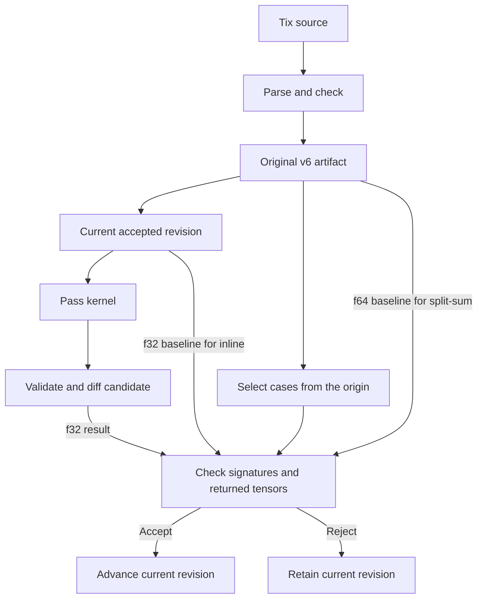

# Tix and checked tensor passes in IR Workbench

## What Stage 1 tested

IR Workbench had one client for its reusable compiler framework. Typed is a small
statically typed language that the workbench compiles to 32-bit RISC-V. Tix provided
a second client with a different representation and a different notion of acceptable
change. Its programs describe tensor computations by writing scalar expressions over
named indices. Inlining should preserve every binary32 result bit. Reassociating a sum
can change those bits, so it needs a numerical acceptance rule.

Stage 1 built a front end, a versioned IR, a CPU interpreter with two precision modes,
and two checked optimization passes. The public Node API compiles a source string, evaluates a named
function on row-major tensors, and applies a list of pass names synchronously. The
evaluated revision, `ce9cf4d281e6025466b198ea3061fa8edfe76f1a`, passed all 25
independent acceptance tests. The independent cross-check also reported agreement
in all 180 program/input cases for each precision. The one place the framework
needed a new entry point was pass application. The artifact, IR projection,
and differential comparison APIs already served the tensor domain. [Public API](../../../../../../src/tensor/index.ts#L16)

## The language and its checked domain

A Tix source file contains one or more named functions. A function takes named
`f32` tensors, defines intermediate tensors in source order, and returns one tensor.
Every statement defines a new whole tensor. Its left-hand indices enumerate the
coordinates of the result, and its right-hand expression computes one scalar per
coordinate. A statement can read parameters and earlier definitions. The language
has decimal literals, scalar arithmetic, shape names used as scalars, pointwise
intrinsics, and `sum` and `max` reductions. The affine expressions in tensor types
and array accesses have their own integer grammar.

Matrix multiplication shows how the two sorts of index work. In the definition of
`out`, the free indices `i` and `j` enumerate the output and `k` is local to the
sum. The two occurrences of `k` agree on the extent `K`.

```text
fn matmul(a: f32[M, K], b: f32[K, N]): f32[M, N] {
  out[i, j] = sum(k) a[i, k] * b[k, j];
  return out;
}
```

The recursive-descent parser retains line and column positions, implements ordinary
operator precedence, and gives an unparenthesized reduction body the rest of the
enclosing expression. Thus `sum(k) a[i,k] / K` divides the terms before adding
them, and `(sum(k) a[i,k]) / K` divides the accumulated sum. Those expressions
can differ under binary32 rounding. The parser distinguishes a binary `max` call
from a reduction using the form of its arguments and, for the ambiguous subtraction
case, the names available as scalar shape values. [Parser](../../../../../../src/tensor/parse.ts#L135)

The checker normalizes affine dimensions and offsets to integer constants and
coefficient lists. A plain access, such as `a[i,k]`, supplies an extent for its
binder. Repeated evidence for an extent must agree. An output index that appears
only inside an affine expression needs an explicit tensor type. Reduction indices
must obtain their extents from plain accesses. The checker resolves binders
lexically and checks single assignment, ranks, and the returned tensor's type.
For an affine access, it derives the smallest and largest possible index from the
active ranges and coefficient signs. It rejects accesses whose bounds it cannot
establish. A statically empty iteration space has no accesses to bound.
[Extent inference](../../../../../../src/tensor/check.ts#L56) · [Bounds checks](../../../../../../src/tensor/check.ts#L176)

At a call, a shape name is bound by a parameter dimension in which it is the sole
name. The binder prefers a plain dimension and can invert a dimension such as
`H - 2`. Every other parameter dimension must match the resulting bindings. This
covers coupled affine dimensions when each of their names has an anchor somewhere
in the signature. Signatures that require a simultaneous solve are outside the
implemented domain. Zero-size axes are supported. Concrete tensor extents are
nonnegative safe integers, and tensor input data uses finite values and a
`Float32Array` or `Float64Array` carrier. [Shape anchors](../../../../../../src/tensor/check.ts#L23) · [Call binding](../../../../../../src/tensor/evaluate.ts#L49)

## The IR and its evaluators

The native representation is a `tensor.tix@1` artifact. In IR Workbench, an
artifact associates an immutable value with a kind, schema version, content hash,
and revision. The Tix value holds functions in source order. Each function holds its
parameters, statement tensors, and returned tensor. A statement holds output
binders with checked extents and a scalar expression tree. The tree carries resolved
tensor references, affine offsets, and reduction binders in evaluation order.
The split pass adds one internal node that carries an existing reduction axis, its
body, and a block width. Source and candidate artifacts undergo the same IR
validation. [Native model](../../../../../../src/tensor/model.ts#L62) · [IR definition](../../../../../../src/tensor/ir.ts#L6)

The framework also opens an artifact as a logical graph. Tix projects functions,
parameters, and statements as stable entities. Ordered containment edges connect
definitions to their functions, and dependency edges record which tensor definitions
each statement reads. The statement entity includes its expression tree so the
framework's diff sees edits confined to a body. Keeping the tree inside the statement
gave both passes a direct representation of lexical scope and let the adapter remain
projection-only. Modeling each expression as a graph entity would make individual
scalar nodes addressable through the generic editor. It would also require rebuilding
scoped expression trees from graph edits, which neither pass uses. The current form
retains the axis bounds and order necessary to enumerate each computation.
[Projection](../../../../../../src/tensor/ir.ts#L17)

Both evaluators walk the same IR. They instantiate shapes from the call, execute
statements in definition order, and write each result into row-major storage. A
reference evaluates its affine coordinates and indexes an already available tensor.
Reduction axes visit increasing lexicographic coordinates, with the first axis
outermost. An empty sum returns positive zero and an empty maximum returns negative
infinity. In binary32 mode every literal, scalar shape value, input conversion,
primitive result, and accumulation rounds through `Math.fround`. In binary64 mode
the rounding operation is the identity on JavaScript numbers and results are stored in
`Float64Array`. Binary32 storage gives JS NaN a fixed quiet bit pattern and preserves
signed zero. The shared traversal avoids maintaining separate implementations of
loop order and indexing. It also makes independent evaluation important, since an
indexing error could affect both modes in the same way.
[Evaluator](../../../../../../src/tensor/evaluate.ts#L80) · [Reduction loops](../../../../../../src/tensor/evaluate.ts#L209)

## How a candidate earns acceptance

The optimizer holds on to the original artifact and a current accepted revision.
A pass proposes an updated native value. The framework creates and validates its
artifact, computes the change set and entity correspondence, and enforces the pass's
declared write set. The Tix gate then checks the function signatures and applies
a versioned differential invariant to the candidate. A semantic rejection leaves the
current revision available to the following pass. An identity can return immediately,
so an accepted step may have made no edit.



The observation consists of the returned shape and every row-major output element.
The exact relation compares raw 32-bit words. It sees the distinction between
positive and negative zero and can compare outputs that contain infinities or
canonical NaNs. Exact checks use the immediate input revision as the baseline
and the original artifact to select cases. This lets an inline after a split
preserve the split's accepted binary32 outputs. For a split, the comparison is
between the candidate's binary32 output and the original unoptimized binary64
output for each function changed by the pass. Comparing back to that original
reference avoids moving the tolerance baseline after each accepted change.
[Relations and gates](../../../../../../src/tensor/meaning.ts#L123)

Tolerance is elementwise. An admitted reference value `r` must be finite, and
the candidate element must also be finite and satisfy the following bound.

```text
abs(candidate - r) <= 2e-6 + 2e-5 * abs(r)
```

The absolute term supplies a noise floor for values near zero, where a purely
relative check becomes especially sensitive to cancellation. The relative term
allows an error of about 168 binary32 spacings near magnitude one, before the
absolute term is added. This leaves headroom for short sampled reductions and
the arithmetic that uses their results. The threshold is a policy for sampled
stage-1 workloads. Reduction length, conditioning and downstream operations all
affect numerical error, and the fixed threshold carries no general error bound.
The independent evaluator's reported `1e-9` threshold for binary64 is a
separate check with a separate purpose.

Case selection is deterministic and starts from the original signature. For each
function, eight uniform assignments set every shape name in turn to one of
`0, 1, 2, 3, 4, 5, 7, 9`. Eight mixed assignments draw from the same set using a
pseudorandom generator seeded with 7 in shape-name order. The sampler instantiates
parameter shapes, skips invalid or oversized cases, and deduplicates concrete
shapes. For each retained shape it tries alternating signed zeros, ones, a
nonuniform signed pattern, and seeded positive values. A `[1,9]` parameter
also triggers the special rounding witness. Case data is stored in binary32 so
both evaluators read the same inputs. [Case selection](../../../../../../src/tensor/meaning.ts#L43)

Each tensor in a checked case has a 4,096-element cap. The origin may take
100,000 scalar expression visits and accumulation steps, and each current or
candidate evaluation may take 200,000. The extra room accounts for new outer
accumulations after a split. The candidate can also be rejected if it exhausts
its budget. A tolerance case enters the comparison only if the origin's entire
binary64 output is finite. This decision precedes evaluation of the candidate.
An entry under check needs at least one comparable case. Evidence records counts
and counterexamples with the function, shapes, data pattern, and first mismatching
element. [Coverage and evidence](../../../../../../src/tensor/meaning.ts#L101)

## The two rewrites

`inline` identifies a reduction-free statement whose tensor has one syntactic
reference in a later statement and is not returned. It replaces the reference
with the producer's scalar expression, composing the consumer's affine offsets
with the producer's output binders, and removes the materialized statement.
Distinct binder IDs prevent capture when the use is inside a reduction. The
rewrite preserves primitive operation boundaries and the consumer's iteration
order. A test inlines a producer into a sum, and another composes two offset
accesses. A deliberately wrong kernel swaps the two substituted axes on a square
input. That candidate passes structural validation. The signed asymmetric case
exposes its incorrect result at the exact gate. [Inline kernel](../../../../../../src/tensor/passes.ts#L25) · [Mutation test](../../../../../../tests/tensor/passes.test.mjs#L55)

`split-sum` rewrites a one-axis sum into blocks of four. It visits consecutive
terms in each block, accumulates a subtotal from positive zero, and then adds
the subtotal to an outer accumulator. The final block stops at the original
extent. Multi-axis reductions and maxima keep their original form. The
following row makes the numerical consequence visible.

```text
[1, 0, 0, 0, 2^-24, 2^-24, 2^-24, 2^-24, 0.25]
```

In the linear binary32 sum, each of the four small terms is half a spacing above
1 and rounds away separately. In the blocked sum they accumulate together
before meeting 1. The linear result is `1.25` (`0x3fa00000`). The blocked
result is `1.250000238418579` (`0x3fa00002`), which matches the original
binary64 result on this input. The exact gate rejects the reassociation and
the tolerance gate accepts it. The test also submits a wrong split kernel
through the same native pass entry point. It reduces a valid eight-column
prefix that leaves out the `0.25` tail. The output becomes
`1.000000238418579`, and the tolerance gate rejects it. The two wrong kernels
demonstrate that valid IR and permitted writes alone do not earn acceptance.
[Split kernel](../../../../../../src/tensor/passes.ts#L77) · [Rounding and tail test](../../../../../../tests/tensor/passes.test.mjs#L22)

## The framework change

The framework's existing `applyPass` is asynchronous and opens a logical edit
before invoking the kernel, even when the kernel returns a native value. Tix's
public optimizer must return synchronously, and the Tix adapter can project a
tree without rebuilding it from a graph. The one changed framework source file,
`src/framework/passes/define-pass.ts`, adds `applyNativePassSync`. It consumes
the existing `Pass` definition and requires a synchronous semantic check. It
refuses declared analysis needs, preservation claims, manager contracts,
logical edits, and asynchronous results. The pass result continues to carry
the artifact, diff, correspondence, and check evidence. [Synchronous entry point](../../../../../../src/framework/passes/define-pass.ts#L244)

Native candidate preparation, declared-write checking, and identity handling
are shared with the asynchronous path in the same file. This keeps the
candidate's preparation on the same artifact and correspondence rules as other
native passes. Calling a Tix kernel directly would have offered a shorter path
to a synchronous result while bypassing those common checks. A synchronous
version of the analysis manager would have exposed more machinery than this
domain needed. Tix could already use the framework's synchronous differential
runner with its own case generator and comparison relation. [Shared candidate preparation](../../../../../../src/framework/passes/define-pass.ts#L193) · [Framework tests](../../../../../../tests/framework/native-pass-sync.test.mjs#L43)

## Verification and independent evaluation

The repository checks exercised the exported API after `npm run build`.
The tensor suite has 17 tests across three files. It covers parsing and static
diagnostics, lexicographic reduction order, signed zero, affine shapes and
offsets, pass decisions, and independent expected outputs for six corpus
programs. The corpus contains rectangular matmul, max-shifted softmax,
layer normalization with scale, offset and epsilon, scaled single-head
attention, a two-projection MLP with tanh-GELU, and valid NCHW convolution.
A test with 3,846 terms exercises a split whose work exceeds the origin
budget after its outer accumulations are added. The framework suite passed
all 18 files, and the four selected Typed test files covering passes,
inline, meaning memoization, and strategies also passed. For this report
I reran the build and all five tensor pass tests with
`node --test --test-isolation=none tests/tensor/passes.test.mjs`.
[Corpus checks](../../../../../../tests/tensor/corpus.test.mjs#L9) · [Pass checks](../../../../../../tests/tensor/passes.test.mjs#L101)

The independent evaluation reported the following results for `ce9cf4d`.
The hidden tests were written from the brief before the implementation.

| Independent check | Reported result |
| --- | --- |
| Hidden fixed-core and API acceptance suite | 25 of 25 passed. |
| Binary32 cross-check against an independent evaluator | 180 of 180 program/input cases bit-identical. |
| Binary64 cross-check against an independent evaluator | 180 of 180 cases within `1e-9` relative to `max(1, abs(r))`. |
| `optimizeTix(p, ['inline'])` on the same 60 programs | 60 of 60 accepted. Every accepted result was bit-identical to its original. |
| `optimizeTix(p, ['split-sum'])` on the same 60 programs | 60 of 60 accepted. Every accepted result agreed with its original in the binary64 run within the reported `1e-9` threshold. |

The two evaluator rows come from 60 random programs with three inputs each.
The independent evaluation reports zero failures and zero pass rejections.
I found no contradiction between those results and the checked-in code or local
tests. The exact rejection of the valid split on the witness and the two
mutation rejections are expected outcomes of the repository tests. The external
acceptance totals do not identify how many of the 60 programs actually changed
under either pass, so they cannot establish rewrite coverage on their own.

## What I would do differently

I would report edit counts alongside acceptance counts from the start. The
framework already distinguishes a changed result from an identity. Recording
that distinction in the evaluation would say which inputs exercised a new
revision, which exercised the identity path, and how many distinct rewrite
sites contributed evidence. I would also keep the independent evaluator in
the validation plan from the first implementation checkpoint. A common
interpreter is convenient for comparing rounding modes, and an independent
implementation is the strongest check we used against mistakes shared by both
modes.

I would expand the measured tolerance study before changing the numerical
policy. The present sampler covers short shapes and a known reassociation and
tail witness. It does not measure error distributions across long reductions,
different cancellation patterns, or deep arithmetic chains. A follow-up
measurement could record worst absolute and scaled errors across controlled
families and report how many cases each limit or finite-reference filter
excluded. That would give future tolerance decisions evidence beyond the
current headroom rationale. I would keep the threshold and its sampling
domain explicit, since the contract answers whether a candidate passed those
checks under that policy.
