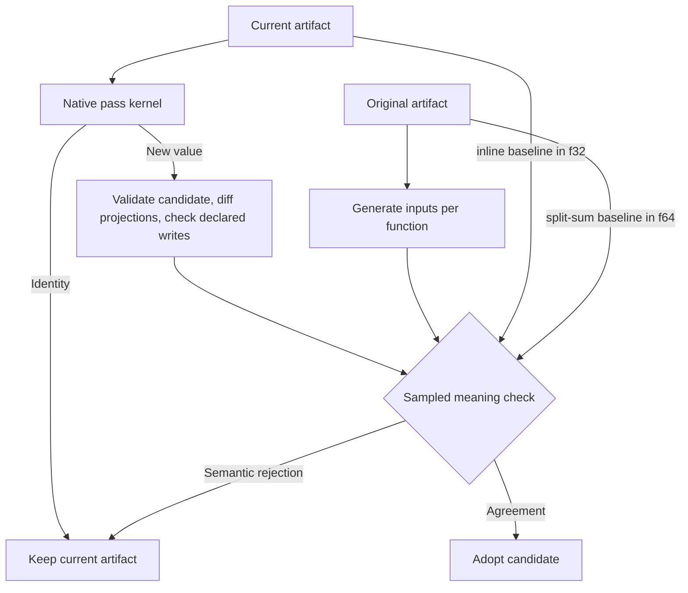

# Checking tensor rewrites in IR Workbench

A row of five binary32 numbers distinguishes the two compiler passes in this experiment. Add `[1, 0, 2⁻²⁴, 2⁻²⁴, 0.25]` from left to right and the result is 1.25. Add adjacent pairs into partial sums first and the result is the next representable number above 1.25. A compiler that permits both evaluations needs a way to say which transformations may introduce that difference. Inlining a temporary carries a stronger obligation. Moving its computation should preserve even the last bit.

IR Workbench originally used its intermediate representation (IR) framework to compile a small statically typed language, Typed, to 32-bit RISC-V. Tix is its second compiler domain. Stage 1 took tensor programs as far as an executable IR and two checked transformations. The existing framework could express both numerical contracts. The one change it needed was a synchronous way to run a pass that supplies a complete candidate revision. The independent evaluation of revision `216faa0` passed all 25 hidden acceptance tests and found bit-identical f32 results in all 180 comparisons with a reference implementation.

## A tensor statement specifies an iteration space

A Tix function takes one or more named f32 tensors and returns one named tensor. Each assignment defines a new tensor. Array subscripts on the left name the output coordinates. A reduction on the right introduces additional coordinates that are local to its body. The matrix multiplication in the corpus needs one assignment.

```text
fn matmul(a: f32[M,K], b: f32[K,N]): f32[M,N] {
  y[i,j] = sum(k) a[i,k] * b[k,j];
  return y;
}
```

The two occurrences of `k` must range over the same symbolic extent, K. The loads also supply M for `i` and N for `j`. The checker collects this information from plain index uses. Every function shape symbol needs a binding from a plain parameter axis. Once bound, a symbol can appear in an affine dimension such as `H-2`, or as a scalar operand such as the divisor D in a mean. Supported calls supply consistent row-major shapes, matching buffers of finite input elements, and in-bounds accesses.

Convolution illustrates why a tensor can need an explicit result type. The corpus kernel reads `x[n,c,y+dy,xpos+dx]` and `w[o,c,dy,dx]`. The filter supplies the extents of the reduction indices, including the two three-element spatial axes. Looking at `y+dy` alone cannot tell the checker how many output rows to produce. The statement declares `f32[N,O,H-2,W-2]`, giving the output coordinates their extents for a 3×3 filter, unit stride and no padding. An unresolved extent, two conflicting plain uses, or an attempt to assign a tensor twice produces a compile error with a line and column.

Scalar expressions support arithmetic, unary minus, common mathematical functions and binary min and max. The parser gives a reduction the longest body allowed by its enclosing expression. In `sum(d) x[i,d] / D`, each element is divided before addition. In `(sum(d) x[i,d]) / D`, the sum is divided once. A regression test uses two values near `3e38`. Division inside the reduction gives a finite f32 result. Summing those values before dividing overflows. A precedence error here would change the language’s numerical meaning even with the optimizer switched off.

## An IR that keeps the axes

The native IR stores functions in order. A function contains parameter shapes, statements and a return tensor name. Each statement holds its output axes with their extents and a scalar expression tree. A load names an earlier tensor and has one affine expression per subscript. A reduction owns its ordered list of axes and its body. Each index declaration receives a distinct identity, so a reduction may reuse the spelling of an outer index without capturing references to it. Affine forms consist of an integer constant and sorted, combined coefficients. This makes `H+1-3` and `H-2` equal during shape checking and makes substitution into a load an algebraic operation.

This representation keeps two pieces of information needed by both passes. A walk of the expression tree tells inline whether a producer contains a reduction. The list of bound axes tells split-sum exactly which additions it can regroup. The evaluator can read the loop nest from those same axes. Lowering immediately to scalar blocks would have made the compiler recover a reduction from accumulator updates before it could apply the second transformation.

An *artifact* in the framework is an immutable value with a kind, schema version and content-derived revision. Tix registers its module as `tensor.tix`, schema version 1. A read-only adapter projects that module into a graph the framework can inspect. Functions are roots with ordered edges to parameters and statements. A read edge connects a statement to each tensor occurrence it loads, and a return edge identifies the result. The scalar tree lives in the statement’s attributes. Replacing a flat sum by a blocked sum therefore changes a visible statement even when it reads exactly the same tensors. Scalar operators need no separate graph identity for these passes.

## Two precisions and two baselines

The built module exposes three synchronous operations. `compileTix` parses and checks source and returns a handle to its origin and current artifacts. `runTix` evaluates a named function in the current revision. `optimizeTix` applies a list of named passes in order, returning a runnable program and one acceptance flag per step. Keeping the origin in the handle lets a second optimizer call refer back to the compiled source.

Both evaluators traverse the same IR. They bind shape symbols from actual inputs, compute row-major strides, and materialize the result of each statement before evaluating its consumers. The default evaluator uses f32 buffers and applies `Math.fround` to literals, scalar shape values, arithmetic and intrinsic results. It rounds after every accumulator update. The f64 evaluator uses the caller’s input precision up to binary64, stores double results, and uses JavaScript double arithmetic throughout. Both visit reduction indices in increasing lexicographic order, first listed axis outermost. Sum starts at positive zero and max at negative infinity, which also defines the result of an empty reduction.

The contract chooses its baseline according to the pass. Inline compares the candidate and its immediate input, both in f32. Split-sum compares the candidate in f32 with the original program in f64. Both use cases generated from the origin. This matters when the optimizer splits a sum and then inlines a producer. Exact agreement with the immediately preceding revision means that inline introduced zero further bit changes on those cases. Checking future approximate transformations against the original f64 program also keeps successive local allowances from accumulating unchecked.



### What the contract observes

The checker compares declared function interfaces, actual output shapes, and every row-major output element. Intermediate tensors are private to a function. For exact comparison, it views the f32 output buffer as unsigned 32-bit words. A change from negative zero to positive zero is visible. For tolerance, an output element passes when

```text
abs(candidate32 - origin64) <= 1e-6 + 1e-5 * abs(origin64)
```

The relative term allows for rounding over several operations and short reductions. Near one, binary32 unit roundoff is about `6e-8`. The absolute term accommodates cancellation when the reference value is near zero. Applying the test per element prevents a large, accurate output from concealing an inaccurate small one elsewhere in the tensor. A tolerance case needs an entirely finite f64 reference output. A nonfinite candidate element on such a case disagrees. If a function supplies no eligible comparison, the gate rejects the changed program. The evidence identifies the function, case pattern, shape assignment and first disagreeing coordinate.

### How the cases and bound were chosen

For each function, the generator first tries all shape symbols at 1, 3 and 5. It also tries raising one symbol at a time from 3 to 5 with the others at 3. Unequal dimensions help expose swapped axes. The generator deduplicates assignments, retains admissible extents and affine accesses, and limits each materialized tensor to 4,096 elements with an estimated work budget of 65,536 visits. These bounds govern optimizer sampling. A function with fixed dimensions uses its own shape when it fits the budget.

Each shape gets three input patterns. One uses mixed signs from the framework generator with seed 7. A second repeats the five-element rounding witness along the innermost axis. The third is a bounded ramp. For flat element index `i` of parameter ordinal `p`, both zero-based, the value is `(1 + ((i + 3*p) % 16)) / 16`. Every ramp element is exactly representable. Shifting its phase distinguishes parameters while keeping the range between 1/16 and 1, however large the flat index becomes.

Layer normalization motivated measuring the bound on the original program. It subtracts a computed row mean before scaling by the inverse standard deviation. An input ramp that grows with position could magnify the effect of cancellation. On the bounded ramp, we compared the original f32 and f64 outputs and divided each absolute error by its allowed error. Across the five sampled layernorm shapes, the maximum ratio over 65 output elements was 0.00635. Across all six corpus programs, 697 ramp output elements met the bound. Attention had the largest ratio, 0.01648 rounded upward. These measurements calibrate the threshold for the exercised cases. They supply no general forward-error bound for longer or more ill-conditioned reductions.

## What the passes changed

**Inline** looks for a reduction-free statement with exactly one load occurrence among later statements. It leaves the returned tensor in place. In `t[i,j] = x[i,j]` followed by `y[i,j] = t[j,i]`, the substitution is `y[i,j] = x[j,i]`. The implementation simultaneously replaces the producer’s axis IDs by the affine expressions at the load, copies the resulting scalar expression into the consumer, and removes the producer. The copied arithmetic retains its individual rounding points. One consumer that loads the producer twice counts as two uses.

A square matrix makes a good negative control because a mistaken transpose still has the right shape. With rows `[1,2]` and `[4,8]`, the correct result flattens to `[1,4,2,8]`. A test mutant reverses the substituted indices and returns the elements in their original order. The exact gate detects the fault on a ramp input. Another mutant strips the minus sign from a zero literal, which the same comparator detects by its sign bit alone.

**Split-sum** replaces an ordinary sum over one index with a blocked expression carrying the same axis and body and a block size of two. It accumulates consecutive pairs from zero and adds the rounded partials to an outer accumulator. The last block ends at the actual extent. Maxima, sums with several bound indices, and already blocked nodes each retain their own evaluation order.

In the five-element example, each isolated addition of `2⁻²⁴` to 1 is a halfway case that rounds back to 1. Pairing the two small terms first produces `2⁻²³`, large enough to survive addition to 1. The trailing 0.25 then gives f32 word `0x3fa00000` for the flat sum and `0x3fa00001` for the blocked sum. Original f64 gives 1.2500001192092896, exactly the blocked result on this input. The exact gate rejected the legal reassociation when the test forced that relation. Its ordinary tolerance gate accepted it. A second mutant shortened the loop to four elements, losing 0.25 and returning 1.0000001192092896. Tolerance rejected that changed function. One input thus distinguishes an intentional precision change from a missing iteration.

## The framework change

The existing pass runner, `applyPass`, coordinates managed analyses and returns a Promise. It also opens a graph edit before calling the kernel. A probe with an adapter capable of projecting and validating an artifact, and a native identity kernel, reported `Adapter probe is not Rewritable` before the kernel ran. Both Tix kernels can produce a complete native value directly. Implementing a graph-to-Tix rebuilder solely to enter the runner would have supplied a capability neither kernel uses, while leaving the public API’s synchronous requirement unresolved.

All framework edits were confined to `src/framework/passes/define-pass.ts`. The new `applyNativePassSync` takes the existing versioned pass declaration, an input artifact and a caller-supplied synchronous check. It refuses declarations that require managed analyses, preservation claims or a managed transformation contract. An identity returns immediately. A changed result goes through two operations shared with the asynchronous runner. `prepareNative` constructs and validates the candidate artifact, diffs the projections and records correspondence between their entities. `checkWrites` verifies that the diff touches only the entity and relation kinds the pass declared.

Only then does the new runner invoke the caller’s check. This is the call from the tensor domain in `src/tensor/optimize.ts`.

```ts
const result = applyNativePassSync(pass, program.current, {
  check: (before, after) => checkMeaning(program.origin, before, after, relation),
});
```

The existing differential checker already supported separate evaluation of baseline and candidate, deterministic cases, and counterexample evidence. Tix supplied its choices of precision, inputs and comparison there. On semantic rejection, the optimizer retains the current artifact and continues with the next requested pass. A structural violation such as an undeclared write remains a framework error. Neither the numerical threshold nor knowledge of tensor axes entered the framework.

## Results at revision 216faa0

The repository checks started with `npm run build` under Node 24. The 29 tensor tests covered language diagnostics, precision, iteration order, both pass orders, faulty kernels, and expected outputs for original and optimized corpus programs. The six fixtures included rectangular matmul, max-shifted softmax with logits of 1001, layernorm with distinct gamma and beta, single-head attention, two dense projections around tanh-GELU, and NCHW convolution with off-center filter taps. For attention, a zero query makes the weights uniform, so the output must equal the mean of distinct value rows. That expected answer can detect a wrong value reduction even if both interpreter precisions share the same indexing mistake. All 18 framework test files and the two affected Typed pass and strategy test files passed.

The independent evaluator supplied a separate set of observations. Its hidden suite was written from the fixed language and API brief before implementation. Its differential experiment used 60 randomly generated programs with three inputs apiece.

| Independent check | Reported outcome |
| --- | --- |
| Fixed core and public API | 25 of 25 hidden tests passed |
| Original f32 against an independent reference | Bit-identical outputs in 180 of 180 cases |
| Original f64 against that reference | 180 of 180 within `1e-9 * max(1, abs(reference))` |
| `inline` on the 60 programs | 60 accepted. Every accepted result was bit-identical to the original on the evaluated inputs. |
| `split-sum` on the 60 programs | 60 accepted. Every accepted result agreed in the reported f64 comparison within `1e-9`. |

There were zero reported failures and zero pass rejections in the independent evaluation. Its f64 comparison after split-sum tests whether the transformed program still computes the reference function on those inputs. The one-bit example answers a different question about the f32 order of evaluation. Both observations are consistent.

## What I would do differently

I would record *accepted* and *changed* separately in the experimental results from the beginning. In a replay on the six repository programs, applying inline and then split-sum gave twelve accepted steps. Comparing the revision before and after each step showed that inline changed attention and the MLP, while split-sum changed five programs. Convolution’s reduction binds three indices and has no single-use pointwise producer, so both steps returned its original revision. Seven changed revisions out of twelve acceptances describes the coverage of those two rewrite kernels more precisely. The independent summary gives acceptance counts only, so the number of changed revisions among its 60 programs is unknown.

I would also start tolerance selection with the original f32-to-f64 comparison on a specified input range. Writing down the ramp formula during review turned a question about layernorm cancellation into a repeatable measurement. The five-element sum supplied the complementary test. It measured the change of one output bit under reassociation and exposed a missing iteration that passed structural validation. Those checks gave the framework experiment a practical division of responsibility. The framework enforced who could publish a revision and what it could change. The tensor domain supplied the evidence for whether its new arithmetic was acceptable.
