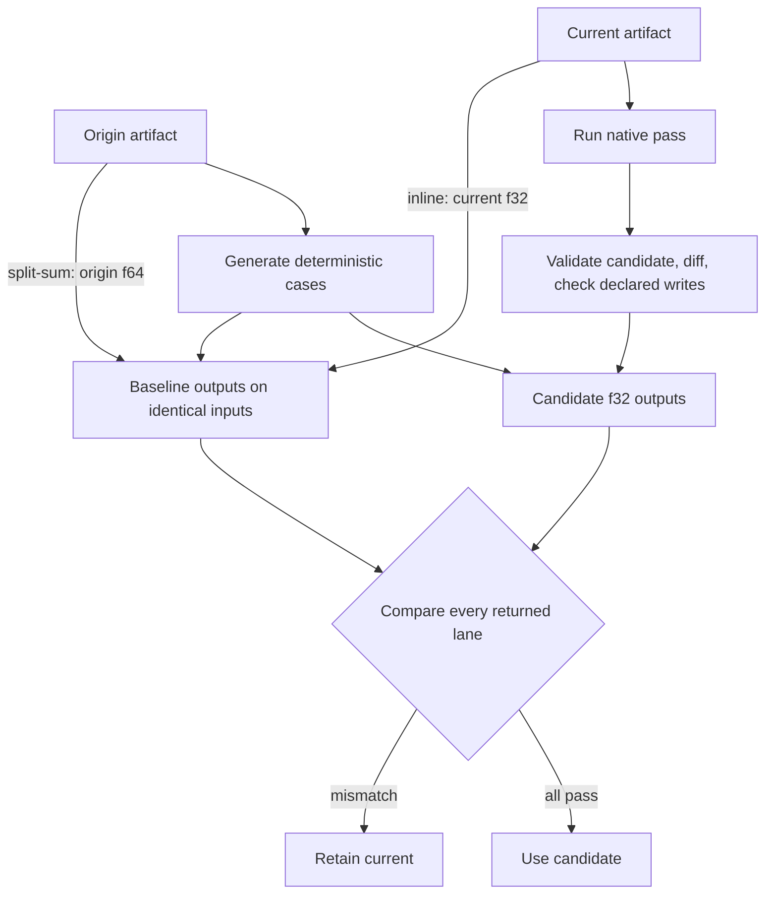

# What a second compiler domain required of IR Workbench

IR Workbench's first compiler transformed a statically typed language into code for a 32-bit RISC-V machine. Its reusable framework tracked program revisions and checked the meaning of optimization passes. Tix put a different question to that framework: could it check a rewrite whose *intended* effect includes changing the bits in the answer? Grouping floating-point additions into blocks is such a rewrite. An equality checker should reject it on a suitable example. A checker that merely allows the result to change would also accept a rewrite that forgot the last block.

The answer at revision `a0277f9` was that the framework already had the semantic abstraction we needed. We supplied the cases, observations and comparison in tensor code. The one framework source change was in pass application: the new domain needed a **synchronous** way to check a candidate revision before returning it. The most informative limitation we observed was in our numerical policy, not the framework. One candidate failed its accuracy test on a lane whose value did not change at all. The distinction between testing an output and attributing its error to a transformation matters throughout this report.

## From source notation to an indexed IR

A Tix function takes named row-major tensors and returns one tensor. An assignment defines all lanes of a new tensor, once. The left-hand indices describe iteration; the right-hand expression computes a scalar at the current indices. A read can use affine subscripts, such as `y + dy`. Addition, subtraction, multiplication and division operate on scalars, as do the elementary functions. There is no need to infer a broadcast: the author says which tensor axes to read. Matrix multiplication, for instance, is a single definition:

```text
fn matmul(a: f32[M,K], b: f32[K,N]): f32[M,N] {
  c[i,j] = sum(k) a[i,k] * b[k,j];
  return c;
}
```

Here the checker learns the extent of `i` from `a` and of `j` from `b`. Both occurrences of `k` must give the same symbolic extent. A shape name can also appear as a scalar in an expression. A reduction consumes the expression to its right up to the enclosing delimiter: `sum(k) a[i,k] / K` divides each term, whereas `(sum(k) a[i,k]) / K` divides the completed sum. Even when both expressions denote the same real number, they specify different rounding steps. The parser must settle the grouping before numerical checking begins.

`src/tensor/parse.ts` resolves index names to binder IDs. A plain read subscript supplies an extent; an affine-only left-hand index needs an explicit extent from the statement type. A reduction binder needs a plain use to infer its extent. The checker rejects a forward or repeated definition, inconsistent extents, and a result of the wrong shape, with source positions expressed as `line:col`. Shape names are bound from plain input axes at call time; the implementation does not solve arbitrary systems of equations over input dimensions. Affine forms have an integer constant and sorted coefficients. The validator bounds a subscript by using each loop's first and last index, taking the coefficient's sign into account. It checks containment conservatively. For example, a loop of extent `H-2` and a kernel axis of extent three permit a read at `y+dy` in an axis of extent `H`.

The native IR, `tix.indexed@1`, is an ordered list of functions, each with parameters, ordered definitions, and a return name. Each definition stores its output axes **and their resolved extents**, and an expression tree whose leaves include affine reads. Reductions own ordered lists of binders and a body. Keeping extents in the IR is important: substituting an expression can erase the plain read that originally justified an extent. There is no reason an optimizer should have to reconstruct that piece of type inference. Nor is there a benefit here to translating the tree into basic blocks before changing a reduction's iteration structure.

Workbench calls an immutable, content-identified value of a specified kind and schema an *artifact*. Tix programs, unlike their execution buffers, are plain data suitable for that representation. An adapter projects each function, parameter and definition as an entity, with ordered containment and read dependencies as edges. A definition's attributes include its expression tree. Thus changing a subscript changes the projected definition without requiring persistent identities for every scalar operation. A native rewrite produces a new value; the framework validates and compares projections. The evaluator and the pass kernels still operate on the indexed representation that suits their work.

## Two executions of the same tree

The default interpreter in `src/tensor/evaluate.ts` binds shapes, converts finite input data to f32, then allocates each defined tensor and fills it in row-major order. Index arithmetic uses integers. Value arithmetic rounds literals, numeric shape values, operations and function results with `Math.fround`; multiplication followed by addition is two rounded operations. Sum starts at positive zero and max at negative infinity. Reduction tuples are visited in increasing lexicographic order, the first binder outermost, with a round after each accumulator update. The returned buffer is a `Float32Array`. These rules define Tix's meaning, not just a convenient way to evaluate examples.

In reference mode the interpreter walks the same domains and expression tree but uses JavaScript doubles and `Float64Array` storage. This is a higher-precision reference, not exact real arithmetic. Sharing the traversal keeps the two interpreters aligned about which operation to execute, but it also lets an indexing error affect both identically. Agreement between these modes is therefore not an independent check of indexing. The test corpus has separate numerical oracles, and the external evaluation compared the interpreters with another implementation.

## What the checker actually promises

`compileTix` returns a handle containing the origin artifact and the current artifact, initially identical. `runTix` evaluates the current one. `optimizeTix` takes an ordered list of pass names, checks each candidate, and reports an acceptance bit per attempt. A failed semantic check leaves the previous current artifact in place. The origin supplies the case domain throughout a pipeline; it also supplies the higher-precision baseline when testing accuracy. The diagram shows one attempt, including the distinction between these two uses of the origin.



For each origin function the generator sorts shape names and takes `L = [1,3,4,5,9]`. First it assigns all names each value of `L` in turn. Then, for offsets zero through four, name number `j` gets `L[(offset+j) % 5]`. It deduplicates assignments in order. This gives both equal and unequal axes without a Cartesian product. Only positive concrete extents are sampled, with at most 65,536 lanes per tensor and an estimated one million expression visits per function invocation. Execution tests separately cover empty reductions. A function with no eligible shape makes the contract fail; its absence cannot count as agreement.

Each retained assignment gets a coordinate pattern and a seeded random pattern. For lane `i` of parameter `j` in signature order, the first is `(1 + (17*i + 7*j) mod 61) / 64`. The second uses `(1 + random()) / 2`, with the framework generator seeded at 20. Both populate f32 buffers; the reference thus sees the same input bits. The ordinary samples are positive, and `eps` of shape `[1]` gets `0.001` for layer normalization. This avoids feeding a negative epsilon to a square root; it does not guarantee a finite result for every function. Single-parameter inputs whose last extent is nine also receive the rounding witness below, repeated across rows.

Both relations check the returned shape and length. **Exact** compares every returned f32 word with the corresponding word from the immediate input program, including the sign of zero. **Tolerance** compares each candidate f32 lane `c` with the untransformed origin's f64 lane `r`. Both must be finite, and each must satisfy

```text
abs(c - r) <= 2e-6 + 2e-5 * abs(r)
```

The absolute term gives a nonzero allowance near zero; the relative term scales the allowance for larger answers. The rationale was the scale of roundoff for a few dozen well-scaled additions with f32 unit roundoff about `6e-8`, leaving room for ordinary accumulated error while detecting a missing term on the witness. It was not a derived forward-error bound for arbitrary Tix expressions. The relation is deliberately elementwise: a poor lane cannot hide among many accurate ones. An exact edit after a tolerated edit preserves the preceding result on the same cases, so it need not start a fresh error budget. Passing either check says nothing conclusive about unsampled inputs.

## The passes and the one framework change

`inline` counts read sites, skips definitions that are returned or contain reductions, and substitutes a single-use producer into its consumer. It composes the producer's affine index expressions with the read-site subscripts simultaneously, by binder identity, then removes the producer. It does not move parentheses or remove arithmetic operations. A materialized lane was already rounded; the substituted tree computes that same rounded value. A negative control swaps two indices of an inlined square matrix. That still type-checks, so rejecting it exercises the meaning check rather than the shape checker.

`split-sum` replaces each one-axis sum with an internal blocked reduction. The evaluator sums consecutive blocks of four from zero, including a final short block, then adds each subtotal to the outer accumulator in block order. Multi-axis sums and max reductions retain their ordinary implementation. On `[1,0,0,0,2^-24,2^-24,0,0,0.25]`, the two small terms individually round away when added to one. Grouping them first retains their sum. Sequential f32 gives `1.25`; blocked f32 gives `1.2500001192092896`, equal to the origin f64 result. The exact relation rejected the changed candidate and tolerance accepted it. Truncating the iteration extent to eight drops the `0.25` tail, and tolerance rejected this wrong variant.

Only `src/framework/passes/define-pass.ts` changed in the framework. Its existing pass runner was asynchronous and opened an edit transaction; the fixed Tix API returns its decision synchronously and uses a read-only projection with native-result kernels. Calling the kernels directly would bypass checks on what changed. We extracted common native candidate preparation (create and validate the artifact, diff, build entity correspondence) and write enforcement. The new `applyNativePassSync` accepts an existing pass definition and a synchronous semantic check. It refuses analysis needs, preservation claims and manager contracts that it cannot discharge. It requires a native result, rejects asynchronous completion, and returns the candidate only after its checks pass. The existing async path uses the shared helpers. No tensor buffer type, floating-point comparator, or special reduction rule entered the framework. The existing differential invariant API already let a domain select the precision of each side and report counterexamples.

## Evidence, including the rejection

At stage completion, `npm run build` succeeded. The 17 tensor tests passed, including independent lane calculations for rectangular matmul, max-shifted softmax, layer normalization with gamma, beta and epsilon, scaled single-head attention, a two-layer MLP with tanh-GELU, and stride-one unpadded NCHW convolution. The tests also checked error locations, binding and reduction order, subnormal rounding, empty extents, mixed pass pipelines and the two wrong candidates. All 226 framework tests and all 26 selected Typed regression tests passed. The commands used Node's test runner on `tests/tensor/*.test.mjs`, `tests/framework/*.test.mjs`, and the `passes`, `inline`, `meaning-memo` and `strategies` tests in `tests/typed/`. This was not a run of the repository's full suite.

The independent evaluation at the same revision passed all 25 hidden fixed-core and API tests. On 60 random programs with three inputs each, f32 was bit-identical to the independent reference in 180/180 cases; f64 was within `1e-9` relative to `max(1, |r|)` in 180/180. Inline was accepted on all 60 and its accepted outputs were bit-identical to the originals on the evaluation inputs. Split-sum was accepted on 59; every accepted program agreed in f64 within `1e-9` in that cross-check. These are externally reported results. We replayed the one rejection, program 39, locally on the unchanged implementation.

The public result was `accepted: false`. The underlying differential evidence identified one disagreement in 20 cases: `C=4, N=5`, coordinate pattern, output lane zero. The decisive control was to run the **same tolerance check with the origin as the candidate**. It failed on precisely the same case with the same numbers:

| Quantity, lane 0 | Origin f64 | Origin f32 | Split f32 |
|---|---:|---:|---:|
| Returned value | −0.19665948275863876 | −0.1966714859008789 | −0.1966714859008789 |

The program's `t0` sums 25 terms over two indices, so the pass leaves that reduction alone (`src/tensor/passes.ts:34`). The ordinary sum rounds every addition (`src/tensor/evaluate.ts:105`). Returning `t0` for inspection gave −14.226834297180176 in f32 and −14.226831896551728 in f64 for lane zero. In the final expression a positive inner sum, 14.421875, largely cancels the negative `t0 - x` in each of five outer iterations. The error in the same `t0` enters all five terms; the magnitude of the final answer is small relative to the quantities that produced it. The absolute output error was `0.000012003142240146758`, about twice the permitted `0.000005933189655172776` (`src/tensor/contract.ts:84–85`).

This was a real violation of the specified accuracy relation, but it was not evidence of a split-induced regression. Both f32 versions gave the same failing lane; on that lane both f64 versions agreed as well. The external observation that plain f32 stayed within `3.7e-7` of f64 relative to `max(1, |r|)` concerned the evaluation's inputs. The contract sampled a different input, and its allowance depends on the reference *output*, not on the sizes of the summands. There is no conflict between the two measurements. The [replay script](../scripts/01-replay-39.mjs) runs both checks and prints the intermediate and final values.

## What I would change

I would keep the absolute accuracy check but report two comparisons for a failing lane: origin f32 against origin f64, and candidate f32 against origin f32. The first answers whether the original implementation already missed the accuracy target. The second answers what the pass changed. Neither alone replaces the declared acceptance criterion. A counterexample containing all three numbers, plus the shape binding and pattern, would have explained program 39 without a separate replay. I would also keep that cancellation case alongside the nine-element witness: one exposes error inherited from the source computation, the other a real change in rounding order. Widening a single constant until both pass would erase the distinction the experiment uncovered.
