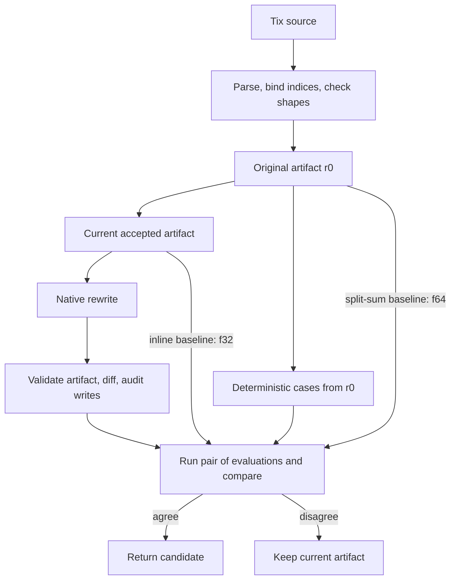

# Tix Stage 1: Checking tensor rewrites on a shared IR framework

Tix tested whether IR Workbench could host a second compiler domain without imposing the first domain's representation or notion of equivalence. The first compiler, Typed, targets 32-bit RISC-V. Tix is a small tensor language whose reductions make rounding order part of program meaning. In Stage 1 it runs in a TypeScript interpreter: there is no CUDA generation, GPU execution, or performance claim. The experiment was to represent the language using the existing artifact and inspection machinery, then run two rewrites under different acceptance relations.

The framework already supported the tensor representation and both relations. One integration point did need a change: the pass API in use was asynchronous and opened a graph edit even for a pass that returned a new native IR value. Tix needed synchronous optimization and did not need graph editing. The implementation added a native-only synchronous entry point that shares artifact preparation and write auditing with the existing path. The independent evaluation of revision `6e5fee7` reported no failures or rejections. The local tests also demonstrated cases where the checker *should* reject, including a valid reassociation submitted under the wrong relation.

## Tix: shapes and reductions in the source

A Tix module contains one or more functions. A function takes named `f32` tensors, defines new tensors once in statement order, and returns a tensor by name. A shape can contain symbolic affine dimensions; array accesses can use affine expressions of index variables. Matrix multiplication is a single defining statement:

```tix
fn matmul(a: f32[M, K], b: f32[K, N]): f32[M, N] {
  y[i, j] = sum(k) a[i, k] * b[k, j];
  return y;
}
```

Here `i` and `j` name the output axes. Their unshifted uses in `a[i,k]` and `b[k,j]` supply the extents `M` and `N`. The sum binds `k` locally; both loads must infer the same extent `K` for it. An output index with no plain use needs a declared shape, as in valid convolution where an output coordinate appears only in an access like `h + dy`. A reduction index with no plain use is an inference error. The parser preserves the distinction between `(sum(k) a[i,k]) / K` and `sum(k) a[i,k] / K`: the second puts the division inside the reduction, where each division rounds before the addition.

The frontend records token locations and reports source errors with `line:col`. It checks definition order, single assignment, access rank, scope, inferred extents and return shape. Shape expressions are normalized before equality checks, so a syntactic rearrangement such as `M + N` versus `N + M` does not create a mismatch. The compiler checks that parameter dimensions determine the shape names; the supplied shapes bind those names at invocation. For example, `f32[2*N+1]` determines `N` only when the supplied size is consistent with an integer solution. The planner also checks concrete size and access bounds before evaluating a cell. An invalid declaration or incompatible inferred extent is a source error; an inconsistent concrete argument cannot be diagnosed until its dimensions arrive. Zero-size iteration domains are supported.

The public API in `src/tensor/index.ts` exports `compileTix`, `runTix`, and `optimizeTix`. Compilation yields an artifact. Execution takes named buffers with row-major shapes and returns a shape and typed array. Optimization takes an ordered list of pass names and returns a runnable artifact with an acceptance flag for each step. There is no scheduling or backend API in this stage.

## A tree that retains iteration order

The native IR is a module of ordered tensor definitions with scalar expression trees. Each definition records its result shape and the binders for its output axes. A scalar load names the tensor and an affine map from binder IDs to coordinates. A reduction has ordered binders, an operator, and a body. Stable IDs distinguish binders with the same spelling in different scopes and let a rewrite preserve the identity of a moved expression. The IR also has an internal blocked-sum node, which is not part of the source language.

I chose this representation over either flattening expressions into a generic relation graph or lowering to control flow and explicit temporaries. For these two passes, the immediate questions are which tensor a load reads, which indices it uses, and what order a reduction takes. Keeping the reduction and its binders together answers those questions without reconstructing loops from a lower-level IR. At the same time, a shape, an ordered index domain, and an affine load are enough for the interpreter to derive loops and row-major offsets. The choice does not depend on a later backend.

A framework artifact is an immutable native value with a schema identity and hashes for its contents and revision. `src/tensor/ir.ts` registers the tensor schema and supplies an adapter: functions, tensors, binders and expressions project to entities, with relations for ordered containment, tensor reads, binding references and returns. This lets the framework inspect changes without taking ownership of the native representation. Shape coefficients and literal spellings are stored as strings in the finite JSON payload; exact integer shape calculations and floating-point results are not persisted as execution state in the artifact. The native validator rechecks structure, scope, tensor definitions and extents independently of the rewrite body.



## Two precisions, one interpreter

`src/tensor/evaluate.ts` uses the same indexing and loop logic for both precisions. It first binds shape names and plans each tensor layout. It then materializes tensors in definition order, visiting all row-major cells, binding the output indices of the current cell, and interpreting its scalar tree. Within a reduction it visits tuples in increasing lexicographic order, with the first listed index outermost. The initial accumulators are `+0` for `sum` and negative infinity for `max`; those are also the results of the corresponding empty reductions.

In f32 mode, the input buffers are converted to `Float32Array`. Literals and numeric shape values round with `Math.fround`, as do each arithmetic or builtin result and every accumulation step. In f64 mode, storage is `Float64Array` and evaluation uses JavaScript double arithmetic without the f32 rounding step. The f32 stores preserve the sign of zero and give NaNs a canonical quiet encoding. The exact relation can therefore read the buffer as 32-bit words and test what was stored, rather than asking JavaScript numeric equality to distinguish the signs of zero.

The two modes share a planner and interpreter so that differences in precision do not accidentally come from different indexing code. That is a useful implementation property, but it also means the optimizer's f64 reference cannot by itself detect an indexing mistake shared by both modes. The independent evaluator and the hand-computed fixtures address that separate risk. The f64 path is a double-precision reference, not exact real arithmetic.

## A contract over cases, observations and relations

The contract in `src/tensor/meaning.ts` first checks that function signatures are unchanged. It then applies a versioned differential check to the same inputs on both sides. The observation is the full returned shape and every element in row-major order. `inline` compares the candidate's f32 words against the immediately preceding accepted revision's f32 words. `split-sum` compares the candidate's f32 results to the *original* artifact's f64 results. Both take cases from the original, even through separate optimization calls. Comparing inline to the predecessor is enough: exact agreement on the same cases preserves what that revision established. Comparing each tolerance-enabled rewrite to the original avoids spending a fresh error allowance at every step.

The tolerant relation requires finite outputs on both sides. For each element, writing `ref` for the original f64 value, it asks:

```text
abs(candidate_f32 - ref) <= 2e-5 + 2e-5 * abs(ref)
```

The absolute term gives a useful allowance near zero, where relative error alone is unstable. The relative term scales with nonzero results. For a short sum of at most nine order-one terms, the usual first-order rounding estimate is roughly the number of additions times the f32 unit roundoff, `2^-24`, times the sum of the absolute terms: around `5e-6` or less for this example, before error propagates through later operations. The threshold leaves headroom for small sampled kernels and propagation while rejecting a missing term of magnitude one in the tail test. That estimate only motivates a threshold. It neither proves the threshold for arbitrary Tix expressions nor calibrates it for large or ill-conditioned workloads. Nonfinite results or excessive error can reject a rewrite that is valid over real arithmetic.

Case selection is deterministic. It considers every function, sorts shape names, and uses the ordered extent proposals `1, 3, 4, 5, 6, 8, 9, 2`. These include extents on both sides of a block boundary. A multi-name signature draws from uniform assignments and nonuniform assignments: single-name perturbations first, then mixed tuples in the same value order. Up to eight shapes are retained, with four places for each stream when possible and spare places backfilled. The planner filters at most 256 distinct proposals per function, caps sampled tensors at 16,384 elements and caps the original program at 250,000 estimated evaluation steps per shape. Changed revisions are allowed 500,000 steps because blocking introduces extra iteration and accumulation work. If even one function has no usable case, or a checked changed revision cannot be evaluated within the budget, the change is not accepted.

For each retained shape, the data include zeros, alternating signed zeros, ones, a row-major ramp, alternating signs, and bounded pseudorandom values from seed 7. A length-six axis adds a targeted pattern for reassociation. The actual inputs are f32-representable in both precision modes during a contract check, isolating the change in evaluation from a change in input conversion. The evidence records the case count and, on disagreement, the function, input shapes, pattern and a reason such as the differing element's words or its error bound. A no-op counts as accepted without a changed revision. Acceptance otherwise says that the tested cases agreed, not that all well-formed invocations would agree.

## The rewrites

`inline` removes an intermediate pointwise definition only if it has one syntactic read and is not returned. The pass moves its scalar tree into that read and composes the producer's affine accesses with the consumer's coordinates. For example, reading `t[i+1]` where `t[j] = x[j] + 1` substitutes `x[i+1] + 1`, not `x[i] + 1`. A read can be inside a reduction; binder IDs, not source name spelling, determine the substitution. The rewrite does not reassociate any arithmetic or introduce a new precision. Moving the tree also preserves the expression IDs; the framework's correspondence records the replaced read and its replacement. The original shape planner still runs before execution of an optimized artifact so deleting a materialization cannot silently enlarge the original invocation domain.

`split-sum` replaces a one-index sum with sums over contiguous blocks of four followed by a sum of the partials. The final block is clipped to the extent. Neither `max` nor a multi-index sum is rewritten at its own reduction site. The decisive input is a row of length six:

```text
[1, 0, 0, 0, 2^-24, 2^-24]
```

In a sequential f32 sum each of the last two additions ties and rounds back to `1` (`0x3f800000`). With blocking, the second partial combines the half-ulps into one ulp; adding that partial to the first produces `0x3f800001`. This result equals the original f64 result for the witness. It fails the exact relation and passes the intended tolerance relation. It is also an input generated by the actual gate, not a handpicked input tested only after optimization.

## What changed in IR Workbench

The only modified framework source is `src/framework/passes/define-pass.ts`. The existing `applyPass` is asynchronous and prepares an edit before calling the pass body. Tix's public optimizer cannot await that API, and its native rewrites do not require an adapter that can rebuild a native value from graph edits. `applyNativePassSync` takes a synchronous native body and a `CheckResult` gate. It shares candidate artifact creation, projection diff, correspondence construction and declared-write auditing with the asynchronous path. A rejected gate returns no accepted candidate; Tix records the rejection and retains the previous artifact. The sync entry refuses unsupported semantic declarations and thenables rather than appearing to honor them. It does not add a synchronous analysis manager, a store transaction or a second contract evaluator.

The existing `differential` definitions and runner suffice for Tix's case generation, two evaluations, comparison and evidence. The synchronous pass is framework code; the choice of relation is domain code. No changes were needed to core artifacts, the IR adapter protocol, contracts, dataflow, or strategy. This is the framework result of Stage 1: reuse worked at the representation and comparison boundaries, while the required calling convention exposed an assumption in pass execution.

## Verification and independent evaluation

The implementation checks ran on Node 24 with `npm run build`, then `node --test tests/tensor/*.test.mjs` (23 passed), `node --test tests/framework/*.test.mjs` (228 passed), and `node --test tests/typed/{passes,inline,meaning-memo}.test.mjs` (18 passed under default settings). The full repository suite was not run. For this report, the build and the 23 tensor tests were rerun on `6e5fee7` and passed again. All six corpus programs—matmul, max-shifted softmax, layer normalization with gamma, beta and epsilon, single-head attention, tanh-GELU MLP, and valid NCHW convolution—ran in both precisions and after the checked pipeline on inputs with independently computed expected outputs.

Local negative tests establish that rejection is real. An inline mutant loses the `+1` index offset; a ramp gives different f32 words. A split mutant shortens a length-five reduction to four; five ones then give four rather than the f64 reference's five. Both candidates pass structural validation and fail the semantic gate. Other tests exercise a finite input that produces nonfinite tolerance observations, cumulative error across calls, and a function with no affordable case. These are expected policy outcomes, not failures of the independent evaluation.

The independent evaluation reported these results for `6e5fee7`:

| Check | Reported result |
| --- | --- |
| Hidden acceptance suite, written from the fixed brief before implementation | 25/25 passed |
| f32 against an independent evaluator, 60 programs × 3 inputs | 180/180 bit-identical |
| f64 against the independent evaluator on those inputs | 180/180 within `1e-9 * max(1, abs(ref))` |
| Public `inline` on the same 60 programs | 60/60 accepted; every accepted result bit-identical to the original |
| Public `split-sum` on the same 60 programs | 60/60 accepted; every accepted result agreed in the reported f64 check within `1e-9` |

There were no reported failures or rejections to diagnose, and nothing in the local evidence contradicts the results. The independent figures are reported findings, not reruns of the hidden suite in this worktree. In particular, `accepted: true` does not say a rewrite fired on every program; it includes no-ops. The f64 split-sum result is not a claim of bit-identical f32 behavior or a bound on untested inputs. The locally verified length-six case shows why that distinction matters.

## What I would do differently

I would keep the same representation and narrow pass boundary, but start the contract work with the independent reference, the half-ulp witness and the two mutants. Those cases answer different questions: whether the interpreter means what the source says, whether staged sums really can change f32 output, and whether the semantic gate can reject a structurally valid candidate. Designing those checks first would make it harder to mistake a permissive checker or a no-op for successful optimization.

I would also separate acceptance counts from actual rewrite counts in evaluation reports and make each reported counterexample directly replayable from a small case record. For numerical coverage, I would add explicit stress cases with larger extents, cancellation and a wider range of magnitudes, then report the error distribution before arguing for any change to the tolerance. The data in this stage do not justify a broader numerical guarantee. The result is narrower and useful: a second domain can share revision tracking and checked rewrites with Typed, while keeping iteration order and the choice of numerical equivalence in the tensor compiler.
