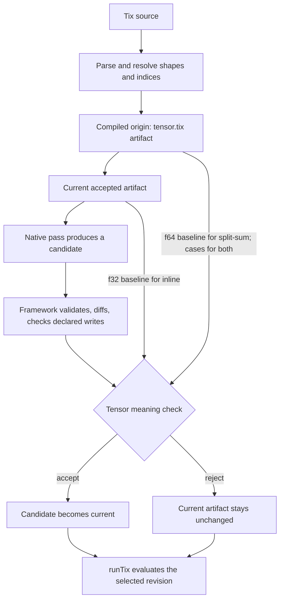

# Tix: a second domain for IR Workbench

IR Workbench began with a single client: Typed, a statically typed language compiled to 32-bit RISC-V. Tix tests the same infrastructure on a different kind of program. Its statements describe tensors, its indices denote iteration domains, and the order of a floating-point reduction is part of the program's meaning. The test of reuse was whether we could represent that meaning, rewrite it, and check the result without importing assumptions from Typed or building a parallel compiler framework.

Stage 1 implemented the front end, two evaluators, and two checked rewrites. It did not implement CUDA lowering or measure optimization speedups. The only framework file that changed was `src/framework/passes/define-pass.ts`: Tix needed a synchronous checked path that could accept a native replacement without editing a generic graph. The independent evaluation of revision `a989925` reported no failures or rejections, including 25 out of 25 hidden acceptance tests and agreement with an independent evaluator on 180 out of 180 input cases in both precisions, under the respective comparison rules.

## The language: shapes and ordered reductions

A Tix file contains named functions with tensor parameters and one returned tensor. Every tensor has an `f32` element type and a rank of at least one. Dimensions can be constants or affine expressions over symbolic shape names. Each statement defines a new tensor; its left-hand indices specify the coordinates at which to evaluate the right-hand scalar expression. An earlier tensor can be read using affine expressions in the current indices. Explicit index use expresses broadcasting: a per-row quantity is read as `m[i]` even when the surrounding statement also iterates over a column index. There is no implicit broadcasting or mutation of previously defined tensors.

For example, the matrix multiplication in `corpus/tensor/matmul/main.tix` contracts over the shared axis `K`:

```tix
fn matmul(a: f32[M, K], b: f32[K, N]): f32[M, N] {
  y[i, j] = sum(k) a[i, k] * b[k, j];
  return y;
}
```

The plain uses of `i` and `j` on the right determine the output extents `M` and `N`. Both uses of `k` propose `K`. The checker requires the proposals for any one index to agree as normalized affine forms. If an output index has no plain use, a type annotation must supply the extent. This is how the output spatial indices in valid, stride-one convolution can appear only in subscripts like `y + dy`. A reduction index has no such annotation, so a missing extent is a source error. Reductions bind fresh lexical indices; a nested reduction can shadow an outer name without changing what loads outside the nested body refer to.

The expression parser uses the usual arithmetic precedence, but a reduction consumes its body to the enclosing delimiter. `sum(k) a[i,k] / K` divides each term before addition. `(sum(k) a[i,k]) / K` performs one division afterward. The evaluator preserves that distinction, including its rounding consequences. `max` can be either a scalar intrinsic or a reduction. The parser distinguishes the two by the argument form and the presence of a body, with a rule for the ambiguous `max(D,E) - x` when both arguments are known shape names: it reads as scalar `max` followed by subtraction.

The front end diagnoses source errors at one-based `line:col` locations. It checks single assignment, scope, rank, extent agreement, return shape, and whether the bounds of each affine access follow from the axis extents. The implemented bounds proof is sufficient rather than complete: it computes affine extrema over rectangular index domains and tries to establish the inequalities by normalization and a small number of known nonnegative forms. Shape names must each be isolated by an input axis, such as `N` or `2*N-1`. Axes that mix names can then be checked for consistency; the implementation does not solve a general coupled system. These are restrictions of the evaluated implementation, not conclusions drawn from the passing acceptance suite. `runTix` binds the shape values from the caller's concrete row-major buffers and checks that the supplied shapes and finite input data match the signature.

## Representation and evaluation

`compileTix` returns an immutable, content-addressed Workbench v6 artifact of kind `tensor.tix`, schema version `1`. The payload is a module of ordered functions. Each function holds its symbolic signature, tensor parameters, ordered definitions, and the ID of its result. Each definition carries an ordered set of output binders and a scalar expression tree. A load names a tensor by ID and uses normalized affine forms over resolved binder IDs. Reductions own their binders and record their iteration order. Locations and node IDs let the implementation retain the source of a rewritten expression without resolving names again.

The resolved tree was a better fit here than a flattened scalar instruction stream. A tree retains the distinction between the operations inside a reduction body and those performed on the result. It also identifies the subtree to copy during inlining, and it exposes the index domains an evaluator needs to create loops. The tensor adapter projects the native representation into the Workbench graph of entities and relations: ordered containment, reads from tensor definitions, index bindings, and return dependencies. That graph lets the pass runner compare revisions, enforce declared writes, and record which entities a rewrite retained, moved, or replaced. The tensor domain did not need to implement reconstruction from arbitrary graph edits. Literal spellings and affine coefficients are artifact data; typed buffers and IEEE nonfinite values are evaluation data, not part of the serialized expression tree.



`runTix` uses one interpreter with two arithmetic policies. The default f32 mode reads inputs through `Float32Array` storage and applies `Math.fround` to the JavaScript result of every literal conversion, numeric shape value, scalar operation, intrinsic, and accumulation step. It does not contract multiply-adds or move arithmetic across a materialized tensor. f64 uses the same index traversal and host math functions without f32 narrowing, materializing `Float64Array` results. Where a caller supplies f32 inputs the f64 policy promotes them exactly; it does not recover lost input precision. In both modes affine address arithmetic uses safe integers rather than the selected scalar precision.

For a regular reduction, the first listed index is the outermost loop. The interpreter visits each tuple in increasing lexicographic order and accumulates from `+0` for `sum` or `-Infinity` for `max`. Those identities are also the results of empty reductions. Arrays store each intermediate tensor in row-major order. f32 output preserves signed zero and uses a fixed quiet-NaN word when storing a computed NaN. f64 is a higher-precision evaluation of the chosen program, not exact real arithmetic. Both modes share shape binding and indexing code, which is a reason to test them against independently computed results.

## When a rewrite is allowed to change the bits

The meaning contract first requires the public signatures to match. For a test case it observes the result shape and every output element, not a checksum or a summary statistic. The versioned differential invariants share the framework's sampled runner but use different baselines and comparison rules. `inline` compares the candidate's f32 words with those of the input revision. Even `+0` and `-0` are distinguished. `split-sum` compares the candidate's f32 values with the compiled origin evaluated in f64, in its original reduction order. Both values must be finite for every compared element, and the check uses a mixed absolute and relative tolerance:

```text
abs(candidate - reference) <= 8e-6 + 2e-5 * abs(reference)
```

The absolute part covers small results, where cancellation can make a relative bound misleading. To set its scale, binary32 has unit roundoff `2^-24`. For up to nine unit-scale terms, the standard summation bound for rounded additions alone is on the order of `9 * 9 * 2^-24`, less than `5e-6`. The chosen absolute term gives some margin at that scale; the relative term gives room to small, well-scaled compositions with nonzero outputs. This justification is not a bound for arbitrary expressions, large fixed reductions, or ill-conditioned inputs. Error from upstream operations can be much larger than summation error. A valid reassociation can therefore fail this acceptance policy. Nor is this the independent evaluator's `1e-9` comparison, which is an f64-to-f64 validation measurement rather than a rule for accepting f32 rewrites.

Both relations sample the same deterministic case domain from the compiled origin. Using seed `20`, the generator tries uniform shape bindings of `1, 2, 3, 4, 5, 8, 9`, then changes one shape name at a time from the all-4 binding, and finally tries up to 32 seeded mixed bindings from the same sizes. It derives concrete parameter shapes, skips duplicates, and admits the first eight valid tuples per function at most. Admission checks that the origin runs with at most 8,192 elements per tensor and 200,000 expression or loop steps per evaluation. If a function has no admitted case, the gate adds an explicit disagreement. A candidate that exceeds its limits on an admitted case also disagrees; it does not silently reduce the coverage requirement.

For each admitted tuple the generator uses ones, small signed dyadic values in `[-1, 1]`, and a repeated eight-element pattern containing small addends. Inputs are materialized as f32 values so both evaluations start from the same numbers. A length-one parameter named `eps` uses `2^-10` so that the layer-normalization fixture exercises finite variance-plus-epsilon calculations. This is a convention of the sampler, not a type rule in Tix. Zero extents have dedicated interpreter tests rather than a place in the default size list. The checker retains counts and bounded counterexamples, including the failing element and case details sufficient to reconstruct the input. Sampling limits the strength of the evidence; it does not prove equivalence over every legal input.

The original baseline is retained across successive `optimizeTix` calls on an artifact returned by that API, via an in-process weak map. Exact steps compare to their immediate input because a preceding reassociation can already have changed bits. On the fixed samples, an exact step preserves the input revision's relationship to the original by substitution of equal outputs. The next tolerant step again checks the origin directly, so the allowance does not accumulate across steps. Detached copies are not a mechanism for carrying this origin history.

## The two passes

`inline` substitutes a reduction-free tensor definition into its one syntactic load, provided the tensor is not also returned. The pass visits producers in reverse statement order and can collapse chains of such definitions. For each producer index it substitutes the corresponding affine coordinate at the consumer's load. For `x: f32[N]`, inlining `t[i] = x[i] * 2` into `y[i]: f32[N-1] = t[i+1]` replaces the latter's right-hand side with `x[i+1] * 2`; the multiplication is not reassociated with neighboring arithmetic. Substitution also handles constants, permutations, and repeated coordinates. Resolved index IDs prevent capture, and newly copied expression nodes have correspondence to their original IDs. The pass removes the producer after validating the replacement. It leaves that producer alone if composition exceeds safe-integer arithmetic or the static bounds proof cannot re-establish safety. This was an observed limitation: separate inequalities for two legal loads can fit the proof budget while their composition does not.

`split-sum` replaces each ordinary single-index sum with an internal `blockedSum` using blocks of four. It visits blocks in increasing order and evaluates their elements using the original absolute index. Each block starts its own f32 sum at `+0`, and the outer sum adds the partial results, also starting at `+0`. The final block can be short; it is not padded. The pass leaves maximum reductions, multi-index sums, and existing `blockedSum` nodes in their own forms. This rewrite preserves the mathematical sum of the terms, but the added parentheses change the meaning under f32 rounding.

The boundary between the inner and outer sums is visible in the interpreter (excerpt):

```ts
partial = round(partial + scalar(e.body)); // once per element
// after the inner loop:
acc = round(acc + partial);                // once per block
```

The length-eight fixture makes the difference concrete. Sequential addition of `[1, 0, 0, 0, 2^-24, 2^-24, 2^-24, 2^-24]` stays at `1` (`0x3f800000`): each small addition is half an ulp at `1` and rounds back to it. In the blocked version the four small terms first sum to `2^-22`, so the final f32 result is `1 + 2^-22` (`0x3f800002`). It equals the original f64 result. The exact check rejects this changed revision and the tolerance check accepts it. The case is part of the sampled gate, not just an external example.

## What changed in the framework

The existing `applyPass` returns a promise and uses the managed contract system; the fixed Tix API requires `optimizeTix` to return synchronously. Simply calling that path would require changing the API. A tensor-local rewrite runner would meet the signature but bypass the common validation, write and correspondence machinery that this stage was meant to exercise. The implemented addition was `applyPassSync` in `src/framework/passes/define-pass.ts`. It takes a synchronous native kernel and a host `CheckResult` callback. The existing async entry retains its managed behavior; both entry points share native artifact preparation, projection and diff, correspondence, write enforcement, and identity reporting.

The synchronous entry does not allocate a generic edit transaction; a projection-only adapter such as Tix's need not implement graph rebuild just to validate a native replacement. It refuses managed analyses, preservation declarations, managed contracts, use of the kernel's edit accessor, and asynchronous results. It validates and diffs a changed candidate before asking the host for a verdict; a false verdict is a `contractRejected` and no candidate is returned from the call. Tix's pipeline catches that rejection and retains the preceding artifact. An unchanged native result, or the absence of a rewrite, returns the input unchanged without running a differential check. The public API reports this identity case as accepted. The domain uses the existing `runDifferential` directly; neither the checker nor the asynchronous contract manager, core artifact format, graph framework, or strategy scheduler had to change.

## Verification and independent results

The local checks ran on Node 24. `npm run build` and `node --test tests/tensor/*.test.mjs` succeeded, with 32 tests passing. The tensor tests exercise the parser and diagnostics, rounding and lexicographic order, shape binding, and both modes against separate reference calculations for six corpus programs: matrix multiplication, max-shifted softmax, layer normalization, single-head attention, a two-layer tanh-GELU MLP, and valid NCHW convolution. The corrected positive epsilon sampling is covered by layer normalization's tolerance acceptance. `node --test tests/framework/*.test.mjs` passed 228 tests, including the new tests of the native synchronous entry. The targeted Typed regression command, `node --test tests/typed/{passes,evaluate-analyses,meaning-memo,strategies,inline}.test.mjs`, passed 31 tests of the shared behavior and its consumers. The full repository suite was not run.

The local pass tests include deliberate negative controls. Besides running the correct blocked sum under the wrong relation for the length-eight witness, they turn a producer's `x[i] + 1` into `x[i] - 1` during inline, and make a blocked reduction count its result twice. The inline mutant changes the f32 words (`tests/tensor/optimize.test.mjs:110`, compared in `src/tensor/meaning.ts:87`). The split-sum mutant gives `10` instead of `5` on five ones (`tests/tensor/optimize.test.mjs:140`), exceeding the tolerance at `src/tensor/meaning.ts:94`. Those candidates make it through structural validation and are rejected specifically by the meaning gate. A separate coverage test gets a disagreement for a function whose input exceeds the 8,192-element budget. These are expected local gate rejections, not failures of the independent evaluation.

The independently reported results for `a989925` were:

| Check | Reported result |
| --- | --- |
| Hidden fixed-core and API suite, authored before implementation | 25/25 passed |
| Independent f32 evaluator, 60 generated programs with 3 inputs each | 180/180 bit-identical |
| Independent f64 evaluator on the same 180 cases | 180/180 within `1e-9 * max(1, abs(reference))` |
| `optimizeTix(p, ['inline'])` on the same 60 programs | 60/60 accepted; all accepted outputs bit-identical to the originals |
| `optimizeTix(p, ['split-sum'])` on the same 60 programs | 60/60 accepted; every accepted program's f64 evaluation agreed within `1e-9` |

There were no reported independent failures, mismatches, or rejections to assign causes to. These aggregates are compatible with the implementation and the local controls. They do not establish how often the passes changed a revision, since `accepted` includes identity steps. Nor does the independent f64 comparison after splitting imply bit-identical f32 output; the explicit witness demonstrates why it should not. The reported independent data establish agreement on the tested programs and inputs, not on all legal tensor programs.

## What I would do differently

I would count changed revisions separately from accepted steps in the evaluation. A generated program can pass through both steps unchanged, while a deliberate witness exercises the changed path. A useful next measurement would report eligible, changed, skipped and rejected rewrites alongside mismatches. The existing public API can stay small; the evaluation needs to inspect revisions and internal evidence rather than infer coverage from a boolean. I would also structure additional cases around known hard boundaries: awkward block tails, cancellation in nested expressions, and valid shapes that uniform sampling cannot find. The present limits caught intentional mistakes and kept the oracle bounded, but the results give no estimate of coverage beyond those cases.

I would also test whether the affine proof rules are closed under substitution before promising broad inline legality. Keeping the intermediate index domain as evidence for a composed access is worth investigating before adding a general shape solver; the current implementation simply declines some unproved rewrites. For numerical checking, an explicit function-specific sample profile would make the positive epsilon convention less dependent on a parameter name. Keeping the independent evaluator in the verification plan remains important: the two local modes intentionally reuse address and loop logic, and cannot reliably find errors they both share. These are changes I would make to a later experiment, not capabilities or measurements of this revision.
