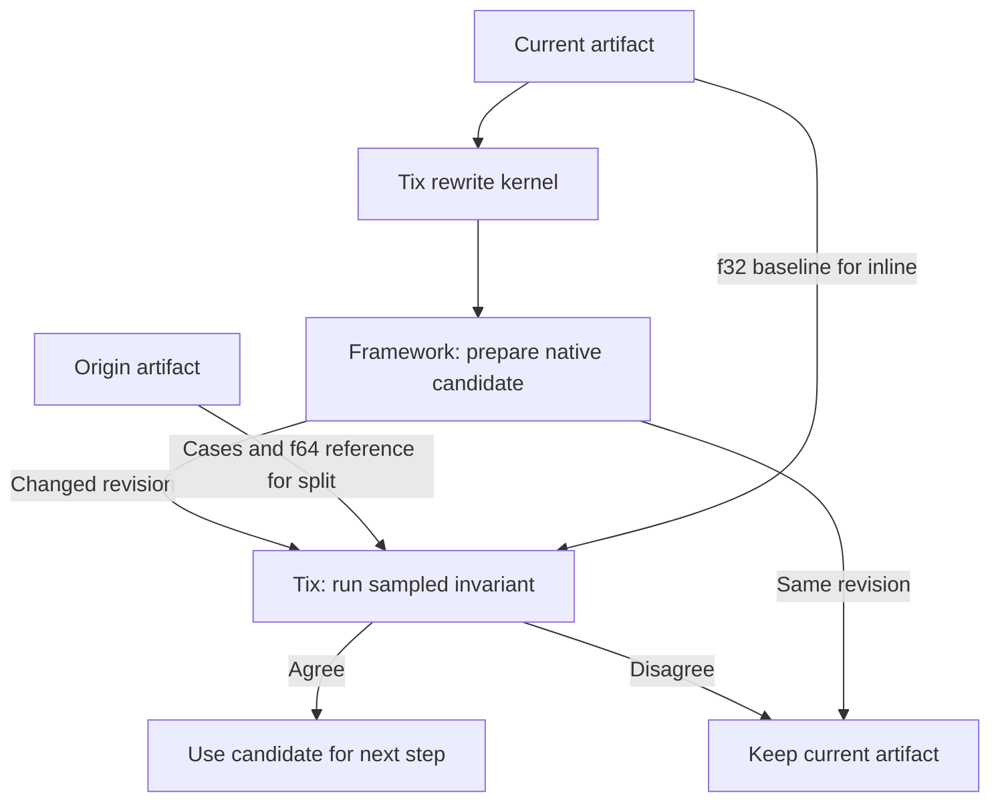

# Tix: checking tensor rewrites on a second compiler domain

IR Workbench had one language, Typed, and one target, 32-bit RISC-V. Its compiler records each optimization as a new revision of a program and checks the result before using it. Tix, a small language for indexed tensor computations, tests whether the machinery for doing that depends on the kind of program it is checking. This stage ends at executable tensor IR. There is no CUDA backend, GPU measurement or claim of a speedup.

At the evaluated revision, `e0233f2`, adding Tix required one change to the framework: separating the preparation of a candidate revision from the decision to accept it. The framework needed no knowledge of shapes, reductions or floating-point tolerance. The most instructive result concerned the *domain* code: one correct sum rewrite was rejected. On both elements that triggered the rejection, the rewritten f32 result was identical to the original f32 result. The contract found real numerical error, but that error was already present before optimization.

## What a Tix program says

A function takes named f32 tensors, defines new tensors in order, and returns one of them. An assignment specifies the computation for one output element; the indices on its left describe the iterations needed to fill the output. For example, the matrix multiply in the corpus is a complete program:

```text
fn matmul(a: f32[M,K], b: f32[K,N]): f32[M,N] {
  y[i,j] = sum(k) a[i,k] * b[k,j];
  return y;
}
```

The two uses of `k` must denote the same extent before any input data is available. The two uses of `K` in the signature establish that fact; it would be an error to use unrelated shape names and rely on two concrete inputs happening to have equal lengths. The compiler infers `i:M` from the first axis of `a` and `j:N` from the second axis of `b`. `sum` binds `k` locally. Its body extends to the expression delimiter: `sum(k) x[i,k] / K` sums quotients, whereas `(sum(k) x[i,k]) / K` divides the accumulated sum. These can differ even when exactly the same elements are read.

Shapes and subscripts are affine integer expressions. In the valid NCHW convolution, a read at `y+dy` does not by itself determine how many output rows or filter rows there are. An annotation supplies the output height `H-KH+1`; a plain use of `dy` in the filter supplies extent `KH`. The compiler checks all plain-use constraints on each binder and compares normalized dimensions. It rejects a reduction index without an inferable extent, a repeated tensor definition, a reference outside its scope or an incompatible return shape, reporting `line:col`. Each shape symbol needs a binding axis in the inputs; other axes can be affine expressions of those symbols. The implementation does not solve arbitrary simultaneous shape equations.

## Keeping indices in the IR

There are two useful views of the same program. The evaluator wants an ordered list of assignments, with explicit output bounds and a scalar expression for the right-hand side. A pass checker wants to know which entities and relations changed. Tix keeps the first representation as its native IR and projects the second through a framework adapter. Lowering immediately to scalar control flow would discard the distinction between a pointwise assignment and a reduction, precisely the distinction the two passes need.

The native representation, `tensor.index` schema 1, contains functions, parameter and statement definitions, a return reference, and scalar trees. A load names a tensor definition and carries an affine map for each subscript. A reduction carries its operator, ordered binders, bounds and body. Binding uses IDs rather than index spellings. This matters when moving a producer's body under a reduction whose printed binder has the same name. Bounds also survive independently of syntax: inlining can remove the only plain subscript from which the source checker inferred a consumer axis. A transformed assignment remains executable without reconstructing the inference.

The adapter exposes ordered containment, reads, index bindings and return references. Thus a permuted access and a change of definition are visible in the graph diff; neither is just a change in a pretty-printed expression. `createIRArtifact` validates and freezes the native value and gives it a content-derived revision. Numeric literals are stored as text, and minus is an operation. Runtime buffers and nonfinite floating-point results do not need to enter the framework's finite JSON representation. `compileTix` returns a handle that retains the original artifact while identifying the current one to run.

## Two executions of one loop interpreter

`runTix` binds the shapes, copies row-major input data into the selected precision, and evaluates the assignments. The default execution implements Tix semantics, not just f32 storage: it applies `Math.fround` to literals, numeric shape values and the result of each arithmetic operation or math function. A product feeding an addition is rounded before the addition. Array offsets, in contrast, are integers; computing an address is not a guest floating-point operation.

For `sum` the accumulator starts at positive zero; for `max` it starts at negative infinity. The first index is the outermost loop, and all indices run in increasing order. Each combine is rounded, including intermediate results never stored in a tensor. The `precision: 'f64'` option uses the same traversal with double operations and `Float64Array` storage. It is a higher-precision reference for rounding error, not an independent implementation of index notation or an exact real-number oracle. An address-calculation bug shared by the two modes could make them agree on the same wrong answer. This is why both hand-computed corpus examples and a separate reference evaluator matter.

## The one framework change

Typed's pass runner can await analyses, call a pass, verify a contract and check preservation claims. Tix's public `optimizeTix` must synchronously return the next runnable program and an acceptance flag for each named step. The problem was not how to describe a tensor in the framework. It was how to reuse the runner's structural checks without either returning a promise or duplicating those checks in the tensor compiler.

The change in `src/framework/passes/define-pass.ts` extracts `prepareNativeCandidate` from the native-result path of `applyPass`. Given the input view and a proposed native value, the helper creates a validated artifact, projects and diffs it, builds entity correspondence and checks the pass's declared write kinds. The async runner uses the helper too. Preparing a revision does **not** certify its meaning. A framework test prepares a structurally valid but meaning-changing candidate, then shows that a candidate writing an undeclared kind cannot get that far.



The same-revision path is an accepted identity step; the disagree path reports rejection. Tix defines its passes and relational postconditions with the existing framework APIs. For changed candidates it runs the differential invariant synchronously on detached revisions. It does not use an async edit transaction or implement a graph-to-native rebuilder merely to run pure native kernels. No changes were made to the artifact format, differential checker, analysis manager or strategy interpreter.

## Two rewrites, two standards of evidence

`inline` looks for a pointwise statement whose value is not returned and has exactly one syntactic load in another statement. It substitutes the producer's scalar tree at that load, composing the producer's index maps with the consumer's arguments in axis order. If a use reads `a[j,i]`, substituting the expression for `a[i,j]` without permuting its indices would produce a well-formed but different program. The good pass retains the arithmetic tree and its rounding points. Storing an already-rounded f32 element and immediately reading it was not an additional arithmetic operation. The required observation is therefore the *same f32 words*, including the sign bit of zero, in the same output shape as the pass input.

`split-sum` changes the arithmetic tree on purpose. For a single-index sum of extent `E`, it introduces an outer sum over blocks of four and an inner sum over the valid lanes of each block. Loads use `4*block+lane`; the last block stops at the remaining extent. Both sums start at zero. Maxima and multi-index reductions are left alone, and generated levels are marked so another application does not split them again. Integer coverage is unchanged, but adding four terms to a fresh partial sum need not give the same f32 answer as adding them to a large running total.

A nine-element test isolates that difference. With `h = 2^-24`, the row `[1,0,0,0,h,h,h,h,h]` sums to `1` in serial f32: each small increment is lost. The blocked version retains one group of four increments and returns `1.000000238418579`. The unsplit f64 result is `1.0000002980232239`. On the *same changed revision* the exact check rejects and the tolerance check accepts. The tests also submit two valid-IR mutants. The incorrect inline drops the permutation of a nonsymmetric input; the incorrect split drops the tail and returns 8 for nine ones. Both fail numerically. Merely demonstrating that a malformed graph is rejected would not exercise either meaning contract.

For each function the checker derives cases from the **origin** signature. In order, it tries uniform symbol sizes 1, 3, 4, 5 and 9, then an asymmetric assignment cycling through 2, 3, 5, 7 and 9 in sorted symbol order. It deduplicates assignments, checks concrete bounds and skips empty results or shapes that exceed its 100,000-element storage or scalar-work limits. For each admitted assignment it generates four inputs: signed uniform values in `[-1,1]`, positive uniform values in `[0.25,1]`, ones, and the repeating nine-term pattern above. A single Mulberry32 stream seeded with 7 supplies one draw per element for the first two patterns. Both sides see the same f32 input words. This gives up to 24 calls per function, or four for an admitted fixed shape.

The observation is the shape and **every element of the returned tensor**. Exact checks compare the candidate with the current revision. This allows an exact inline after an accepted approximate split without granting inline another error allowance. A split checks the candidate's f32 output against the *origin's f64* output, so successive approximations cannot silently move the reference. The checker screens out nonfinite references using the origin alone; a nonfinite candidate on a finite reference fails. A function without any covered nonempty case cannot be hidden by agreement on other functions.

The tolerance condition for each finite reference element `r` and candidate element `y` is:

```text
abs(y - r) <= 2e-6 + 2e-5 * abs(r)
```

The floor allows a small absolute residual near zero. The second term scales with the answer and leaves room for multiple f32 roundings in short contractions and nonlinear expressions; f32 unit roundoff is about `6e-8`. This was a chosen budget, not a derived forward-error bound. It passed the nine-element reassociation and rejected the missing order-one term. Neither result makes the budget suitable for arbitrary cancellation. In particular, it describes acceptable *total output error*, not error *introduced by the pass*.

## Verification and independent evaluation

On Node 24.18.0 the implementation built with `npm run build`. The 20 tensor tests passed (`node --test tests/tensor/*.test.mjs`), as did 226 framework tests and 27 affected Typed tests covering passes, project metadata, strategies, auditing and inlining. The corpus under `corpus/tensor/` includes rectangular matmul, max-shifted softmax, layer normalization with gamma, beta and epsilon, scaled single-head attention, a two-layer MLP with tanh-GELU, and valid stride-one NCHW convolution. Each fixture runs both precisions, before and after the pass sequence, against independently specified answers. Large softmax logits, unequal query/key lengths and the last legal convolution window check details that a comparison of the two interpreter modes alone would miss.

The independent evaluation of `e0233f2` reported 25/25 passing hidden tests written from the language and API brief. On 60 random fixed-core programs with three inputs each, original f32 execution was bit-identical to the independent reference in 180/180 cases. Original f64 was within `1e-9` relative to `max(1, |r|)` in 180/180. Inline was accepted on 60/60 programs and the accepted results were bit-identical to the originals. Split was accepted on 59/60; all accepted results agreed in f64 within `1e-9` on the evaluation inputs. These are acceptance counts, not counts of non-identity rewrites, and agreement on these inputs is not a proof for all shapes and values.

## Why program 39 was rejected

The one rejection was reproducible with the unchanged compiler. The independent evaluation reported plain f32 error within `3.7e-7` relative to `max(1, |r|)` on its inputs. The pass checks *different* inputs. Replaying the optimizer's own seed-7 cases gave 22 agreements, two disagreements and no inconclusive cases. Both disagreements were at output element 4 (zero-based), on the positive random pattern. Each violated the implemented inequality:

| `N=C` | Origin f64 | Origin **and** split f32 | Absolute error | Allowed error |
|---:|---:|---:|---:|---:|
| 5 | −0.348363717112 | −0.348373413086 | 9.695974e−6 | 8.967274e−6 |
| 9 | 1.448254082961 | 1.448211669922 | 4.241304e−5 | 3.096508e−5 |

Only two statements contribute to the return. `t0[i]` is a double reduction over two indices, accumulated in f32 and **not** rewritten. In `t3[i]`, each outer summand adds `sum(r9) (C-v[r9])` to `t0[i]-x[r8,i]`. The terms can be much larger than their sum. For the size-nine disagreement, f32 `t0[4]` was −74.43063354492188 against −74.43062743165282 in f64. The inner positive sum was about 75.162697. Cancellation leaves a small result, and the outer sum uses the same rounded `t0[4]` nine times. At size five the corresponding cancelling quantities were about −21.00093 and 21.35571. A separate scalar replay of just these statements reproduced the serial f32, blocked f32 and reference f64 answers in the table.

The checker at `src/tensor/contract.ts:126` asks whether candidate error exceeds the budget. It does not ask whether origin f32 already exceeds it. Across these 24 cases the split changed four returned elements, **none of them the two failing elements**. Thus the rejection is correct under the declared accuracy contract and conservative as a decision about the rewrite. It is not evidence of lost terms or of additional reassociation error at the reported coordinates. The [replay script](../scripts/01-replay-program-39.mjs) captures the actual rejected candidate and delegates to the ordinary checker; it does not force acceptance or change the evaluated source.

## What I would do differently

I would include three numbers in an approximate pass's rejection evidence from the outset: origin f64, current f32 and candidate f32 at the first failing element. The implemented comparison needs only two of them, but the third distinguishes an existing accuracy problem from a regression. I would also include a cancellation example with a reused intermediate in the original contract tests. The half-ulp example answers whether the checker can distinguish reduction orders; program 39 answers a different question about what the checker is entitled to blame on that change.

I would keep an absolute accuracy requirement distinct from a no-regression requirement. Relaxing a global tolerance until program 39 passes would blur that distinction without explaining the two counterexamples. If accuracy relative to f64 is the requirement, the rejection should stand. If the purpose is to catch damage caused by an optimization, the diagnostic should identify existing error as such before deciding whether a different policy is warranted. That choice belongs with the domain's definition of meaning. Nothing in this result calls for changing the framework's artifact or pass model.
