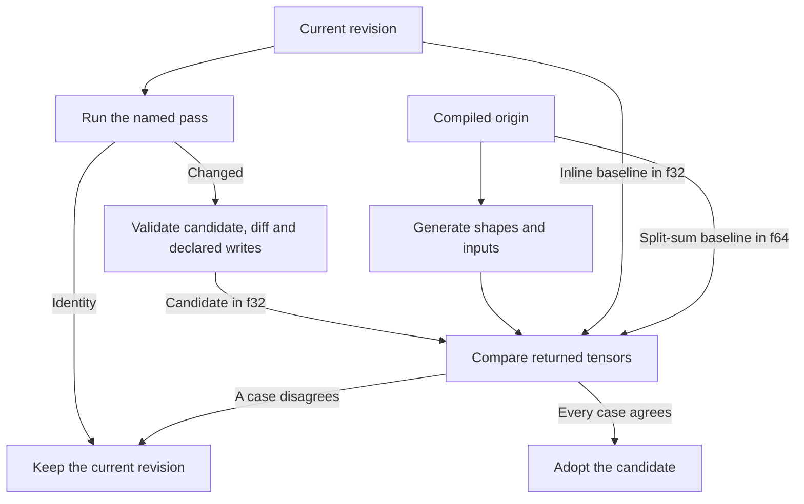

# Checking tensor rewrites in IR Workbench

IR Workbench began with a compiler for Typed, a statically typed language targeting 32-bit RISC-V. Its passes work on versioned programs, declare what they can change and submit their results to a meaning check. Tix, a second language for tensor programs, put a particular question to that framework. Could it check one rewrite that promises identical output bits and another that deliberately changes the order of floating-point addition? Both checks fit the existing contract machinery. The changes to the framework concerned how to run a pass and when to open an editor.

Stage 1 produced an executable tensor IR, two evaluation modes and two checked rewrites in TypeScript. This stage runs on the host. CUDA lowering belongs to a later stage. An independent evaluator tested revision `8b94514`. All 25 hidden acceptance tests passed, and the f32 evaluator agreed bit-for-bit with the independent reference on 180 program/input pairs. Our own tests also exercised a rejection. On one row of eight numbers, the two reduction orders gave adjacent f32 results. The very same candidate failed the exact check and passed the tolerance check.

## From indices to a checked program

A Tix function takes named f32 tensors and returns one named tensor. A statement defines every element of a fresh tensor by giving its free indices and a scalar expression. The matrix multiplication in the corpus is a complete Tix function.

```text
fn matmul(a: f32[M,K], b: f32[K,N]): f32[M,N] {
  c[i,j] = sum(k) a[i,k] * b[k,j];
  return c;
}
```

The plain subscript `i` on the first axis of `a` gives `i` extent `M`. The second axis of `b` gives `j` extent `N`. Both operands supply the same extent `K` for the reduction index. The compiler checks those equalities symbolically, so two unrelated shape names would be a source error even if one caller happened to pass equal sizes. Each shape name has a bare axis in a parameter type from which to obtain its value at a call. Other dimensions can be affine expressions of those names. Parameters and results have at least one axis, and an axis can have extent zero. Calls use finite input values and consistent concrete shapes, with data laid out in row-major order.

Convolution shows where inference needs help. An output coordinate `oy` occurs in the input access `oy+dy`. Either a larger output or a larger kernel could account for a larger input, so that access alone cannot supply an extent for `oy`. The NCHW corpus program declares its output shape as `f32[N,O,H-2,W-2]`. The three-tap weight axis supplies the extent of `dy` through a plain subscript. The largest input row the two indices can select is then `(H-3)+2`, or `H-1`. Tix normalizes affine forms, checks ranks and index scopes, and rejects impossible accesses it can establish from the bounds. It also rejects a redefinition, a forward tensor read or a reduction binder whose extent cannot be inferred. Source errors carry a one-based line and column. [Convolution source](../../../../../../corpus/tensor/conv2d/main.tix)

The expression grammar includes ordinary arithmetic, scalar `min` and `max`, and `exp`, `log`, `sqrt` and `tanh`. Reduction scope matters numerically. In `sum(d) x[i,d] / D`, division belongs to the body and runs for every term. In `(sum(d) x[i,d]) / D`, it runs once after accumulation. A test uses a row with two entries of approximately `3e38`. The first spelling produces a finite f32 result. The second overflows during the sum and returns infinity. That example tests the parser and the evaluator together through the public API.

## An IR with explicit iteration order

The unit of versioning in the v6 IR framework is an artifact. Tix makes the whole checked module one artifact. Its framework kind is `tensor.indexed`, schema version 1. Functions contain ordered parameters, definitions and a return binding. Each definition records the result shape, the ordered free axes and a scalar expression tree. Reads name a tensor and carry an affine form for each subscript. A reduction is a *fold* node with an operator, an ordered list of bound axes and a body. A fresh ID identifies each index binder. Two source occurrences spelled `i` can therefore denote different loops without confusing a substitution.

I chose this level because both passes need information already present in index notation. To inline, the compiler needs a producer body and the mapping from its axes to a consumer's subscripts. To split a sum, it needs the extent, iteration order and point at which accumulation starts. A control-flow graph of loads, branches and increments would require the passes to reconstruct these facts. Retaining source text would make each pass parse them again. The indexed IR keeps them directly executable. For a blocked sum, the inner axis records which outer block controls its range.

The framework sees a coarser graph through a read-only adapter. Functions, parameters and definitions are entities. Ordered membership, reads and the returned tensor are edges. The expression tree is an attribute of its definition, so replacing a reduction body shows up in the framework diff as a change to that definition. The adapter and the IR type use the same native validator. Creating an artifact validates the data, freezes it and assigns content and revision hashes. The artifact holds the program, including literal spellings and explicit negation. Runtime tensor buffers live in the evaluator. [IR types](../../../../../../src/tensor/model.ts) · [Validator and graph projection](../../../../../../src/tensor/ir.ts)

The public entry points are synchronous. `compileTix(source)` produces a program holding the compiled origin and the current artifact, initially the same revision. `runTix(program, fn, inputs, options)` evaluates the named function of the current artifact and returns its shape and data. `optimizeTix(program, passes)` processes the names in order, returns a runnable program, and reports acceptance for each step. Keeping the origin in the program also makes it available when a caller optimizes the result of an earlier call.

## Two precisions on the same loops

The evaluator visits definitions in source order. For each definition it binds the input tensors and reduction extents into scalar evaluation functions, allocates the result buffer and enumerates the free axes. A read evaluates its integer subscripts and computes the flat offset one axis at a time. A fold visits its indices in increasing lexicographic order, with the first listed index outermost. Sum starts at positive zero and max at negative infinity. An empty reduction returns that initial value.

In f32 mode the evaluator converts inputs to f32 and applies `Math.fround` to literals, shape values used as scalars, unary and binary operations, scalar calls and every accumulator update. A multiply used by an addition has its own rounding point. For example, the exact product `4097 * 4097` is 16,785,409. Rounding the product to f32 gives 16,785,408, so subtracting 16,785,408 gives zero. Performing both operations in double precision gives one. A test adds a small input to this expression and checks both results.

The f64 mode uses JavaScript doubles throughout and stores intermediates and outputs in `Float64Array`. Its job in the optimizer is to evaluate the original expression on the same f32 samples supplied to the candidate. The two modes share traversal and address calculation. An indexing bug could therefore make them agree on an incorrect element. Independent expected tensors for the corpus and an independent evaluator for the random programs check that part of the implementation. [Evaluator](../../../../../../src/tensor/evaluate.ts) · [Language and precision tests](../../../../../../tests/tensor/language.test.mjs)

## Pointwise substitution and blocked accumulation

`inline` considers a definition whose expression contains no fold. It counts syntactic reads across the function and leaves a returned producer in place. Exactly one read qualifies, even when the consumer executes that read many times in a loop. Two occurrences in one consumer, such as `t[i] + t[i]`, disqualify the producer. For a qualifying read the pass simultaneously substitutes the actual affine subscripts for the producer's free binder IDs. Reading `t[j,i]` swaps two axes. Inlining two successive reads at offset `i+1` composes their offsets to `i+2`. The producer disappears, its operation tree and rounding points survive, and the pass records which consumer received it.

`split-sum` rewrites a full single-axis sum into two explicit folds. For extent `K`, the outer fold visits `ceil(K/4)` blocks. Block `b` starts a fresh sum and visits global indices from `4*b` up to, but excluding, `min(4*b+4,K)`. The outer sum adds each block's partial. Clamping the inner endpoint keeps the final one, two or three terms. The pass visits expression trees from the bottom up, which lets it split nested single-axis sums. The generated axes have distinct block and within-block kinds, so applying the pass again skips them. Max and sums with multiple axes retain their original order. [Pass implementations](../../../../../../src/tensor/passes.ts)

The eight-term test explains why these rewrites need different promises. Take the f32 row `[1, 0, 0, 0, 2⁻²⁴, 2⁻²⁴, 0, 0]`. Each small term is half the gap from 1 to the next larger f32 number. Added separately to 1, each rounds back to 1 under ties-to-even. In the second block the small terms first add to each other, giving exactly 2⁻²³. Adding that partial to the first block's 1 reaches the next representable number. The observed serial result was `0x3f800000`. The blocked result, `0x3f800001`, equaled the original f64 sum.

## What the meaning check observes

The observation is the complete returned tensor of a named function, including the shape and every element in row-major order. Tix constructs two versioned invariants with the framework’s `differential` function. Each names a baseline and a subject, supplies an evaluator for each side and defines the comparison of their observations. The origin supplies the cases for both passes. Inline compares the candidate to its immediate input in f32, viewing both output buffers as unsigned 32-bit words. This catches a change in the sign of zero. It also lets an inline following an accepted split preserve exactly the bits its caller already had. Split-sum compares the f32 candidate to the compiled origin in f64. Referring back to the origin prevents successive approximate steps from acquiring a fresh error allowance at every revision.



For the tolerance relation, each candidate element `c` and reference element `r` must be finite and satisfy

```text
abs(c - r) <= 1e-5 + 1e-5 * abs(r)
```

The absolute term gives a meaningful allowance near zero, including after cancellation. The relative term scales with the magnitude of the reference. I chose the constants for short reductions and chains of operations on the sampled data. F32 unit roundoff is approximately 6 × 10⁻⁸, so the threshold leaves room for several rounding steps around unit scale. This is an engineering threshold for the sampled contract. The experiment did not establish a worst-case bound for arbitrary extents, inputs or conditioning.

For each function, the sampler assigns every shape symbol 1, then 8, then 9. A fourth assignment cycles 3, 5 and 9 in signature order to exercise unequal dimensions. With a block size of four these assignments include singleton ranges, full blocks and a residual block. The sampler instantiates affine extents, drops duplicates and illegal shapes, and requires a nonempty returned observation for every callable function. It fills each retained shape three ways. One fill uses all ones, one repeats the eight-element rounding example, and one uses signed f32 values drawn from `[-1,1)` with a pseudorandom generator seeded with 20. Parameters of fixed shape `f32[1]` receive 1, 2⁻¹⁰ and 2⁻⁵ respectively. This keeps the layer-normalization epsilon positive while still varying it. A changed candidate must pass every case. A counterexample records the function, dimensions, fill, seed and reason, including the first differing element for a numerical mismatch. [Sampler and relations](../../../../../../src/tensor/contract.ts)

## What changed in the framework

Both changes are in `src/framework/passes/define-pass.ts`. First, the existing pass runner returned a Promise even for a synchronous native rewrite. The fixed optimizer API needed the accepted program before returning to its caller. The framework already had a synchronous differential checker. I added `applyNativePassSync(pass, before, verify)` for native kernels that need no managed analyses, preservation checks or transformation contract. Its caller binds the appropriate numerical baseline in `verify`. The runner invokes that check once it has a structurally valid change.

```ts
if (!candidate.changed) return candidate;
const check = synchronous(verify(before, candidate.artifact), 'Native pass verifier');
Check.validate(check);
```

Both runners use the same native candidate preparation, including artifact validation, structural diff, correspondence and declared-write checks. A false verdict in the synchronous runner carries the checker's evidence. The early return above is why a pass with no applicable rewrite can succeed without running either evaluator.

Second, the asynchronous runner used to open a graph edit before calling the kernel. In an early probe, an expression artifact passed validation with a read-only adapter, but applying an identity native pass raised `ir.capability` before its body ran. Opening an edit required a way to rebuild native data from an edited graph. The tensor passes already produce native data themselves. The runner now opens the editor when the kernel accesses `ctx.edit` and retains the supplied store's revision checks. A regression applies a changed native pass through both runners on the same read-only projection and compares their artifact, diff, correspondence and edit count. Tensor semantics and tolerances reside entirely in the tensor domain. [Shared pass runner](../../../../../../src/framework/passes/define-pass.ts) · [Framework regression](../../../../../../tests/framework/native-pass-sync.test.mjs)

## Measurements and independent evaluation

The six corpus programs have small numerical oracles. Rectangular matmul checks axis order. Max-shifted softmax runs on logits around 1,000, where direct exponentiation would overflow. Layer normalization uses distinct gamma and beta values and tests both constant and nonconstant rows with explicit epsilon. Single-head attention has a uniform row and a row sensitive to the dot-product scaling. The two-layer MLP checks tanh-GELU between affine layers. The NCHW convolution uses sparse asymmetric kernel taps across two channels and two batches, so a tap reversal or a wrong stride selects a different pixel. Each oracle runs before and after the pass sequence in both precisions. [Corpus checks](../../../../../../tests/tensor/corpus.test.mjs)

Negative controls test the acceptance decision itself. A deliberately wrong inline drops a negation in the second function of a module. On an input of one it changes `-1 + 1` into `1 + 1`. The exact check rejects it, and the next pass operates on the last accepted program. A deliberately wrong split discards the residual block. On nine ones it returns 8, against a reference of 9 and an allowance of 0.0001. The tolerance check rejects it. The honest split also fails when the test explicitly selects exact comparison on the eight-term example. All three rejections are expected test outcomes. [Rejection tests](../../../../../../tests/tensor/passes.test.mjs)

We built with `npm run build` on Node 24.18.0. The commands `node --test tests/tensor/*.test.mjs` and `node --test tests/framework/*.test.mjs` passed across 19 tensor tests and 18 framework test files, respectively. Ten affected Typed test files also passed. [Validation commands](01-diary.md)

For this report I rebuilt the evaluated revision, reran its tensor tests and measured the corpus in pass order `inline`, then `split-sum`. All 12 steps were accepted. Inline changed attention and the MLP. Split-sum changed all five programs with eligible reductions. Convolution's one sum binds three indices, so both passes left it intact. For the five changed split results, I compared final f32 output with origin f64 output on the actual contract schedule. Across 60 shape/fill cases and 2,415 elements, the largest error as a fraction of the allowed error was 0.02983, about 3%. It occurred at flat element 21 in the MLP with all extents 8 and signed inputs. That is a retrospective measurement on this corpus, separate from the independent evaluation.

The independent evaluation used revision `8b94514`. The hidden suite was written from the fixed language and API brief before implementation. A separate differential cross-check generated 60 fixed-core programs and ran three inputs per program against an independent reference.

| Independent check | Reported outcome |
| --- | --- |
| Hidden acceptance suite | 25 of 25 tests passed. |
| Original programs, f32 | 180 of 180 evaluations matched the reference bit-for-bit. |
| Original programs, f64 | 180 of 180 were within 10⁻⁹ relative to max(1, ∣r∣). |
| Inline on the same 60 programs | 60 accepted. Every accepted result was bit-identical to the original on the tested inputs. |
| Split-sum on the same 60 programs | 60 accepted. Every accepted result agreed in f64 within the reported 10⁻⁹ criterion. |

The independent evaluation reported zero failures and zero rejections. Its f64 cross-check and the optimizer's mixed-precision tolerance answer different questions. The former checks agreement with an independent implementation. The latter decides whether a particular reassociation remains close enough when executed in f32.

## What I would do differently

I would record how many pass applications changed an artifact alongside how many were accepted. Both counts are already accessible internally. On the six corpus programs, the public result alone reads as twelve successes. Comparing adjacent revision hashes identifies the seven steps that actually rewrote code. The independent results establish acceptance on all 60 programs for each pass. Their summary gives no count of changed revisions. Recording both counts would make rewrite coverage visible while keeping the three-function API intact.

I would also keep the largest observed fraction of the tolerance with each successful test run, alongside the exact bits for the rounding example. A pass/fail result tells the compiler whether to adopt a candidate. The fraction tells a reader how close that decision came to its threshold on the cases actually run. The local MLP measurement could be recovered from the existing sampler and evaluators after the fact. Collecting it at verification time would have given the original tolerance choice an empirical record from the first corpus run.

I would make the positive input domain for epsilon explicit when specifying the layer-normalization cases. The current sampler identifies it by shape alone. Consequently every fixed one-element parameter receives the same three positive samples, even if it represents an ordinary signed coefficient. The language handles signed coefficients, but those samples exercise only their positive values. Giving epsilon its own case specification would let other one-element parameters receive signed inputs too.
