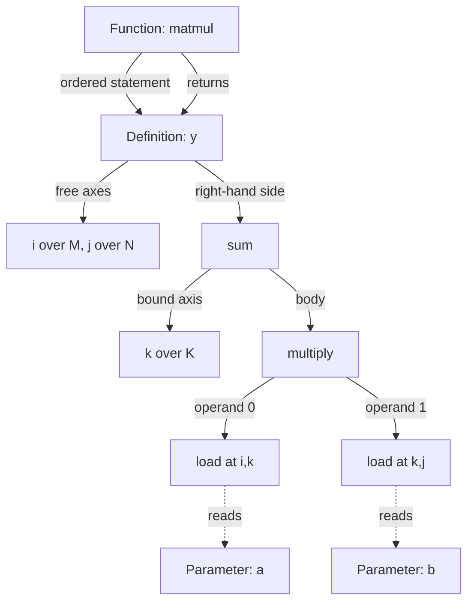

# Tix: checking tensor rewrites in IR Workbench

Summing one row of seven f32 numbers gave `0x3f800000` before optimization and `0x3f800002` afterward. Both executions visited all seven elements in order. The difference was where the second execution finished one partial sum and started another. This was the useful test of a second compiler domain in IR Workbench: could the same framework reject that edit under one contract, accept it under another, and still reject an edit that actually computed the wrong function?

At revision `c03f209`, it could. The original domain compiled a statically typed language to 32-bit RISC-V. The new domain, Tix, describes tensor elements by index and runs on a CPU interpreter. Both use immutable program revisions, explicit edits and checked passes. The numerical comparison needed no change to the framework's contract model. The change the framework *did* need was a way to apply a restricted class of checked passes synchronously. This report concerns language semantics and pass acceptance; there is no GPU implementation or speedup claim.

## A language of tensor definitions

A Tix function takes named f32 tensors and returns one tensor. Each assignment defines an entire new tensor. For example, this is the matrix product in the corpus:

```text
fn matmul(a: f32[M,K], b: f32[K,N]): f32[M,N] {
  y[i,j] = sum(k) a[i,k] * b[k,j];
  return y;
}
```

`M`, `K` and `N` are integer shape values bound from the inputs. `i` and `j` range over output coordinates; `k` is local to the reduction. The two plain uses of `k` must imply the same extent. The compiler rejects an inconsistent contraction even if the caller might happen to choose two equal dimensions. Scalar arithmetic has the usual precedence, but a reduction consumes the rest of the expression up to its delimiter. `sum(k) x[i,k] / K` divides each term; `(sum(k) x[i,k]) / K` divides once. In this language that syntactic difference can change the result.

The front end in `src/tensor/parse.ts` and `check.ts` resolves tensor definitions in statement order and gives each index binder its own identity. Dimensions and subscripts are affine forms: an integer constant plus sorted symbol/coefficient pairs. A direct use such as `w[dy]` supplies an extent for `dy`; `x[y+dy]` alone does not say how far either index runs. The convolution therefore declares its output spatial extents as `H-2,W-2`, and the kernel supplies the extents of `dy,dx`. For a height-three kernel the last possible input row is `(H-3)+2`, exactly `H-1`. The checker bounds an affine subscript at the endpoints of its indices and checks it against the axis it addresses.

Shape names must be determined by plain named input axes; the compiler does not solve simultaneous equations to infer them. Other dimensions may be expressions of those names. A left-hand type annotation can supply a missing output extent, but a reduction binder must have an extent witness in its scope. Out-of-scope indices, repeated assignments, incompatible extents and wrong return shapes are source errors with `line:col`. At execution, the caller supplies concrete shapes and finite row-major data. The three public operations are `compileTix`, `runTix` and `optimizeTix`, exported synchronously from `dist/tensor/index.js` after the TypeScript build.

## The program is an index graph

Tix uses the framework's versioned artifact format, called v6 here. An artifact identifies its kind, schema version and immutable payload revision. The Tix kind is `tensor.index`, schema version `1`. Its native payload is already a graph; it is neither source text to reparse nor an expanded graph with a node per tensor element. A definition owns an ordered list of free-axis binders and a scalar expression tree. A reduction owns binders and a body. A load has a binding edge to the tensor it reads and one affine form per subscript, over binder IDs. Operand slots and loop axes have explicit order. The graph for the matrix product is the same size regardless of the concrete values of `M`, `K` and `N`.



Keeping the binding and the loop domain, rather than just an operator named “matmul,” matters to both edits. One pass must move an expression across a binding site; the other must change where an accumulator is initialized. Both changes can be inspected in the resulting graph. In `src/tensor/ir.ts` the adapter exposes this representation to the generic edit system and rebuilds the native graph from the edited entities and relations. Validation checks containment, operand arity, availability of tensor definitions, binder scope, extents and loads. In particular, it validates an elaborated extent; it does not insist that every plain source-level use from which that extent was inferred still exists after a rewrite.

## Evaluation and the contract

Evaluation materializes definitions in program order. The interpreter iterates output coordinates with the last axis varying fastest and uses those same strides for loads. A reduction iterates its listed indices lexicographically, the first outermost. The f32 evaluator copies input data into f32 buffers, rounds literals and scalar shape values, and applies `Math.fround` to each JavaScript arithmetic or builtin result. Integer coordinates and address calculations are not rounded to floats. The critical operation in `src/tensor/evaluate.ts` is inside the reduction loop:

```ts
const v = args[0]();
acc = round(sum ? acc + v : Math.max(acc, v));
```

A sum starts at positive zero; a maximum starts at negative infinity. If the loop is empty, the identity is its result. There is no fused multiply-add in the matrix product: the product is rounded before it reaches the addition. The f64 evaluator uses the same loop and expression order but stores doubles and takes `round` to be the identity. This is a reference evaluation, not exact real arithmetic. Sharing traversal ensures that the two paths differ in precision by construction; it also means that a shared indexing error could escape a comparison between them.

Every program handle retains its original artifact as well as its current revision. The contract in `src/tensor/contract.ts` makes calls from the *original* signature, then observes the callable signature, return shape and all row-major result cells. Intermediate tensors need not match. There are two relations:

- **Exact:** compare the candidate and the current pass input, both evaluated in f32. Reinterpret the result buffers as 32-bit words and require equality at each offset. This distinguishes positive and negative zero.
- **Tolerance:** compare the candidate in f32 with the *original*, unoptimized program in f64 on the same f32 inputs. For every cell, both values must be finite and `abs(candidate - reference) <= 2e-5 + 2e-5 * abs(reference)`.

The absolute term matters near a zero caused by cancellation; the relative term gives larger outputs a proportionately larger budget. For scale, f32 unit roundoff is `2^-24`, and the usual first-order absolute error scale for seven normal additions is about `7 * 2^-24` times the sum of term magnitudes. The programs here also have rounded products, more than one reduction and nonlinear functions. The chosen tolerance is an engineering allowance on small inputs, not a derived bound for all such programs. Checking each cell avoids hiding a wrong element in an average. A nonfinite reference is grounds for refusing a tolerance check even when both executions produce the same infinity.

For each function, the checker tries assigning all shape symbols the same value from `1,4,5,7`, then assigning rotations of `3,5,7` across symbols. It keeps distinct admissible assignments. Unequal extents can distinguish axes; seven exercises a short last block. For each shape it tests ones, a bounded row-major ramp offset by parameter position, a repeating last-axis pattern chosen to expose rounding, and seeded mixed-sign f32 values in `[-1,1)`. Parameters whose *declared type* normalizes to `f32[1]` receive `2^-10 + abs(value)` in these profiles. That supplies positive scalar inputs such as a layer-normalization epsilon without recognizing a parameter name. A symbolic dimension that merely happens to equal one is not treated this way.

The samples have nonempty tensor shapes, at most 32,768 cells per tensor and an origin work bound of two million scalar visits and loop steps per call. No admissible call for even one function means there is insufficient evidence to accept. The case set stays fixed for a pass sequence, but the execution budget does not: the candidate gets the structural bound of its *own* loops. Counting its extra block iterations against the origin cap would confuse a change in cost with a change in meaning. The checker records sample metadata and a mismatch offset and values when comparisons disagree. Agreement is evidence about those calls, not a proof over the language's input domain.

## Two edits, two meanings of preservation

`inline` takes the first eligible definition per function in an invocation: a reduction-free producer with exactly one load occurrence and no return use. It moves the producer expression to the consumer and substitutes all actual subscripts for the producer's free-axis IDs simultaneously. Consider `p[i,j]=x[j,i]+1` followed by `y[i,j]=p[j,i]*2`. The two transpositions cancel. Copying the spelling `i,j` into the new scope instead of substituting the actual arguments would leave a transposition behind, an error that shape checking on a square tensor cannot catch. The correct edit removes the intermediate store but leaves every scalar operation in order. Its result was already rounded before the removed store, so this pass uses the exact relation.

`split-sum` changes an ordinary one-index sum into two nested sums. The outer binder visits block starts `0,4,8,…`; for each start, the inner sum visits the original indices up to the smaller of the block end and the extent. Both accumulators start from zero. Multi-index sums, maxima and already-blocked reductions are left alone. The artifact records the outer and inner binders and their relationship. Nothing about this evaluation order depends on a flag passed to the interpreter.

For the seven terms `[1,0,0,0,2^-24,2^-24,2^-24]`, each of the last three additions to `1` in sequential f32 rounds back to `1`. With blocks of four, the second partial first accumulates `3 * 2^-24`; adding that to the first partial rounds to `0x3f800002`. The f64 result on these inputs is `1.0000001788139343`, and the blocked f32 result differs from it by `5.960464477539063e-8`. Testing the changed graph under both relations rejected exact and accepted tolerance. In a sequence of passes, an exact inline *after* this split must preserve the changed f32 bits, not restore the original bits. Checking exact agreement with its immediate input on the same origin-derived calls preserves the earlier comparison. A subsequent tolerant pass compares to the original again, so it cannot accumulate an extra tolerance allowance per pass.

## What the framework had to change

Only two files under `src/framework/` changed. `passes/sampled-sync.ts` adds `applySampledPassSync`. The existing framework runner awaits a pass and a semantic analysis manager; a synchronous optimizer cannot simply return its result. The new runner accepts ordinary edit-based pass definitions but only a pure transformation with sampled differential postconditions. It rejects unsupported requirements, effects, preservation claims and asynchronous work rather than reporting those obligations as checked.

The runner validates artifact ports, opens a private edit and lets the pass describe its changes. Preparing that edit invokes the adapter's rebuild and yields a candidate artifact, a structural diff and a correspondence between old and new entities. The runner checks the diff against the pass's declared writes, binds the named input/output ports of each guarantee, and invokes the existing differential checker. A correspondence says which nodes came from which others; the numerical test, not that correspondence, decides acceptance. The caller selects the new artifact only on success. On a contract rejection the optimizer retains the last accepted program and continues with the next requested pass.

`passes/index.ts` exports the new entry point. That is the entire remaining framework delta: no tensor-specific exceptions in the artifact validator, no floating-point tolerance in the pass runner, and no change to the asynchronous path used by the original compiler. Shapes, case generation and numerical policy live in `src/tensor/`. A framework parity test applied one expression-graph edit through both runners and checked that they produced the same changed revision, correspondence and sampled evidence.

## Checks and independent evaluation

The local corpus in `corpus/tensor/` contains matrix multiplication, max-shifted softmax, layer normalization with gain, offset and epsilon, single-head attention, a two-layer MLP with tanh-GELU, and valid NCHW convolution. Tests compare original and optimized programs in both precisions with expected values or small separate calculations. A nonsquare image and asymmetric kernels exercise convolution addresses; unequal query and key lengths exercise the orientation of attention scores. Separate language tests cover location diagnostics, rounding, signed zero, empty reductions and reduction order.

Two deliberately wrong edits tested the contract rather than the parser. Reversing the inlined load's indices on the square example remained well typed but failed exact comparison. Replacing the outer sum of partials with a maximum returned `4` instead of `7` on seven ones; it failed tolerance. Tests also exercised rejection followed by another pass, and an admitted shape whose candidate exceeds the origin's work cap. These rejections are *successful negative controls*.

On Node 24, `npm run build` succeeded. `node --test tests/tensor/*.test.mjs` passed 19 tests; `node --test tests/framework/*.test.mjs` passed 227. The affected Typed suites (`passes`, `strategies`, `evaluate-analyses`, `meaning-memo`) passed all 24 tests. These are the implementation's recorded checks, separate from the following results supplied by the independent evaluator for `c03f209`:

| Independent check | Result |
| --- | --- |
| Hidden acceptance suite, written from the fixed core and API before implementation | 25 of 25 tests passed. |
| 60 random fixed-core programs, three inputs each, versus an independent reference | f32 was bit-identical in 180 of 180 calls; f64 was within `1e-9` relative to `max(1, abs(reference))` in 180 of 180. |
| `inline` on those 60 programs | Accepted on 60 of 60; every accepted result was bit-identical to the original on the comparisons. |
| `split-sum` on those 60 programs | Accepted on 60 of 60; every accepted result agreed on the compared function values in f64 within `1e-9`. |

There were **no reported failures, mismatches or pass rejections** in that evaluation. The independent f64 check is not the internal candidate-f32 versus origin-f64 contract, and it does not claim bit identity for a reassociated f32 sum. Nor does an accepted step necessarily imply a changed revision: the runner checks identity candidates too. The totals establish agreement on the reported observations; they do not give a rewrite count or an error distribution.

## What I would do differently

I would record the accepted-and-changed count alongside the acceptance count in evaluation summaries. The internal pass result already distinguishes the two, and the targeted tests assert an actual graph change. Reporting that distinction would show directly how often a random-program run exercised substitution or reassociation, without changing the public API. I would also make a small independent evaluator part of the initial test strategy. The local cell oracles catch specific mistakes; the independent random-program comparisons add something two precisions of one interpreter cannot supply: a second implementation of indexing and scope.

I would keep the seven-term witness and the wrong-axis and wrong-accumulator edits. They answer a question a pass rate alone cannot: whether the *same* checker can tell a permitted rounding change from a different tensor calculation. That distinction, more than the number of operators in Tix, is what this experiment established about the framework.
