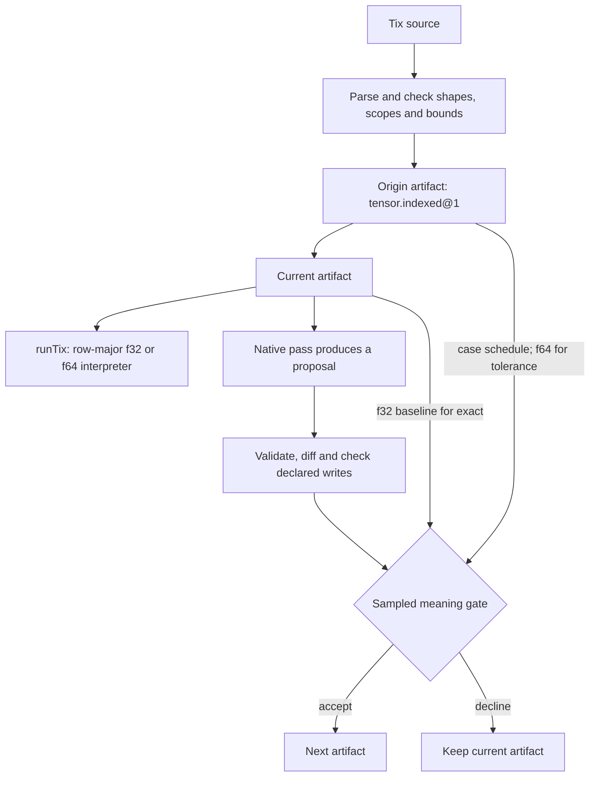

# Tix in IR Workbench: Stage 1 report

IR Workbench began with one compiler domain: a statically typed language called Typed that targets 32-bit RISC-V. Its framework gives passes immutable, content-addressed program revisions and a way to check a proposed revision before returning it. Tix tests whether those same abstractions work for tensor programs, where even a correct rewrite can change floating-point results. Stage 1 implemented and evaluated Tix through a CPU interpreter. It did not generate CUDA, run on a GPU, or measure optimization speedups.

The existing artifact model and differential checker fit Tix without alteration. The two framework changes were both at the pass boundary: native rewrites needed to run without opening a graph edit, and the public API needed a checked result synchronously. Independent testing of revision `24f830a` passed all 25 hidden acceptance tests and matched a reference on 180 evaluations in each precision. The useful discrepancy was in optimization acceptance: `split-sum` was declined on five of 60 programs. The two supplied programs reproduced a policy problem. Their candidates returned the same infinity as their originals on legal, zero-extent inputs, which the tolerant relation rejects by definition.

## The language and the checked IR

A Tix function takes named tensors, defines new tensors one at a time, and returns a tensor by name. The left-hand indices say which element is being computed. The right-hand side is a scalar expression with tensor loads, arithmetic, elementary math calls, and `sum` or `max` reductions. For instance, this function defines one output for each row-column pair and binds `k` only inside the reduction:

```tix
fn matmul(a: f32[M, K], b: f32[K, N]): f32[M, N] {
  y[i, j] = sum(k) a[i, k] * b[k, j];
  return y;
}
```

Here the plain uses of `i`, `j`, and `k` give their extents `M`, `N`, and `K`. The two uses of `k` must agree. A statement can declare an output shape when a subscript is affine rather than plain: for convolution a spatial index can appear only in `h + dy`, yet the output shape still specifies how many positions to visit. The parser uses ordinary arithmetic precedence and treats a reduction body as extending to the right up to its enclosing delimiter. Thus `sum(k) a[i,k] / K` divides each term before summing, while `(sum(k) a[i,k]) / K` divides once. That distinction matters in f32.

The checker resolves loads to preceding definitions, enforces single assignment, verifies ranks and return shapes, and attaches line and column numbers to source diagnostics. Affine shapes and subscripts are normalized to sums of integer coefficients. Each shape name must be determined by a parameter axis that mentions only that name; for example, `2*N+1` can bind `N`, but two coupled equations with no such axis are not solved. For a subscript, the checker computes its extrema over the enclosing index ranges and tries to prove both bounds using affine cancellation and nonnegative extents. It rejects an unresolved proof rather than adding a runtime access guard. At a call, actual input axes must satisfy the signature and concrete extents must be valid. Zero extents are legal. The bounded shape schedule used to verify passes is not a limit on what the interpreter accepts.

The native IR is `tensor.indexed@1`. Each function holds ordered tensor definitions and a return reference. A definition holds its shape, output axes, and a tree for its scalar body. Fold nodes have ordered axes and explicit ranges; loads refer to a tensor and carry affine subscripts. Unique binder IDs separate lexical scopes from source spelling. This is one level more explicit than the parsed syntax: a rewrite no longer has to infer what `k` means or reconstruct the loop bound from a load. It stays above a flat instruction stream, so substituting an expression and changing a reduction's grouping are local tree operations. Runtime tensor contents are not part of the artifact, and literal text with an explicit unary negation preserves the spelling needed to interpret `-0` without relying on JSON to preserve a signed zero.

A Workbench adapter projects that native form as functions, parameter and statement entities, ordered containment, tensor-read dependencies, and return bindings. A statement's scalar expression appears as an attribute. The framework can therefore diff a change to a fold even when the enclosing statement and its dependencies stay the same. Keeping the scalar body as a tree also avoids a separate editor and graph-to-tree rebuilder for this experiment. The same native validator checks compiled source and pass proposals.



## Two evaluators, one loop implementation

The TypeScript implementation builds a Node API with three exports: `compileTix`, `runTix`, and `optimizeTix`. `runTix` takes named row-major arrays, checks the actual shapes against the function signature, and evaluates definitions in order. Each statement iterates over its output index rectangle and materializes one tensor. A fold iterates in lexicographic order, first listed axis outermost, starting `sum` at positive zero and `max` at negative infinity. In particular, an empty `max` returns negative infinity without reading any input cell.

In f32 mode the interpreter uses `Math.fround` on loads, literals, numeric shape values, arithmetic and math results, and after each accumulator step. Shape and offset computations stay integer calculations, separate from the scalar value of a shape name. The result is a `Float32Array`; at the output boundary the interpreter preserves signed zeros and infinities and normalizes NaNs to one quiet-NaN word. The f64 mode uses JavaScript doubles and returns a `Float64Array`. It executes the same IR, including the candidate's loop order if called on an optimized program, without f32 rounding. Sharing the interpreter keeps the shape rules and iteration order identical across precision modes. It also means f64 is not an independent implementation of those rules or an exact real-arithmetic oracle. The independent evaluator used in the external cross-check supplies a separate check on the shared logic.

## How the meaning gate works

`optimizeTix` remembers the original artifact across calls and applies named passes to the current one. For a changed candidate, the Tix gate first checks that function names, parameter names and normalized shapes, and declared result shapes still match the origin's signature. It then uses Workbench's existing differential checker. Tix supplies a case generator, an evaluator for each side, and a comparison of the returned tensors. There is no comparison of internal temporaries.

Both relations generate cases from the origin. For each function the schedule first tries uniform assignments of the symbols from `0, 1, 2, 3, 4, 5, 7, 8, 9`, then 24 seeded mixed assignments with names sorted and seed `7`. The schedule deduplicates tuples and admits only shapes within the origin's extent and work limits. The mixed assignments matter: they cover, for example, a zero reduction axis and a nonempty result axis in the same call. For each admitted tuple it tries ones, alternating signed zeros, seeded values in `[-1,1]`, and the rounding witness cycled along each input axis. Inputs are f32-representable even when used by the f64 reference. The case generator gives a parameter named `eps` a positive f32 `1e-5` in every pattern. This keeps the layernorm samples meaningful without restricting the public input signature.

Admission limits the origin to 65,536 cells per tensor and 100,000 estimated loop and expression visits. Execution allows up to 800,000 visits per side, so a candidate has room for the extra block iterations that a split introduces. A budget overrun counts against the candidate; it is not evidence of agreement. The tolerant check also requires at least one sampled nonempty output shape per function. The checker retains a bounded number of counterexamples with the binding, input pattern, and first differing cell or diagnostic.

**Exact** compares the current artifact and candidate in f32. Shapes must match and each pair of output words must be identical. It detects a change from positive to negative zero and can accept the same infinity on both sides. **Tolerant** compares the f32 candidate with the f64 origin, not with the previous candidate. This prevents a sequence of approximate changes from measuring only incremental error. Both values must be finite, after which each cell must satisfy:

```text
abs(candidate - reference) <= 2e-6 + 2e-5 * abs(reference)
```

The bound was chosen as a practical budget for the small tensor cases. F32 unit roundoff is `2^-24`; nine rounded additions give a first-order scale of about `5.4e-7` times the sum of term magnitudes. The relative term leaves room for other operations, and the absolute term allows small differences near zero. The term-magnitude estimate is not a bound relative to the final output under severe cancellation, and the same tolerance is not justified for arbitrary expression depth, affine extents, or conditioning. This is a sampled numerical check, not a proof of preservation. Finiteness is a separate predicate: changing the size of the finite tolerance would not affect the two rejection diagnoses below.

## The passes and the framework changes

`inline` finds a pointwise definition with one load use. It substitutes the scalar body at the load by composing the producer's affine subscripts with the consumer's actual indices. It does not reorder scalar operations. Where the IR can still express and prove the composed bounds, the pass drops the producer, keeps the consumer's identity, and reports the removal and changed dependencies. A return reference counts as a use and cannot be inlined. The exact gate checks the immediate f32 input, even if an earlier `split-sum` was allowed to change its bits.

`split-sum` rewrites full-range single-axis sums into nested sums. It visits four-element blocks in order, using a shorter final block where necessary, and accumulates the block totals in order. It does not allocate partial-result tensors, split multi-axis sums, or alter `max`. The nine-element sample uses `[1,0,0,0,h,h,h,h,0.125]` with `h=2^-24`. In sequential f32 the four half-ULP additions to `1` round away; inside their own block they sum to two ULPs at that scale. The original produces `0x3f900000` and the split produces `0x3f900002`, matching the f64 result on this input. The exact gate rejects the candidate and the tolerant gate accepts it. A valid but incorrect variant taking the maximum of block totals reaches the gate and fails, as does an `inline` variant that substitutes subtraction for addition.

Both framework changes are in `src/framework/passes/define-pass.ts`. First, the old `applyPass` opened an edit draft before it knew whether a pass would return a new native value. Opening a draft requires a rebuilding adapter. `mode: 'native'` tells the runner not to open a draft and gives the pass a context without `edit`. The pass can still use the async runner and its semantic manager, as a framework test demonstrates. Tix could have implemented a rebuilder just to meet the earlier interface; that would advertise an editing capability it did not need.

Second, `applyNativePassSync` lets a synchronous native pass return a checked result without returning a Promise from `optimizeTix`. It shares artifact creation, validation, diffing, correspondence, and declared-write enforcement with the async path. It runs a host-provided synchronous `CheckResult` gate on changed candidates. The existing differential checker already runs synchronously here, so no second `TransformationDefinition` evaluator was needed. This path does not offer the semantic manager's analysis needs, preservation claims, or resource transactions. A rejection leaves the current artifact in place; the public step reports `accepted: false`. An identity step reports `accepted: true` without running the gate, which matters when interpreting acceptance rates.

## Validation and independent evaluation

The repository build passed with `npm run build`. On Node 24, `node --test tests/tensor/*.test.mjs` passed 21 tests. The tests include parser and extent errors, precision and ordering witnesses, both accepted rewrites and rejected mutants, and independent formulas for six corpus programs: rectangular matmul, max-shifted softmax, layernorm, single-head attention, a tanh-GELU MLP, and NCHW conv2d. `node --test tests/framework/*.test.mjs` passed 228 tests, including native sync/async parity and write enforcement. `node --test tests/typed/{passes,evaluate-analyses,audit,strategies}.test.mjs` passed 21 targeted regressions. The full repository suite was not run.

The external evaluator reported **25/25** hidden acceptance tests passed. On 60 generated programs with three inputs each, the default f32 interpreter was bit-identical to the independent reference in **180/180** cases. The f64 interpreter was within `1e-9 * max(1, |r|)` in **180/180**. `inline` returned acceptance on **60/60** programs and every accepted result was bit-identical on the evaluation inputs. `split-sum` returned acceptance on **55/60**; the external report found the accepted results within its `1e-9` f64 comparison. These rates include identity steps, so they should not be read as counts of actual rewrites. The external report also found that plain f32 evaluation of the five declined programs stayed within `1.6e-7 * max(1, |r|)` of f64 on its own inputs. Those inputs are not the gate's case schedule.

### Why the gate declined two supplied candidates

There is an important distinction between a failure of a rewrite and a failure of a requirement about its output domain. Tix allows empty reductions and does not promise finite outputs for all finite inputs. Nevertheless, `src/tensor/meaning.ts:117` rejects a nonfinite result on either side before comparing error. The two supplied examples reach exactly that branch, with matching signed infinities. No tolerance adjustment on finite numbers can make those cases pass.

**Program 31.** The replay finds `N=0, C=8` with all inputs set to one where present. The returned `t1` reads an empty `max(r4) u[r4]`. The accumulator starts at negative infinity and is never updated (`src/tensor/evaluate.ts:181–186`); division by the positive denominator and addition of the finite first term leave `-Infinity`. The rewrite is in `t0`, which is dead with respect to the return. `split-sum` walks all statements, not just those reachable from the return (`src/tensor/passes.ts:112`), so the dead change still triggers the gate. The original f64, original f32 and candidate f32 all return eight `-Infinity` cells on that case. The tolerant verdict reports **130/140** agreement and the exact f32 check reports **140/140**.

**Program 34.** The replay finds `N=9, C=0` with all inputs set to one where present. The empty `max` over `v` makes `t0` negative infinity after two divisions by positive denominators. The sum of `1.25 - u[r3]` is `2.25` with this input, with or without splitting. Division by the numeric shape value `C` then produces positive infinity (`src/tensor/evaluate.ts:172`); the negated minimum of `t0` and `u` is also positive infinity, so the returned product is positive infinity in both precisions. The original f64, original f32 and candidate f32 all return nine `+Infinity` cells. The tolerant verdict again reports **130/140** agreement. The exact f32 check reports **136/140**, so this example also shows why exact equality is not a substitute for the finite-case tolerance.

The local replay used the unmodified gate on the supplied programs. It proves a rejection cause for each: the gate rejects an output classification that the original already had. This is a false rejection of those rewrites if the goal is to preserve the program's behavior on those cases, but a correctly reported failure of the implemented finiteness requirement. Neither counterexample is an observed numerical regression. The [replay script](../scripts/01-replay-split-rejections.mjs) prints the gate evidence and evaluates the displayed case on both revisions.

### What is known about the other three declines

The independent summary also lists **43**, **51**, and **54**. It does not include their sources, a reproducible generator, or the rejecting case evidence. For each, the public `accepted: false` identifies the gate-rejection path (`src/tensor/index.ts:52` and `src/framework/passes/define-pass.ts:306–310`). It does not say which predicate failed. The passing finite comparisons on the external inputs cannot rule out a nonfinite sample, an exceeded budget, a missing admissible observation, or a finite tolerance failure on a different input. Matching infinities are a candidate explanation, not an established cause for any of those three IDs. The replay script accepts additional `.tix` files to obtain the missing evidence without changing the evaluated compiler.

## What I would do differently

First I would keep zero-extent tests but separate finite error from exceptional-value preservation. For a finite origin, a nonfinite candidate should still fail. For an infinite origin, I would test preservation of its sign rather than rejecting it unconditionally. NaN needs its own explicit policy and separate evidence, including whether NaN observations count toward numeric coverage. This is more informative than globally excluding zero shapes, which would remove meaningful tests of empty reductions. The small positive `eps` rule solved a corpus sampling problem but did not replace the need to specify what the gate does when an original result is nonfinite.

Second, I would record per-pass outcomes at a level below the fixed boolean API when running an evaluation: no match, changed and accepted, or changed and declined with its first counterexample and reason. A separate report of finite agreements and matching exceptional outputs would make it easier to see whether the tolerance was exercised. The internal gate already records counterexamples, but `optimizeTix` intentionally compresses that information to a boolean. For future independent cross-checks I would retain the exact rejected source and evidence as well as the aggregate counts.

Finally I would either restrict `split-sum` to return-reachable definitions or record how many of its edits were dead, and test both options with cases like program 31. That would separate a useful reduction rewrite from a change with no effect on the observed function. I would keep the native IR and the small framework boundary: those choices let the same artifact and differential infrastructure handle bit-identical and approximate transformations without putting tensor arithmetic into Workbench. None of these follow-ups changes revision `24f830a`.
