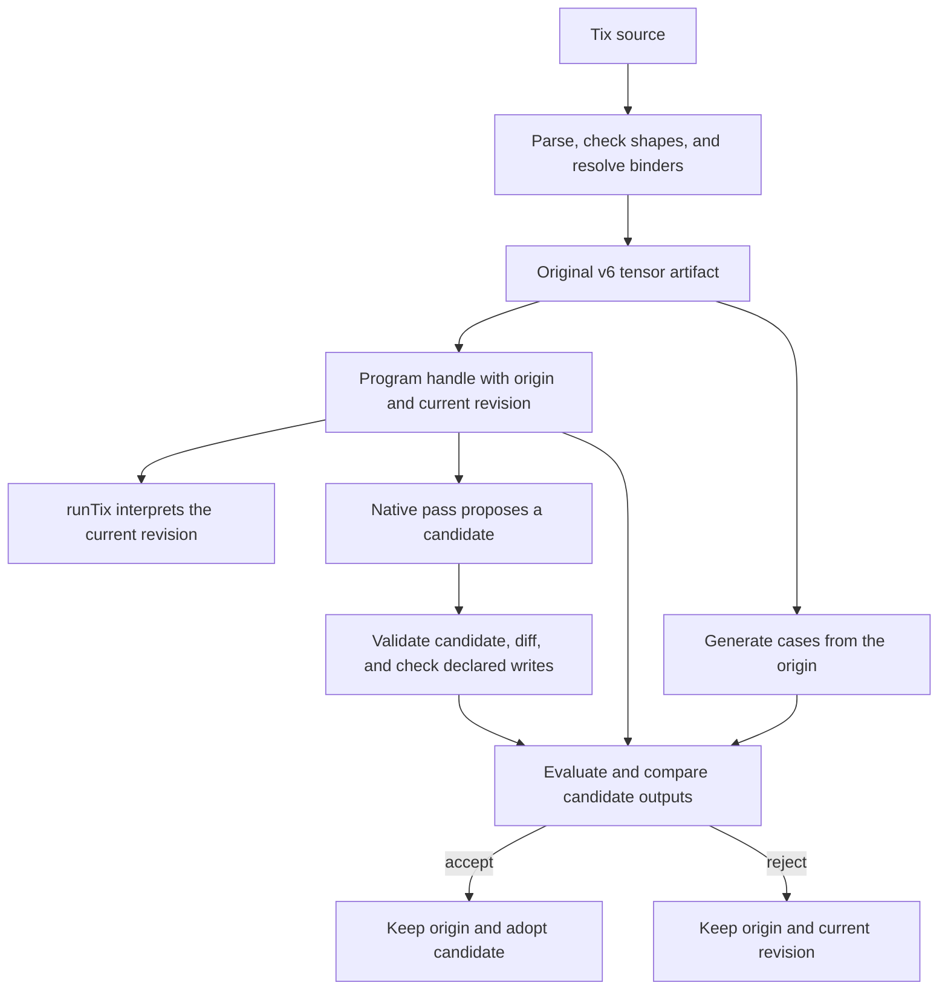

# Tix and the IR Workbench’s second compilation domain

Tix is a small language for tensor computations written in index notation. It was built to answer a framework question. Could IR Workbench, which had compiled the statically typed language Typed to 32-bit RISC-V, carry a second intermediate representation and check optimizations under a different definition of meaning? At revision `1c217ab`, Tix compiles to an immutable tensor artifact, interprets it in f32 and f64, and runs two checked passes through the framework. The independent evaluation reported 25 of 25 acceptance tests passing and agreement with its reference evaluator on all 180 program-input pairs in each precision. The production framework change was a synchronous entry point for native passes. The existing artifact, projection, correspondence, and differential-checking machinery served the new domain.

## A language that makes index ranges and arithmetic order matter

A Tix function takes named tensors and returns one tensor. A statement defines a tensor once, and the left-hand indices describe the elements it computes. The right-hand side uses scalar arithmetic, elementary functions, affine tensor coordinates, and reductions. There is no mutable tensor assignment. A program may contain several independent functions. The public interface consists of `compileTix`, `runTix`, and `optimizeTix`. Compilation reports source errors with a one-based line and column. Execution takes named, row-major inputs and defaults to f32. Optimization takes a sequence of pass names and reports acceptance for each step. These calls are synchronous. [Public interface](../../../../../../src/tensor/index.ts)

The entire matrix multiplication in the corpus is this function.

```text
fn matmul(a: f32[M, K], b: f32[K, N]): f32[M, N] {
  y[i, j] = sum(k) a[i, k] * b[k, j];
  return y;
}
```

The checker infers `i` from the first axis of `a`, `j` from the second axis of `b`, and `k` from the matching contraction axes. It compares normalized affine expressions when a binder has several plain uses. For the convolution, the coordinate `y + dy` does not by itself tell the compiler the range of the output index `y`. The output annotation supplies `H - 2`, and a plain filter coordinate supplies the kernel extent of three for `dy`. The checker can then show the upper bound is `H - 1` whenever that iteration region runs. The same reasoning applies to the width. In the implemented input domain each shape name has an input axis from which it can be recovered directly. An axis such as `2*N+1` suffices, and axes involving several names are checked once those names have been bound. Affine access proofs use symbolic intervals and simple nonnegative extent constraints. [Source checker](../../../../../../src/tensor/check.ts) · [Access verification](../../../../../../src/tensor/ir.ts) · [Convolution example](../../../../../../corpus/tensor/conv2d/main.tix)

A reduction has a deliberately wide body. In `sum(d) x[i,d] / D`, each term is divided before it reaches the accumulator. In `(sum(d) x[i,d]) / D`, the accumulator is divided once. This matters in f32 even when the corresponding real-number formula is the same. The parser handles the usual precedence for scalar arithmetic and lets a reduction consume the rest of the enclosing expression. The tests distinguish the two forms with an input on which their rounded results differ. They also check reduction binder shadowing and the distinction between a binary `max` call and a `max` reduction. [Parser](../../../../../../src/tensor/parse.ts) · [Language tests](../../../../../../tests/tensor/language.test.mjs)

## A native tensor IR with a framework projection

The IR stores ordered functions and ordered tensor definitions. Each definition carries its result binders, their resolved extent expressions, and a scalar expression tree. Tensor reads use normalized affine coordinates over binder IDs. During checking, each scope gets its own IDs, so an optimizer can substitute a coordinate without accidentally capturing a source-level name. Reductions are expression nodes with an operator, an ordered binder list, and a body. A one-index sum can additionally carry a block size. This makes the grouping part of the representation while leaving the original extent and term expression visible. [IR model](../../../../../../src/tensor/model.ts)

Tix keeps this representation high enough to make a single use or a pointwise producer easy to recognize, and explicit enough that a loop order can be read directly from it. Extents are resolved before the artifact is created. Rewrites can therefore remove a read that originally supplied an extent without forcing the compiler to infer the extent again. The framework sees a logical graph of functions, parameters, and statements. Containment gives the function structure, adjacency records statement order, and read edges identify tensor dependencies. The full expression tree is a statement attribute, so changing an arithmetic operator or a reduction order shows up in the framework’s diff even when the dependency edges stay the same. [Native validator and adapter](../../../../../../src/tensor/ir.ts)

The v6 artifact is the framework’s immutable, content-addressed representation of a revision. Tix defines its artifact type and supplies a read-only adapter that projects and validates the native value. Integer coefficients are decimal strings in the artifact and are calculated exactly with `BigInt`. Numerical literals also keep their source text until evaluation. This allows the artifact to use the framework’s canonical finite JSON representation while the evaluator can still produce signed zero, infinity, or NaN in typed-array storage. The public program handle retains both the source artifact and the current artifact. They initially identify the same revision. An accepted optimization changes the current artifact and carries the source artifact forward. [Artifact construction](../../../../../../src/tensor/index.ts#L12) · [Affine representation](../../../../../../src/tensor/model.ts#L12)



## Two precisions in one evaluator

Both modes instantiate the affine shapes, traverse statements in definition order, and materialize their results in row-major arrays. In f32 mode the evaluator rounds input elements on ingress. It rounds each literal, shape value, arithmetic operation, and elementary-function result using `Math.fround` on the JavaScript double result. For a flat reduction the first listed index is outermost and the last varies fastest. A sum starts at positive zero, a maximum starts at negative infinity, and every update rounds. A reduction over several indices has one accumulator across the full lexicographic traversal. The f32 array writer standardizes NaN to the word `0x7fc00000`, and preserves the sign of zero. [Evaluator](../../../../../../src/tensor/evaluate.ts)

The f64 mode uses the same traversal and expression semantics with JavaScript double arithmetic and `Float64Array` buffers. It removes the explicit f32 rounding. Its use of the same traversal is important because grouping can affect double precision as well. Public f64 execution interprets the supplied program’s current artifact. The tolerance check explicitly evaluates the unoptimized source artifact in f64. One regression uses four `2^-54` terms to distinguish the double-precision flat and blocked folds and verifies that the source reference survives a second optimization call. The test corpus uses separately written JavaScript loop references to exercise the parts that both interpreter modes share. [Reference-lifetime test](../../../../../../tests/tensor/passes.test.mjs#L81) · [Corpus references](../../../../../../tests/tensor/corpus.test.mjs)

## What it means for a pass to be accepted

The contract observes the returned shape and all its row-major elements. Its exact relation compares the f32 output words of the candidate and the preceding revision. This detects a sign change on zero and compares NaN through the standardized storage word. Its tolerance relation compares candidate f32 with the original flat f64 reference. For a finite reference element `r` and a finite candidate element `c`, the condition is

```text
abs(c - r) <= 1e-5 + 2e-5 * abs(r)
```

A nonfinite reference matches NaN or the same signed infinity, as applicable. A shape mismatch or an execution error on a selected case counts as disagreement. The checker records the generated case and the first differing output coordinate with expected and observed words or values. Exact inline after a tolerant step uses the preceding revision as its f32 baseline. If its words are identical on the same origin-derived cases, the observation already accepted against the original f64 run is preserved. Another tolerant step compares to the original f64 run again, so successive passes do not get separate allowances for accumulated error. [Comparison and evidence](../../../../../../src/tensor/meaning.ts#L132) · [Relation dispatch](../../../../../../src/tensor/index.ts#L33)

The baseline selection appears directly in the gate.

```ts
const baseline = relation === 'exact' ? before : origin;
const evidence = runDifferential(spec, { baseline, candidate });
```

The case suite is generated once per optimization call from the source artifact. It visits every function. For symbolic shapes it tries uniform assignments from `0, 1, 3, 4, 5, 7, 8, 9` and one asymmetric assignment cycling through `2, 3, 5`. It filters unsupported concrete extents, deduplicates the actual input shapes, and caps each source input or statement tensor at 4,096 elements and estimated source work at 100,000 scalar expression visits per call. For each remaining shape it generates ones, mixed-sign multiples of `1/16` with seed 7, and a sparse pattern with signed zero and very small positive terms. These data are exactly representable in f32. The values exercise signs, short and partial blocks, and rounding around a large contribution relative to its neighbors. A function with zero usable cases prevents publication of a changed artifact. [Case generator](../../../../../../src/tensor/meaning.ts#L22)

The tolerance is an empirical whole-output envelope informed by the rounding error of a short sum. For ordinary round-to-nearest f32 addition, unit roundoff is `2^-24`. For a sum of nine already-rounded terms of magnitude at most one, the standard relative rounding model gives an absolute bound of `9 × (9u)/(1 - 9u)` with `u = 2^-24`, below `5e-6`. With four-element blocks and nine terms, the longest addition path has at most seven updates. The absolute term gives extra room near cancellation and the relative term scales with the output magnitude. Neither calculation bounds an arbitrary output expression containing divisions, exponentials, or very ill-conditioned cancellation. The acceptance decision comes from the samples. A repository test demonstrates the consequence by amplifying a benign change in sum grouping until the final output falls outside the envelope. [Cancellation regression](../../../../../../tests/tensor/passes.test.mjs#L103)

## The two passes and the framework change

`inline` finds a reduction-free tensor definition with one static read occurrence in a later statement. A tensor returned from the function remains materialized. The pass uses the consumer’s coordinates to substitute for the producer’s result binders and composes affine coordinates in each copied read. It preserves expression order and the consumer’s resolved extents, then removes the producer and lets the projection account for the changed dependencies. This also works when the consumer reads inside a reduction. Before proposing the replacement, the pass checks the composed access bounds. If the checker’s conservative proof cannot establish them, the producer stays materialized. A regression covers this case. [Inline kernel](../../../../../../src/tensor/passes.ts#L23) · [Affine proof regression](../../../../../../tests/tensor/passes.test.mjs#L222)

`split-sum` changes a flat one-index sum to consecutive blocks of four. Each block gets a zero-initialized inner accumulator. The outer accumulator visits those partial sums in block order. The final block stops at the original extent. Multi-index sums and maxima retain their original traversal. With an input of `[1, 0, 0, 0, 2^-25, 2^-25, 2^-25, 2^-25]`, the flat f32 fold rounds away each small term after it has reached one. The blocked fold combines the last four terms into `2^-23` before adding that partial to one. The output words are `0x3f800000` and `0x3f800001`. The flat f64 result is `1.0000001192092896`, equal to the blocked f32 value. The exact gate rejects the real split kernel on this witness and the tolerance gate accepts it. [Split kernel](../../../../../../src/tensor/passes.ts#L94) · [Gate witness](../../../../../../tests/tensor/passes.test.mjs#L25)

The framework integration exposed two issues at the same call boundary. The existing `applyPass` returns a promise, as does managed transformation verification. It also opens a logical edit before invoking a pass kernel, even on the path where the kernel returns a native value. The design probe exercised that route and got a capability error from a read-only projection. Tix needed a synchronous result and already had a native validator. Making the tensor adapter implement logical rebuilding solely for pass invocation would have introduced an unused translation. [Existing pass entry point](../../../../../../src/framework/passes/define-pass.ts#L291)

The only framework source change is in `src/framework/passes/define-pass.ts`. It adds `applyNativePassSync` for an existing `definePass` registration and a required synchronous check. The new path opens the input projection, calls the native kernel without opening an edit, and uses the same candidate construction, diff, entity correspondence, and declared-write enforcement as the existing runner. It returns a changed artifact after the gate accepts. The tensor check uses the framework’s existing standalone `runDifferential` with tensor-specific cases, evaluator, and relation. The new test file checks the read-only path, write enforcement, the evidence returned on rejection, and synchronous invocation. [Shared native preparation](../../../../../../src/framework/passes/define-pass.ts#L193) · [Synchronous runner](../../../../../../src/framework/passes/define-pass.ts#L234) · [Framework tests](../../../../../../tests/framework/native-pass-sync.test.mjs)

## Checks and independent evaluation

The repository checks exercised compilation, both evaluator modes, artifact inspection, and pass sequencing through the built API. The six corpus programs cover rectangular matrix multiplication, max-shifted softmax, layer normalization with gamma, beta, and epsilon, single-head attention, a tanh-GELU MLP, and stride-one NCHW convolution with a three-by-three filter. Their independent loop references check output shapes and values. The build and all three tensor test files passed, covering 23 tests. The 18 framework test files passed. The Typed pass and strategy test files passed and exercise the existing asynchronous paths that share native candidate preparation. [Corpus checks](../../../../../../tests/tensor/corpus.test.mjs) · [Typed pass tests](../../../../../../tests/typed/passes.test.mjs) · [Typed strategy tests](../../../../../../tests/typed/strategies.test.mjs)

Two deliberate wrong kernels checked whether the gate could detect a real defect. Both are registered passes that run through the same synchronous framework entry point and generated-case machinery. The wrong inline kernel substitutes subtraction for addition and is rejected by the exact gate. The wrong split kernel stops at four for a reduction of extent seven. On the ones case its candidate returns four against a reference of seven, so the tolerance gate rejects it. Separate tests cover retaining the current revision after a rejection, continuing with later passes, and accepting an unchanged revision as an identity. [Deliberate wrong kernels and pipeline tests](../../../../../../tests/tensor/passes.test.mjs)

The independent evaluator reported the following results for revision `1c217ab`. The 25 hidden acceptance tests were written from the fixed core and API brief before the implementation existed. The differential evaluation used 60 random programs, each with three inputs, and compared the outputs to an independent reference.

| Independent check | Reported result |
| --- | --- |
| Hidden fixed-core and API acceptance suite | 25 of 25 passed |
| Plain f32 evaluation | 180 of 180 bit-identical |
| Plain f64 evaluation | 180 of 180 within `1e-9 × max(1, abs(reference))` |
| `optimizeTix(p, ['inline'])` | Accepted for all 60 programs. Every accepted result was bit-identical to the original. |
| `optimizeTix(p, ['split-sum'])` | Accepted for all 60 programs. Every accepted result agreed in f64 within the reported `1e-9` criterion. |

The supplied independent results contain zero failures or rejections. The accepted counts describe public step verdicts, which include identities. The evaluator supplied aggregate outcomes without a count of changed revisions. The deliberate rejections described above are measured repository checks. In particular, the f64 cross-check and the f32 witness answer different questions about the split pass. The reported split check concerns double-precision agreement after optimization. The witness shows an observable f32 difference and exercises the runtime contract’s f64 tolerance. [Public verdict handling](../../../../../../src/tensor/index.ts#L40) · [Exact-versus-tolerance test](../../../../../../tests/tensor/passes.test.mjs#L25)

## What I would do differently

I would count changed, unchanged, and rejected steps separately in the evaluation record from the start. The public verdict is useful for pass sequencing. For an experiment, a count of changed artifacts would reveal how often each kernel found an opportunity, and the existing framework result already has a `changed` field. I would also keep the small rounding witness as a required check alongside broader generated coverage. The witness gives a known reason for the precision relation to matter, while the independent comparison measures agreement on a larger input collection.

I would make sample coverage easier to inspect per function and shape. The uncovered-function regression already shows that a bounded grid can leave a valid source with zero checked calls. The asymmetric assignment and partial-block sizes are similarly intentional. A coverage record would let a reader see which shapes actually ran after filtering, and make it easier to tell whether a numerical decision came from broad coverage or a single special case.

Finally, I would investigate reusing the original proof of a producer’s access safety when substituting into a separately proved consumer read. The implemented pass recomputes bounds over the composed expression and conservatively keeps the producer if that check fails. The regression shows a valid example where the individual reads both have proofs and the combined inequality exceeds the implemented prover. That example is a concrete place to assess whether retaining and composing local facts would be worth the added compiler complexity. [Affine proof regression](../../../../../../tests/tensor/passes.test.mjs#L222)
