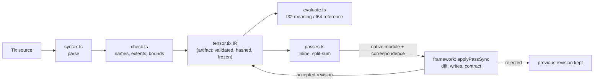
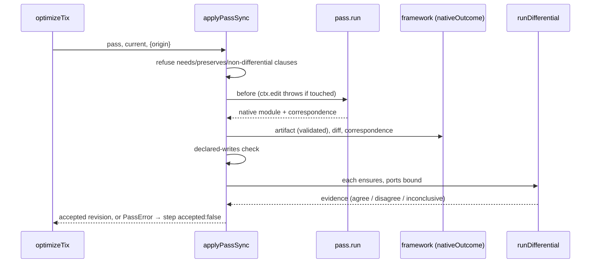

# Tix: a tensor domain on the v6 framework (stage 1)

## What this is

The IR Workbench repository contains a compiler framework in `src/framework/`. The framework covers artifacts
with content hashes, IR adapters, semantic contracts, checked passes and a strategy language. Until now one
domain used it: Typed, a small statically typed language compiled to 32-bit RISC-V. Every optimisation pass in
Typed is checked against the original program by running both on generated inputs.

Stage 1 of the tensor track adds a second domain:

- **Tix**, a small index-notation language for tensor programs.
- A Tix IR stored as a framework artifact.
- An f32 evaluator, which defines meaning, and an f64 evaluator, which serves as a reference.
- A meaning contract with an exact relation and a tolerance relation.
- Two checked passes.
- A six-program corpus.

The aim was to test the framework, not to build a tensor compiler. The framework changes this domain needed are
the main result. There were two, both small, both in `src/framework/passes/define-pass.ts`.

In numbers, the work is about 1,500 lines of TypeScript in `src/tensor/`, 190 changed lines in the framework,
six corpus programs, and four test files with 40 tests. An independent evaluation passed 22 of 25 hidden
acceptance tests. All three failures have one cause: my checker refuses an index named like a tensor (section 9).

## 1. Tix

A Tix program is a list of functions. Each statement defines a new tensor over named indices, using an
expression in index notation. Here is the corpus softmax:

```
fn softmax(x: f32[N, C]): f32[N, C] {
  m[i] = max(j) x[i, j];
  e[i, j] = exp(x[i, j] - m[i]);
  s[i] = sum(j) e[i, j];
  y[i, j] = e[i, j] / s[i];
  return y;
}
```

**Shapes.** Shape names such as `N` and `C` are bound when the function is called, by the shapes of its
inputs.

**Extents.** The extent of an index is inferred from its plain uses. A plain use is an index that appears
exactly as itself in some position. In `x[i, j]`, `i` gets extent `N` and `j` gets extent `C`. An index that
appears only in affine positions, like `p` in `x[n, c, p + r, q + s]`, takes its extent from the statement's
declared type, which is then mandatory:

```
fn conv2d(x: f32[N, C, H, W], w: f32[K, C, R, S]): f32[N, K, H - R + 1, W - S + 1] {
  y[n, k, p, q]: f32[N, K, H - R + 1, W - S + 1] = sum(c, r, s) x[n, c, p + r, q + s] * w[k, c, r, s];
  return y;
}
```

**Reductions.** `sum(...)` and `max(...)` take a list of indices. A reduction's body extends as far right as
possible, so `sum(d) x[i, d] / D` divides inside the sum. Inputs are finite, and every value is rounded to f32
(section 3).

### The front end

The lexer and parser are in `src/tensor/syntax.ts`. They are a hand-written recursive descent with the brief's
precedence. Two details are not dictated by the grammar:

- **The body of a reduction is parsed as a complete expression.** That gives the "as far right as possible" rule
  for free, because parsing stops at the enclosing `)`, `,` or `;`.
- **`max(a, b)` and `max(j) body` share a prefix.** I resolve this with names: if every name in the parentheses
  is a shape name of the function, it is the two-argument call, otherwise it is a reduction. This is sound only
  because index names may not coincide with shape names, a rule the checker enforces.

The checker is in `src/tensor/check.ts`. It turns the syntax tree into the IR and reports the first error as
`line:col: message`. It checks:

- names and single assignment;
- ranks;
- that every extent is inferred consistently;
- that every reference is provably in bounds;
- that the returned shape equals the declared result type.

Bounds are checked symbolically:

- An index expression is an affine form `c + Σ aᵢ·iᵢ`.
- Its minimum and maximum come from substituting 0 or `extent − 1` for each index, depending on the sign of its
  coefficient.
- Both `min ≥ 0` and `dim − 1 − max ≥ 0` must be provably non-negative over all shape values ≥ 1.

For an affine form over shape names, "provably non-negative" means: every coefficient is ≥ 0, and the value at
all-ones is ≥ 0. This rule is sound, and it is simple enough to explain in one sentence. It proves conv2d's
`p + r < H` exactly: the maximum is `(H − R) + (R − 1) = H − 1`.

## 2. The IR, and why this form

The IR (`tensor.tix`, version 1, in `src/tensor/ir.ts`) is statement-level index notation with everything
resolved.

- A **statement** records its tensor name, its indices with explicit extents (affine forms over shape names),
  and the id of its expression root.
- **Expressions** live in a flat table keyed by stable ids (`e1`, `e2`, …).
- A **reduction node** lists its axes in iteration order, each with an extent.

```ts
type Expr =
  | { op: 'num'; value: number } | { op: 'shape'; name: string }
  | { op: 'ref'; kind: 'param' | 'stmt'; name: string; at: Affine[] }
  | { op: 'neg' | 'exp' | 'log' | 'sqrt' | 'tanh'; a: string }
  | { op: 'add' | 'sub' | 'mul' | 'div' | 'max' | 'min'; a: string; b: string }
  | { op: 'reduce'; kind: 'sum' | 'max'; axes: { name: string; extent: Extent }[];
      guard?: { at: Affine; lt: Affine }[]; blocked?: true; body: string };
```

**Why this form.** It is the checked source made explicit. Each statement maps directly onto a loop nest: one
loop per left-hand index, the reductions as inner loops in axis order, and a guard as an `if`. That keeps it
ready for the later loop-level lowering to CUDA without committing stage 1 to a loop order. I considered three
other forms:

- **The parse tree.** It has no stable ids, and the framework's correspondence records need ids.
- **An explicit loop-nest IR.** It would have turned `inline` into a loop-fusion problem.
- **A graph of whole-tensor operations** (matmul, reduce, …). It cannot express the index arithmetic `split-sum`
  needs.

**Two additions over the source language.**
- An extent may be `ceil(aff / k)`.
- A reduction may carry guards.

Both exist only because `split-sum` must work on symbolic extents, and Tix has neither floor division nor
conditionals. The bounds rule was extended to match: a reference that contains an integer multiple of a guarded
form `at`, where the guard says `at < lt`, gets the bound `lt − 1` for that part. That way the IR validator can
still prove a split reduction's reads in bounds.

**Validation.** The validator is the framework's `defineIR` hook, so every artifact is validated when it is
created. It checks that:

- every id resolves;
- expressions form trees, with no sharing;
- references point at a parameter or an earlier statement;
- every index in an affine form is in scope;
- bounds are provable, using the same function as the front end.

A pass whose output fails validation is rejected before its contract runs.

**The projection.** The framework's adapter interface requires a projection to entities and relations, so
generic tools (diff, correspondence, traversal) can work on any domain:

- entities: `fn:`, `param:`, `stmt:` and `expr:<op>`;
- relations: `contains`, `root`, `operand`, `reads` and `returns`.

The adapter has no `rebuild`: passes return native values rather than editing the projection. That is where
the first framework change came from.



## 3. The evaluators

There is one interpreter, `src/tensor/evaluate.ts`, parameterised by a rounding function: `Math.fround` for the
f32 meaning, and the identity for the f64 reference.

**Shapes.** They are bound from the input shapes. Every declared dimension is then evaluated and compared with
the input. Mismatches throw.

**Statements** run in program order. Each fills a row-major buffer over its index space. Expressions are
compiled once per statement into closures over an integer environment of index slots. Every operation result
is rounded:

```ts
if ('b' in e) { const a = compile(e.a, sc), b = compile(e.b, sc), op = BIN[e.op];
                return env => round(op(a(env), b(env))); }
```

**Reductions.** `sum` starts at +0 and `max` at −∞. Both walk the axes like an odometer, with the first axis
outermost, skip iterations whose guard fails, and apply `acc = round(acc ⊕ v)` at every step.

Rounding the double result of `+ − × ÷ √` to f32 gives the correctly rounded f32 result, because double has
more than twice the precision. For `exp`, `log` and `tanh`, the meaning is by definition `fround` of
JavaScript's double function.

**Why an interpreter and not compiled JavaScript.** The meaning should be the easiest thing in the domain to
trust, and the check cases are small (shape values up to 8).

## 4. The meaning contract

The contract is built from the framework's existing `differential()` invariant. That invariant generates cases,
runs a baseline and a subject on each one, compares the outcomes, and records the case counts and the first
counterexamples as evidence. There are two relations, each wrapped in a transformation contract with inputs
`{input, origin}` and output `{output}` (`src/tensor/contract.ts`).

**The exact relation (`tensor.exact-f32`).**
- On every case, the output program's f32 result must be element-wise `Object.is`-equal to the result of the
  pass's *input*.
- It compares against the input, not the original program. That way an exact pass applied after a tolerance pass
  must keep the bits it was handed, rather than recover the original ones.

**The tolerance relation (`tensor.close-f64`).** Per element, the output's f32 value `y` and the *original
program's* f64 value `r` must satisfy

```
|y − r| ≤ τ · max(1, |r|),     τ = 2⁻¹² ≈ 2.44e−4
```

- A case is inconclusive when `r` is not finite, or when the original program's own f32 result fails the same
  bound. The relation cannot judge a pass on inputs where the program itself is not that accurate.
- Every step is compared with the original's f64 output, so successive tolerance passes cannot accumulate slack.

**Cases.** Per function there are nine, all from seed 1, so a verdict is a deterministic function of the two
programs.

- **Cases 1–8** draw every shape name from 1 to 8, redrawing until all dimensions are at least 1, and every
  input element uniformly from [−1, 1].
- **Case 0, the wide case**, was added after review. All shapes are 8. Inputs are `±2⁻ᵏ` with `k` from 0 to 24.
  At extent 8, a one-axis sum has two blocks of four. With magnitudes spread over 24 binades, low bits that the
  sequential order absorbs survive in the blocked order. In other words, the case is built to make a
  reassociation visible.

A domain cannot guarantee a bit change for an arbitrary program: `sum(j) 1` is the same in every order. So the
guarantee is narrower. The wide case is designed for it, and a test pins the result: the exact relation rejects
`split-sum` on every corpus program that has a one-axis sum, and the wide case is among the counterexamples
each time.

**Evidence.** It carries only `{fn, n, shapes}` and string reasons. The analysis manager freezes evidence with
a function that throws on typed arrays and non-finite numbers. Putting raw outputs in the evidence would have
replaced the real rejection reason with that error.

**Why τ = 2⁻¹² and the `max(1, |r|)` scale.** I chose the number before measuring, from three constraints:

1. **It must accept the honest rewrite.** Reassociating n terms of magnitude about 1 changes an f32 sum by
   roughly n²·u, where u = 2⁻²⁴. For n ≤ 8 that is about 4e−6, well below τ.
2. **It must reject real bugs.** A wrong reduction that drops a term of size about 0.5 out of eight is off by
   about 0.1.
3. **The scale.** A relative or ULP bound would reject honest results near zero after cancellation (layernorm's
   `x − μ`). A normwise bound would let one large element hide errors in small ones. The mixed scale is
   absolute near zero and relative above one.

The implementation then measured both sides on the corpus. Below, "scaled error" is `|y − r| / max(1, |r|)`:

| program | original's own f32 error | split-sum output | split-sum-wrong output | exact rejection of split-sum: cases |
| --- | --- | --- | --- | --- |
| matmul | 1.08e−7 | 1.08e−7 | 1.8e−1 | 5 of 9 |
| softmax | 4.11e−8 | 4.11e−8 | ∞ | 2 of 9 |
| layernorm | 1.03e−6 | 1.03e−6 | 7.9e+1 | 3 of 9 |
| attention | 6.72e−8 | 6.02e−8 | 7.5e−2 | 4 of 9 |
| mlp | 1.43e−7 | 1.43e−7 | 6.2e−1 | 6 of 9 |

What the measurements show:
- The honest margin is at least 237× below τ.
- The deliberate bug is at least 300× above τ.
- No case was inconclusive.
- On softmax only two cases disagree under the exact relation, and the wide case is one of them. Without it, the
  exact rejection would have rested on one uniform case.

## 5. The two passes

Both passes, in `src/tensor/passes.ts`, return a new native module and its correspondence, and declare which
entity and relation kinds they write. The framework does the rest: diff, enforcement of the declared writes,
the contract. Neither pass checks itself.

**`inline`, checked by the exact relation.**
- **Eligible statements.** A statement is eligible when it has no reduction, is not returned, and has exactly
  one reference.
- **The rewrite.** That reference `P[a₁…aₙ]` is replaced by a copy of P's expression, with P's indices
  substituted by the affine forms `aₖ`. An affine form of an affine form is still affine.
- **Bounds and capture.** P has no binders, so nothing can be captured. The substituted indices stay within P's
  extents, so P's own bounds proof carries over.
- **Order.** Inlining repeats, earliest statement first, until nothing is eligible, so one application follows
  chains.
- **Why it is bit-identical.** P's element at an index depends only on P's inputs at that index, and every
  operation is rounded the same way wherever it is evaluated.
- **Correspondence.** It is built by tracking, for each output expression, the set of input expressions it came
  from. That map survives a chain of inlinings.
- **On the corpus,** it fires on attention (`p` into the output reduction) and mlp (the GELU `g` into the second
  matmul).

**`split-sum`, checked by the tolerance relation.** Every one-axis `sum` that is not already blocked becomes

```
sum(j: E) body   ⟶   sum(jb: ceil(E/4)) sum(jk: 4 | 4·jb + jk < E) body[j := 4·jb + jk]
```

Here is matmul's reduction after the pass, as the IR stores it:

```json
{"op":"reduce","kind":"sum","axes":[{"name":"k_b","extent":{"aff":{"c":0,"t":{"K":1}},"div":4}}],"blocked":true,"body":"e6"}
{"op":"reduce","kind":"sum","axes":[{"name":"k_k","extent":{"aff":{"c":4,"t":{}}}}],"blocked":true,
 "guard":[{"at":{"c":0,"t":{"k_b":4,"k_k":1}},"lt":{"c":0,"t":{"K":1}}}],"body":"e3"}
```

The outer node keeps the original id, so the correspondence records a split of one node into two. `blocked`
stops the pass from splitting its own output again. Multi-axis sums, such as conv2d's `sum(c, r, s)`, are left
alone.

**Deliberately wrong variants** (test-only, not reachable through `optimizeTix`):
- **`inline-wrong`** inlines, then rewrites `x·(y·z)` as `(x·y)·z` inside the copy. This is exact over the reals,
  so the exact relation rejects it on mlp and the tolerance relation alone accepts it. That pair isolates what the
  exact relation adds.
- **`split-sum-wrong`** takes `floor(E/4)` blocks, written as `ceil((E−3)/4)`, and so drops the remainder. The
  tolerance relation rejects it on all five programs.

## 6. The framework changes

The rest of the framework fitted without change: artifacts with floating-point payloads, the adapter, the
declared-writes check, the sampled differential invariant, and per-application contract overrides.

A probe run against the built framework before any design was written (`scripts/01-probe-framework-fit.mjs`)
found the two places where it did not fit.

**F1: `applyPass` opens its IR edit only when the pass uses it.**
- **The problem.** `applyPass` always called `view.beginEdit()` before running the pass. Opening an edit requires
  a *rewritable* adapter, one that can rebuild native storage from an edited graph. So a pass that returns a
  native value, and never touches the edit, still failed on a read-only adapter with
  `Adapter … is not Rewritable`. Typed never hit this, because its adapter happens to be rewritable.
- **The fix.** `ctx.edit` is now a getter that opens the edit on first access. Nothing changes for passes that
  use it.
- **The alternative I rejected.** A `rebuild` that throws. It would claim a capability the adapter does not have,
  and every future native-result domain would have to repeat the workaround.

**F2: `applyPassSync`.**
- **The problem.** The fixed API `optimizeTix(program, passes)` returns its result directly. Every framework path
  to a contract-checked revision goes through the analysis manager, which is asynchronous throughout, and Node
  cannot wait for a promise synchronously. The sampled differential check itself, however, is synchronous.
- **The fix.** I moved the steps that follow a native result (build and validate the artifact, diff the
  projections, build the total correspondence) out of `applyPass` into one internal function. A new
  `applyPassSync` shares that function:
  - It accepts a pass with no declared analyses and no preservation claims, whose contract consists only of
    differential `ensures`.
  - It decides those with `runDifferential`, and rejects with the same `PassError('contractRejected')` as
    `applyPass`.
  - Anything outside that domain is refused up front, rather than half-checked.
- **The cost.** The synchronous path records no facts in a manager. The evidence goes back to the caller and is
  not stored.
- **The alternative I rejected.** Running the same steps inside `src/tensor/` from exported pieces. It would have
  duplicated pass application outside the framework, where the copy would drift from `applyPass`.

Both changes have their own test file, `tests/framework/pass-native-sync.test.mjs`. The tests apply a
native-result pass on an adapter without `rebuild`, and check that `applyPassSync` and `applyPass` agree on the
output revision. They also check that `applyPassSync` refuses passes with analyses, asynchronous passes,
property clauses and undeclared writes.



## 7. How I checked the work

- **Front end** (`tests/tensor/frontend.test.mjs`, 23 tests):
  - precedence;
  - the reduction-body rule, with numbers chosen so the two parses differ (`sum(d) x + 1` against
    `(sum(d) x) + 1`);
  - `max` as a call and as a reduction;
  - declared types for affine-only indices;
  - eighteen check errors, each asserting its `line:col`.
- **Evaluator** (`evaluate.test.mjs`, 6 tests):
  - matmul, softmax and conv2d against hand-written `Math.fround` loops, bit for bit;
  - literal rounding;
  - f32 within τ of f64 on every corpus program;
  - input errors.
- **Contract and passes** (`contract.test.mjs`, 8 tests):
  - every verdict in sections 4 and 5;
  - chained inlining;
  - `split-sum` not re-splitting its own output;
  - `optimizeTix` with the result staying within τ of the original;
  - the asynchronous manager path producing the same revisions as the synchronous one, with a readable
    rejection message;
  - total correspondence.
- **Required suites:** the 228 framework tests, plus the Typed tests that go through `applyPass` (40). All pass.

## 8. Independent evaluation

The evaluation was run on revision `5c025fd` by someone else, with tests written from the brief before any
implementation existed.

- **Hidden acceptance suite: 22 of 25.** All three failures stopped at `compileTix` on the evaluators' mlp
  program, with `5:8: index x is a parameter`:
  - f32 bit-exact on mlp;
  - f64 against an f64 reference on mlp;
  - `optimizeTix` inline on the corpus.
- **Variant suite: 25 of 25.** It renames that one index from `x` to `e`.
- **Differential cross-check.** 60 random fixed-core programs, 3 inputs each, against an independent reference:
  - f32 bit-identical in 180 of 180 cases;
  - f64 within 1e−9 (scaled) in 180 of 180.
- **`optimizeTix(p, ['inline'])`.** Accepted on 60 of 60, every result bit-identical to the original.
- **`optimizeTix(p, ['split-sum'])`.** Accepted on 60 of 60, every result the same function (f64 within 1e−9).

That a pass was accepted includes programs where it had nothing to change, because `optimizeTix` reports an
unchanged pass as accepted.

## 9. The failure and its cause

The evaluators' mlp writes its output statement as `y[i, x] = (sum(f) g[i, f] * w2[f, x]) + b2[x]`, so `x` is
both the input tensor and an output index. My checker refuses that:

- `src/tensor/check.ts:69-74`: `taken(n)` reports a name as taken if it is a shape name, a parameter or an
  earlier statement tensor.
- `src/tensor/check.ts:121-122`: every left-hand index is checked with `taken`, and is rejected as
  `index x is a parameter`. This is the line the three tests hit.
- `src/tensor/check.ts:185-186`: the same check for reduction indices. It is latent: no evaluated program
  reached it.

`scripts/04-repro-index-named-like-a-tensor.mjs` reproduces the failure, shows the renamed program compiling,
and shows the same rejection for a reduction index named like a parameter and for an index named like an
earlier statement.

**The evaluation is right, and the restriction was mine.**
- The brief does not say whether index and tensor names may coincide. Its grammar keeps them apart: a tensor
  name appears only before `[`, and an index name only inside brackets and reduction lists. The program is valid
  Tix.
- My design's first check rule ("no name may belong to two of" the sets of parameters, tensors, shapes and
  indices) was stricter than the language, and it survived review.
- Nothing downstream needs the tensor half of the rule. In the IR, references and index forms are separate
  fields. The evaluator keys tensors and index slots separately. `split-sum` only uses the set of names to
  invent fresh ones.
- The shape half is load-bearing and should stay. Bare names in expressions are shape names, and the
  call-or-reduction rule for `max(...)` depends on no index being a shape name.

**The fix, not applied** because code was frozen for this turn: test only the shape set at lines 121 and 185,
and add the repro programs as front-end tests.

## 10. What I would do differently

- **Derive the namespace rules from the grammar, not from caution.** Every rule I added beyond the brief's text
  should have been justified by an ambiguity it resolves. The shape-name rule passes that test and the
  tensor-name rule does not. The test suite also had no case asserting that a legal-but-unusual program is
  *accepted*. All eighteen error tests assert rejections. A small set of positive "odd but valid" programs
  (reused names, broadcast indices, literal dimensions, comments everywhere) would have caught this.
- **Report "no change" separately from "accepted".** `optimizeTix` uses one flag for both, which would hide a
  pass that silently stopped firing.
- **Plan for facts.** With F2, tensor pass applications leave no facts in the analysis manager. If later stages
  need fact reuse across passes, an asynchronous `optimizeTix` variant built on `applyPass` is the next step.
- **Make the tolerance rigorous.** A per-element error bound from an absolute-value evaluator (the γₙ·Σ|x|
  bound) would make the tolerance proven instead of argued. It is the first thing I would add to the contract.
