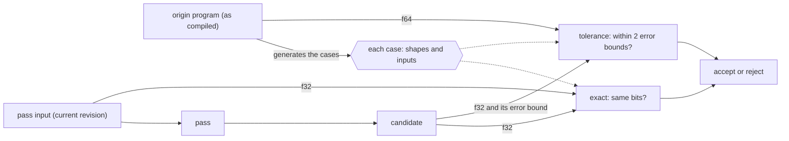

# A second domain on the IR framework: tensor programs, stage 1

## What this was for

The IR Workbench is a TypeScript repository built around a reusable compiler framework: versioned IR artifacts,
adapters that project a native IR onto a graph of entities and relations, contracts that a transformation must
satisfy before its output is accepted, and passes that declare what they write. Until this work the framework had
carried one domain, a small statically typed language compiled to 32-bit RISC-V.

This stage starts a second domain on the same framework: tensor programs, which later stages will compile to CUDA.
The purpose is to find where a framework shaped by one domain does not fit another, so each change to the
framework, with its reason, is the main result. This stage built the language front end,
an IR, two evaluators, a contract for "this pass kept the program's meaning", and two passes that exercise it.

Two framework changes were needed. An independent evaluation then ran a hidden acceptance suite and a differential
cross-check against the result; 22 of 25 hidden tests passed, and all three failures have one cause, described near
the end.

## Tix

Tix is a small index-notation language. Its grammar and its f32 meaning were fixed by the task, so that several
implementations could be compared on it. A program is a list of functions. A function takes tensors whose types
name their dimensions symbolically, and its body is a list of single-assignment statements:

```
fn softmax(x: f32[N, C]): f32[N, C] {
  m[i] = max(j) x[i, j];
  e[i, j] = exp(x[i, j] - m[i]);
  s[i] = sum(j) e[i, j];
  y[i, j] = e[i, j] / s[i];
  return y;
}
```

Each statement defines a new tensor. Its left-hand indices range over extents that are inferred from the right-hand
side: an index used as a whole subscript of a tensor takes that dimension's extent. An index that appears only in
affine subscripts, such as `i` in `x[i + dy]`, takes its extent from a type declared on the statement, as in a
convolution:

```
y[n, o, i, j]: f32[N, O, H - KH + 1, W - KW + 1] = sum(c, dy, dx) x[n, c, i + dy, j + dx] * w[o, c, dy, dx];
```

`sum` and `max` are reductions that bind their own indices, and a reduction's body extends as far right as possible.
The f32 meaning is exact about order and rounding: every literal, operation and function result is rounded to f32,
and a reduction starts from 0 (or negative infinity) and accumulates in increasing lexicographic order of its
indices, rounding after each step. That makes the result of a program a specific bit pattern, not a value up to
rounding, which is what lets a pass be checked for bit-identity.

The grammar leaves some points open, and I had to decide them. Three are worth naming:

- `max(N, D)` (a call on two shape values) and `max(i, j) x[i, j]` (a reduction over two indices) begin with the
  same tokens. I decide by the names: if the parenthesised list is two or more bare names that are all shape names
  of the function, it is a call.
- Shape names are bound when the function is called. I require each shape name to appear as a whole dimension of
  some parameter, which binds it without solving equations.
- For an affine subscript, the checker proves it in bounds for all shapes. It computes the smallest and largest
  value of the subscript over the index extents, which are affine forms in the shape names, and accepts when the
  slack to each bound has non-negative coefficients and is non-negative when every shape name is 1. This is a
  sufficient test. It accepts the convolution above and rejects `x[i + 1]` over the full extent.

A fourth decision was a mistake, and it is the cause of the evaluation's failures: I made index names and tensor
names disjoint. The section on evaluation results comes back to it.

## The IR

The IR is the checked program with every inferred fact made explicit. A function is an ordered list of statements.
A statement is a perfect loop nest over its indices, each with an explicit extent, around an expression tree. A
reduction inside the tree is an inner loop nest with one accumulator.

```ts
interface Stmt  { name: string; indices: Index[]; expr: Expr }
interface Index { name: string; extent: Extent }
interface Aff   { c: number; terms: Record<string, number> }   // c + sum of coef * name
type Extent =
  | { k: 'aff'; aff: Aff }
  | { k: 'min'; a: Extent; b: Extent }
  | { k: 'ceildiv'; a: Extent; by: number };
type Expr =
  | { k: 'lit'; value: number } | { k: 'shape'; name: string }
  | { k: 'ref'; tensor: string; at: Aff[] }
  | { k: 'neg'; a: Expr } | { k: 'bin'; op: '+' | '-' | '*' | '/'; a: Expr; b: Expr }
  | { k: 'call'; fn: 'exp' | 'log' | 'sqrt' | 'tanh' | 'max' | 'min'; args: Expr[] }
  | { k: 'reduce'; op: 'sum' | 'max'; indices: Index[]; body: Expr };
```

I chose this form for three reasons.

First, the meaning of a Tix program is an evaluation order, and a loop nest with an accumulator states that order
directly. An operator graph in the style of ONNX (a `matmul` node, a `conv` node) would hide it, and the two passes
of this stage are rewrites of indices and loops, not of operators.

Second, nothing downstream should repeat inference. The checker resolves every extent to an affine form over shape
names, and the IR stores it on the index. The evaluators and passes read it.

Third, a later stage lowers to loops. The one place where I let that requirement shape this stage is the `Extent`
type. The surface language can only write affine extents. A blocked loop needs `ceil(N / B)` blocks and
`min(B, N - B*jb)` iterations in the last one, where `jb` is the outer loop's index. So an extent may be a `min` or
a ceiling division, and may mention an enclosing reduction index. The alternative was to keep extents rectangular
and express a blocked sum as full blocks plus a separate remainder sum, with floor division and modulo. That needs
as many new extent forms, adds a second reduction per split, and adds a `+ 0` when there is no remainder.

The framework does not see expression nodes. Its view of an IR is a graph of entities and relations supplied by an
adapter. For Tix the entities are functions, parameters and statements, and a statement's expression tree is
attribute data on its entity. Neither pass of this stage needs to match patterns inside expressions.

IR validation is structural: names resolve, ranks match, an extent mentions only names bound outside it. It does not
re-prove subscript bounds, because after a sum is split that proof needs reasoning about `min`. The evaluator checks
every subscript against its dimension instead, and a failed check is a *trap*, an outcome the contract can compare.

## The evaluators

The task asks for two evaluators: f32, which is the program's meaning, and f64, a reference for tolerance checks.
I wrote one evaluator and run it in an *arithmetic*, a small record that says what a value is and how one operation
is computed.

```ts
const plain = (name, r) => ({
  lit: r, shape: r, input: r, zero: 0, negInf: -Infinity,
  add: (a, b) => r(a + b), mul: (a, b) => r(a * b), exp: a => r(Math.exp(a)),
  max: (a, b) => Math.max(a, b), /* ... */
});
export const F32 = plain('f32', Math.fround);
export const F64 = plain('f64', x => x);
```

The order of evaluation, which is the meaning, is written once. The f64 reference cannot disagree with the f32
meaning about which element is added to which accumulator, because it is the same loop. The cost is that a bug in
that one loop is in both evaluators, so the tests compare the f32 results of all six corpus programs with loops
written by hand with `Math.fround`, bit for bit.

There is a third arithmetic, `BOUND`, used only by the contract. Its values are pairs: the f64 value and a bound on
how far the f32 evaluation of the same expression can be from the exact value. The next section explains why it
exists.

## The meaning contract

A pass is accepted only if a contract says its output still means what the program meant. The framework's contracts
include a sampled differential check: generate cases, run a baseline and a subject on each, compare. The tensor
contract is one of those, with a domain, an observation and two relations.



**Domain.** For each function, 16 cases are generated from a seed. Each shape name is drawn from 1 to 8, and a
binding is redrawn if it makes an extent smaller than 1 (a convolution needs the image at least as large as the
kernel) or makes the function's loop work exceed 2^18 steps. Each input element is uniform in [-4, 4), rounded to
f32. A case is the record `{ fn, n, shapes, seed }`; input values are regenerated from the seed. That keeps a case
plain JSON, which the framework requires of a rejection's counterexamples.

**Observation.** The function's result: its shape and elements, or a trap.

**Relations.** `exact` requires the candidate's f32 result to be bit-identical to the f32 result of the pass's
input. `tolerance` compares the candidate's f32 result with the f64 result of the *origin*, the program as first
compiled.

The two relations use different references on purpose. Bit-identity is transitive, so comparing with the pass's
input says "this step changed no bit", and the relation stays usable after an earlier step was accepted under
tolerance. Tolerance is not transitive, so every step is compared with the origin's reference and drift cannot
accumulate across steps unnoticed. A compiled program therefore carries its origin with it:
`TixProgram = { origin, current }`.

### The tolerance, and how I justified it

The simplest rule is a fixed relative tolerance, `max|c - r| <= tau * max|r|`. Before any evaluator existed, I
measured it on four hand-written kernels over the planned domain: a matrix-vector product, softmax, layer
normalisation, and a covariance (a mean of products minus a product of means). Each ran as a sequential sum (the
original), a sum in blocks of four (the correct rewrite), and a wrong blocked sum that drops the partial last block,
200,000 cases each.

The fixed rule does not separate correct from wrong. A correct f32 evaluation of the covariance kernel was up to
9.9e-3 away from its f64 reference in relative terms, because the subtraction cancels. A wrong evaluation was as
close as 1.6e-6, because the dropped term happened to be small. The error of a correct evaluation depends on the
conditioning of the case, not on the size of the result. At `tau = 1e-4` the fixed rule rejected 0.074% of correct
covariance cases; a check that must accept all of its cases turns that into rejected correct passes.

So the tolerance is computed per element, by a first-order running error analysis of the candidate's own
evaluation order. With `u = 2^-24`, a rounded operation whose f64 result is `v`, and whose operands' errors
propagate to at most `p`, has the bound

```ts
const rounded = (v, p) => ({ v, e: p + U32 * (Math.abs(v) + p) });
```

and each operation has a propagation rule: `ea + eb` for addition, `|a| eb + |b| ea + ea eb` for multiplication,
`(ea + |v| eb) / (|b| - eb)` for division, `v * expm1(ea)` for `exp`, `max(ea, eb)` for `max`, and so on. Inputs
and shape values are exact, a literal carries `u * |v|`. The relation is then, per case:

1. if an element of the reference is not finite, the case is inconclusive;
2. if the candidate traps, has another shape, or has an element that is not finite, it disagrees;
3. if an element of the bound is not finite, the case is inconclusive;
4. otherwise it agrees when `|c[i] - r[i]| <= 2 * e[i]` for every element.

On the same four kernels this rule rejected no correct case, at factor 1 or 2, and accepted at most 0.001% of wrong
cases. The correct evaluations came within 0.94 of the bound, so the bound is not loose. The factor 2 is margin for
what a first-order bound leaves out: second-order terms, the f64 reference's own error, and JavaScript's `exp`,
`log` and `tanh` not being correctly rounded.

After the evaluators existed I repeated the measurement on the real corpus through them. Over 48 cases per program
no element exceeded its bound, and the largest error as a share of the bound was 0.70 (convolution), 0.57 (layer
normalisation, matrix product), 0.46 (MLP, softmax) and 0.07 (attention).

The bound is a first-order estimate, not a proof. It is also computed on the candidate, so a wrong pass that makes
its program ill-conditioned widens its own allowance.

## The two passes

**`inline`** substitutes a statement into its consumer when the statement is pointwise (no reduction), is not the
function's result, and is referenced exactly once. The reference `d[a1, ..., an]` becomes d's expression with d's
k-th index replaced by the affine form `ak`; affine forms compose, so `u[j + 1, j + 1]` over
`u[a, b] = z[a, b] - t[b]` becomes `z[j + 1, j + 1] - t[j + 1]`. It claims `exact`: the f32 meaning rounds every
operation separately, and an inlined expression performs the same operations on the same values.

**`split-sum`** rewrites a `sum` over one index into two levels:

```
sum(j) body        becomes        sum(j_b) sum(j_i) body[j := 4*j_b + j_i]
                                  j_b in ceildiv(E, 4),   j_i in min(4, E - 4*j_b)
```

It reassociates the sum, so f32 results change, and it claims `tolerance`.

Each has a deliberately wrong variant, kept out of the public pass table. The wrong inline binds the definition's
indices to the subscripts in reverse order. The wrong split uses `floor(E / 4)` full blocks and loses the partial
last one.

The verdicts on the corpus, wherever a pass changes the program:

| Pass | under `exact` | under `tolerance` |
| --- | --- | --- |
| `inline` | accepted | accepted |
| `split-sum` | rejected | accepted |
| wrong inline | rejected | rejected |
| wrong split | rejected | rejected |

The table has gaps that I did not see until I ran it. No pass changes the convolution program: its sum has three
indices and it has no pointwise statement. And the wrong inline is only wrong for rank 2 and above, so on layer
normalisation, whose one inlinable statement has rank 1, it is the correct pass and is accepted. The table rests on
four programs for the split and on two (attention, MLP) plus small test programs for the wrong inline.

The domain matters here. With blocks of four, an extent below 6 gives the same bits as the sequential sum, and
`exact` rejected `split-sum` on only 3 to 7 of each program's 16 cases. A domain of extents 1 to 4 would have
accepted it as bit-identical.

## The framework changes

Before designing on the framework I ran it against a toy second domain: an adapter, a pass that returns a new native
value, a wrong pass, and a contract. The first call failed, and the script's output became the evidence for both
changes. Both are in the framework's pass module.

**A pass can be applied and gated without a Promise.** The task fixes `optimizeTix(program, passes)` as a function
that returns its result directly. The framework's `applyPass` is `async`, because the analysis manager that
evaluates contracts is, even when the pass, the check and every callback are synchronous. The first domain never met
this, because its pipeline runner is itself asynchronous. I added

```ts
applyPassSync(pass, before, { params?, outputId?, check }): PassResult
```

for passes with no declared analyses that return synchronously. The part of `applyPass` between the pass's return
and the contract gate (build the output artifact, diff the two projections, build the entity correspondence,
enforce the declared writes) moved into one internal function that both entry points call. The gate is a required
`check` callback. For tensors it runs the same differential specification that the asynchronous path wraps in a
contract. What is lost is the manager's record: the synchronous path leaves no evidence history. The asynchronous
path still works for the same passes, and a test asserts that both give the same verdicts.

**A pass's graph edit is opened only when the pass asks for it.** `applyPass` opened an edit on the entity graph
before running any pass, and opening an edit requires the adapter to implement `rebuild`, the translation from an
edited graph back to the native value. A domain whose passes all return native values would have to write that
translation, for Tix that means rebuilding expression trees from attribute data, and nothing would call it. The edit is now
created on first access.

The differential check itself needed no change: its `run` callback is told which side it is running, so the
reference can run in f64 and the candidate in f32.

A reviewer read the design before implementation and caught two failures on the asynchronous path that I had not
seen: contract objects must be cached, one per parameter set, and counterexamples must be JSON. Both would have
appeared as a rejection with the wrong reason, so the parity test asserts the rejection's message, not only the
verdict.

## How I checked the work

There are 33 tests of the tensor domain and 6 of the framework changes, placed where I judged the risk to be:

- evaluation order and rounding: all six corpus programs against hand-written `Math.fround` loops, bit for bit;
- the checker: the grammar's open points and 35 check errors with positions;
- the bound: on the corpus, no f32 result further from f64 than its bound;
- the passes: the verdict table, and `split-sum` against hand-blocked loops at extents 1, 3, 4, 5, 8 and 11;
- the framework: the synchronous path, the lazily opened edit, and parity with the asynchronous path.

Writing the tests found two defects: an error position that pointed at a subscript's operator instead of its start,
and a rejection reason that printed `-0` as `0`. The framework's own 231 tests pass, and of the 53 tests of the
first domain that apply passes, 52 pass and 1 is skipped in the test file.

## Evaluation results

The stage was evaluated independently, on the committed revision.

| Check | Result |
| --- | --- |
| Hidden acceptance suite, 25 tests of the fixed language and API | 22 passed, 3 failed |
| The same suite with one index renamed in its MLP program | 25 passed |
| Differential cross-check, 60 random programs, 3 inputs each, f32 | bit-identical in 180 of 180 |
| The same, `precision: 'f64'`, within 1e-9 relative | 180 of 180 |
| `optimizeTix(p, ['inline'])` on the 60 programs | accepted on 60, every result bit-identical to the original |
| `optimizeTix(p, ['split-sum'])` on the 60 programs | accepted on 60, every result the same function (f64 within 1e-9) |

The three failures are the suite's f32 test of an MLP program, its f64 test of the same program, and its test that
`inline` is accepted on the corpus programs, which includes that program. All three stop at the same compile error:

```
5:8: 'x' is a tensor and cannot be an index
```

The suite's MLP ends with `y[i, x] = (sum(f) g[i, f] * w2[f, x]) + b2[x];`, where `x` is an index and is also the
function's input tensor. My checker rejects that at `src/tensor/check.ts:123-124`:

```ts
if (tensors.has(n.name) || n.name === s.name)
  throw new TixError(n.pos, `'${n.name}' is a tensor and cannot be an index`);
```

The cause is a rule I added, not one the language has. The task's grammar does not say whether an index may share a
name with a tensor. In my design I wrote that shape names, tensor names and index names are disjoint within a
function. I needed part of that: a bare name in an expression must be a shape name, which is how `max(N, D)` is told
from a reduction, so an index cannot share a name with a *shape*. I did not need the rest. A tensor name only ever
appears before `[`, and an index name only inside subscripts and binder lists, so the two can never be confused, and
nothing after the checker depends on them being different: IR validation, the evaluator and both passes keep index
names and tensor names in separate tables. I extended a rule that had a reason to a case where it had none, and in
doing so narrowed the language the task had fixed.

I think the suite's reading is the right one and the failure is mine. Removing the two lines above would accept the
program; I reproduced the failure and the renamed variant's success with a script in the ticket
(`scripts/04-repro-index-named-like-tensor.mjs`), and did not change the evaluated code. My own corpus MLP uses
other index names, which is why my tests did not find it.

The cross-check found no other difference on its 60 random programs.

## What I would do differently

**Resolve open points of a fixed language towards accepting more.** Where the grammar was silent I decided, and each
decision was either forced (the `max(` ambiguity) or a restriction I found tidy (disjoint names, no shadowing). The
tidy ones are where an independently written program can fail to compile. I should have asked, for each rule, which
later component needs it, and dropped the rule when the answer was none.

**Choose wrong variants that are wrong everywhere.** The reversed-subscript inline is correct for rank 1, which left
a hole in the verdict table and an odd assertion in the tests (that a "wrong" pass is accepted). A variant that
drops a subscript's constant term, or substitutes the wrong statement, would have no such case.

**Make the corpus exercise the passes.** The convolution program is untouched by all four passes, so the contract
was never shown on a three-index reduction. A corpus program with a bias statement feeding the convolution, or a
`split-sum` that handles the innermost index of a multi-index sum, would close that.

**Probe the front end as I probed the rest.** The tolerance rule changed because a short probe contradicted my
first choice, and both framework changes came from a probe that failed on its first call. I wrote no adversarial
programs before the checker. A handful would likely have found the naming rule.
