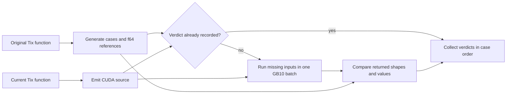

# Checked lowering of Tix to CUDA

A matrix product with 512 terms per output gave the same 262,144 binary32 words on a GPU as it did in a JavaScript interpreter. Softmax, on the same two engines, gave different words at more than a million positions. Both kernels traversed their reductions in the prescribed order. The difference arose earlier, when one backend evaluated the exponential in single precision and the other rounded a JavaScript exponential to single precision. The distinction matters when specifying what a compiler pass preserves.

Tix is a small language for tensor index notation. It was added to the IR Workbench, a compiler framework originally exercised on a statically typed language targeting RISC-V, to find out how much of the framework another domain could use. This stage added a CUDA backend with a remote execution step inside its acceptance check. The evaluated revision was `816012a`, running CUDA 13.0 on an NVIDIA GB10. All six corpus programs passed the sampled numerical contract. The more informative results are which programs also preserved every f32 bit, where that stronger property failed, and how little framework machinery the remote check required.

## From a statement to a kernel

A Tix function takes named, row-major f32 tensors and returns one tensor. Each statement defines a fresh tensor. For example, `y[i,j] = sum(k) a[i,k] * b[k,j];` defines an output matrix with one sequential dot product per element. The function signature supplies the relationship among dimensions, while the call supplies their sizes. The stage-1 compiler resolves names, infers iteration extents and represents addresses as integer affine expressions. Its f32 evaluator rounds every scalar result, including every step of a reduction. A second evaluator traverses the same tree using JavaScript double precision.

The backend emits CUDA directly from the selected function in the current program revision. Its input already specifies which values to materialize, which indices are free and which are bound, and exactly where each accumulator starts and ends. The stage has one fixed thread mapping and no transformations between mapping and printing. A separate kernel IR would have repeated those decisions and required another representation to validate. Direct emission also made the candidate for the acceptance check unambiguous. The check receives the complete source text produced by the transformation.

Each statement becomes a kernel with a flat output index. The host launches blocks of 256 threads. A thread inside the output range unpacks its index from the last axis to the first and evaluates the scalar expression for that coordinate. Loads fold affine coordinates into row-major offsets using wide integer arithmetic. The following excerpt starts immediately after the two operand loads inside the matmul kernel’s loop over the shared dimension.

```cuda
    float v4 = __fmul_rn(v5, v6);
    v2 = __fadd_rn(v2, v4);
  }
  out[flat] = v2;
```

The two rounding sites are visible. A fused multiply-add could produce a different low bit even with exactly the same loop order. The accumulator starts at positive zero for a sum and negative infinity for a maximum. For a reduction over several indices the first listed index is the outer loop. Empty reductions return their initial value. Empty outputs need no launch. Min and max propagate NaNs and explicitly resolve ties between signed zeros. The emitter takes literal bits from the host's f32 conversion so the CUDA compiler need not interpret the original decimal spelling.

The same traversal works after either of the stage-1 rewrites. Inlining substitutes the producer expression and composes its affine addresses. A blocked sum introduces an outer accumulator over blocks of four and an inner accumulator whose final extent may be shorter than four. Both accumulators appear in the emitted kernel. Collapsing them back into one would undo a rounding decision made by the optimizer. Binder IDs distinguish two reductions that use the same index spelling, and generated CUDA identifiers keep a tensor name distinct from a loop variable.

## What it means to accept a lowering

The executable API has three entries. `cudaSource` returns a translation unit with kernels and a file-driven host program. `runTixCuda` executes it on concrete f32 inputs and returns the output shape, data and kernel time. `checkLowering` runs a versioned transformation whose postcondition executes its actual text output on the remote GPU. The public program handle contains both the original and current Tix revisions. The checker uses them for different purposes.



For each selected case the shapes must agree. For each finite original f64 result element r, the GPU value must be finite and its absolute error must be at most `2e-6 + 2e-5 * abs(r)`. The absolute allowance matters near cancellation. The relative allowance scales with the size of the result. This was the existing stage-1 budget for rewrites that may reassociate a sum. Checking against the origin charges the whole pipeline to that budget, even when the caller supplies an already optimized function. Comparing the GPU only with the optimized interpreter would answer a useful lowering question while overlooking error accumulated before emission.

The case generator starts from the original function signature. It tries shape assignments of 1, 3, 4 and 7, then an asymmetric assignment cycling through 3, 5 and 7. This exercises singletons, complete blocks and partial blocks as well as differently sized axes. The inputs include signed and positive streams generated with seed 20 and a repeating sequence containing half-ULP terms that expose reassociation. Duplicate shapes are removed. The generator limits tensor sizes to 4,096 elements and reference evaluation to a million metered visits and loop iterations per case. It retains cases in the valid address domain with finite f64 outputs. An empty set of decided cases cannot establish agreement. Special values outside the finite-reference sample are also exercised in execution tests.

The reference tensors are built inside case generation, which lets the framework reuse them with the inputs. The differential checker keys the baseline by original revision and function, together with its own invariant version, seed and configuration. A digest of the emitted source identifies the candidate. On a cold check the async decision callback receives all outstanding case indices, packs their inputs in one binary file and makes one remote invocation. On a repeat it can replay the decisions without a remote round trip. Cache validity assumes a fixed host, driver, toolkit and compiler mode during the process lifetime. Compile and transport errors provide no reusable numerical verdict.

## The numerical experiment behind the contract

The design probe ran 8,192 exactly representable input pairs through twelve calculations each on the GB10 with `nvcc -O3 -arch=sm_121`. The local comparison used JavaScript operations rounded at each f32 site and a separate unrounded f64 reference. Addition, subtraction, multiplication, division, negation, square root, min, max and a seven-term sequential fold all matched the f32 values on those inputs. The three other operations supplied direct counterexamples.

| Emitted operation | Unequal f32 results / 8,192 | Input | JavaScript rounded to f32 | CUDA float |
|---|---:|---:|---:|---:|
| expf | 2,468 | −3.986328125 | 0.0185677669942379 | 0.01856776885688305 |
| logf | 626 | 0.0751953125 | −2.5876662731170654 | −2.5876665115356445 |
| tanhf | 1,262 | −3.6123046875 | −0.9985442161560059 | −0.9985441565513611 |

Each pair of displayed outputs differs by one f32 step. A second, untimed test sent the three witnesses through the evaluated public backend in one Tix function. It reproduced every one-step difference, isolating a single intrinsic in each output lane. [Probe source](../scripts/06-intrinsic-witnesses.mjs) Across all 98,304 observations, the largest error relative to the allowed f64 budget used 0.967% of that allowance, in the seven-term fold. That fold agreed exactly with the f32 interpreter. Its distance from f64 measures accumulated rounding even when the backend implements every f32 step identically. The probe gives both a falsifier for exact f32 equivalence of the complete instruction set and a measurement for the sampled tolerance. A finite probe cannot give a worst-case bound for arbitrary compositions of those instructions.

## Framework and remote execution

Stage 2 changed zero files under `src/framework/`. The workbench pass runner normally prepares a second artifact of the same representation, checks a graph diff and tracks writes. Stage 1 had already added a synchronous entry point for native rewrites. Neither operation fits a change from Tix to source text followed by a remote check. The existing semantic transformation API does fit: it accepts differently typed inputs and outputs and can await a differential invariant. A framework probe delegated two missing cases together on the first invocation and replayed both on the second. Tensor-specific source generation, input framing and reference selection therefore stayed in the tensor backend.

One tool needed a change. The remote helper had used a single hash directory for compiling, running and fetching results. Two simultaneous submissions of identical files could share an executable, but they could also clear each other's output before retrieval. The revised helper gives each invocation a private remote working directory through the end of the download. It protects creation of the executable with a per-hash lock and publishes a completed binary by rename. The compile cache still includes all uploaded inputs and the target architecture. Two concurrent cold submissions produced exactly one compile and two identical 393,216-byte results. The compile lock serves a different purpose from the existing GPU timing lock.

## Kernel and interpreter timings

The host allocates device buffers and copies inputs before timing. It calls `cudaFuncGetAttributes` for each generated kernel before recording a start event, including for a single call through the public API. This moves CUDA's lazy kernel loading outside the measurement. CUDA events surround the ordered launch sequence on one stream. The host synchronizes the stop event before reading elapsed time. This measures elapsed GPU time across the sequence, including gaps between kernels. Compilation, startup, transfers and result decoding are outside the interval.

For the measurements below the original corpus programs received the same seeded f32 inputs on the two machines, with positive epsilon for layer normalization. Each GB10 benchmark used the helper's timing lock, one warm-up and three timed intervals in one process. The table reports their median. The interpreter figures are single Node 24.18.0 wall-clock intervals after a small warm-up on the shared local machine. They include intermediate tensor materialization and exclude input generation. The independent evaluator also reported the public API's event time at the same shapes. Its figures are separate observations with their own inputs and run conditions.

| Function | Dimensions | GB10 median (ms) | Local interpreter (s) | Independent gpuMs (ms) |
|---|---|---:|---:|---:|
| matmul | M=K=N=512 | 0.249888 | 139.604 | 0.255 |
| softmax | N=4096, C=1024 | 0.509792 | 15.800 | 0.448 |
| layernorm | N=4096, D=1024 | 0.467584 | 25.380 | 0.480 |
| attention | Q=K=1024, D=V=64 | 1.003040 | 192.660 | 1.394 |
| mlp | N=1024, D=256, H=1024, O=256 | 0.925056 | 813.613 | 0.819 |
| conv2d | N=8, C=16, H=W=64, O=32, kernel 3×3 | 0.162048 | 399.577 | 0.351 |

The local benchmark retained output shapes and endpoint values for a cross-machine spot check. [Local records](cpu.jsonl) · [GB10 records](gpu.jsonl) The independent evaluation compared every output element at these sizes. End-to-end remote latency is much larger than an event time. The independent calls to the sampled contract averaged 6.0 seconds per function. That distinction is why batching and replay matter even when most of a kernel sequence finishes within a millisecond.

## Independent evaluation and attribution

The hidden stage-1 suite passed 25 of 25 tests and the three new exports were present. The following tables reproduce the coordinator's observations for the evaluated revision. “Exact” counts binary32 words identical to the f32 interpreter. The f32 error column is the largest difference scaled by max(1, |r|). The f64 column gives the separately reported largest difference from the double reference. For the optimized comparisons the f32 comparator executed the **optimized** program. A changed grouping of additions is therefore shared by both sides of that comparison.

| Small program | Exact / elements | Largest f32 error | Largest f64 difference |
|---|---:|---:|---:|
| matmul | 35/35 | 0 | 3.2e−7 |
| softmax | 54/76 | 3.0e−8 | 5.3e−8 |
| layernorm | 72/72 | 0 | 1.3e−7 |
| attention | 56/72 | 6.0e−8 | 6.6e−8 |
| mlp | 21/24 | 8.9e−8 | 3.6e−7 |
| conv2d | 160/160 | 0 | 3.1e−7 |

| Small program after inline and split-sum | Exact / elements | Largest f32 error | Largest f64 difference |
|---|---:|---:|---:|
| matmul | 35/35 | 0 | 2.2e−7 |
| softmax | 56/76 | 3.0e−8 | 4.9e−8 |
| attention | 47/72 | 3.0e−8 | 4.4e−8 |
| mlp | 18/24 | 1.2e−7 | 3.4e−7 |

| Original program at benchmark size | Exact / elements | Largest f32 error |
|---|---:|---:|
| matmul | 262,144/262,144 | 0 |
| softmax | 2,616,298/4,194,304 | 3.7e−9 |
| layernorm | 4,194,304/4,194,304 | 0 |
| attention | 10,618/65,536 | 3.7e−8 |
| mlp | 231,045/262,144 | 2.2e−5 |
| conv2d | 984,064/984,064 | 0 |

Softmax's first differing operation is the exponential of a shifted logit. The emitter selects `expf` at `src/tensor/cuda-source.ts:29`. The interpreter uses `Math.exp` in double precision and rounds the result to f32. Once one numerator changes, the row sum can change, and division by the common denominator can move other entries in the row. This explains how many probabilities can change at a very small absolute scale. Attention uses the same exponential after subtracting the row maximum of the scores. The change in normalized weights then reaches the final weighted sum over values. The square root in the score scaling and the explicitly rounded dot-product updates agree with the interpreter on identical operands.

The MLP's first differing operation is `tanhf`, selected at `src/tensor/cuda-source.ts:31` for the GELU approximation. Its result enters a product with the hidden activation. The second matrix multiplication combines many such values with signed weights. Thus an error at a hidden unit can reach many outputs, and cancellation can leave a larger scaled final difference. The large MLP's 2.2e−5 is a discrepancy against **f32**. The contract compares small sampled cases against **origin f64**. That number alone cannot decide its verdict. Matmul, layernorm and convolution contain none of the three discrepant transcendentals, so exact agreement on all their tested f32 elements is consistent with their nonzero distances from f64. Both f32 engines round intermediates that the f64 evaluator carries onward.

Of 20 random fixed-core programs, 16 matched f32 on every element; the largest reported difference was 1.2e−7. In addition to the two corpus operations, the emitter selects `logf` at `src/tensor/cuda-source.ts:30`, which has its own scalar counterexample. The aggregate for the random set does not identify the expressions or the first differing operands in the four affected programs. It supports attribution to the float transcendental family, without establishing a count for each intrinsic. In a separate test of contract acceptance, all six corpus functions and ten random functions passed, 16 of 16 with relation `tolerance`.

## Verification and what I would change

The build passed and all 29 tensor tests passed, including the dedicated live GPU tests. Besides checking corpus returns, tests exercised transposed inline reads, split tails, nested reduction scopes, ordered cancellation, empty dimensions, signed zeros and NaN propagation. A deliberately wrong but compilable candidate replaced a final store with zero. The real transformation rejected it with a differing coordinate. A second check of an unchanged good candidate reused the previous decisions. In a separate live run, all six corpus functions passed after requesting inline followed by split-sum; five executable revisions changed. The convolution's single multi-index reduction supplied no rewrite opportunity.

Of the two proposed uniform relations, sampled tolerance against origin f64 is the strongest the evaluated backend supports across the fixed core. The scalar witnesses disprove exact f32 for the instructions it actually emits. The error budget is empirical; the measurements establish neither its optimal constants nor a bound for every program and input. A stronger check is possible for restricted functions, and a different choice of intrinsic can change the answer for the whole language.

I would probe the double CUDA functions alongside the float functions before choosing the lowering. Independently, the coordinator compared double `exp`, `log` and `tanh` followed by `__double2float_rn` with the corresponding rounded JavaScript calls for **all 2³² binary32 input patterns** on the GB10. They agreed for every input with NaNs compared as a class. Together with IEEE-mode arithmetic, correctly rounded square root and the preserved evaluation order, that supplies an operation-by-operation basis for checking exact f32 agreement against the *current* Tix revision with that alternative emission. An earlier split-sum still has its own obligation to the origin. The evaluated source uses the float calls; the times in this report measure that choice. I would also retain a first differing intermediate and its operands for each generated-program failure. That small piece of evidence would make per-program attribution possible even when publishing only aggregate output statistics.
