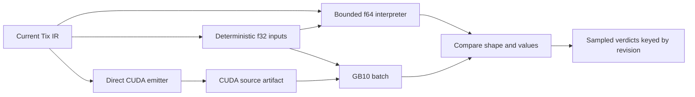

# Direct CUDA lowering for Tix

Tix is a small index-notation language for tensor programs. It was built to test whether IR Workbench, a TypeScript compiler framework also used for a typed RISC-V language, can support a second domain with different rules for program equivalence. Stage 1 gave Tix a checked tensor IR, interpreters at two precisions, and two checked rewrites. Stage 2 emits and runs CUDA for that same IR. It uses the framework to check a transformation whose input is a tensor program, whose output is CUDA source, and whose evidence arrives from a remote GPU. This report describes the evaluated revision `6685804` and a subsequent diagnostic probe that left that revision's implementation intact.

In Tix, every statement defines a tensor, and the right-hand side specifies the scalar computation at each output coordinate. A reduction binds one or more indices and visits them in lexicographic order, with the first listed index outermost. The f32 interpreter rounds every scalar operation and fold step with JavaScript's `Math.fround`. Its f64 mode uses the same tensor accesses and reduction structure with JavaScript number arithmetic. An optimizer can remove a pointwise definition by inlining its expression or replace a sum with width-four blocks, each with its own accumulator. The latter can change the f32 result, so CUDA lowering takes the current checked revision as its input and uses that revision's reduction tree.

## From tensor definitions to CUDA

The emitter produces a complete CUDA C++ translation unit for a selected function. Each tensor definition becomes one kernel. Kernels run in statement order on a single stream, with 128 threads per block and one active thread per output element. A thread's linear position determines its row-major coordinate. The emitter substitutes resolved binder identities into affine tensor accesses and computes each flat offset with 64-bit integer arithmetic. The host reads the bound dimensions from input shapes and passes them, the element count and the tensor pointers as kernel arguments.

Each reduction becomes a sequential loop nest within the thread that owns its result element. A sum starts at positive zero and uses `__fadd_rn` at each update. A maximum starts at negative infinity and applies the same max helper as a scalar max expression. A split sum retains the two accumulators introduced by the optimizer, including the partial last block. This matters even for a seven-element row. With the inputs `[1, 0, 0, 0, 2^-24, 2^-24, 2^-24]`, the ordinary f32 sum is 1 and the blocked f32 sum is 1.000000238418579. The GPU test observes the same two-stage rounding in the optimized program. The emitter skips a launch for an empty output tensor. A nonempty output with an empty reduction domain still produces the appropriate initial accumulator.

The following excerpt is from softmax's exponential kernel, just after it decodes the output coordinate. The preceding kernel has already stored the maximum for each row. Each source scalar operation becomes a float temporary, so the subtraction has an explicit rounding point before the exponential.

```cpp
const float value2 = tensor0[(index1 * dim1 + index0)];
const float value3 = tensor1[index1];
const float value4 = __fsub_rn(value2, value3);
const float value5 = expf(value4);
tensor2[element] = value5;
```

The compiler runs `nvcc -O3 -arch=sm_121`. The emitter calls `__fadd_rn`, `__fsub_rn`, `__fmul_rn`, `__fdiv_rn` and `__fsqrt_rn`. Unary negation flips the sign. A shape scalar uses `__ll2float_rn`, and a literal embeds the single-precision word that the interpreter gets from the decimal spelling. The min and max helpers propagate NaNs and choose the zero sign according to JavaScript's rules. If both operands are zeros, max yields negative zero only when both are negative, and min yields it when either is negative. The transcendental operations use CUDA's single-precision `expf`, `logf` and `tanhf`. Those three choices determine the numerical relation available to this backend. [Emitter](../../../../../../src/tensor/cuda-source.ts#L17)

### Why emit directly

The input IR already records definition order, free axes, bound reduction indices, loop bounds and affine accesses. The backend needs exactly that information to print its fixed mapping. A second kernel IR would repeat those decisions and require a second adapter and validator before printing the same CUDA. The actual output is a small content-addressed contract artifact that carries the translation unit, its function name and the binary protocol version. It gives the checker an exact candidate to execute and identify without introducing another editable representation.



The public operations expose different parts of that path. `cudaSource` returns the translation unit. `runTixCuda` runs it on caller-supplied f32 tensors and returns result shape, data and CUDA-event milliseconds. `checkLowering` runs the checked transformation on a fixed set of cases and returns a verdict with the relation and, on rejection, a reason. Each path emits from the same Tix revision. Checking a function does not require repeating the differential experiment on each subsequent user input. [Public API and transformation](../../../../../../src/tensor/cuda.ts)

## The numerical contract

The contract compares a GPU output `g` with the f64 interpreter output `r` on the same f32 input words and the same selected IR revision. It first checks output shape and element count. For every coordinate in every admitted case it requires

```text
isFinite(g) && abs(g - r) <= 2e-6 + 2e-5 * abs(r)
```

The absolute term covers results near zero. The relative term scales the allowance with the reference magnitude. The constants are inherited from Stage 1's sampled tolerance and were checked on this stage's own cases. Before implementation, the CPU f32 interpreter spent at most 24.67% of the allowance across the six corpus programs and four requested rewrite sequences. The equivalent calibration after implementation gave the same maximum on the GB10, in conv2d. A test also makes the limit concrete. For `(16777216 + 1) - 16777216`, the f32 interpreter and GPU both produce zero, while the f64 reference gives one. The checked lowering rejects that sampled result. The check therefore establishes an f64 output budget on its cases, even when ordinary f32 execution itself exceeds that budget.

The sampler tries uniform symbolic dimensions of 1, 3, 4 and 7, then a mixed assignment and an all-zero assignment. The mixed assignment cycles through 3, 5 and 7 in sorted symbol order, so distinct axes need not happen to have the same length. It deduplicates assignments and uses seed 20. For each eligible shape it tries signed and positive seeded data, a sequence containing half-ULP contributions, and alternating signs of zero. The bounded reference evaluation limits tensors to 4,096 elements and the evaluation to one million scalar visits and loop iterations. It screens invalid executed accesses and retains cases whose f64 result is finite at every coordinate. A function with no eligible case has no accepted verdict. The ordinary CUDA runner and the dedicated tests also exercise cases with nonfinite results, such as an empty maximum. [Sampler](../../../../../../src/tensor/samples.ts) · [GPU calibration](../scripts/03-corpus-calibration-gpu.jsonl)

The design probe established that an exact f32 output comparison would reject the chosen device intrinsics. On the GB10, over 65,536 inputs per operation, `expf`, `logf` and `tanhf` differed from their rounded JavaScript counterparts in 19,892, 2,148 and 2,447 trials. The tested arithmetic, square root, extrema, shape casts and literal loads agreed, with NaNs compared as a class. A separate multiply-add returned zero with explicit separate rounding and `2^-46` when the compiler contracted the operations. A cancellation-heavy ordered sum agreed with the f32 interpreter bit for bit while spending 2.93 times the fixed f64 allowance. Together with the corpus calibration, these results support the selected budget for the sampled workloads and show why it cannot serve as a uniform error bound for all Tix programs. [Original numerical probe](../scripts/01-gb10-probe/observed.json)

## The framework and the remote runner

The framework needed zero source changes. The lowering uses `AnalysisManager.execute` with distinct input and output artifact types and an asynchronous invariant in its postcondition. The same-adapter pass runner is suited to editing a program in place. Here the typed transformation already has the right boundary. The existing differential invariant's `decide` hook lets the tensor layer submit all uncached cases for one function in a single remote batch. It returns the verdicts in case order after fetching and comparing the results. A numerical disagreement records its coordinate, the expected and observed values, the allowance and the case description.

There are two forms of reuse. The invariant's baseline key identifies the current Tix revision and the function, with the case policy and seed scoped by the invariant. The subject key identifies the emitted CUDA artifact. The existing process-local memo retains generated cases, f64 references and decided comparisons. While the entry is resident, a repeated check on the same candidate makes zero remote calls. Transport and compilation failures leave the cases available for retry because the batch never returns a set of decisions. The memo assumes a stable GPU target for the lifetime of the Node process. Separately, the remote binary cache allows different inputs to use the same compiled CUDA. Keeping the two caches distinct lets the checker reuse decisions while ordinary function calls can evaluate new data with the same executable.

The generated host program reads a versioned little-endian case file. It contains shapes and contiguous f32 words, in parameter order, for each case. The host allocates device buffers for nonempty tensors, copies parameter data, runs the kernels and writes a result record containing shape, timing and data. The Node wrapper verifies the response header, count and record lengths. The same protocol serves a one-case call and a differential batch.

The remote tool originally hashed the entire upload directory and used the hash directory as the execution workspace. Stage 2 added repeatable `--input` arguments to identify runtime data. The tool uploads these files while excluding them from the compile key. The key covers compile file names and bytes, the compiler path and effective flags, with a remote compiler-version component. Each invocation now uploads, executes and fetches outputs in a private directory that it cleans up afterward. This keeps two concurrent calls that share one executable from overwriting each other's input or result files. A per-key compile lock serializes installation. The tool compiles a temporary executable and atomically moves it into the cache only after a successful compile. The existing timing lock is used for benchmark executions. [Remote tool](../../../../../../tools/cuda-remote.mjs)

## Verification and performance

The checked-out implementation built with `npm run build` and passed all 26 tests in `node --test tests/tensor/*.test.mjs`. Local tests verified source selection and serialization and exercised the existing interpreter and optimizer. The separate GPU file checked original and optimized corpus programs, rounding sites, the order of multi-index folds, split tails, empty extents, parameter returns, index shadowing, transposed reads and JavaScript extrema. One test changed an emitted kernel to store zero and verified that the actual contract rejected it. Another checked that repeated verification replayed the decisions, and a concurrent run checked that two inputs with one compile key returned independent outputs. The post-evaluation build also succeeded before running the diagnostic probe. [Verification record](02-cuda-verification-and-corpus-timings.md)

Our performance run used the original functions with identical finite, row-major f32 inputs on both engines. Seed 20 generated values in `[-0.25, 0.25)`, with a positive epsilon of `1e-5` for layernorm. The GPU ran on an NVIDIA GB10 at `sm_121` with nvcc 13.0.88 and driver 580.178.04. The generated host preloaded kernel code with `cudaFuncGetAttributes`, then recorded CUDA events around the full ordered sequence of launches on one stream. Input copies preceded the events and result copies followed them. The interval includes the gaps between launches. Each corpus timing is the median of five recorded intervals after one warm-up in a single timed job. For the interpreter, the local Intel Core i7-1165G7 ran Node 24.18.0. A short warm-up preceded a single full-size wall-clock reading, including interpreter buffer allocation. The CPU was shared, and the GPU interval measures device execution rather than the remote API's end-to-end latency.

| Program | Dimensions | GB10 kernels (ms) | Local f32 interpreter (s) | Max absolute GPU–CPU difference |
| --- | --- | ---: | ---: | ---: |
| matmul | M=K=N=512 | 0.242 | 176.436 | 0 |
| softmax | N=4096, C=1024 | 0.906 | 15.211 | 4.66e-10 |
| layernorm | N=4096, D=1024 | 0.681 | 25.442 | 0 |
| attention | Q=K=1024, D=V=64 | 0.878 | 197.902 | 8.38e-9 |
| mlp | N=1024, D=256, H=1024, O=256 | 0.979 | 819.716 | 1.43e-6 |
| conv2d | N=8, C=16, H=W=64, O=32, 3 × 3 kernel | 0.201 | 390.126 | 0 |

The output check in this table uses the f32 interpreter, whereas the acceptance contract uses f64. The event readings, including the discarded warm-up and runner metadata, are recorded with the benchmark inputs' dimensions and seed. [Raw timing data](../scripts/04-benchmark-results.json)

## Independent evaluation and mismatch diagnosis

The independent Stage 1 hidden suite passed 25 of 25 tests and confirmed the three new exports. The evaluator also called `runTixCuda` on the six corpus programs with small inputs. Four optimized comparisons were supplied after `optimizeTix(p, ['inline', 'split-sum'])`, each using the matching optimized f32 reference. The f32 differences below are scaled by `max(1, abs(r))`. The f64 column reproduces the evaluator's reported differences from f64. The rows with matching f32 words can still differ from f64 because the f32 calculation rounds throughout.

| Small program | Revision | f32 words equal | Max scaled f32 difference | Max f64 difference | Source of f32 divergence |
| --- | --- | ---: | ---: | ---: | --- |
| matmul | Original | 35/35 | 0 | 3.2e-7 | — |
| softmax | Original | 54/76 | 3.0e-8 | 5.3e-8 | `expf` |
| layernorm | Original | 72/72 | 0 | 1.3e-7 | — |
| attention | Original | 56/72 | 6.0e-8 | 6.6e-8 | `expf` |
| mlp | Original | 21/24 | 8.9e-8 | 3.6e-7 | `tanhf` |
| conv2d | Original | 160/160 | 0 | 3.1e-7 | — |
| matmul | Optimized | 35/35 | 0 | 2.2e-7 | — |
| softmax | Optimized | 56/76 | 3.0e-8 | 4.9e-8 | `expf` |
| attention | Optimized | 47/72 | 3.0e-8 | 4.4e-8 | `expf` |
| mlp | Optimized | 18/24 | 1.2e-7 | 3.4e-7 | `tanhf` |

At the brief's full sizes, the independently reported `gpuMs` and f32 comparison were as follows. These are separate observations from the benchmark above.

| Full-size program | f32 words equal | Max scaled f32 difference | Reported `gpuMs` | Source of f32 divergence |
| --- | ---: | ---: | ---: | --- |
| matmul | 262,144/262,144 | 0 | 0.244 | — |
| softmax | 2,616,298/4,194,304 | 3.7e-9 | 0.404 | `expf` |
| layernorm | 4,194,304/4,194,304 | 0 | 0.490 | — |
| attention | 10,618/65,536 | 3.7e-8 | 1.577 | `expf` |
| mlp | 231,045/262,144 | 2.2e-5 | 1.003 | `tanhf` |
| conv2d | 984,064/984,064 | 0 | 0.358 | — |

Softmax calls `expf` on each input minus its row maximum. An exponential that rounds differently affects the numerator and can also affect the row sum used as a denominator. Attention has the same divergence in the exponential of the shifted score. The normalization and weighted value sum then take those changed weights as inputs. Attention's square root uses the explicitly rounded `__fsqrt_rn`. The MLP uses `tanhf` inside its GELU activation. A change in that value can propagate through the activation and into the second affine layer's dot products. In each named program the identified call is the only single-precision transcendental site. This explains the same finding at both sizes and after the rewrites, which preserve the scalar call in the current IR. The maximum reported MLP difference at full size is a scaled f32 comparison. The contract checks separate sampled cases against f64, so the two numbers answer different questions. [Exponential mapping](../../../../../../src/tensor/cuda-source.ts#L22) · [Tanh mapping](../../../../../../src/tensor/cuda-source.ts#L25)

I tested the attribution with one post-evaluation untimed GB10 job. It ran eight deterministic input sets for each of the three programs before and after optimization. For each function revision it compared the actual emission with a second copy whose sole numerical change was replacing the identified call with the double device function followed by `__double2float_rn`. The original and optimized softmax outputs differed from f32 in 209 and 262 of 608 words. Attention differed in 197 and 204 of 576. MLP differed in 23 and 22 of 192. Every mismatch in the probe disappeared with the single substitution. The runs used the public emitter and the existing case codec, with the alternative sources generated in a temporary job for diagnosis. [Diagnostic script](../scripts/05-intrinsic-diagnosis.mjs) · [Probe observations](../scripts/05-intrinsic-diagnosis.json)

Of 20 independently generated fixed-core programs, 16 matched the interpreter on every output word and the largest reported difference was `1.2e-7`. The aggregate result supplies neither the four programs and inputs nor their scalar traces. The emitter's known scalar divergence sites are `expf`, `logf` and `tanhf`, all of which have individual witnesses in the original probe. The evidence leaves open which sites were reached and responsible for each of the four random outcomes. Separately, the independent checker accepted all six corpus and ten random programs under the tolerance relation, averaging 4.9 seconds per check. [Original intrinsic witnesses](../scripts/01-gb10-probe/observed.json)

## What I would do differently

The evaluated implementation and evidence support a sampled tolerance, and they rule out exact f32 equivalence for its single-precision transcendental calls. The particular f64 allowance is conservative on the measured cases, so its sufficiency is established there and its optimality is open. Exact agreement with the f32 interpreter and closeness to the f64 interpreter are different obligations, as the cancellation test demonstrates. The coordinator subsequently compared double CUDA `exp`, `log` and `tanh` rounded to f32 against the corresponding Node operations over all 2³² f32 representations on the GB10, treating NaNs as a class. That exhausts the scalar input domain for those substitutions on this stack. Together with the correctly rounded basic operations and preserved reduction order, it supports an exact-to-f32 contract for a backend using those substitutions, with an explicit NaN-class policy and whole-program regression checks. The exhaustive scalar result applies to the double variants and leaves the measured single-precision backend's verdict unchanged.

I would settle the intrinsic policy before choosing the transformation's relation. With the coordinator's evidence, I would try the rounded double variants and compare raw f32 words on the same case set, including zero signs, infinities and NaN classes. The post-evaluation probe tests the numerical effect of those substitutions on six program revisions. All published timing rows describe the evaluated single-precision backend, so the performance cost of changing them remains an open measurement. I would also retain the source, input seed and first differing output coordinate for each random program. The intervention used here could then identify the first diverging scalar operation for each failure instead of leaving four programs represented only by an aggregate count.
