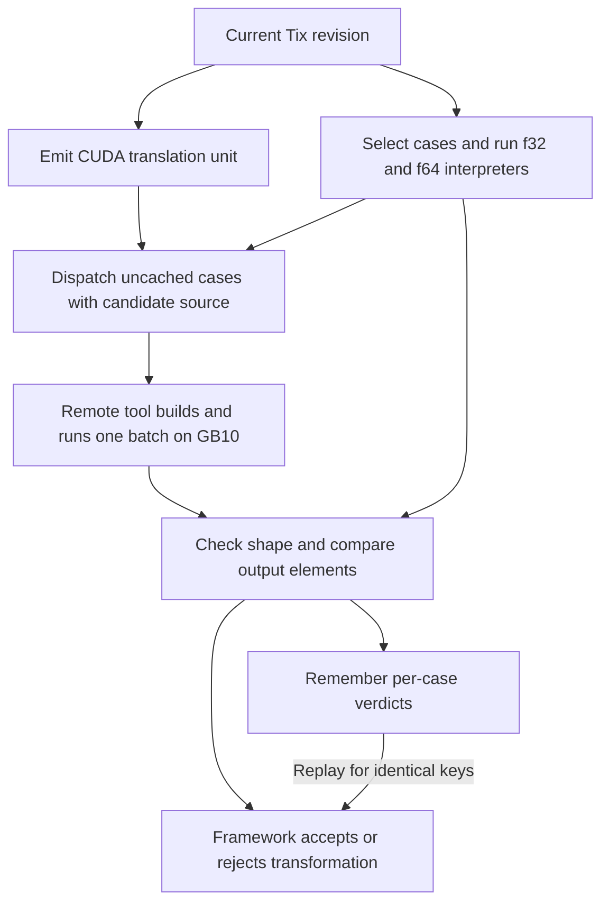

# Can a CUDA lowering keep Tix's floating-point meaning?

In single precision, adding three copies of `2^-24` to `1` does not necessarily change the result. Each addition lands halfway between `1` and the next representable number. If each step rounds to nearest, ties to even, the accumulator stays at `1`. In double precision the same sequence gives `1.0000001788139343`. This is a useful test for a GPU compiler: an implementation that combines partial sums, promotes the accumulator, or fuses a multiply and an add can produce a mathematically plausible answer that is not the answer the source language specifies.

Tix is a small tensor language in IR Workbench, a TypeScript compiler framework. The initial implementation evaluated the same tensor IR with two precisions. Its f32 interpreter uses JavaScript arithmetic and rounds every literal, scalar shape value, operation, intrinsic result, and reduction step with `Math.fround`. Its f64 interpreter evaluates the expression tree and the folds without those binary32 roundings. Tix deliberately exposes reduction order in its semantics. This stage asked whether a CUDA backend could keep that order and whether the workbench could check the resulting program using a remote GPU without changing the framework. The answer at revision `30a13b4` was yes. The gate used sampled tolerance against f64, but the independent evaluation found no disagreement with the intended f32 result. A separate exhaustive check of the widened transcendental operations makes a stronger, target-specific gate credible.

## Lowering a tensor definition

A Tix function takes named, row-major tensors. The GPU path handles finite f32 input words with consistent concrete shapes and in-bounds affine accesses; dimensions can be zero, and the program can produce infinities or NaNs. Input dimensions bind shape variables such as `M`, `K`, and `N`. The existing front end resolves tensor names, infers index extents and gives each index binder its own identity. The IR is already a list of tensor definitions with affine reads, scalar expression trees, and explicit reduction bounds. Matrix multiplication, for example, says to assign `y[i,j] = sum(k) a[i,k] * b[k,j]`. There is no need for the backend to rediscover what `i`, `j`, and `k` range over, or where a reduction body ends.

The emitter uses the selected function of the **current** Tix revision. For every statement it emits a kernel and, for a nonempty result, launches that kernel in a one-dimensional grid of 128-thread blocks. A thread converts its flat output offset to row-major coordinates and computes one result element. Tensor loads turn the affine coordinates into an offset using the referenced tensor's dimensions. A reduction becomes a local accumulator and a loop nest with the first listed binder outermost. Empty sums leave `+0`; empty max reductions leave `−∞`. Distinct binder IDs let an inner reduction shadow a source index name without capturing the enclosing loop variable. The following excerpt is the matrix-multiply kernel body with simpler names and the redundant affine constants removed:

```cuda
const I flat = I(blockIdx.x) * blockDim.x + threadIdx.x;
if (flat >= count) return;
const I n = dims[5], k = dims[4];
const I row = flat / n, col = flat % n;
float acc = 0.0f;
for (I j = 0; j < k; ++j) {
  const float product = __fmul_rn(buffers[0][row * k + j],
                                 buffers[1][j * n + col]);
  acc = __fadd_rn(acc, product);
}
buffers[2][flat] = acc;
```

The separate product and add are intentional. NVCC compiled with `-O3 -arch=sm_121` and no fast-math option; the emitter uses explicit round-to-nearest CUDA operations for addition, subtraction, multiplication, and division rather than relying on source expressions to prevent contraction. `exp`, `log`, and `tanh` widen the already-rounded operand to double and round the CUDA result back to float. Square root uses `__dsqrt_rn` and the same conversion. Float literals are rounded by Node and emitted as bit patterns. Negation flips the sign bit. Min and max check for NaN explicitly and reproduce JavaScript's signed-zero ordering; CUDA `fmaxf`, for example, would return the numeric operand when the other operand was NaN.

The backend does not change grouping introduced by an earlier optimization. If `inline` substitutes an affine load into its consumer, the emitter follows the substituted expression. If `split-sum` introduces block and lane reductions, the emitter generates both loops and both accumulators, including a shorter last block if necessary. Flattening them back into one sum would recreate the original evaluation order, not preserve the rewritten function. The host driver binds concrete dimensions, allocates the tensors, and launches the nonempty statements in order in one stream. No shape specialization is baked into the source. A function may return a parameter; an empty output needs neither a launch for that tensor nor a zero-byte device allocation.

We emitted source directly rather than defining a second IR for CUDA kernels. The existing tensor IR supplied everything needed for this mapping, and this stage did not perform transformations on GPU code. A second adapter would have introduced a representation to validate and maintain without supporting another pass. Instead the emitted translation unit is itself the typed output of a checked framework transformation. `cudaSource` exposes that source, `runTixCuda` executes it on caller-supplied inputs and returns the shape, data, and device time, and `checkLowering` applies the sampled gate. The execution API does not imply that the gate has run.

## Checking the actual candidate on the GPU

The checker receives the Tix artifact and the CUDA source the pass produced. It compares the returned tensor with an interpreter run of that same input revision, not with the original pre-optimization program. In particular, `split-sum` may legally change f32 results under its own stage-one contract. A lowering should not be charged for that change. The framework transformation uses an asynchronous postcondition, so acceptance follows observation of the candidate on the GPU, not just successful compilation.



For ordinary finite results the emitted result `g` must satisfy `abs(g - r) <= 2e-6 + 2e-5 * abs(r)` for the f64 reference `r`. Both interpreters and CUDA receive the same input f32 words. The absolute term allows a small residual near zero; the relative term is about 336 binary32 unit roundoffs and leaves room for short sequences of rounded operations. It is a sampled error budget, not a bound on arbitrary sums or ill-conditioned expressions. If either interpreter result is nonfinite, the gate compares with f32 instead, distinguishing the infinity sign and comparing NaNs as a class. When both f32 and GPU results are zeros, their signs must match. Independent exact witnesses test rounding and reduction order because the finite tolerance alone could miss a small change in either.

The initial GB10 probe was the reason not to assume exactness. It used 98,181 finite f32 inputs per intrinsic on CUDA 13.0 with a mixture of random bit patterns and targeted ranges. `expf` differed from Node's rounded result 19,304 times, `logf` 2,275 times, and `tanhf` 2,210 times; `sqrtf` did not differ on that sample. For example, `expf(-1)` gave `0x3ebc5ab3` instead of `0x3ebc5ab2`. None of the widened implementations differed on the sample, treating NaNs as a class. Their largest finite error versus f64 used about 0.30% of the proposed budget. The same probe verified preserved subnormals and distinguished separate multiplication and addition from FMA. The widened operations measured well enough for the chosen tolerance, but that sample did not settle every possible rounding midpoint.

Cases use small shapes derived from the function's signature: uniform extents of 1, 3, 4, 7 and 0 where valid, a mixed non-square assignment, and assignments with one zero axis. The seed is 20. Input streams cover signed and positive nonuniform values, a half-ulp pattern, and both signs of zero. Sampling caps tensors at 4,096 elements and bounds interpreter work to one million steps per evaluation, screening invalid shapes and accesses on the Tix side. A function with no comparable cases is not accepted. A decoded result must have the expected shape and the batch must be complete.

The key cost is a remote round trip, not comparing small arrays. The framework's existing differential `decide` callback accepts a list of outstanding case indices. It sends them in one invocation of the candidate executable as a versioned binary file containing concrete dimensions and little-endian f32 words. The driver executes cases serially and returns binary results in the same order. The baseline key reuses case inputs and interpreter results for the same revision, function and Node/V8 versions under the same checker configuration. The subject key includes a hash of the exact CUDA source, host, tool and configured compiler settings. Matching decided verdicts can be replayed within the process, assuming the configured remote environment is unchanged. A failed build or incomplete result publishes no case verdict. This is not a persistent verdict cache or live attestation of the GPU on a hit.

## What changed in the infrastructure

**No framework files changed.** The existing `defineTransformation` and `AnalysisManager.execute` accept non-IR ports, so CUDA source could be a typed text value without a dummy graph adapter or a change to the same-IR pass runner. The existing asynchronous invariant and differential delegate handled the remote operation, the batch, and reuse. The framework did not need to understand CUDA or its floating-point rules.

The SSH runner, `tools/cuda-remote.mjs`, did need two related changes. It gained an opt-in `--cache-main` mode so changing runtime inputs would not cause a rebuild of an unchanged, self-contained translation unit. The default still hashes all staged input files, since they can be compile dependencies in other clients. Both modes include NVCC path, version output and flags in the build key. The old shared working directory also could not safely serve two invocations of the same build with different data. The tool now stages each run in a separate remote directory and fetches that invocation's outputs before cleaning up. A per-build lock protects compilation, and a successful binary is published by renaming a temporary binary. The existing timing lock still covers timed executions only. The tool test ran concurrent invocations sharing a build, checked that each received its own output, and verified that different input files still produce separate default-mode keys.

## Measurements and verification

CUDA's lazy loading can otherwise make the first timed launch look like kernel work. After review, the generated driver calls `cudaFuncGetAttributes` on every kernel before recording events. The benchmark uses one warm-up and five recorded repeats in the same process on the same buffers. The interval starts before the first launch and ends after the last launch in the stream; it excludes compilation, allocation, input and output transfers, and startup. These are warmed device spans, not end-to-end SSH timings. The local measurement is one wall-clock call to the stage-one f32 interpreter on Node 24.18.0 on an Intel i7-1165G7, excluding parsing and input generation. The machines were shared; timing-lock users serialize with each other but not with untimed clients, and the CPU wall time includes scheduler contention.

The six unoptimized workloads used seed 20, values in `[−1, 1]`, and a positive `1e-5` layernorm epsilon. The NVIDIA GB10 ran NVCC 13.0.88 (CUDA runtime and driver API 13000). The device times below are medians and ranges from the standalone GPU run; CPU times come from runs of the same harness with the same inputs. In those paired executions every full-size output agreed with f32, with zero absolute difference.

| Unoptimized workload | Shape bindings | GB10 median (range), ms | Local f32 wall time, s |
| --- | --- | ---: | ---: |
| Matmul | `M=K=N=512` | 0.1886 (0.1876–0.1887) | 819.144 |
| Softmax | `N=4096, C=1024` | 0.7602 (0.7561–0.7648) | 67.521 |
| Layernorm | `N=4096, D=1024` | 0.5452 (0.5440–0.5501) | 97.796 |
| Attention | `Q=K=1024, D=V=64` | 0.9680 (0.9672–0.9688) | 501.244 |
| MLP | `N=1024, D=256, H=1024, O=256` | 1.1457 (1.1379–1.1486) | 1,354.094 |
| Conv2d | `N=8, C=16, H=W=64, O=32`, 3×3 filter | 0.3076 (0.3057–0.3089) | 847.464 |

`npm run build` passed. `node --test tests/tensor/*.test.mjs` passed 19 local tests, with six explicit GPU opt-ins skipped. `TIX_TEST_GPU=1 node --test tests/tensor/cuda-gpu.test.mjs` passed all six, covering separate rounding, lexicographic folds, nonfinite results, empty extents, rewritten artifacts, build isolation and replay. A runnable candidate that wrote zeros instead of the computed sum was rejected through the actual postcondition. A compile failure was not memoized as a numerical verdict. All 208 bounded corpus cases agreed with the implemented relation; convolution used the largest fraction of the f64 budget, about 24.7%. The full repository suite was not run.

## What the independent evaluation found

At `30a13b4` the stage-one hidden suite passed 25 of 25 tests and all three CUDA API exports were present. Every compared f32 element matched in the small corpus, in the four reported evaluations after `inline` followed by `split-sum`, and in 20 of 20 random programs from the language core. The largest f32 difference scaled by `max(1, |reference|)` was zero throughout. The nonzero numbers below are distances to the **f64** reference, not disagreements between CUDA and Tix f32.

| Workload | Original f32 matches | Original max f64 difference | Rewritten f32 matches | Rewritten max f64 difference |
| --- | ---: | ---: | ---: | ---: |
| Matmul | 35/35 | `3.2e-7` | 35/35 | `2.2e-7` |
| Softmax | 76/76 | `5.3e-8` | 76/76 | `4.9e-8` |
| Layernorm | 72/72 | `1.3e-7` | — | — |
| Attention | 72/72 | `6.6e-8` | 72/72 | `6.0e-8` |
| MLP | 24/24 | `3.6e-7` | 24/24 | `4.6e-7` |
| Conv2d | 160/160 | `3.1e-7` | — | — |

Matmul and convolution round each product and each accumulator update rather than accumulating full double products. Softmax rounds the shift subtraction, the exponential, the normalizer sum, and the division. Layernorm rounds the mean and variance computations, the square root and the final normalization and affine transform. Attention composes rounded dot products and a square-root scaling with a softmax and a weighted sum. MLP rounds both affine layers and the tanh-GELU expression, including its nonrepresentable decimal constants. In the rewritten versions, the partial and outer sum steps each round as well. These are the precision sites that separate the f32 and f64 computations. The aggregate errors do not include input words, output coordinates, or intermediate traces, so no particular site can be singled out as the cause of any one maximum. The [diary](01-implementation-diary.md) maps each reported delta to the relevant emission lines.

A separate [three-row witness](../scripts/03-precision-witness.mjs) isolates three of these operations in one untimed GPU run. Three half-ulp terms leave the f32 sum at `1`, versus `1.0000001788139343` in f64. A single `(1 + 2^-23) * (1 - 2^-23)` rounds to `1` in f32, versus `0.9999999999999858` in f64. Widened `exp(-1)` rounds to `0.3678794503211975`, versus `0.36787944117144233` in f64. GPU and CPU-f32 words agree in all three rows. None of these witnesses is a reconstruction of an evaluator maximum.

The independent full-size runs also reported zero f32 difference. Their single-call `gpuMs` values below are separate from the warmed medians above. The independent `checkLowering` runs accepted 16 of 16 functions (six corpus and ten random functions), reported `tolerance`, and took 3.9 seconds per check on average.

| Full-size workload | Bit-identical f32 elements | Independent `gpuMs` |
| --- | ---: | ---: |
| Matmul | 262,144/262,144 | 0.207 |
| Softmax | 4,194,304/4,194,304 | 0.672 |
| Layernorm | 4,194,304/4,194,304 | 0.585 |
| Attention | 65,536/65,536 | 1.479 |
| MLP | 262,144/262,144 | 1.155 |
| Conv2d | 984,064/984,064 | 0.327 |

## What I would do differently

I would check exact f32 equivalence on the qualified GB10/Node configuration, with NaNs compared as a class, and report f64 distance separately rather than making it the acceptance criterion. Independently of this backend, the coordinator compared CUDA's widened `exp`, `log`, and `tanh` against Node's rounded functions over all `2^32` f32 input patterns on GB10 and found agreement, comparing NaNs as a class. That closes the major numerical uncertainty left by the design probe. IEEE rounding of the basic arithmetic and square root, together with the emitted operation order and signed-zero handling, supports an exact comparison with the immediate f32 revision. Such a gate would detect a small lowering error that tolerance could allow, without rejecting correct f32 code merely because the reference in a different precision diverged. It would still be a sampled whole-program check, and the device/host evidence does not claim portability to arbitrary CUDA and Node versions. The evaluated contract remains unchanged.

I would also keep the exact witness input and output coordinate for the largest f64 deviation in each evaluation. A maximum alone is enough to summarize a budget, but not enough to trace that deviation back through a softmax or the two layers of an MLP. The workbench already reused the expensive part of the experiment without a new kernel IR or contract mechanism; the more valuable addition would be better evidence about individual computations.
