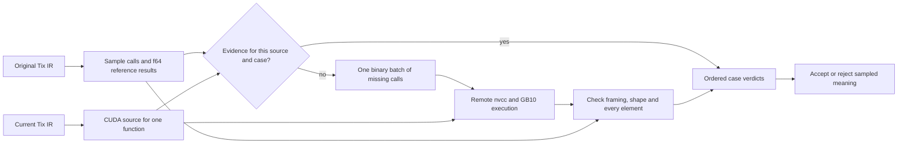

# What a checked CUDA lowering preserves

On a matrix multiplication with 262,144 outputs, a simple CUDA lowering reproduced every result word of an f32 interpreter. On a softmax with 4,194,304 outputs, it reproduced 2,616,298 words. The largest scaled difference in the latter comparison was only 3.7 × 10⁻⁹. The important distinction between these programs was not how they scheduled their reductions. Both visited every reduction index in source order, with one thread doing the entire fold. The distinction was how the two engines computed an exponential.

Tix is an index-notation language in IR Workbench, a TypeScript compiler framework also used by a compiler targeting RISC-V. Tix was built to test whether the same framework could check transformations in a second domain. This stage took a tensor program whose meaning was already executable on the host, lowered it to CUDA, and asked the framework to check the result on an NVIDIA GB10 across an SSH connection. This report describes the implementation evaluated at `b7e6b2b`. It distinguishes our measurements from the independent evaluation and from a diagnostic change to generated text that **did not** become part of the compiler.

## From a definition to a kernel

A Tix statement defines a tensor once. In `y[i,j] = sum(k) a[i,k] * b[k,j]`, the free indices select one element to write, and the bound index describes how to compute it. The host f32 meaning rounds each scalar operation, including each fold step. It evaluates an intrinsic such as `exp` by applying JavaScript's `Math.exp` and rounding the resulting double to f32. The f64 reference traverses the same expression without those f32 rounding steps. The two interpreters therefore answer different questions even on identical f32 input bytes.

The emitter consumes the **current** checked tensor IR, not source syntax. That IR already resolves tensor names, binder identities, affine reads, output shapes and reduction bounds. There is one launch per nonempty statement, in definition order on the same stream. A linear thread index selects one row-major output element; division and remainder recover its coordinates from the last axis back to the first. Affine addresses and shape arithmetic use signed integers. Each reduction is a loop nest inside that thread, first listed axis outermost. No atomic operation or inter-thread reduction chooses the addition order.

Here is the essential part of the emitted matmul kernel. The two long, bounds-checked address expressions are abbreviated; the accumulator and arithmetic calls are as emitted.

```cuda
float v2=+0.0f;
for(I i3=0;i3<(0LL + 1LL*s.d1);++i3) {
  float v5=p0[/* row, i3 */];
  float v6=p1[/* i3, column */];
  float v4=__fmul_rn(v5,v6);
  v2=__fadd_rn(v2,v4);
}
out[t]=v2;
```

Those two intrinsics require a rounded product and a separately rounded sum; compiling at `-O3` must not turn them into a single fused multiply-add. Literal f32 values are emitted as bit patterns, including values that would be awkward to spell as C literals. A maximum starts at negative infinity, a sum at positive zero. Zero iterations leave those identities intact. Minimum and maximum propagate NaNs and implement JavaScript's zero-sign tie rules rather than silently discarding a NaN operand. Zero output elements require no launch. A function can also return a parameter without manufacturing a kernel.

We emitted a translation unit directly rather than building a second kernel IR. There was no intervening kernel transformation to validate: a second graph would have duplicated the statement partition and loop structure, and the meaning check would still have had to execute the final text. Direct emission also makes it explicit which revision is under test. After inlining, the emitter sees an already-substituted read. After `split-sum`, it sees an outer block sum and an inner lane sum with a tail bound. It emits both accumulators. On the seven-term rounding witness from stage 1, the sequential sum returns 1; the split sum returns 1.000000238418579. Lowering the latter back into a single flat sum would be a lowering error, even though the two results are close.

## Checking the program that actually ran

`cudaSource` returns a complete translation unit for one function. `runTixCuda` runs a supplied call and returns its shape, f32 words and kernel time. Neither operation asserts that the candidate is correct. `checkLowering` binds the candidate **source string** as the output of a versioned transformation. Its postcondition runs the compiled candidate or uses prior evidence for precisely those source bytes. In particular, the checker does not regenerate an ostensibly equivalent program after the candidate has been submitted.



The case generator starts from the original function. It tries symbolic extents 1, 3, 4 and 7, mixed extents, and single-axis zeros where legal. The sizes distinguish singleton, complete block and partial block behavior. The streams include signed values, positive values and a sequence of half-ulp increments; the seed is 20. Sampling limits are 4,096 elements per tensor and one million metered visits per evaluation. The tolerance domain excludes cases with a nonfinite reference result. Extra empty-shape probes are not allowed to rescue an otherwise non-comparable function with an empty return. If there is no evidence, the check does not pass.

The contract requires matching shapes and a finite GPU result `g` at each coordinate, with `abs(g − r) ≤ 2e-6 + 2e-5 × abs(r)`, where `r` is the **original f64** result on the very same f32 inputs. The absolute term matters near cancellation. This is the stage-1 budget: a previous reassociation and the lowering together get one allowance, not one per pass. It is a test on the selected calls, not an assertion about arbitrary reduction lengths or ill-conditioned inputs. In our six small corpus batches the worst element used 24.67% of the allowance, in convolution. Even there, the device agreed exactly with f32 on the independently evaluated calls. Agreement with f32 and distance to f64 are different measurements.

One checker invocation sends the missing cases for a function together. A binary input file carries ordinals, ranks, extents and little-endian tensor words in parameter order. The executable writes a corresponding result record per case. The reader checks the count, order, dimensions, byte lengths and event times before returning the batch. A short transfer or failed compilation produces no reusable numerical verdict. A wrong but complete output can produce a counterexample with shape assignment, data stream, coordinate and values.

**No framework file changed.** The framework's same-IR pass runner produces another revision with the same adapter; it was unnecessary to invent a graph diff between a Tix module and C text. The transformation verifier already accepts an IR input and a typed scalar output. Its differential invariant can delegate all unseen indices to an asynchronous `decide` callback. The baseline key includes the origin revision and function; the framework associates that with the invariant version and generator settings. Subject keys include a hash of the candidate bytes, current revision and configured execution profile. The memo holds cases, references and verdicts in process, not event timings. Reuse assumes the selected host, GPU and toolchain remain stable for the process. In a counting-engine test a repeated check needed no second batch, whereas a source mutation had to be checked afresh.

We did change `tools/cuda-remote.mjs`. Two simultaneous identical calls should share an executable but must not share the writable directory from which either caller fetches results. The tool gives each invocation a private directory and cleans it after retrieval. It locks compilation per build key and atomically installs the completed executable. The key covers length-framed file names and contents, compiler path and version string, flags and target architecture. Changing input data can still cause a recompile. The tool exposes the `nvcc --version` result in its JSON; the running program reports device capability, driver and runtime from CUDA. A cached build saves compilation but does not establish a verdict about any output.

## Measurements on the two engines

We used the unoptimized corpus and identical seeded f32 inputs on both machines. The GB10 ran CUDA 13.0, nvcc V13.0.88, `-O3 -arch=sm_121`, without fast math. Each case allocates and copies inputs, launches a whole warm chain and synchronizes, then uses two CUDA events around the next chain. The result excludes context startup, transfers and output decoding. One short locked tool invocation per program carried three cases; the table gives the median event interval. The host measurement wraps one full `runTix` call after a smaller warm call, using Node 24.18.0 on a shared i7-1165G7. It includes interpreter allocations and scheduling delays but not parsing or data generation.

| Program and extents | GPU median, ms | Local f32 wall time, s |
|---|---:|---:|
| matmul, M=K=N=512 | 0.176832 | 187.734 |
| softmax, N=4096 C=1024 | 0.501312 | 15.255 |
| layernorm, N=4096 D=1024 | 0.515616 | 25.047 |
| attention, Q=K=1024 D=V=64 | 0.902368 | 302.965 |
| mlp, N=1024 D=256 H=1024 O=256 | 0.743168 | 2116.759 |
| conv2d, N=8 C=16 H=W=64 O=32, valid 3×3 | 0.172576 | 506.913 |

These are not end-to-end speedup ratios. The longest local call took over 35 minutes; the shortest GPU sample did not pay for a network round trip. Conversely, a caller checking a tiny kernel cannot expect a submillisecond verdict: the independent evaluation reported 3.8 seconds per `checkLowering` on average. This difference in cost is the reason to batch and reuse evidence.

## Independent evaluation and diagnosis

Our build and 32 tensor tests passed, including 11 live GPU tests. They include independent small numerical oracles, shadowed and empty reductions, NaN and signed-zero rules, inlining a transposed read, the split rounding witness, concurrent identical batches, rejection of incomplete evidence and a **compiled** mutant that drops a reduction tail. The independent stage-1 hidden suite passed 25/25 and confirmed that the three new functions are exported. On the six corpus programs and ten random ones, the public lowering check accepted 16/16 with relation `tolerance`.

The next table gives the coordinator's small-call results. “Same” counts equal output words against the f32 interpreter of the revision actually lowered. Δ32 is the largest difference scaled by `max(1, |r|)` as reported by the evaluator; Δ64 is the reported largest difference from f64. The optimized rows follow `inline` then `split-sum`.

| Revision | Program | Same / elements | Δ32 | Δ64 |
|---|---|---:|---:|---:|
| Original | matmul | 35/35 | 0 | 3.2e-7 |
| Original | softmax | 54/76 | 3.0e-8 | 5.3e-8 |
| Original | layernorm | 72/72 | 0 | 1.3e-7 |
| Original | attention | 56/72 | 6.0e-8 | 6.6e-8 |
| Original | mlp | 21/24 | 8.9e-8 | 3.6e-7 |
| Original | conv2d | 160/160 | 0 | 3.1e-7 |
| Optimized | matmul | 35/35 | 0 | 2.2e-7 |
| Optimized | softmax | 56/76 | 3.0e-8 | 4.9e-8 |
| Optimized | attention | 47/72 | 3.0e-8 | 4.4e-8 |
| Optimized | mlp | 18/24 | 1.2e-7 | 3.4e-7 |

In the full-size independent runs, the three programs without a device exponential, logarithm or hyperbolic tangent still agreed on every word. The other three did not. Here Δ32 has the same scaling as above, and `gpuMs` is the evaluator's observation from our API, not another sample in our median.

| Program | Same / elements | Δ32 | Independent `gpuMs` |
|---|---:|---:|---:|
| matmul | 262144/262144 | 0 | 0.174 |
| softmax | 2616298/4194304 | 3.7e-9 | 0.498 |
| layernorm | 4194304/4194304 | 0 | 0.545 |
| attention | 10618/65536 | 3.7e-8 | 1.742 |
| mlp | 231045/262144 | 2.2e-5 | 0.785 |
| conv2d | 984064/984064 | 0 | 0.404 |

The softmax discrepancy starts at `expf` (`src/tensor/cuda-source.ts:20`), applied to the difference between a logit and its row maximum. Changing one numerator can change the row sum, hence even normalized entries whose own exponential was exact. Attention uses the same call on shifted scores. It also uses the normalized weights in another dot product, so one changed exponential can affect many returned coordinates. Neither its correctly rounded square root nor a different reduction order is needed to explain the discrepancy. MLP uses `tanhf` (`src/tensor/cuda-source.ts:19`) in the hidden activation. The second affine layer sums weighted activations; its output error is not bounded by the single-call difference at one hidden unit. The full-size MLP Δ32 of 2.2e-5 is against f32, not an observed violation of the small-case origin-f64 contract.

The original numerical probe already isolated the library calls. For 8,192 arguments per operation, `expf` disagreed in 2,468 cases with `Math.fround(Math.exp(x))`, `logf` in 626 with the corresponding host logarithm, and `tanhf` in 1,262 with the host hyperbolic tangent. `sqrtf` disagreed in none. For example, at −3.986328125 the device exponential returned 0.01856776885688305; the host f32 value was 0.0185677669942379. Under the same flags the seven-step exponential fold and cancellation probes fit the f64 allowance. The compiler emits standard device functions, not CUDA fast-math approximations selected by a compiler flag.

A post-evaluation diagnostic tested the attribution in whole kernels, not just scalar isolation. We generated the original and optimized functions, made temporary copies of their CUDA text, and changed **only** the affected call to a double device call followed by `__double2float_rn`. On a fresh set of deterministic inputs the shipped kernels differed on 79 and 101 softmax words, 74 and 85 attention words, and 70 and 81 MLP words (original and optimized, respectively). The paired variants differed on **zero** of the 279, 133 and 289 outputs per revision. All pairs ran in one untimed tool invocation. These are our diagnostic inputs, not reconstructions of the hidden inputs. The evaluated sources were not changed.

For the twenty fixed-core random programs, the independent result was 16/20 identical on every element, largest difference 1.2e-7. The known first-divergence sites for finite scalar values are `expf`, `tanhf` and `logf` (the last at `src/tensor/cuda-source.ts:18`). No named corpus program uses log. The aggregate random result does not include the four expressions or a first differing intermediate for any of them. It identifies a pattern consistent with these three calls; it cannot identify which call occurred in each hidden program. Nonzero Δ64 even on f32-identical rows has a separate explanation: the f64 evaluator does not round each product, sum, division or intrinsic result to f32. Output maxima do not identify a particular fold iteration as the source of that rounding error.

## The stronger experiment

For the shipped backend, tolerance is the strongest of the two proposed **uniform** relations supported across Tix functions: there are concrete finite counterexamples to exact f32 equality. This does not make the chosen tolerance constants optimal, or the samples a universal error bound. Exact agreement with the current f32 tree is a stronger expectation on paths without the three discrepant calls, treating NaNs as a class. The coordinator tested **a different implementation** of those calls: CUDA double `exp`, `log` and `tanh` followed by explicit round-to-nearest f32 agreed with the host meaning for all 2³² binary32 inputs on this GB10, comparing NaNs as a class. Together with the IEEE arithmetic and `sqrtf` result, that evidence supports pursuing an exact checker of the *lowering step*. It does not turn the shipped float calls into double calls or undo an authorized reassociation relative to the original program.

I would run the paired float-versus-rounded-double experiment before choosing the relation. I tested ordinary CUDA functions against the host meaning, found a mismatch, and accepted approximation; the missing question was whether a small change at those three call sites would remove the mismatch. I would also separate two obligations in the evidence: does CUDA execute the **current f32 tree** exactly, and does the optimized program remain within budget relative to the **original f64 meaning**? A single end-to-end tolerance answers the second while potentially hiding a small lowering mistake. For any future disagreement I would retain a replayable case and the first differing intermediate, not just a maximum at the returned tensor. That distinction is what lets an evaluator attribute an error to an operation rather than merely count its downstream effects.

[Measurement protocol and raw timing samples](02-gb10-corpus-measurements-and-validation.md) · [Paired diagnostic](../scripts/05-isolate-libm.mjs) · [Implementation diary](01-design-and-implementation-diary.md)
