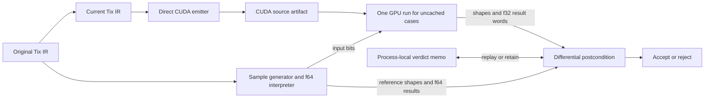

# Checking a Tix-to-CUDA lowering on the GB10

A matrix multiply can come back from a GPU with every bit in agreement and still tell us little about what will happen to a softmax. In this implementation the two programs use the same emitter, the same CUDA compiler settings, and the same rule for walking a reduction. Their difference is an operation that matrix multiply never executes: CUDA's single-precision exponential. A one-bit change in an exponent can reach more than one output because the exponents share a denominator. Attention takes that effect one step further by using the probabilities in another contraction.

IR Workbench uses Tix, a small tensor language, to test how much of a compiler framework can be shared across domains. Stage 1 defined the language's tensor IR, two interpreter modes and two checked rewrites. Stage 2 compiled that IR to CUDA and used the GPU itself to check the lowered artifact. The result evaluated here is revision `04a9da3`. The GPU contract needed no new framework code. Its numerical promise is sampled tolerance against the original program in f64, not bit identity with the current program in f32. Those are two different questions; the independent evaluation asked both.

## From a tensor definition to a CUDA kernel

A Tix function has typed tensor parameters, a sequence of single-assignment definitions and a return naming one tensor. Parameter shapes bind symbolic dimensions. A tensor read can use affine indices: a convolution, for example, reads `x[n,c,y+dy,xpos+dx]`. The front end resolves the binders and infers extents before lowering. Reductions are scalar expressions with ordered axes, not library calls. The f32 interpreter rounds after each scalar operation and each fold step. A sum starts at positive zero; a max starts at negative infinity. An empty reduction returns that initial value. By contrast, the f64 reference uses the same expression structure but evaluates in JavaScript double precision without the explicit f32 rounding sites.

The emitter consumes the **current** IR revision. It generates one CUDA kernel per statement, gives each live thread one output element, and materializes each intermediate tensor as a row-major f32 array. From a flat thread index it recovers the output coordinates; affine reads use integer address arithmetic. CUDA names come from internal slots and scoped binder identities, so names that shadow one another in Tix do not collide in C++. The driver launches the kernels in statement order on one stream, in blocks of 256 threads. Empty outputs are not launched. A function with no launches can return a parameter or an empty tensor with an event time of zero.

Here is the emitted matrix-multiply kernel with only line wrapping changed. The last axis is the remainder modulo the result width; the preceding axis is the quotient. The single thread walks `K` in increasing order. In particular, the multiply and the add round separately rather than contracting into an FMA.

```cuda
__global__ void kernel0(const Meta *m, U count, float *out,
                        const float *p0, const float *p1) {
  const U flat = U(blockIdx.x) * blockDim.x + threadIdx.x;
  if (flat >= count) return;
  U rem = flat;
  const U i0 = rem % m->d[5];
  rem /= m->d[5];
  const U i1 = rem;
  float v2 = 0.0f;
  const U n3 = (m->s[1]);
  for (U i4 = 0; i4 < n3; ++i4) {
    const float v6 = p0[((i1) * m->d[1] + (i4))];
    const float v7 = p1[((i4) * m->d[3] + (i0))];
    const float v5 = __fmul_rn(v6, v7);
    v2 = __fadd_rn(v2, v5);
  }
  out[flat] = v2;
}
```

Multiple reduction axes become nested loops, with the first listed axis outermost. An inlined program already has its composed affine reads in the IR. A sum after `split-sum` has separate block and lane folds, each with its own accumulator and an explicit partial-tail bound. Compiling those folds into a single accumulator would be a change even if a tolerance test missed it. Our order-sensitive test used one plus three half-ULP terms separated by three zeros: the unblocked interpreter returned the word `0x3f800000`; CUDA for the blocked program returned `0x3f800002`, matching the blocked interpreter.

We emitted CUDA directly rather than introducing a kernel IR. The existing IR already had the statement dependencies, coordinates, loop bounds and grouping this lowering needed. A separate editable representation would have duplicated them without a target-side rewrite to consume it. The pass still produces an artifact: a versioned terminal payload containing the emitted translation unit and its ABI and build profile. The bytes checked on the GPU are the bytes in that artifact. `cudaSource` exposes the same emitter, `runTixCuda` executes it on supplied input, and `checkLowering` is the entry point that makes the sampled acceptance claim.

## Checking the artifact on the GPU

The framework models the lowering as a typed transformation whose inputs include the original Tix revision, the current revision and the selected function. Its output is CUDA source. The existing transformation manager validates the ports and awaits the differential postcondition before accepting the output. The original program remains the f64 reference even when the current revision is optimized: a split sum cannot spend the numerical budget at the rewrite and then get a fresh budget at lowering. The origin-based comparison does not excuse compilation of the wrong grouping, which is why the check for the blocked result word is separate.



For a finite reference element \(r\), the result \(g\) must be finite and satisfy `abs(g - r) <= 2e-6 + 2e-5 * abs(r)`. Shape and element count must agree. For nonfinite references the comparator requires the same infinity sign or a NaN; it does not compare NaN payloads. The absolute term leaves room near zero. This is the Stage-1 tolerance budget, applied to a deterministic sample, not a proof of an error bound on arbitrary programs. Even a faithful f32 program can fail such a comparison: the design probe showed that `expf(89)` is infinite while the f64 reference is finite.

Cases are derived from the original signature. The generator tries small uniform dimensions, mixed dimensions and zero extents, then fills inputs with seeded signed and positive values, a half-ULP sequence, or alternating signed zeros. Cases outside the original address domain or above the sample limits are screened out by the CPU reference evaluation. The limits are 4,096 elements per tensor and one million interpreter scalar visits and loop iterations per case. The stored case couples the original f64 reference with the same f32 input bits that will go to the GPU. A function with no eligible case cannot pass by default.

The framework's `decide` hook takes all missing case indices for a check. The backend encodes them as one binary input for one remote invocation, decodes a result for every case in order, and returns the comparisons together. The format carries raw f32 words and dimensions, so signed zero and nonfinite outputs do not have to survive a JSON conversion. A transport, compilation, execution or framing failure aborts the batch without adding any per-case verdicts. A disagreement can name its shape bindings, input stream, seed and output coordinate. The existing baseline memo reuses the case set and f64 references for a given origin revision and function. The subject key includes the CUDA source artifact revision and the configured host and compiler path. With the target assumed stable for a process, a warm check can reuse its verdicts without any GPU request. That evidence memo is independent of the remotely cached executable.

The design probe ran on an NVIDIA GB10 under `nvcc -O3 -arch=sm_121`, without fast math or flush-to-zero. Across 8,192 samples per operation, the explicit rounded arithmetic and sqrt probes matched the f32 reference; the probes found 2,467 different `expf` words, 721 `logf` words, and 1,258 `tanhf` words. An eight-row softmax of width 1,024 differed at 3,451 outputs. The largest fraction of the chosen f64 budget across these finite scalar and softmax results was 0.655%, for exp. That experiment justified keeping the budget for sampling and ruled out exactness for the implementations we had chosen. It did not establish that mismatches were inherent to CUDA.

## What changed in the framework and remote tool

No framework source changed. The same-representation pass runner is built around one adapter and revision edits; this lowering crosses an artifact-kind boundary and needs neither an editable target graph nor a graph diff. The existing typed transformation and the asynchronous differential hook covered the boundary. The framework's existing revision-keyed memo also sufficed without a second tensor-specific evidence cache.

The remote tool needed to separate the lifecycle of an executable from the lifecycle of its inputs and outputs. It gained `--runtime-dir`, an opt-in top-level directory whose contents are uploaded but not hashed as compiler inputs. The build key includes the other files, the flags, compiler path and the remote compiler version. A source file is therefore compiled once across batches with different shapes and data; unmodified callers still have all their inputs in the key except `out/`. The tool parses the new option explicitly, passes the compiler path and arguments as quoted shell words, and limits the directory walk to regular files and directories. Each call uploads into a private remote run directory. A per-key lock serializes builds, and the finished executable is moved atomically into the cache before being linked into the run directory. The tool fetches only that invocation's `out/` and does not report a fetch failure as success. The private directory is cleaned up afterward. The GPU lock still applies only when callers request `--timed`; no new remote target query is needed on a warm acceptance check.

## Tests and measurements

`npm run build` and `node --test tests/tensor/*.test.mjs` passed, with 24 tests including five GPU tests in a separate file. In addition to the six corpus programs before and after optimization, we checked nested scope, affine indexing, empty output and reduction extents, signed zero, subnormals and nonfinite results. We changed the generated split bound from ceiling to floor and submitted that candidate to the real GPU contract. It compiled and ran but failed the postcondition. An offline batch double checked that a partial response does not poison the memo, and two concurrent GPU calls with different runtime data checked the separation of executable and result reuse. No full repository test suite was run.

The benchmark used unoptimized corpus sources, with identical seed-22 f32 input bits on both machines. It ran `node corpus/tensor/benchmark-cuda.mjs` with a small local warm-up and one timed call to the Stage-1 f32 interpreter per full workload. On the GPU, CUDA events bracketed the complete kernel sequence after allocation, upload and `cudaFuncGetAttributes` preloading. That last call matters under CUDA's lazy loading: merely allocating device buffers does not load the kernels. It also runs before the one interval in `runTixCuda`. The benchmark requested the remote timing lock and used one full-size warm-up plus five event intervals in the same process; the table gives the median and range. The GPU was a GB10 (`sm_121`, nvcc 13.0.88); the interpreter ran on Node 24.18.0 on a Core i7-1165G7. These are event times versus interpreter wall times on shared systems, not end-to-end GPU speedups. Neither remote overhead nor an extra full-size f64 evaluation is included.

| Function | Shape bindings | GPU median (ms) | GPU min–max (ms) | f32 interpreter (s) |
| --- | --- | ---: | ---: | ---: |
| Matmul | `M=K=N=512` | 0.210 | 0.201–0.213 | 706.304 |
| Softmax | `N=4096, C=1024` | 0.523 | 0.521–0.524 | 44.238 |
| Layernorm | `N=4096, D=1024` | 0.471 | 0.467–0.472 | 73.164 |
| Attention | `Q=K=1024, D=V=64` | 0.976 | 0.974–0.993 | 421.773 |
| MLP | `N=1024, D=O=256, H=1024` | 0.852 | 0.837–0.857 | 962.088 |
| Conv2d | `N=8, C=16, H=W=64, O=32`, 3×3 kernel | 0.171 | 0.169–0.172 | 165.707 |

## Independent evaluation and attribution

The independent evaluation passed 25 of 25 Stage-1 hidden tests and found all three new API functions exported. `checkLowering` reported `tolerance` and accepted all six corpus programs and ten random programs, at 3.1 seconds per check on average. Separately, the evaluator called `runTixCuda` and compared its arrays directly. In the following tables, the f32 difference is scaled by `max(1, abs(reference))`; the f64 difference is reported as supplied by the evaluator. The optimized f32 comparator is the interpreter on the *optimized* program, so its mismatch counts do not include numerical changes authorized by `split-sum`.

| Small corpus case | Identical to f32 | Max scaled f32 difference | Largest f64 difference | First differing operation |
| --- | ---: | ---: | ---: | --- |
| Matmul | 35/35 | 0 | 3.2e-7 | None vs f32 |
| Softmax | 54/76 | 3.0e-8 | 5.3e-8 | `expf` |
| Layernorm | 72/72 | 0 | 1.3e-7 | None vs f32 |
| Attention | 56/72 | 6.0e-8 | 6.6e-8 | `expf` |
| MLP | 21/24 | 8.9e-8 | 3.6e-7 | `tanhf` |
| Conv2d | 160/160 | 0 | 3.1e-7 | None vs f32 |
| Matmul, optimized | 35/35 | 0 | 2.2e-7 | None vs f32 |
| Softmax, optimized | 56/76 | 3.0e-8 | 4.9e-8 | `expf` |
| Attention, optimized | 47/72 | 3.0e-8 | 4.4e-8 | `expf` |
| MLP, optimized | 18/24 | 1.2e-7 | 3.4e-7 | `tanhf` |

| Full-size case | Identical to f32 | Max scaled f32 difference | Independent `gpuMs` (ms) | First differing operation |
| --- | ---: | ---: | ---: | --- |
| Matmul | 262,144/262,144 | 0 | 0.200 | None vs f32 |
| Softmax | 2,616,298/4,194,304 | 3.7e-9 | 0.620 | `expf` |
| Layernorm | 4,194,304/4,194,304 | 0 | 0.550 | None vs f32 |
| Attention | 10,618/65,536 | 3.7e-8 | 1.748 | `expf` |
| MLP | 231,045/262,144 | 2.2e-5 | 0.830 | `tanhf` |
| Conv2d | 984,064/984,064 | 0 | 0.328 | None vs f32 |

In softmax and attention the shifted-score exponential is the only transcendental site that can seed the reported f32 differences: `exp` lowers to `expf` at `src/tensor/cuda-emit.ts:13`. Softmax uses the rounded exponent in both its numerator and its row sum. Attention uses it to compute weights that feed the weighted-value reduction. Attention's scaling sqrt uses `__fsqrt_rn` (`src/tensor/cuda-emit.ts:15`); it is not the exponential discrepancy. In the MLP, the tanh in the GELU expression lowers to `tanhf` (`src/tensor/cuda-emit.ts:16`). Its rounded result changes some hidden activations and then the second affine layer. Summation and cancellation can make final differences much larger than the discrepancy at a single activation. The full-size MLP number is an output discrepancy **vs f32**, not a measured f64 contract violation. For the small cases, the f64 differences also include ordinary rounding of scalar operations and reductions, which explains why bit-identical f32 runs can still differ from f64.

We tested the diagnosis by recompiling temporary copies of the emitted translation units, changing only the intrinsic at the suspect arithmetic site to a CUDA double call followed by `__double2float_rn`. The [ablation script](../scripts/04-intrinsic-ablation.mjs) ran all pairs in one untimed tool invocation on the GB10 using deterministic inputs chosen locally. The shipped softmax had 37 and 36 differing words in original and optimized runs respectively, attention had 41 and 32, and MLP had 17 and 24. The changed variants had **zero** differences against their respective f32 runs. These were reproductions of the mechanism on independent inputs, not replays of the withheld evaluation cases.

Of 20 random fixed-core programs, 16 matched the f32 interpreter at every element; the maximum reported difference was `1.2e-7`. The aggregate result does not identify the four failing programs or their inputs, so it cannot distinguish among `expf`, `logf` and `tanhf` for each of them. Those are the nonmatching intrinsic implementations at `src/tensor/cuda-emit.ts:13–16`; all three have scalar witnesses. The ablation also isolated the log site at line 14: at `3.243557929992676` the emitted `logf` returned `0x3f969d26` while the interpreter and the double-then-round CUDA variant returned `0x3f969d27`. Assigning a particular intrinsic to any of the four unseen programs would go beyond the evidence.

## What I would do differently

For the evaluated implementation, sampled tolerance is the strongest of the two proposed relations that the evidence supports across the fixed core: exact f32 equality is falsified at the single-precision transcendental sites, and whole-program measurements establish only a sampled tolerance, not a tighter general error bound. Separately, the coordinator exhaustively compared CUDA double `exp`, `log` and `tanh`, each rounded once to f32, with the JavaScript f32 meaning for all 2³² input words on the GB10. They agreed with NaNs compared by class. With the correctly rounded basic operations and sqrt in IEEE mode, that supports a stronger primitive implementation than the one shipped. It does not retroactively establish exactness for this artifact or exact bit equivalence to the original after a reassociating rewrite.

I would widen those three intrinsics first, then measure the change rather than assuming its cost. I would check the lowering itself against the **current** interpreter with a signed-zero-sensitive comparator and explicit NaN-class equality, while keeping the original f64 budget for any intentional reassociation in the rewrite pipeline. The coordinator's sweep is scalar evidence; the compiler would still need tests of addressing, grouping and transport. I would also record the emitted operation and a replayable input at the first mismatch in future evaluation runs. Counts tell us how often results differed; retaining those witnesses tells us where to look without spending more GPU time reconstructing a failure.
