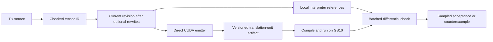

# Checking a Tix-to-CUDA lowering on the GB10

A compiler that preserves the order of every addition can still change thousands of output bits by changing one exponential. The Tix backend illustrates both halves of that observation. On an independent test, a 512 × 512 matrix multiplication produced the same 262,144 single-precision words as the interpreter. In attention, the GPU agreed bit for bit on only 10,618 of 65,536 outputs at the requested size, yet the largest absolute difference scaled by the reference magnitude was only `3.7e-8`. Both computations kept their original reduction order. The second called CUDA’s `expf` where the interpreter called JavaScript’s `Math.exp` and rounded to single precision.

Tix is a small tensor language in IR Workbench, a repository for testing reusable compiler infrastructure across domains. In the first stage, Tix acquired an interpreter and two checked rewrites. This stage added a deliberately simple CUDA backend and asked whether the existing framework could check a lowering whose candidate runs on a remote GPU. The evaluated revision is `9ff60d567f1dbc58ac7aac535c6b443dd95369b0`. It needed no framework source changes. It did need a change to the remote tool, because reusing a compiled executable and sharing a run’s working directory are different operations.

## From tensor equations to threads

Tix functions take named f32 tensors and return one tensor. Statements define tensors in order, and a right-hand side can refer to an input or an earlier definition. In `c[i,j] = sum(k) a[i,k] * b[k,j]`, shape checking establishes the bounds of `i`, `j`, and `k`. Affine subscripts such as `y+dy` are also allowed. The intermediate representation records tensor shapes, resolved index binders, scalar expression trees, and ordered reduction axes. At invocation, the input dimensions bind the symbolic shapes. The calling domain is consistent, nonnegative dimensions, finite input elements, in-bounds accesses, and sizes and index arithmetic representable by the target. Finite inputs can still produce a NaN or infinity.

The backend emits one CUDA kernel per statement of the **current** IR. A linear thread ID identifies one row-major output element. The thread checks the launch boundary, reconstructs the free indices by quotient and remainder, evaluates the scalar expression, and stores the result. The host issues the kernels in statement order on one stream and allocates a separate buffer for each tensor. It skips launches for zero-element outputs. A function that returns an input with no statements requires no kernels. A reduction inside a scalar expression becomes a sequential loop nest, first listed binder outermost. An empty sum leaves its accumulator at `+0`; an empty maximum leaves it at `−∞`. Generated variable names come from resolved binders and internal slots, so a shadowed index or a tensor named like a CUDA identifier does not change the generated code’s bindings.

Here is the inner loop from the emitted matrix multiplication, shortened only by simplifying the generated offset expressions. `v0` and `v2` are the output row and column; `s0` and `s2` are the reduction extent and output column count.

```cuda
float v3 = 0.0f;
for (I v5 = 0; v5 < s0; ++v5) {
  float v6 = p0[v0 * s0 + v5];
  float v7 = p1[v5 * s2 + v2];
  float v8 = __fmul_rn(v6, v7);
  v3 = __fadd_rn(v3, v8);
}
p2[linear] = v3;
```

Each arithmetic operation has its own f32 rounding site, as in the interpreter. CUDA’s explicit round-to-nearest intrinsics for addition, subtraction, multiplication, division and square root keep that intent visible; in particular, the multiplication and addition above are not contracted. The emitter encodes f32 literal bits after rounding in Node and converts integer shape values to f32 only when used as scalar values. Negation flips a sign bit. The min and max helpers propagate NaN and distinguish the signs of tied zeros to match JavaScript. The three transcendental operations use `expf`, `logf`, and `tanhf`. Compilation uses `nvcc -O3 -arch=sm_121`, without fast math.

This layout also lowers rewritten programs. Inlining substitutes the consumer’s affine index tuple into a producer expression and may remove an entire definition. Split-sum replaces a sequential sum with an outer sum over blocks of four and an inner sum over each block’s remaining lanes. The emitter assembles integer block and tail bounds, but leaves the two accumulators distinct. The blocked and original programs can visit identical input addresses in identical order and still round differently: the inner sums introduce new accumulation boundaries. For that reason, the contract uses the current revision as its baseline, not the original source revision.



The emitter walks the tensor IR directly. The output artifact contains the translation unit and small metadata identifying the function, target and protocol. It is not a kernel IR: there is no second internal language of grids, loops, instructions, and buffers to validate or rewrite. For this thread mapping, a kernel IR would restate the statement and reduction structure already available to the emitter. The source artifact is useful nonetheless: it gives the actual text sent to the GPU a revision and a typed output port. The public API separates emitting source (`cudaSource`), running one input (`runTixCuda`), and checking a candidate (`checkLowering`); an ordinary run does not implicitly launch the contract’s samples.

## What the contract establishes

The checked pass compares the candidate’s output shape and all its elements on generated cases. For a finite f64 reference value `r`, the GPU value `g` must be finite and satisfy `abs(g - r) <= 2e-6 + 2e-5 * abs(r)`. The absolute term matters near zero; the relative term scales the budget with magnitude. If an f64 reference element is nonfinite, the comparator uses the current interpreter’s f32 value at that coordinate: NaN must match as a class, infinities must match in sign, and a finite fallback uses the same tolerance formula. Finite comparisons do not distinguish signed zeros; targeted tests cover those. This budget is a criterion on the sampled inputs. It is not a bound for arbitrary well-formed programs, especially those with long reductions, cancellation, or intermediate overflow.

The design probe ran 32,768 arguments per operation on NVIDIA GB10 with nvcc 13.0.88. Against JavaScript’s double result rounded to f32, `expf` mismatched in 9,821 cases, `logf` in 2,257, and `tanhf` in 1,976. The rounded square root matched every tested argument. The largest device error relative to the f64 budget for any of those four probes used less than 0.68% of it. A 1,024-term signed dot product gave `5.511519432067871` on both GPU and f32 interpreter, versus `5.511516308124524` for the f64 calculation. These measurements ruled out exact comparison for the chosen float intrinsics and supported using the stage-1 budget as the starting point for the sampled check.

Cases use seed 20, first trying shape symbols uniformly at 0, 1, 3, 4, and 7, then at mixed extents, including assignments that zero one axis at a time. Input streams include signed and positive values, half-ULP patterns, signed zeros, and subnormals. Buffer and work limits keep the examples small. The baseline, not the GPU candidate, screens out shapes and addresses outside the sample domain. A batch sends the not-yet-decided cases together to the GPU. Its binary records carry case IDs, dimensions, and f32 words, preserving zeros and nonfinite representations that a JSON number array would lose. The host checks record counts, order and lengths before the contract compares outputs. Missing evidence, including a timeout or truncated batch, does not count as acceptance. Numerical rejection can name a case, coordinate, expected value and permitted error.

No framework file changed. The repository’s generic edit pass runner assumes one native IR kind on both sides, which is the wrong abstraction for a transition from checked tensor IR to executable CUDA text. The contract layer already accepts different typed input and output artifacts through `defineTransformation` and `AnalysisManager.execute`. Its asynchronous `differential.decide` callback takes case indices still needing a verdict. We store the local references in the cases, then delegate those indices in one remote invocation. The framework replays completed per-case evidence using keys that include the baseline revision and function, the candidate revision, and the configured engine. The replay is process-local and assumes the configured engine does not change in place during that process. The transformation does not cache accepted outputs; even a repeat passes through the postcondition. The framework provided both the acceptance boundary and the evidence reuse without learning about CUDA or SSH.

The remote tool, `tools/cuda-remote.mjs`, gained opt-in `--standalone` mode. The original mode keyed compilation and working storage by the contents of the entire input directory. Changing only runtime inputs would therefore recompile, and two invocations using one directory key could overwrite each other’s `out/`. Standalone mode stages each invocation independently and cleans up that staging directory. It keys the executable on the full source digest, architecture, compiler path and reported version, and flags. A per-key lock serializes compilation; the executable is published only after a successful compile. Fetch errors are surfaced, and the legacy mode remains available for callers with multiple compile-time files. The Tensor API invokes the tool asynchronously with a 120-second subprocess timeout, covering compilation and transfers as well as device execution.

## Measurement and checks

The generated host allocates and uploads buffers, then calls `cudaFuncGetAttributes` before timing to take CUDA 13 lazy kernel loading out of the first interval, including for a single `runTixCuda` call. The benchmarks warm up once, synchronize, and take three CUDA event intervals in the same process. Each interval covers the ordered kernel sequence; it excludes transfers, allocation, compilation, SSH and startup. The tool’s timing lock serializes other timed invocations, not untimed activity. The local f32 interpreter was timed on the same unoptimized functions and seed-20 f32 inputs, including its normal per-call allocation, on a Core i7-1165G7 with Node 24.18.0. The CPU column measures a whole interpreter call, not the CPU side of the GPU operation. It is therefore not an end-to-end GPU speedup comparison.

| Program | Shape bindings | Kernels | GPU median (ms) | Local f32 (s) |
| --- | --- | ---: | ---: | ---: |
| matmul | M=K=N=512 | 1 | 0.229408 | 514.487 |
| softmax | N=4096, C=1024 | 4 | 0.462656 | 38.215 |
| layernorm | N=4096, D=1024 | 4 | 0.413856 | 67.373 |
| attention | Q=K=1024, D=V=64 | 6 | 0.890080 | 313.957 |
| mlp | N=1024, D=256, H=1024, O=256 | 3 | 0.967872 | 871.406 |
| conv2d | N=8, C=16, H=W=64, O=32; 3×3 | 1 | 0.160992 | 526.903 |

Matmul reports the median of three interpreter calls, which ranged from 327.839 to 827.310 seconds under shared load. To limit load, the remaining CPU measurements are single calls after a small warm-up. The [measurement record](02-cuda-lowering-results-and-corpus-timings.md) contains the GPU samples and reproduction command. No full-size f64 interpreter runs were part of that benchmark.

The Node build and all 24 tensor tests passed. Offline tests cover emission, protocol framing, rejection of corrupt or incomplete results, and cache replay. GPU tests cover sampled acceptance on all six corpus functions, a transposed inline, nested binders, empty extents and reductions, signed zero, NaN, and isolated concurrent invocations sharing a compile. The split-order test compares output words: a seven-term sum gives `0x3f800000` sequentially and `0x3f800002` after splitting. A deliberately changed CUDA candidate that drops the final reduction term compiles and runs but fails the actual contract. The word test and the mutant test catch different bugs; the tolerance that accepts a valid split is too large to catch the loss of two low-order bits in that small order witness.

## Independent evaluation and attribution

The independent evaluator confirmed all three exports and passed the 25-test stage-1 hidden suite. Its `checkLowering` calls accepted all six corpus programs and ten random programs, with relation `tolerance`, averaging 3.1 seconds per check. The following results are separate output comparisons via `runTixCuda`. The f32 error column gives the largest difference scaled by `max(1, abs(reference))`; the f64 column reports the evaluator’s largest supplied f64 difference. The optimized rows compare against the interpreter of the same optimized program, not against its unsplit predecessor.

| Small case | f32 words identical | Max scaled f32 difference | Max f64 difference | Cause of f32 differences |
| --- | ---: | ---: | ---: | --- |
| matmul | 35/35 | 0 | 3.2e-7 | None |
| softmax | 54/76 | 3.0e-8 | 5.3e-8 | `expf` |
| layernorm | 72/72 | 0 | 1.3e-7 | None |
| attention | 56/72 | 6.0e-8 | 6.6e-8 | `expf` |
| mlp | 21/24 | 8.9e-8 | 3.6e-7 | `tanhf` |
| conv2d | 160/160 | 0 | 3.1e-7 | None |
| optimized matmul | 35/35 | 0 | 2.2e-7 | None |
| optimized softmax | 56/76 | 3.0e-8 | 4.9e-8 | `expf` |
| optimized attention | 47/72 | 3.0e-8 | 4.4e-8 | `expf` |
| optimized mlp | 18/24 | 1.2e-7 | 3.4e-7 | `tanhf` |

| Full-size case | f32 words identical | Max scaled f32 difference | Independent `gpuMs` (ms) | Cause of f32 differences |
| --- | ---: | ---: | ---: | --- |
| matmul | 262,144/262,144 | 0 | 0.219 | None |
| softmax | 2,616,298/4,194,304 | 3.7e-9 | 0.496 | `expf` |
| layernorm | 4,194,304/4,194,304 | 0 | 0.627 | None |
| attention | 10,618/65,536 | 3.7e-8 | 1.827 | `expf` |
| mlp | 231,045/262,144 | 2.2e-5 | 0.946 | `tanhf` |
| conv2d | 984,064/984,064 | 0 | 0.347 | None |

The independent `gpuMs` column is an API measurement, not the median benchmark above. Its full-size f32 differences likewise do not measure the f64 contract budget. In particular the MLP result does not establish a full-size contract rejection: later multiplies and sums can carry the activation discrepancy to the returned tensor, and the scaled error against f32 is not the sampled f64 comparison. Even when there is no f32 discrepancy, the f64 interpreter lacks the GPU’s intermediate f32 rounding, including in the ordered reductions. Nonzero f64 distance in those rows does not identify a lowering error.

The operations responsible for the corpus mismatches are selected at `src/tensor/cuda-source.ts:13` (`expf`) and `src/tensor/cuda-source.ts:16` (`tanhf`) and emitted at line 174. Softmax and attention exponentiate a max-shifted value; the discrepancy then enters normalization and, in attention, the weighted value sum. MLP uses `tanhf` in its GELU approximation, before the final linear layer. A follow-up [diagnostic](../scripts/03-isolate-intrinsics.mjs) compiled the original emitted text alongside temporary diagnostic copies. It replaced just the relevant intrinsic in each copy with the CUDA double call rounded to f32. Across small softmax, attention, and MLP instances, the stock kernels differed on 23, 13, and 5 outputs respectively; the optimized stock kernels differed on 27, 9, and 6. Every widened copy matched the corresponding interpreter on all words. This was one untimed invocation on separately generated inputs, not a rerun of the independent fixtures or a modification of the backend.

Among 20 independently generated programs, 16 agreed exactly on every element; the largest difference in that experiment was `1.2e-7`. The primitive-level candidates are `expf`, `logf`, and `tanhf` (`src/tensor/cuda-source.ts:13`, `:14`, and `:16`); the GPU probe exhibited a difference for each one. The aggregate random-program results contain no program bodies or mismatch traces, so they cannot identify which of those calls ran in each of the four mismatching programs. There is no evidence of a changed reduction order in that aggregate.

## What I would do differently

Tolerance is the strongest of the two offered *uniform* relations supported by this implementation and its samples: exact f32 equality is contradicted by the emitted float transcendental calls, and the sampled tolerance was exercised successfully without claiming a global error bound. The coordinator independently found that CUDA double `exp`, `log`, and `tanh`, rounded back to f32, match the corresponding JavaScript operations over all 2³² input words on the GB10, treating NaN as a class. The IEEE arithmetic and square root already match the f32 rounding rule. That makes an exact f32 check, with explicit NaN-class equivalence and signed-zero checks, a credible target for a **different emitter** in the tested environment; it is not evidence that the evaluated float-call emitter is exact.

I would probe those widened intrinsics before picking a whole-program relation. The first probe answered whether the float calls were good enough for a tolerance test, but not whether a small substitution could make the ordered baseline exact. With a stronger primitive probe up front, an exact sampled contract could diagnose even one lost low bit and leave tolerance to rewrites that intentionally change grouping. I would measure the cost of widened calls separately rather than assume that the measured float-call timings carry over. For independent random testing, I would also keep the seed, generated programs, and first mismatch (including the offending operation when available), so the four aggregate failures could be attributed individually. None of those changes is part of the evaluated backend.
