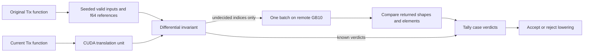

# Checking a Tix lowering on the GB10

A matrix multiplication produced the same 262,144 single-precision words on a GPU and in a JavaScript interpreter. An attention program on the same machine produced identical words at only 10,618 of 65,536 positions. Both programs used the same lowering for dot products. The difference that matters here is in the softmax *between* the two matrix products in attention: CUDA's single-precision exponential can differ from the exponential that the language specifies. A small change to one weight can affect many outputs without a single multiplication being rounded incorrectly.

Tix is an index-notation language built to test IR Workbench, a compiler framework. The question for its second stage was whether a pass could lower a tensor function to a different representation and check its meaning by running the candidate on a remote GPU. At revision `0bf5f99` the answer was yes, with no changes to the framework or the remote tool. The evidence is a sampled comparison against a double-precision reference, not a proof of exact lowering. The choice of numerical relation turns out to depend on three lines of the emitter.

## From tensor definitions to CUDA

A Tix statement defines an entire tensor. In `y[i,j] = sum(k) a[i,k] * b[k,j]`, the free axes `i` and `j` select an output element. The reduction axis `k` traverses the inner dimension of the two input matrices. The front end resolves these names to binder identities and records their extents. Its executable representation also records each tensor's symbolic shape, affine subscripts such as `y+dy` in convolution, and a scalar expression tree for each definition. A program handle retains both the original module and its current, possibly optimized revision.

The lowering emits CUDA C directly from the selected function in the current revision. It does not construct a kernel IR. At this stage the statement already specifies the materialization boundary, and the ordered expression tree already specifies the fold. There is no scheduling decision for another IR pass to make. The output of the transformation is still a framework artifact: its value is the complete translation unit. This gives the checker an identity for the exact source being compiled without introducing a second set of editable loop and tensor entities.

There is one kernel per definition. Each thread first checks its flat index against the output size and decodes it into row-major coordinates. It computes one scalar and stores it once. A reduction takes place entirely within the thread: it starts at positive zero for a sum or negative infinity for a maximum and visits its indices in increasing order, first listed outermost. In the emitted matmul kernel the end of the loop and the store are literally:

```cuda
float v4=__fmul_rn(v5,v6);
v2=__fadd_rn(v2,v4);
}
t2[at]=v2;
```

Here `v5` and `v6` hold the two indexed loads; `v2` was initialized to `0.f` before the loop. The intrinsics force a separately rounded multiply and add rather than a fused multiply-add. Subtraction and division likewise use round-to-nearest intrinsics. Literals enter the kernel as the bit patterns obtained by rounding their parsed values to f32. Shape values used in scalar expressions convert to float; shapes, strides and affine indices used for addressing remain integers. Maximum and minimum propagate NaNs rather than silently returning the other operand.

Ordinal CUDA names distinguish user tensors, dimensions and binders even when their source spellings coincide. The same machinery handles a pointwise expression inlined through a transposed read. After `split-sum`, the IR contains *two* folds, an outer one over blocks of four and an inner one over lanes bounded by the remaining tail. Emitting both accumulators matters: turning this back into one flat sum would undo the optimizer's chosen grouping. Empty reductions return their initializer; an empty output needs no kernel launch.

The generated `main` reads shapes and binary f32 inputs, allocates buffers, transfers the parameters, and launches the kernels in definition order on one stream. It copies back the returned tensor, which can also be a parameter. The packet carries case ordinals and result shapes so a check cannot compare the right numbers from the wrong batch position. `cudaSource` returns the source, `runTixCuda` runs a supplied input and returns the shape, f32 data and event time, and `checkLowering` applies the pass contract. The caller can run a case without silently paying for a whole validation campaign.

## Which meaning, and whose evidence?

The f32 interpreter applies JavaScript arithmetic or a `Math` function and rounds after **each** scalar operation and fold step. The f64 reference uses the same traversal without the f32 rounds. These give two distinct questions: did CUDA reproduce the current expression's words, and is the value still within the allowed distance of the original computation? They need not have the same answer. Even an exactly implemented split sum can differ from the original f32 sum because its partial sums meet in a different order.

Before selecting the contract, I ran an untimed probe through the remote tool. CUDA 13.0.88 compiled with `-O3 -arch=sm_121`, without fast math. The probe evaluated 16,384 f32 inputs starting at −8 in increments of 1/1024, using `x+9` for log and sqrt. Compared to rounded JavaScript results, `expf` differed on 5,007 inputs, `logf` on 902, `tanhf` on 1,264 and `sqrtf` on none. At −7.998046875, for example, the rounded JS exponential is 0.0003361184790264815; `expf` returned 0.00033611844992265105. This is a counterexample to bit identity of the selected operation, without any uncertainty about subscript calculations or reduction order.

The pass kept the existing stage-1 elementwise allowance. For a finite original f64 result `r`, the CUDA result must be finite and satisfy `abs(gpu − r) ≤ 2e-6 + 2e-5*abs(r)`. It must also have the expected shape. The absolute term covers small residuals where relative error alone would be misleading. The intrinsic probe used at most 0.00657 of one such allowance. That observation does not bound a long chain of operations; the check therefore evaluates the final outputs as well. The oracle stays the **origin** even for an optimized input to lowering, so the backend does not receive an additional budget on top of a previous rewrite.



The generator tries symbolic sizes 1, 3, 4 and 7, then a mixed assignment cycling through 3, 5 and 7 in sorted name order. It deduplicates equal assignments. Seed 20 supplies reproducible asymmetric signed and positive inputs; a third stream repeats values including half an ulp at one to exercise accumulation. Cases are selected from the original program, bounded to 4,096 elements per tensor and a million evaluation steps. Invalid shapes, out-of-domain accesses and cases whose reference result is not finite do not justify acceptance. The gate cannot pass without a decided case. Separate execution tests cover behavior, such as an empty maximum, that a finite-reference tolerance check does not certify.

**Framework change ledger: none.** The same-representation pass runner expects one adapter; a CUDA source string is not a new revision of the Tix tree. Existing transformation ports can instead bind origin, current module and function name to an output of another type. An `ensures` condition runs the differential invariant against the *actual output*. Its asynchronous `decide` callback receives all undecided case indices together. It submits one packet, compares in order and returns per-case verdicts. The framework reuses cases by origin revision and function within a versioned specification, and replays decided verdicts by candidate revision and case. A different emitted string cannot borrow the good string's verdict. This process-local memo needs neither a long-lived analysis record containing binary packets nor a remote environment discovery service.

**Remote tool change ledger: none.** `tools/cuda-remote.mjs` already ships a directory, caches compilation for identical inputs, runs the executable and retrieves `out/`. The tensor runner invokes it as an asynchronous child with a fresh local directory. Compile reuse and verdict reuse save different work: the first still executes the binary; the second avoids the remote invocation for already-decided cases. The experiment did not require concurrent execution of identical packets against the tool's shared remote directory.

## Checks and measurements

`npm run build` succeeded and `node --test tests/tensor/*.test.mjs` passed 23/23. Local tests include independent small corpus oracles, packet validation and the original optimizer checks; a dedicated network test file exercises the GPU path. Tests include shadowing, a transposed inlined read, a partial split block, parameter return, empty reductions, signed zero and an intermediate NaN. A warm check replayed the cold check's verdicts. Changing the emitted block count to round down then ran a different candidate through the same postcondition: it compiled and ran but failed at a reported output coordinate. Compilation success alone would have missed the dropped tail.

All six unoptimized corpus checks passed. In the order matmul, softmax, layernorm, attention, MLP and convolution, they had 15, 15, 14, 15, 15 and 12 eligible cases. Their largest fractions of the budget were respectively 0.02887, 0.00638, 0.01282, 0.01000, 0.03253 and 0.24668. The last occurred in convolution's signed stream at flat index 699 for an output of shape `[7,7,5,5]`. Convolution can be bit-identical to the f32 interpreter yet use more of an **f64** allowance than softmax does. The accumulation rounds on both f32 engines but not in the f64 reference.

For timing, both machines received the same seed-22 f32 input words, checked by digest. On shared host `f` (Intel i7-1165G7, Node 24.18.0), one wall-clock interval around unmodified `runTix` followed a smaller warmup; the time includes its normal allocations and host contention. On the GB10, `cudaFuncGetAttributes` preloaded each kernel to keep CUDA's lazy module loading out of the event interval. The locked measurement used one warmup and three timed sequences with inputs resident. Events bracketed the kernels, not compilation, process startup or transfers. The table gives the median and range; CPU times are rounded to milliseconds.

| Program and dimensions | CPU f32 ms | GPU ms, median (range) |
|---|---:|---:|
| matmul M=K=N=512 | 288981 | 0.1834 (0.1826–0.1884) |
| softmax N=4096 C=1024 | 13652 | 0.5152 (0.5113–0.5222) |
| layernorm N=4096 D=1024 | 21412 | 0.4754 (0.4740–0.4766) |
| attention Q=K=1024 D=V=64 | 197772 | 0.9762 (0.9730–0.9832) |
| MLP N=1024 D=256 H=1024 O=256 | 2137183 | 0.8637 (0.8573–0.8666) |
| conv2d N=8 C=16 H=W=64 O=32, kernel 3×3 | 488625 | 0.1631 (0.1623–0.1649) |

These are not end-to-end application speedups. The interpreted MLP alone took over 35 minutes; a remote contract includes transport that the sub-millisecond kernel timing deliberately omits. The first and last output elements agreed within 0.000002 for all six timing inputs. That is only a sanity check. The independent evaluation below compared whole output tensors. The ticket retains the [CPU intervals](../sources/cpu.jsonl), [GPU intervals](../sources/gpu.jsonl), [error maxima](../sources/budget.jsonl) and [reproduction commands](01-stage-2-diary.md).

## Independent evaluation and diagnosis

The independent evaluator reported 25/25 passes in the stage-1 hidden suite and all three new exports present. The following are its measurements, not additional local trials. “Exact” counts output words equal to those of the f32 meaning. The maximum f32 difference is scaled by `max(1, |r|)`; the last column in the first table gives the reported maximum difference from f64. For optimized rows the f32 comparator ran the **optimized** program. An em dash for the cause means no observed f32 discrepancy.

| Small program | Exact / total | Max vs f32 | Max vs f64 | First differing operation |
|---|---:|---:|---:|---|
| matmul | 35/35 | 0 | 3.2e-7 | — |
| softmax | 54/76 | 3.0e-8 | 5.3e-8 | expf |
| layernorm | 72/72 | 0 | 1.3e-7 | — |
| attention | 56/72 | 6.0e-8 | 6.6e-8 | expf |
| MLP | 21/24 | 8.9e-8 | 3.6e-7 | tanhf |
| conv2d | 160/160 | 0 | 3.1e-7 | — |
| matmul, inline + split | 35/35 | 0 | 2.2e-7 | — |
| softmax, inline + split | 56/76 | 3.0e-8 | 4.9e-8 | expf |
| attention, inline + split | 47/72 | 3.0e-8 | 4.4e-8 | expf |
| MLP, inline + split | 18/24 | 1.2e-7 | 3.4e-7 | tanhf |

| Full-size program | Exact / total | Max vs f32 | Evaluator's `gpuMs` | First differing operation |
|---|---:|---:|---:|---|
| matmul | 262144/262144 | 0 | 0.198 | — |
| softmax | 2616298/4194304 | 3.7e-9 | 0.475 | expf |
| layernorm | 4194304/4194304 | 0 | 0.501 | — |
| attention | 10618/65536 | 3.7e-8 | 1.435 | expf |
| MLP | 231045/262144 | 2.2e-5 | 1.012 | tanhf |
| conv2d | 984064/984064 | 0 | 0.355 | — |

Softmax calls `exp` on the input minus the row maximum. Line 104 of `src/tensor/cuda-source.ts` chooses `expf`; the f32 oracle calls `Math.exp` on the promoted argument and rounds the double result. A difference can change both the numerator and the row sum used by every division. Attention makes the same call on its shifted scores and feeds the resulting weights into another dot product. Its `sqrt(D)` is not another approximation of this kind. In MLP, line 107 selects `tanhf` in the GELU activation. Differences there pass through the second affine layer; the 2.2e-5 full-size scaled difference is an **output** error, not a measured error of that size in one tanh call. Neither that metric nor its reference is the contract's error test.

In each optimized comparison both engines execute the blocked fold. Grouping can change the inputs to an intrinsic or the way a difference propagates, explaining why the counts can change; it is not a backend reassociation. The nonzero differences from f64 also include ordinary f32 rounding of literals, arithmetic and every fold update. Even for an all-exact f32 row it would be incorrect to attribute its f64 residual to a particular faulty CUDA instruction. The maxima alone do not identify individual rounding steps.

Of 20 random core programs, 16 were exact on every element; the reported maximum difference was 1.2e-7. The backend has a third discrepant mapping, `logf` at `src/tensor/cuda-source.ts:105`, as well as `expf` and `tanhf`. All three have direct single-operation witnesses. For finite numerical differences these are the suspect operations in the random group; no random source listings, per-program intrinsic traces or failing inputs accompanied the aggregate. It cannot establish which of the three fired in each of the four programs, or even that `logf` fired in this group. Independently, `checkLowering` accepted six corpus and ten random functions, 16/16 with relation `tolerance`, averaging 3.0 seconds per check. Acceptance describes those generated cases, not all possible inputs to those functions.

## What I would change

I would have compared two implementations of each transcendental *before* settling on a backend relation. The coordinator independently tested CUDA double `exp`, `log` and `tanh` followed by `__double2float_rn` against the corresponding rounded JavaScript functions on **all 2³² f32 input words** on the GB10. They agreed with NaNs compared as a class. In IEEE mode the basic arithmetic and `sqrtf` also round as the f32 meaning requires. My original probe falsified exactness for the float library calls I emitted; it did not falsify exactness for CUDA. There was no need to assume that reproducing the JS result would require implementing a math library from scratch.

Of the two uniform relations offered for this evaluated backend, tolerance is the strongest defensible choice: bit identity to current f32 is false, with single-operation counterexamples and whole-program mismatches. The chosen constants are a sampled acceptance budget, not the tightest possible bound or a theorem about every Tix function. There is stronger evidence for the arithmetic-only subset. With a *different* lowering using the tested double functions and an explicit NaN comparison policy, I would check GPU results directly against current f32, keeping the original-f64 budget separately for earlier rewrites that change grouping. That would isolate code generation errors from error already authorized by the optimizer. No such change was made to the evaluated revision.
