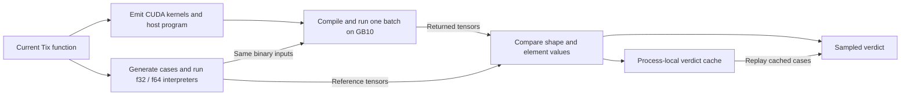

# Lowering Tix to CUDA with a checked contract

IR Workbench uses one compiler framework for two domains. Typed is a small language that targets 32-bit
RISC-V. Tix is an index-notation language for tensors. Tix gives the framework a second kind of execution
model to check. Before this stage, it had a frontend, interpreters at two precisions and two checked
rewrites. This stage added a CUDA backend and asked whether the same framework could check a lowering
whose candidate runs on a remote GPU. It could. The existing transformation and differential-checking
APIs were sufficient, and the independent evaluator found matching f32 output words in every comparison
it reported. The shipped contract still uses tolerance. The distinction between the implementation and
what its contract actually enforces is the main finding.

## From tensor statements to kernels

A Tix function describes its inputs, defines a sequence of tensors and returns one tensor. A statement
defines every element of a tensor by an expression in its output indices. A reduction introduces extra
indices with their own bounds and lexical scope. The earlier frontend resolves these scopes and records
the integer affine expressions used for shapes and addresses. It also records reduction bounds and their
order. The f32 interpreter rounds each scalar operation and every accumulation step. The f64
interpreter walks the same tree with JavaScript numbers and omits these f32 rounding steps. An output
can depend on the location of a rounding step, even when all inputs are representable exactly in f32.

The backend walks the selected function in the current Tix revision and directly emits CUDA C. It
generates a kernel per statement, submits those kernels in statement order on one stream and materializes
a separate buffer for each definition. Each in-range thread computes one output element. Within that
thread, the emitter decodes the flat index into row-major coordinates and evaluates the scalar expression
for those coordinates. Integer affine arithmetic stays in the address calculation. A zero-sized statement
is skipped at launch. A nonempty statement with an empty reduction domain still evaluates its expression,
using positive zero for an empty sum or negative infinity for an empty maximum. A function may also
return a parameter. [CUDA emitter](../../../../../../src/tensor/cuda-source.ts)

The emitted matmul has a private accumulator and a sequential inner loop. This excerpt retains the
generated identifiers and simplifies the affine offset expressions for readability. Here `d0`, `d1` and
`d2` bind the row extent, the reduction extent and the column extent.

```cuda
const long long flat = (long long)blockIdx.x * blockDim.x + threadIdx.x;
if (flat >= count) return;
const long long i0 = flat % d2;
const long long i1 = (flat / d2) % d0;
float acc2 = 0.0f;
for (long long i3 = 0; i3 < d1; ++i3) {
  acc2 = __fadd_rn(acc2, __fmul_rn(p0[i1 * d1 + i3], p1[i3 * d2 + i0]));
}
out[flat] = acc2;
```

The multiply and add have separate rounding sites. Ordinary scalar addition, subtraction and
multiplication use the corresponding CUDA round-to-nearest instructions, with the same addition
instruction at each sum step. Literals are converted to f32 by the emitter and embedded as their
32-bit words. Scalar shape values use a round-to-nearest integer-to-f32 conversion. Division widens
both operands, uses round-to-nearest double division and converts the result to f32. The `exp`, `log`,
`sqrt` and `tanh` helpers also operate in double and round their result once to f32. The minimum and
maximum helpers explicitly propagate NaNs and preserve the specified ordering of signed zeros.
Compilation uses `nvcc -O3 -arch=sm_121`, with no fast-math option. The explicit rounded instructions
keep the dot product from turning into a fused multiply-add. [Arithmetic emission](../../../../../../src/tensor/cuda-source.ts#L4)

The same emitter handles both Stage 1 rewrites. Inline replaces a tensor read with an expression whose
addresses may be composed affine expressions. Those addresses follow the ordinary load path. Split-sum
turns an eligible reduction into a nested reduction with block and tail bounds. Each level gets its own
accumulator and each loop follows the order recorded in the rewritten tree. The comparison therefore
uses the rewritten revision's interpretation. An order-sensitive test illustrates the distinction. The
values `[1, 0, 0, 0, 2^-24, 2^-24, 2^-24]` produce exactly `1` in the original sequential sum and
`1 + 2^-22` after splitting. The CUDA backend returned both expected words, each for its corresponding
revision. [Split witness](../../../../../../tests/tensor/cuda-gpu.test.mjs)

Direct emission was the smaller choice for this backend. The Tix representation already contains the
loop nests, binder identities and normalized addresses the emitter needs. The only output consumed
here is a complete CUDA translation unit. A separate kernel IR would require a second representation,
a conversion pass and an emitter, and there would be no consumer for the intermediate form in this
stage. CUDA text is consequently a typed result of the transformation. This keeps the boundary between
the framework and the target explicit without introducing a second IR.



## What the contract checks

The public API separates three operations. `cudaSource` emits the source for inspection.
`runTixCuda` executes it on caller-supplied inputs and returns the shape, a `Float32Array` and the
CUDA event time. `checkLowering` asks the framework to execute a typed transformation whose
postcondition compares the emitted source on generated cases. The framework awaits that postcondition
before returning an accepted transformation. Source emission itself is cheap and is repeated. The
GPU comparison is the work worth reusing. [Public entry points](../../../../../../src/tensor/index.ts#L53)

The checker derives cases from the selected **current** function. It tries uniform shape assignments of
0, 1, 3, 4 and 7, plus a mixed 3/5/7 assignment, and deduplicates equivalent shapes. The four input
streams include signed and positive pseudorandom data, a repeating half-ULP pattern and alternating
signed zeros. The generator uses seed 20. Sampling skips invalid shapes and accesses and bounds the
cost at 4,096 elements per tensor and one million scalar or loop visits per evaluation. It computes
both references on the same f32 input words before handing the batch to the GPU. The checker returns a rejection if no case qualifies.

The comparator requires the returned shape and element count to match. Let `s` be the f32 result
and `r` the f64 result for one coordinate, and let `B(x) = 2e-6 + 2e-5 * abs(x)`. When both references
are finite and `abs(s - r) <= B(r)/2`, it requires a finite GPU value within `B(r)` of `r`.
Otherwise it compares with `s`, using `B(s)` for finite values and exact classification for NaN and
the two signed infinities. If the GPU and f32 values are both zero, it also checks their signs.
A disagreement gives a reproducible case description, a coordinate, both reference values and the
GPU value. The returned relation is `tolerance`. [Comparator and sampling](../../../../../../src/tensor/cuda-contract.ts#L37)

Originally the practical question was whether CUDA and JavaScript would agree closely enough at the
rounding points. A CUDA probe on the GB10 tested 65,536 rows with finite f32 operands, including signed
zeros, subnormals, extreme values and seeded samples. It matched every sampled non-NaN f32 word. It also
exposed a raw NaN-word difference in the double log helper. For input `-1`, Node produced
`0x7fe00000` and CUDA produced `0xffc00000` in that probe. Both results are NaNs. Among the sampled
finite pairs, the largest error relative to the chosen f64 budget was about 0.003 for individual
operations and 0.00813 for the seven-term sum. Those observations supported a useful sampled budget.
They left open what would happen at other inputs and through longer expressions.

A separate probe made the case for keeping an f32 fallback under the chosen design. On the same
operands, `(2^24 + 1) - 2^24` returns zero in f32 and one in f64. The addition has already discarded
the unit increment before the subtraction runs. A fixed, tight f64 envelope at every coordinate
would reject both the CUDA and interpreter implementations of this example. The fallback instead
checks the outcome of the evaluation model that Tix actually prescribes. [Original GB10 probe](../scripts/02-probe-numerics.mjs) · [Local rounding witnesses](../scripts/04-rounding-witnesses.mjs)

A cache miss delegates every uncached case in one executable invocation. The generated host program
reads a little-endian binary batch with case IDs, concrete dimensions and f32 words, then writes the result shape,
event time and f32 words for each ID. The binary format preserves bits, including negative zero.
The Node runner checks the framing, counts and IDs. The baseline key identifies the current revision
and function, and the checker version identifies its sample policy. The subject key identifies the
generated source and the pinned target and compiler policy. The existing process-local differential
cache retains reference cases and completed verdicts under those keys. A failed or incomplete
execution yields no verdict to replay. [Batch runner](../../../../../../src/tensor/cuda-run.ts) · [Differential adapter](../../../../../../src/tensor/cuda-contract.ts#L102)

## Framework and remote tool

No framework files changed. The existing `defineTransformation` supports the two different port types,
Tix IR and CUDA source text. Its `ensures` postcondition can invoke an asynchronous differential
checker. The differential hook already supports submitting a batch of undecided indices and replaying
completed results. An integration probe exercised this path with a real Tix artifact and a scalar
output port. Repeating an output reused its verdict, and changing the output delegated again and failed
acceptance. Extending the same-IR pass runner would have duplicated a boundary the transformation API
already supplied.

The remote tool needed changes because its previous cache keyed the whole input directory and used
that directory as the run location. The opt-in `--source-only` mode separates the identity of
standalone `main.cu` from the binary data passed to it. The executable cache also includes the compiler
identity and build policy. The default mode continues to key the staged file bundle. Every invocation
gets a private remote working directory, so repeated or concurrent executions can use one executable
with different inputs and outputs. A per-build lock and atomic rename prevent another invocation
from running a partially compiled file. Copy, build or execution, and fetch failures surface with
diagnostics. These changes make independent verdict reuse and executable reuse safe at their
respective boundaries. The benchmark still obtains the existing exclusive lock via `--timed`.
Ordinary runs retain their previous behavior. [Remote tool](../../../../../../tools/cuda-remote.mjs)

## Measuring execution

The benchmark used the original corpus functions. It generated identical finite f32 data on both
paths with seed 20, scaling the pseudorandom values to [−0.25, 0.25) and using a fixed positive epsilon
for layer normalization. CPU times are the Stage 1 f32 interpreter's wall time on Node v24.18.0.
They include its allocations and input conversion. The benchmark warmed up the interpreter on a
small case and recorded one full-size run per workload. The initial plan called for three full-size
CPU trials. A single matmul trial approached three minutes on the shared machine, so the measurements
use one trial throughout.

The CUDA host program creates the context, allocates and uploads the inputs, and preloads each active
kernel via `cudaFuncGetAttributes` before recording the first event. CUDA 13's lazy loading made the
preload necessary even for the one-shot public API. The program records events around the launches on
the same stream and synchronizes the ending event before reading the elapsed time. The resulting
interval includes any gaps between launches on the stream. Allocation, transfers, process startup
and the SSH exchange are outside it. For the retained benchmark, the tool held its exclusive timed
lock while the program ran one warmup and five measured intervals. The independent evaluation
reported its own `runTixCuda` intervals, also shown below.
[Benchmark driver](../scripts/03-benchmark.mjs) · [Raw timing records](02-cuda-verification-and-corpus-timings.md)

| Program | Shape bindings | GB10 median (ms) | Local f32 (s) | Independent GPU (ms) |
| --- | --- | ---: | ---: | ---: |
| Matmul | M=512, K=512, N=512 | 0.246 | 177.804 | 0.234 |
| Softmax | N=4096, C=1024 | 0.938 | 17.333 | 0.941 |
| Layernorm | N=4096, D=1024 | 0.816 | 27.367 | 1.775 |
| Attention | Q=1024, K=1024, D=64, V=64 | 1.119 | 209.486 | 7.311 |
| MLP | N=1024, D=256, H=1024, O=256 | 1.087 | 828.263 | 1.027 |
| Conv2d | N=8, C=16, H=64, W=64, O=32 | 0.162 | 394.405 | 0.350 |

The local GPU column summarizes warmed trials from one measurement protocol. The independent
column gives separately reported API intervals. The two series provide no per-kernel traces or
matched repeated runs to explain the larger differences, including the attention result.

## Verification and independent evaluation

The build and the 33 focused tensor tests passed. Local tests exercised deterministic source,
binary framing, both numerical rules, split bounds, and the behavior of the verdict cache after an
interruption. GPU tests checked the six corpus functions through the contract and exercised optimized
programs, ordered and nested reductions, zero extents and nonfinite results. A changed-read mutant
was valid CUDA and executed on the GPU, then failed the actual framework postcondition. Transport
tests showed that two simultaneous invocations with the same source and different payloads compiled
once and fetched the correct independent results. They also exercised a missing result file and a
failed fetch. [Local tests](../../../../../../tests/tensor/cuda.test.mjs) · [GPU tests](../../../../../../tests/tensor/cuda-gpu.test.mjs)

The independent results below apply to commit `dcc3de3`. The inherited hidden suite passed 25 of 25
cases and found all three CUDA API exports. All 20 random fixed-core programs agreed with f32 on every
element. The six corpus functions and ten random programs passed `checkLowering` 16 of 16 times
under its shipped tolerance policy, at a mean of 3.1 seconds per check. The remaining rows distinguish
bit agreement with f32 from the evaluator's reported gaps against f64.

| Program | Small, f32 words matched | Small, largest f64 gap | Optimized small, f32 words matched | Optimized small, largest f64 gap | Full-size, f32 words matched |
| --- | ---: | ---: | ---: | ---: | ---: |
| Matmul | 35/35 | 3.2e-7 | 35/35 | 2.2e-7 | 262,144/262,144 |
| Softmax | 76/76 | 5.3e-8 | 76/76 | 4.9e-8 | 4,194,304/4,194,304 |
| Layernorm | 72/72 | 1.3e-7 | — | — | 4,194,304/4,194,304 |
| Attention | 72/72 | 6.6e-8 | 72/72 | 6.0e-8 | 65,536/65,536 |
| MLP | 24/24 | 3.6e-7 | 24/24 | 4.6e-7 | 262,144/262,144 |
| Conv2d | 160/160 | 3.1e-7 | — | — | 984,064/984,064 |

All reported f32 differences were zero, including when scaled by `max(1, abs(r))`. The optimized
rows compare the GPU with the f32 interpreter of the optimized function. The evaluator supplied only
aggregate f64 maxima, without the input tensors, output coordinates or intermediate values at those
maxima. That permits a diagnosis of the precision difference and a trace to the emitted operations
that introduce it. It does not identify a single instruction responsible for each reported maximum.

Matmul and conv2d use the same two rounding sites in their inner loops, one after each multiply and
one after each accumulation. Split matmul reaches those same sites with separate block and tail
accumulators. Softmax rounds the shifted logits, the exponential of each shifted logit, the running
sum and the final division. The split variant uses separate accumulators at the sum levels.
Layernorm rounds the mean and variance folds, centering and squaring, the square root and the
arithmetic that scales and shifts the normalized value. Attention combines the rounded score dot
product and scaling with the softmax operations and a rounded weighted-value dot product. The
optimized version has split sums. The MLP rounds its affine layers and the literals, arithmetic and
`tanh` in its GELU expression. Splitting the affine sums changes their grouping before lowering.
Exact max selection on finite operands can pick up an earlier difference, but introduces no
rounding error of its own. The diary links these sites to source lines for each of the ten f64 gaps.
A local script isolates representative rounding sites using fresh inputs. It does not reconstruct the
independent evaluator's inputs or maxima.
[Operation mapping](../../../../../../src/tensor/cuda-source.ts#L4) · [Sum-step emission](../../../../../../src/tensor/cuda-source.ts#L90) · [Diagnostic diary](01-diary.md)

## What I would do differently

I would check exact f32 equality on the supported GB10 target, comparing output words for non-NaNs
and treating NaNs as one class. The coordinator independently compared CUDA's double `exp`, `log`
and `tanh`, rounded to f32, with JavaScript's corresponding f32 results across all 2³² f32 input
encodings, with agreement when NaNs were compared as a class. That evidence, the matching IEEE
arithmetic and square-root semantics, and the emitted reduction order support a stronger sampled
postcondition on the current revision than the finite tolerance we shipped. The original `log(-1)`
probe still rules out raw bit equality for every result, including NaN encodings. Exact sampled
agreement with this NaN rule would catch finite one-bit errors that the current budget can admit,
while leaving f64 useful for assessing changes to the numerical algorithm, such as split-sum.
This is a conclusion about the stated compiler mode, engine and target. The independent checks establish agreement at the operation level and test a sample of full programs.

I would also record paired timing samples using the one-shot API and the warmed benchmark, with the same
inputs and per-kernel intervals when investigating a divergence. That would make the two timing
columns easier to interpret, particularly for the multi-kernel attention workload. For numerical
differences, I would retain the input seed or tensor words, the output coordinate and the intermediate
values at the maximum. An aggregate error is useful for describing scale. Replaying its path is what
lets a reader tell whether one rounding site dominates or several accumulate.
