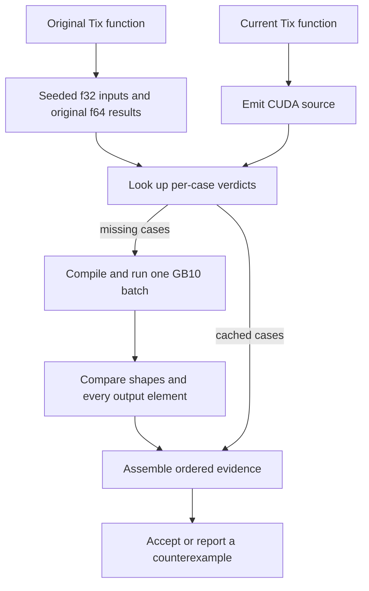

# What a GPU lowering preserves

On a 512 × 512 matrix multiplication, the GPU returned the same 262,144 single-precision words as the Tix interpreter. On attention, only 10,618 of 65,536 words matched, although the largest scaled difference was just 3.7 × 10⁻⁸. Both programs used the same compiler, the same mapping from output coordinates to threads, and sequential reductions. The first numerical divergence is in the device math call. Matrix multiplication needs rounded multiplies and adds. Attention also needs an exponential, and the CUDA function we selected can return a neighboring f32 value.

Tix is the second language in IR Workbench, a compiler framework originally exercised by a statically typed language targeting RISC-V. Tix describes tensor calculations in index notation. It serves as a test of what the framework can express, particularly when checking the meaning of a transformation costs more than performing it. Stage 1 supplied a typed tensor IR, two interpreters and two checked rewrites. Stage 2 added direct CUDA emission and a pass that gets its numerical evidence by executing the emitted program on a remote NVIDIA GB10. This report covers the independently evaluated revision `a441c31`.

## From an index expression to a kernel

Consider the Tix statement `y[i,j] = sum(k) a[i,k] * b[k,j];`. It defines a new tensor. The left-hand indices enumerate output coordinates, and the reduction binds a private index over the common input dimension. The f32 interpreter starts the sum at positive zero, visits k in increasing order, rounds each product to f32 and rounds again after adding it to the accumulator. More generally, it implements scalar operations as JavaScript number operations followed by `Math.fround`. Its f64 reference traverses the same expressions and indices in double precision. A small difference from f64 is possible even when every output word agrees with the f32 interpreter.

The backend emits one kernel per statement of the **current** function. An active thread owns one output element. It decodes its linear thread index into row-major coordinates, evaluates the right-hand side and stores once. Here is the emitted inner loop for matrix multiplication. In this kernel `i1` denotes the output row, `i0` the column, `i2` the reduction index, and `s1` and `s2` the dimensions K and N.

```cuda
float v0 = 0.0f;
for (long long i2 = 0; i2 < s1; ++i2) {
  float v1 = __fmul_rn(p0[(i1 * s1 + i2)], p1[(i2 * s2 + i0)]);
  v0 = __fadd_rn(v0, v1);
}
out[offset] = v0;
```

The two round-to-nearest operations retain the rounding point between multiplication and addition under `nvcc -O3 -arch=sm_121`. A reduction over several indices emits nested loops with the first listed index outermost. Each nested reduction gets its own accumulator. An empty sum yields positive zero and an empty maximum yields negative infinity. Scalar min and max propagate NaNs and handle signed-zero ties explicitly. Shape and address calculations use integer arithmetic until a shape value enters a scalar expression. Separate generated names for tensors, shapes and binders make a tensor and an index with the same source spelling unambiguous.

We emitted directly from the Tix IR. It already records statement order, result extents, scoped binder identities and affine reads. Those fields determine every launch and address under this one-thread-per-element mapping. A second kernel IR would have introduced another representation to validate without giving this stage a second scheduling decision to express. The generated translation unit includes its own main. It reads concrete shapes and f32 words, allocates device storage, launches nonempty statements in order, and writes the actual result shape, words and event time. Returning a parameter is valid, including in a function with no kernels. [Emitter](../../../../../../src/tensor/cuda-source.ts) · [Execution code](../../../../../../src/tensor/cuda-run.ts)

Two stage-1 rewrites make the distinction between original and current IR observable. Inlining substitutes a pointwise producer's expression into its consumer, including affine index substitution. Splitting a single-index sum groups terms into blocks of four with a separate accumulator for each partial sum, including the final short block. The backend lowers the tree it receives. On the input `[1,0,0,0,2^-24,2^-24,2^-24]`, the original GPU fold returned `0x3f800000`, while the split GPU fold returned `0x3f800002`. Both matched their respective f32 interpreters. This pair of words tests a detail that an output tolerance alone can conceal.

## The contract and its cost

The public API exposes three operations. `cudaSource` gives the complete translation unit for a named function. `runTixCuda` runs it on supplied inputs. `checkLowering` runs a framework transformation whose postcondition receives the **actual output text**. This last detail matters for testing the checker itself. A checker that silently regenerated the source could accept a correct recomputation while the caller held a faulty candidate.



For every compared coordinate with original f64 value r, the candidate must produce a finite result g satisfying `abs(g − r) ≤ 2e−6 + 2e−5 × abs(r)`. Shapes must agree. Using the original function gives successive optimizations one numerical budget. An exact comparison with the current f32 interpreter answers a complementary question about instruction selection and reduction order. Both comparisons start with identical f32 input words. Neither depends on decimal serialization.

The case generator takes seed 20. It tries assigning all symbolic dimensions 1, 3, 4 and 7 in turn, then cycles 3, 5 and 7 through the sorted shape names for a mixed assignment. These sizes include a complete block and a partial second block. For each shape it tries signed inputs, positive inputs and a stream containing the half-ULP sum witness. The specification requests 15 cases. Deduplication, bounds, a 4,096-element limit per tensor, a one-million-visit work limit and screening for finite original f64 returns determine which are comparable. A function with no comparable case gets a rejected verdict. An accepted verdict covers the retained cases.

The choice of tolerance had a concrete witness. We evaluated six expressions for 32,769 exactly representable arguments on the GB10. At x = −3.998291015625, CUDA `expf` returned `0x3c964c60` and Tix f32 returned `0x3c964c61`. Across the grid, 9,840 exponentials, 2,786 logarithms and 5,058 hyperbolic tangents differed in their f32 words. The square root, ordered multiply-add fold and division expressions matched throughout. All 196,614 device observations fit the f64 budget. The largest observed error consumed 0.67% of the allowance at its coordinate. This calibrated the decision on the grid. It supplies no worst-case error bound for an arbitrarily long Tix computation. [Probe kernel](../scripts/01-gb10/main.cu) · [Interpreter comparison](../scripts/02-compare.mjs)

A remote invocation is expensive enough that the unit of execution should be a batch, even though the unit of evidence is one case. The checker collects the missing indices, packs their inputs and runs the candidate once. The baseline key identifies the original revision and function. The subject key includes the digest of the emitted text and the expected engine. The spec version covers the evaluator, comparison policy, compiler configuration and wire format. On a dispatched batch, the checker compares the reported host, device, compute capability and runtime to `manuel@bling`, NVIDIA GB10, 12.1 and 13000. The nvcc build 13.0.88 and flags are versioned configuration. An incomplete batch or transport error supplies no reusable numerical verdict. A full evidence hit avoids SSH entirely. [GPU postcondition](../../../../../../src/tensor/cuda-contract.ts)

## What the second backend required of the framework

There was one framework source change. The differential checker already knew how to collect missing indices, delegate them together, restore case order and reuse verdicts. Its spec type nevertheless required synchronous callbacks for running and comparing individual cases. There is no synchronous local implementation of the GPU evaluator. We added `BatchDifferentialSpec`, which requires an asynchronous batch decider. A union parameter admits it to the existing async runner. Guards at the synchronous and worker-side single-case entry points catch an attempt to send such a spec down either path. The existing transformation manager could already verify a relation between an IR artifact and a text output. [Framework change](../../../../../../src/framework/contracts/differential.ts)

The remote tool needed a separate fix. It keys its compiled binary by architecture and the complete uploaded inputs. Two simultaneous cold checks of the same function can upload identical bytes and therefore choose the same key. When that directory also held mutable run outputs, one caller could clear or fetch another caller's results. Each invocation now owns a private working directory. A per-key lock protects compilation, and rename publishes the successful binary. Fetches read the caller's private output and surface transfer failures. In a forced cold collision, exactly one of two invocations compiled. Both returned the expected SHA-256, and a third run reused the binary. This compile cache and the in-process verdict memo save different work. [Remote runner](../../../../../../tools/cuda-remote.mjs) · [Concurrency experiment](../scripts/05-concurrent-runner.mjs)

## Independent numerical evaluation

The independent evaluator confirmed the three exports and passed all 25 hidden stage-1 tests. The following measurements compare GPU output with the f32 interpreter on the same revision of the program. “Scaled f32” is the maximum absolute difference divided coordinate-wise by max(1, |r|), where r is the f32 reference. The last column gives the evaluator's reported largest difference from f64.

| Small corpus run | Identical f32 words | Largest scaled f32 difference | Largest difference from f64 |
| --- | ---: | ---: | ---: |
| matmul | 35/35 | 0 | 3.2e−7 |
| softmax | 54/76 | 3.0e−8 | 5.3e−8 |
| layernorm | 72/72 | 0 | 1.3e−7 |
| attention | 56/72 | 6.0e−8 | 6.6e−8 |
| mlp | 21/24 | 8.9e−8 | 3.6e−7 |
| conv2d | 160/160 | 0 | 3.1e−7 |
| matmul after inline and split-sum | 35/35 | 0 | 2.2e−7 |
| softmax after both passes | 56/76 | 3.0e−8 | 4.9e−8 |
| attention after both passes | 47/72 | 3.0e−8 | 4.4e−8 |
| mlp after both passes | 18/24 | 1.2e−7 | 3.4e−7 |

**Softmax and attention share a cause.** Both compute an exponential of a score after subtracting the row maximum. The emitter chooses `expf`. Tix computes `Math.exp` in double and rounds that result to f32. A changed exponential can change the denominator and consequently the normalized value at other coordinates in the row. Attention then multiplies those weights by the values and sums them. One differing scalar call can affect many returned features. The attention score's square root uses a round-to-nearest instruction. It introduces no separate discrepancy under the specified IEEE arithmetic. After optimization both engines execute the same blocked sum tree, and both GPU functions still contain the same `expf` call. [Softmax](../../../../../../corpus/tensor/softmax/main.tix) · [Attention](../../../../../../corpus/tensor/attention/main.tix)

**The MLP diverges in its hidden activation.** The tanh approximation to GELU is part of the Tix program and both engines evaluate that same formula. The first differing operation is CUDA `tanhf` versus `Math.fround(Math.tanh(x))`. The rest of GELU scales the result, then a second affine layer combines contributions from many hidden units. At full size this program had the largest observed scaled f32 difference, 2.2e−5. That figure compares GPU and f32 at benchmark size. The contract compares GPU and original f64 on its small generated cases. The two measurements cannot be used interchangeably to decide whether a case passed. [MLP](../../../../../../corpus/tensor/mlp/main.tix) · [CUDA operation selection](../../../../../../src/tensor/cuda-source.ts)

To test causality, we made diagnostic copies of the emitted kernels and changed just the suspect call to the corresponding double CUDA function followed by explicit f32 rounding. One untimed GB10 job ran both versions before and after optimization on new seed-20 inputs. The original and optimized stock kernels respectively differed on 69 and 65 of 152 softmax words, 84 and 87 of 143 attention words, and 28 and 24 of 84 MLP words. Widening the single operation restored every word in all six comparisons. This experiment isolates the source of the differences on fresh inputs. The counts in the table above come from the independent evaluation on its own inputs. [Paired precision experiment](../scripts/06-isolate-math.mjs)

On 20 random fixed-core programs, 16 matched the f32 meaning at every element. The largest reported difference was 1.2e−7. The emitter has a third independently witnessed source of such differences, `logf` versus rounded `Math.log`. None of the six corpus programs calls log. The random aggregate contains neither the four failing expressions nor the first divergent scalar in each. It supports the diagnosis at the operation-family level, but assigning a particular one of those four to exp, log or tanh would require its trace or source and inputs. The independent `checkLowering` runs accepted all six corpus functions and ten random functions with relation `tolerance`, averaging 4.0 seconds per check.

## Time on the GPU and in the interpreter

Our benchmark measured the original corpus functions at the specified sizes with identical seed-20 input words for both engines. The local Node 24.18.0 interpreter ran a small warm-up followed by one full-size wall-time measurement, including its allocations. On the GB10, each benchmark used one process under the runner's measurement lock. It preloaded kernels with `cudaFuncGetAttributes`, ran a warm-up, then measured three executions. The table gives the median CUDA-event interval across the statement kernels. A single `runTixCuda` call also preloads the kernels before the start event, so CUDA's lazy module loading occurs outside the measured interval. Uploads and downloads, compilation and SSH are outside GPU time.

| Original program and shape bindings | Local interpreter, s | Our GPU median, ms | Independent gpuMs | Independent identical f32 words | Largest scaled f32 difference |
| --- | ---: | ---: | ---: | ---: | ---: |
| matmul, M = K = N = 512 | 128.819 | 0.2497 | 0.262 | 262144/262144 | 0 |
| softmax, N = 4096, C = 1024 | 15.317 | 0.4528 | 0.461 | 2616298/4194304 | 3.7e−9 |
| layernorm, N = 4096, D = 1024 | 24.689 | 0.4354 | 0.493 | 4194304/4194304 | 0 |
| attention, Q = K = 1024, D = V = 64 | 195.979 | 0.9828 | 1.507 | 10618/65536 | 3.7e−8 |
| mlp, N = 1024, D = 256, H = 1024, O = 256 | 812.828 | 0.9924 | 1.025 | 231045/262144 | 2.2e−5 |
| conv2d, N = 8, C = 16, H = W = 64, O = 32, 3 × 3 | 405.719 | 0.1700 | 0.360 | 984064/984064 | 0 |

Matrix multiplication, layer normalization and convolution matched f32 at every output at both sizes. Layer normalization exercises division and square root as well as arithmetic. Their small-case f64 differences arise because f64 carries intermediate precision that Tix f32 deliberately discards. For example, the rounded product and subsequent rounded addition in the matrix loop above each represent an opportunity to depart from f64. The timings likewise have specific meanings. A submillisecond kernel sequence and a four-second remote check measure different parts of the pipeline. Batching matters precisely because the cost of obtaining evidence extends well beyond the device arithmetic. [Benchmark driver](../scripts/04-benchmark.mjs) · [GPU intervals](gpu-times.jsonl) · [Interpreter observations](cpu-times.jsonl)

## Verification and what I would change

The build succeeded and 29 tensor tests passed, with GPU-dependent cases in their own file. Tests exercised affine substitution, nested shadowing, empty outputs and reductions, signed zero, NaN propagation and binary framing for typed-array views with nonzero offsets. A mutation replaced the split loop's ceiling block count with a floor. The CUDA compiled and ran, then failed the real postcondition on a positive input because the tail's contribution was missing. All 227 framework tests passed. The selected Typed suites passed 59 tests and skipped the opt-in whole-program Candela O2 workload. Framework tests also covered partial cache hits, short batch replies, retry after failure and counterexamples in original case order.

I would change the experiment that determines the instruction selection. At design time we tested the float library functions and chose tolerance on the strength of actual counterexamples. The coordinator subsequently tested CUDA's **double** exp, log and tanh, followed by `__double2float_rn`, on all 2³² f32 input patterns on this GB10. Each agreed with the corresponding rounded JavaScript double result when NaNs were compared as a class. Combined with the supplied IEEE-mode result for arithmetic and square root, that result suggests preserving the existing tree, replacing those three calls and checking the result exactly against the current f32 IR. I would test that route first, measure its cost, and retain the original-f64 check for the end-to-end budget after reassociation. The published timings belong to the evaluated float-call emitter.

Of the two proposed whole-language relations, sampled tolerance against original f64 is the strongest defensible uniform choice for the shipped emitter. There are direct counterexamples to equality with current f32. A stricter conditional check is available for computations using only matching operations in the same order. Those results can be checked exactly against current f32, with NaNs compared as a class. The coordinator's exhaustive result concerns a different implementation of three operations. It strengthens the case for changing the lowering, while the observed f64 margins establish neither a tightest tolerance nor a bound on every possible input.
