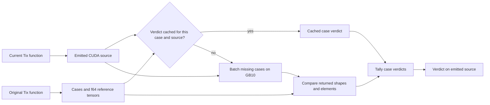

# What a checked CUDA lowering preserves

At full size, the GPU reproduced every one of the 262,144 output words of Tix matrix multiplication. In attention it reproduced only 10,618 of 65,536 words, although the largest scaled difference was just 3.7e-8. Both programs use a thread per output element and sum their products in a prescribed order. What distinguishes them is one intervening statement. Attention takes the exponential of each shifted score. A difference of one float at that point can reach many outputs through a shared denominator and a weighted sum.

Tix is an index-notation tensor language built to exercise IR Workbench, a compiler framework also used for a statically typed language targeting RISC-V. Tix already had a checked front end, interpreters at two precisions, and an optimizer. This stage added a CUDA target and asked the framework to check the actual source text by compiling and executing it on another machine. The evaluated revision is `709f8fb`. Its three new entry points are `cudaSource`, `runTixCuda` and `checkLowering`. [Tensor API](../../../../../../src/tensor/index.ts)

## Compiling a statement

A Tix function takes row-major f32 tensors with finite inputs and consistent shapes. Each statement defines a fresh tensor, and the function returns one named tensor. Shapes can contain integer affine expressions, as when a valid 3 × 3 convolution on an image of height H produces an output of height H − 2. A read can also have an affine subscript such as `y + dy`, combining a free output coordinate with a bound kernel offset.

Consider `y[i,j] = sum(k) a[i,k] * b[k,j]`. By the time the emitter sees this statement, the front end has associated each tensor with a shape and each index occurrence with a binder. The shape of `y` gives the launch size. A thread forms a linear index from its block and lane, checks it against the element count, and decodes a row-major coordinate by successive remainders and quotients, last axis first. In this example the generated index `i1` is the row, `i0` the column, and `i2` the reduction index. Here is the inner part of the emitted translation unit.

```cuda
  float v0 = 0.0f;
  for (Index i2 = 0; i2 < (0LL + 1LL * a->dim[1]); ++i2) {
    const float v2 = a->tensor[0][((0LL + 1LL * i1) * (0LL + 1LL * a->dim[1]) + (0LL + 1LL * i2))];
    const float v3 = a->tensor[1][((0LL + 1LL * i2) * (0LL + 1LL * a->dim[2]) + (0LL + 1LL * i0))];
    const float v1 = __fmul_rn(v2, v3);
    v0 = __fadd_rn(v0, v1);
  }
  a->tensor[2][p] = v0;
```

The multiply and add have separate rounding sites even under `nvcc -O3 -arch=sm_121`. In the Tix f32 interpreter, a scalar operation receives already-rounded operands, computes a JavaScript number, then applies `Math.fround`. A fused multiply-add could change a result even with the right loop order. The emitter chooses explicit round-to-nearest instructions for addition, subtraction, multiplication, division and square root. It materializes the f32 bits of each parsed literal and keeps integer affine address calculations separate from floating-point operations. The min/max helpers propagate NaNs and select the JavaScript sign for a zero tie. [Emitter](../../../../../../src/tensor/cuda-source.ts) · [Interpreter](../../../../../../src/tensor/evaluate.ts)

The host binds the shape symbols from the supplied parameter axes, allocates tensors, and launches one kernel per nonempty statement on one stream in a one-dimensional grid of 128-thread blocks. Each thread writes one element. A reduction with several indices becomes nested loops, first listed index outermost, with one accumulator for that reduction. An empty sum produces positive zero and an empty maximum produces negative infinity. With input shape [2,0], summing the second axis must launch work and write two zeros. An empty output needs no launch. A function returning its parameter can have no kernels at all.

I emitted CUDA directly from the current Tix IR. An additional kernel IR would have restated the ordered statements, axes, scalar expression trees and affine loads that already determine the code. That choice also made the optimization boundary concrete. `inline` can remove a producer and substitute its indices into a consumer. `split-sum` can turn a single-index sum into an outer sum of width-four partial sums, with a shorter final block. Walking the resulting tree gives each inner fold its own rounded accumulator. Flattening it back into one sequential sum would silently undo the grouping that the optimizer had been authorized to change. [Rewrites](../../../../../../src/tensor/passes.ts)

## Checking the source that will execute

A compiled Tix program retains both its original and its current revision. The current revision determines the kernels and the f32 result used to diagnose their fidelity. The original revision supplies the f64 reference for the public contract, including after optimization. Comparing the final candidate with that same reference keeps an earlier split and the subsequent lowering within one end-to-end numerical budget.



For each eligible case the returned shapes must agree. At every coordinate with finite f64 reference `r` the GPU must produce a finite `g` satisfying `abs(g − r) ≤ 2e-6 + 2e-5 × abs(r)`. The absolute term matters for a nearly cancelling sum. In the design probe, the seven-term dot product at offset 1,648 agreed exactly with the f32 interpreter at −0.10265588760375977. The f64 evaluator returned −0.10265525521730723. This pair used 15.6% of the allowance, the largest fraction across the probe's 40,960 comparisons. A different pair showed why exact f32 equality was already untenable for the chosen exponential. Input word `0x3f800001` gave `0x402df855` on the GPU and `0x402df856` in the interpreter. [Probe measurements](../scripts/04-probe-result.json)

The case generator tries all symbolic extents equal to 1, 3, 4 and 7, and a mixed assignment cycling through 3, 5 and 7 in symbol-name order. Four exercises a complete split block and seven exercises its tail. It deduplicates shapes and generates signed values, positive values and a repeating half-ULP rounding witness as three f32 streams with seed 20. There are at most 15 cases per function. Screening uses the origin, with bounds of 4,096 elements per tensor and one million evaluator visits, valid addresses and finite f64 outputs. A function with no eligible case receives no acceptance. These limits bound the cost of obtaining evidence. The execution API also handles large calls and computed infinities, which have separate tests. [Case generation and comparison](../../../../../../src/tensor/contract.ts)

**The framework required no source changes.** A versioned transformation accepts the original artifact, current artifact and function name and has CUDA source text as its output port. Its differential invariant receives that exact string. The asynchronous `decide` hook receives all missing case indices at once. The Node runner encodes them in one binary file, invokes the remote tool once, and matches returned case IDs, shapes and values before issuing verdicts. The checker can therefore reject altered source even when the original emitter would have emitted correct code. [Checked transformation](../../../../../../src/tensor/cuda-contract.ts)

The baseline cache key includes the origin revision, function and Node version. The framework also keys by invariant identity, version, seed and case-count bound. A digest of the complete emitted source identifies the subject. Version 1 assumes a fixed GB10 installation, driver, compiler flags and wire format for the life of the checker process. A repeat can reuse the decided cases without contacting the GPU while the baseline remains resident. A change in the source requires new subject evidence. Separately, the remote tool can reuse a compiled executable for identical staged files and architecture. That saves compilation time on an actual run. Only completed comparisons populate the verdict cache. [Differential checker](../../../../../../src/framework/contracts/differential.ts)

**The only tool change was isolation of concurrent invocations.** Previously, two identical requests shared the directory for compilation, execution and output retrieval. One could clear the other's result before it was fetched. Each invocation now stages and fetches in a private directory beneath the content hash. A per-hash lock serializes compilation and a rename publishes a completed binary for reuse. The existing timing lock still covers benchmark execution. Neither a process-local lock nor the timing lock alone would protect two independent callers through retrieval. [Remote runner](../../../../../../tools/cuda-remote.mjs)

## What the independent evaluation observed

The independent stage-1 hidden suite passed **25 of 25** tests and found all three new API exports. The tables give its comparisons through `runTixCuda`. “Exact” counts equal f32 output words. The f32 difference column is the largest `abs(g − r) / max(1, abs(r))`, where `r` is the same program's f32 result. The f64 column gives the evaluator's separately reported maximum difference from f64. Optimized rows use `inline` followed by `split-sum` and compare with the f32 interpreter executing that optimized revision.

| Small program | Revision | Exact / elements | Max scaled f32 difference | Max difference from f64 |
| --- | --- | ---: | ---: | ---: |
| matmul | Original | 35/35 | 0 | 3.2e-7 |
| softmax | Original | 54/76 | 3.0e-8 | 5.3e-8 |
| layernorm | Original | 72/72 | 0 | 1.3e-7 |
| attention | Original | 56/72 | 6.0e-8 | 6.6e-8 |
| mlp | Original | 21/24 | 8.9e-8 | 3.6e-7 |
| conv2d | Original | 160/160 | 0 | 3.1e-7 |
| matmul | Optimized | 35/35 | 0 | 2.2e-7 |
| softmax | Optimized | 56/76 | 3.0e-8 | 4.9e-8 |
| attention | Optimized | 47/72 | 3.0e-8 | 4.4e-8 |
| mlp | Optimized | 18/24 | 1.2e-7 | 3.4e-7 |

| Full-size original program | Exact / elements | Max scaled f32 difference | Independent `gpuMs` (ms) |
| --- | ---: | ---: | ---: |
| matmul | 262,144/262,144 | 0 | 0.231 |
| softmax | 2,616,298/4,194,304 | 3.7e-9 | 0.498 |
| layernorm | 4,194,304/4,194,304 | 0 | 0.570 |
| attention | 10,618/65,536 | 3.7e-8 | 1.409 |
| mlp | 231,045/262,144 | 2.2e-5 | 0.984 |
| conv2d | 984,064/984,064 | 0 | 0.404 |

Softmax first departs from the f32 interpreter at `expf` in the shifted exponential. The subtraction has the same rounded operands and result up to that point. One changed exponential can alter the row sum that every division uses. Attention uses the same `expf` after computing scaled dot products and row maxima. Its divisions produce weights, and its final weighted sum can transmit an error to several value channels. In the MLP the first differing operation is `tanhf` in the GELU activation. The following multiply and output projection can amplify an activation difference, especially where contributions partially cancel. The full-size MLP figure of 2.2e-5 compares against f32 at benchmark size. The contract applies its allowance to origin f64 on bounded sample shapes. Those measurements answer different questions. [Softmax](../../../../../../corpus/tensor/softmax/main.tix) · [Attention](../../../../../../corpus/tensor/attention/main.tix) · [MLP](../../../../../../corpus/tensor/mlp/main.tix)

Matmul and convolution use separately rounded multiplication and addition throughout. Layer normalization adds subtraction, division and square root, all explicitly rounded. Their nonzero small-case f64 differences coexist with complete f32 agreement. A rounded product or partial sum, for example, becomes the next operand in the GPU and f32 computations, whereas the reference retains double precision there. The other workloads have this ordinary f32 roundoff as well as the intrinsic differences. A split changes where partial sums round on *both* sides of an optimized f32 comparison. It can change the observed count and the distance from f64 without introducing a GPU-only reassociation.

Of 20 independent random fixed-core programs, 16 agreed on every element and the largest reported difference was 1.2e-7. The three demonstrated sources of finite scalar disagreement are `expf`, `logf` and `tanhf`. None of the six corpus programs uses `logf`. The aggregate for the four differing random programs does not identify their expressions, input bits or first differing nodes, so it cannot apportion those four among the intrinsics. Independently, `checkLowering` accepted six corpus functions and ten random ones, all under the tolerance relation, in 4.0 seconds per check on average. [Evaluation record and source locations](01-design-and-implementation-diary.md#step-6-independent-evaluation-and-first-differing-operations)

## Isolating the library calls

I ran one untimed diagnostic on the GB10 after the independent evaluation. For each affected corpus function I generated two copies of the emitted code and supplied identical seed-22 inputs. In the second copy I widened the suspect call’s operand to double, called the double device function, then applied `__double2float_rn`. Loop bounds, operands, accumulators, stores and the CPU oracle stayed the same. The control reproduced end-to-end word differences. The changed call eliminated every difference on these inputs, including for the optimized revisions. This used diagnostic translation units staged from the ticket. [Diagnostic script](../scripts/08-isolate-intrinsics.mjs) · [Results](../scripts/09-diagnosis.json)

| Diagnostic | Shipped mismatches, original / optimized | With one call replaced, original / optimized |
| --- | ---: | ---: |
| softmax, 187 outputs each | 81 / 68 | 0 / 0 |
| attention, 143 outputs each | 86 / 82 | 0 / 0 |
| mlp, 143 outputs each | 21 / 24 | 0 / 0 |

For a separate log-only function, I repeated one input word, `0x3f908e2a`, eleven times. All eleven outputs differed with `logf` and all eleven matched after the substitution. The earlier scalar probe records the adjacent words `0x3df91a3b` on the device and `0x3df91a3c` in the f32 interpreter. The coordinator independently tested the double implementations of exp, log and tanh followed by f32 rounding on **all 2³² f32 input patterns**. Each agreed with its corresponding rounded JavaScript function on the GB10, treating NaNs as one class. That exhaustive result concerns the three alternative scalar implementations. Our own end-to-end diagnostic sampled entire programs. [Scalar witnesses](../scripts/04-probe-result.json)

## Timing and verification

For each original corpus program I generated one set of f32 inputs with seed 22, uniform in [−1,1], with positive layernorm epsilon `1e-5`. All six pairs of input digests and output shapes matched across backends. On the GB10 the binary header selected one warm-up and three measured executions in a short locked invocation. CUDA events on the same stream bracketed all statement kernels, after allocation and upload and before copying the result back. The public `gpuMs` uses one warmed event interval. On the shared Node 24.18.0 host I warmed the interpreter at a small valid shape, then timed one complete f32 evaluation at actual size. Those wall times include interpreter allocations. They cannot be read as end-to-end speedups for a remote API call. [Timing harness](../scripts/05-benchmark.mjs) · [Local observations](../scripts/06-cpu.jsonl) · [GPU intervals](../scripts/07-gpu.jsonl)

| Program and shape bindings | Kernels | Our GPU median (ms) | Local interpreter (s) |
| --- | ---: | ---: | ---: |
| matmul, M = K = N = 512 | 1 | 0.231872 | 813.946 |
| softmax, N = 4096, C = 1024 | 4 | 0.482496 | 84.049 |
| layernorm, N = 4096, D = 1024 | 4 | 0.453632 | 98.367 |
| attention, Q = K = 1024, D = V = 64 | 6 | 0.876128 | 627.407 |
| mlp, N = 1024, D = 256, H = 1024, O = 256 | 3 | 0.988288 | 1,162.685 |
| conv2d, N = 8, C = 16, H = W = 64, O = 32, kernel 3 × 3 | 1 | 0.166208 | 281.867 |

At the evaluated revision `npm run build` passed and `node --test tests/tensor/*.test.mjs` passed all 29 tests with none skipped. Tests covered the binary format, returned parameters, empty domains, signed zeros, shadowing, optimized addresses and two concurrent identical checks. A deliberately incorrect kernel discarded the last partial block of a split sum. It compiled and ran, but at coordinate [0] returned zero against a reference of 0.5052213072776794 and an allowance of 0.00001210442614555359. The checker rejected those source bytes after accepting the correct candidate. This tested the path that decides whether generated code can be trusted. [GPU tests](../../../../../../tests/tensor/cuda-gpu.test.mjs) · [Test receipt](../various/tensor-tests.log)

## Which relation to ask for next time

Of the two whole-language choices for the shipped emitter, sampled tolerance against origin f64 is justified and blanket bit identity to current f32 is false. A stronger conditional check would retain the end-to-end budget and require equality to current f32 where computation uses only the matching operations, preserving signed zero and treating NaNs as a class. The exhaustive sweep supports extending that f32 obligation to paths through all three intrinsics **if their implementations are changed**. Exact agreement with an optimized f32 program would still leave a separate question about how much error the earlier rewrite introduced relative to origin f64. The measured allowance is an acceptance criterion on the sampled inputs, not a universal forward-error bound.

I would put both device implementations in the initial primitive probe. The interpreter's `f32` label specifies the representation at every rounding boundary, but it is the expression `Math.fround(Math.exp(x))` that specifies which value arrives at that boundary. Starting from that expression would have led directly to the double-call-and-round experiment. I would keep the same public distinction between producing code, running it, and checking it, and retain the dropped-tail test. I would also keep a failing random program and its input words alongside its aggregate score. An exact-output count measures how often a difference survives to the return tensor. A replay identifies the operation a compiler engineer can actually change.
