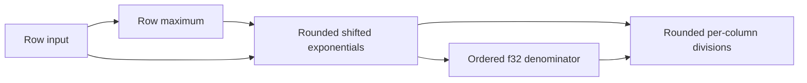
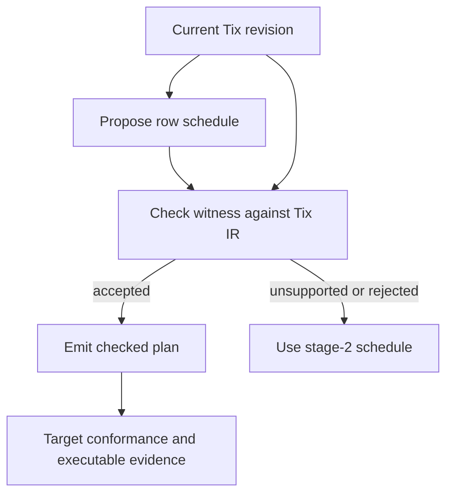

# Certified scheduling for Tix

## Decision

Tix should compete on **the fastest execution of the f32 program a user can audit**. The unit of comparison is a particular observable function. Compare against independent implementations using the same primitive results, reduction order, output shape, and output observation. Keep cuBLAS and conventional fused kernels on the chart as performance context. They answer a useful second question about the cost of the semantic constraint.

1. Keep row-local producer chains in one GPU block and preserve their rounded operation tree. Parallelize independent elements and the signed-zero-aware maximum, and keep sum order.
2. Check schedule certificates against the original immutable Tix artifact. Cover affine ownership, initialized reads, barrier visibility, and scalar provenance. Test the resulting binary separately.
3. Permit integer tensor-core contraction only where an exact input-grid guard proves every source f32 product and possible partial sum already representable. Run the ordered schedule otherwise.

All three are compatible with a user separately choosing a numerically relaxed contract. An exact backend must preserve the **current** artifact, whose ordered tree can already have changed under the sampled `split-sum` contract. Exact lowering of that artifact cannot retroactively certify equivalence to the original source.

## Observation and targets

Use shape equality and exact words, including the sign of zero and infinities, with all NaN payloads observed as one class. Tix currently has no payload-inspection operation. Stage 1's exact sample comparator retains the payload bits, so name and version the new relation explicitly. Stage 2's actual postcondition checks tolerance against current f64. The coordinator's exhaustive unary conformance result and the stage report's NaN witness support working with a pinned GB10, CUDA, and Node profile. Proof of a schedule and validation of its compiled realization are two distinct claims.

Record exact-eligible domain coverage, eligible fallbacks, proof verification wall time, per-shape kernel median and p90, and transfer-inclusive and compile-inclusive wall time separately. The first acceptance targets are 100% negative schedule-mutant rejection and under 10 ms p95 per eligible function for off-device schedule verification on the local host, plus at least a 1.3× paired speedup for one of the two corpus normalizations. These are engineering gates to test, with corresponding failure outcomes. For target-independent interpretation report scratch bytes, active blocks, launches and arithmetic changes as well as time.

## Row-resident scheduling

The row of the output identifies a producer fiber. If every use of an intermediate in the candidate group projects to the same row, a block can own that row. A store to a statement's f32 buffer consumes an already rounded value, so it can move from global to shared memory without inserting or removing a scalar rounding operation. The proof is by induction over definitions, then over the lexical reduction tuple at each reduction. The entry shape and device resource guards decide between the fused region and the stage-2 schedule.

A max reduction is a join after collapsing NaNs and ordering -0 below +0. It can use a tree with the correct tie and NaN combiner. General f32 sum needs its original carry. For layernorm, buffer the rounded centered values and retain the mean and variance carries. For attention, first fuse the post-score pipeline and keep the score contraction independent. FlashAttention keeps mathematical exactness while rescaling partial sums and outputs. Its rescaling changes the f32 program defined by Tix's fixture. [Dao, Fu, Ermon, Rudra, and Ré, FlashAttention, 2022](https://proceedings.neurips.cc/paper_files/paper/2022/hash/67d57c32e20fd0a7a302cb81d36e40d5-Abstract-Conference.html)

## Schedule certificates

The optimizer proposes placements and layouts. An independent validator derives the expected operation and dependence view from the artifact, checks the proposal, and rejects stale or structurally unsupported certificates before code generation. Start with one symbolic row, row-private intermediate state, structured lane-cyclic column loops, a distinguished scalar lane, and convergent barriers. This is translation validation over a restricted schedule language. The producer, checker and CUDA emitter require distinct tests. Halide's formal semantics already studies algorithm-schedule separation and order preservation. Tix's research question is whether its small f32 trees and v6 revisions make these checks cheap and actionable at each pass. [Reinking, Bernstein, and Ragan-Kelley, Formal Semantics for the Halide Language, 2022](https://arxiv.org/abs/2210.15740)

The existing v6 `defineTransformation` and typed `ensures` can carry this first prototype. Reuse strategy for versioned alternatives and selection after successful proof. Add evidence schema and proof-kind semantics after the restricted language has at least two real implementations to exercise them.

## Exact integer contraction

For existing f32 inputs on grids `a = qa·2^ea`, `b = qb·2^eb`, write `e=ea+eb`. A checked absolute coefficient sum bound `B <= 2^24`, `e >= -149` and `e+floor(log2 B) <= 127` makes every nonzero product and every possible partial sum exactly representable. This yields a direct induction from the source left fold to the integer dot. The same `B` bounds the s32 accumulator. Signed zero deserves a separate argument from the +0 initializer. An input guard must test the original words before choosing the integer path. This directs integer hardware at proving equivalence to the existing source, a different target than high-precision matrix multiplication via several integer slices. [Ootomo, Ozaki, and Yokota, DGEMM on Integer Matrix Multiplication Unit, 2024](https://arxiv.org/abs/2306.11975)

## Order of work and failure criteria

Build the stage-2 paired measurement harness first. Check the row schedule language and implement one resident emitter together. Port the pattern to layernorm and the post-score part of attention only when the proof obligations and timing gate hold. Evaluate worst-case long rows, insufficient parallel rows, and shape/resource fallbacks. Finally add exact integer specialization as a separate guarded transformation. A narrow eligibility domain or guard costs greater than the replacement savings argues for keeping it experimental.

This is the opening research checkpoint. The local build and dist import passed, and a GB10 CUDA smoke test returned 1.5 from explicit rounded multiply and add. The row, certificate and contraction experiments below will determine which claims survive. The experiment design intentionally includes sum reassociation, omitted tails, unavailable GPU evidence, and guard misses as falsifiers.
