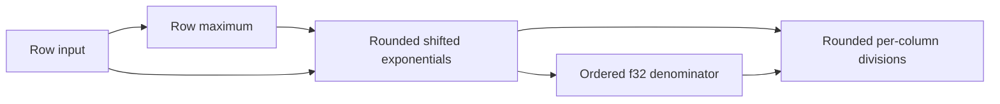
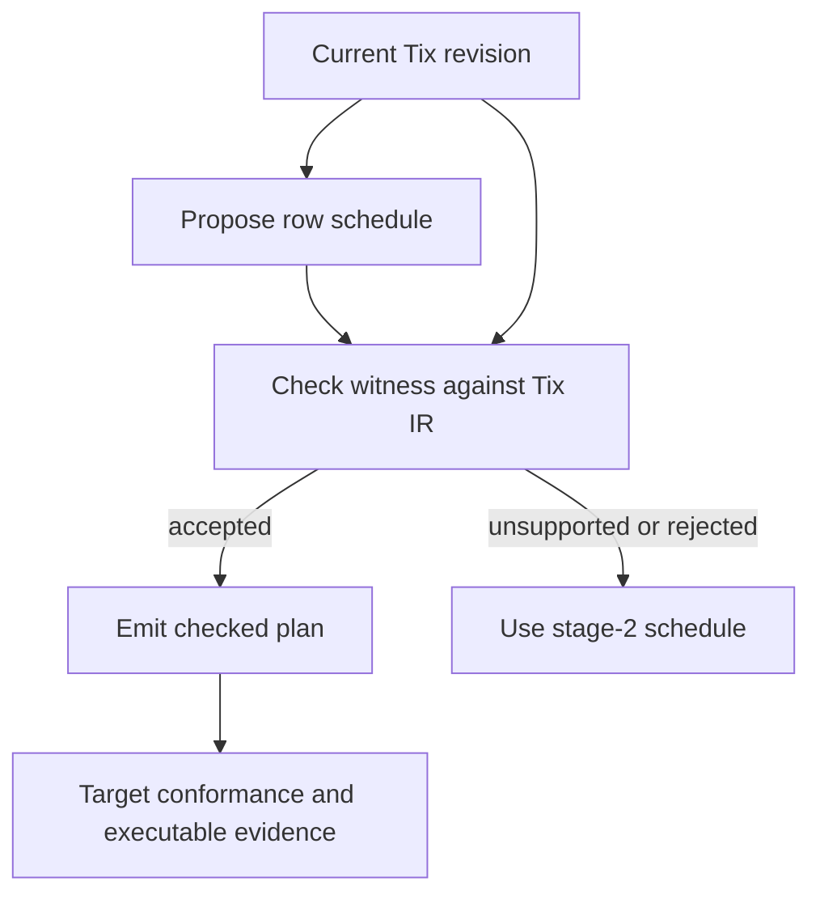

# Certified scheduling for Tix

## Decision

Tix should compete on **the fastest execution of the f32 program a user can audit**. The unit of comparison is a particular observable function. Compare against independent implementations using the same primitive results, reduction order, output shape, and output observation. Keep cuBLAS and conventional fused kernels on the chart as performance context. They answer a useful second question about the cost of the semantic constraint.

1. Keep row-local producer chains in one GPU block and preserve their rounded operation tree. Parallelize independent elements and the signed-zero-aware maximum, and keep sum order.
2. Check schedule certificates against the original immutable Tix artifact. Cover affine ownership, initialized reads, barrier visibility, and scalar provenance. Test the resulting binary separately.
3. Permit integer tensor-core contraction only where an exact input-grid guard proves every source f32 product and possible partial sum already representable. Run the ordered schedule otherwise.

All three are compatible with a user separately choosing a numerically relaxed contract. An exact backend must preserve the **current** artifact, whose ordered tree can already have changed under the sampled `split-sum` contract. Exact lowering of that artifact cannot retroactively certify equivalence to the original source.

## Observation and targets

Use shape equality and exact words, including the sign of zero and infinities, with all NaN payloads observed as one class. Tix currently has no payload-inspection operation. Stage 1's exact sample comparator retains the payload bits, so name and version the new relation explicitly. Stage 2's actual postcondition checks tolerance against current f64. The coordinator's exhaustive unary conformance result and the stage report's NaN witness support working with a pinned GB10, CUDA, and Node profile. Proof of a schedule and validation of its compiled realization are two distinct claims.

Record exact-eligible domain coverage, eligible fallbacks, proof verification wall time, per-shape kernel median and p90, and transfer-inclusive and compile-inclusive wall time separately. The first acceptance targets are 100% negative schedule-mutant rejection and under 10 ms p95 per eligible function for off-device schedule verification on the local host, plus at least a 1.3× paired speedup for one of the two corpus normalizations. These are engineering gates to test, with corresponding failure outcomes. For target-independent interpretation report scratch bytes, active blocks, launches and arithmetic changes as well as time.

## Row-resident scheduling

The row of the output identifies a producer fiber. If every use of an intermediate in the candidate group projects to the same row, a block can own that row. A store to a statement's f32 buffer consumes an already rounded value, so it can move from global to shared memory without inserting or removing a scalar rounding operation. The proof is by induction over definitions, then over the lexical reduction tuple at each reduction. The entry shape and device resource guards decide between the fused region and the stage-2 schedule.

A max reduction is a join after collapsing NaNs and ordering -0 below +0. It can use a tree with the correct tie and NaN combiner. General f32 sum needs its original carry. For layernorm, buffer the rounded centered values and retain the mean and variance carries. For attention, first fuse the post-score pipeline and keep the score contraction independent. FlashAttention keeps mathematical exactness while rescaling partial sums and outputs. Its rescaling changes the f32 program defined by Tix's fixture. [Dao, Fu, Ermon, Rudra, and Ré, FlashAttention, 2022](https://proceedings.neurips.cc/paper_files/paper/2022/hash/67d57c32e20fd0a7a302cb81d36e40d5-Abstract-Conference.html)

## Schedule certificates

The optimizer proposes placements and layouts. An independent validator derives the expected operation and dependence view from the artifact, checks the proposal, and rejects stale or structurally unsupported certificates before code generation. Start with one symbolic row, row-private intermediate state, structured lane-cyclic column loops, a distinguished scalar lane, and convergent barriers. This is translation validation over a restricted schedule language. The producer, checker and CUDA emitter require distinct tests. Halide's formal semantics already studies algorithm-schedule separation and order preservation. Tix's research question is whether its small f32 trees and v6 revisions make these checks cheap and actionable at each pass. [Reinking, Bernstein, and Ragan-Kelley, Formal Semantics for the Halide Language, 2022](https://arxiv.org/abs/2210.15740)

The existing v6 `defineTransformation` and typed `ensures` can carry this first prototype. Reuse strategy for versioned alternatives and selection after successful proof. Add evidence schema and proof-kind semantics after the restricted language has at least two real implementations to exercise them.

## Exact integer contraction

For existing f32 inputs on grids `a = qa·2^ea`, `b = qb·2^eb`, write `e=ea+eb`. A checked absolute coefficient sum bound `B <= 2^24`, `e >= -149` and `e+floor(log2 B) <= 127` makes every nonzero product and every possible partial sum exactly representable. This yields a direct induction from the source left fold to the integer dot. The same `B` bounds the s32 accumulator. Signed zero deserves a separate argument from the +0 initializer. An input guard must test the original words before choosing the integer path. This directs integer hardware at proving equivalence to the existing source, a different target than high-precision matrix multiplication via several integer slices. [Ootomo, Ozaki, and Yokota, DGEMM on Integer Matrix Multiplication Unit, 2024](https://arxiv.org/abs/2306.11975)

## Order of work and failure criteria

Build the stage-2 paired measurement harness first. Check the row schedule language and implement one resident emitter together. Port the pattern to layernorm and the post-score part of attention only when the proof obligations and timing gate hold. Evaluate worst-case long rows, insufficient parallel rows, and shape/resource fallbacks. Finally add exact integer specialization as a separate guarded transformation. A narrow eligibility domain or guard costs greater than the replacement savings argues for keeping it experimental.

## Paired GB10 measurements

The research harness compiles the corpus with the workbench and invokes the generated stage-2 kernels directly in the same process as the handwritten candidate. It disables neither target rounding nor CUDA's gradual underflow. Each timing interval covers all kernels for the function, with launches rotated each round, four discarded rounds and 21 retained CUDA-event times per variant. The CPU builds seeded finite f32 buffers and transfers them outside the interval. Untimed odd-tail and extreme finite cases check the corresponding output words. The CUDA runner's timed lock coordinates other timed users. No timing includes SSH or remote compilation. [Harness](../scripts/01-row-bench.mjs) · [Raw events](../scripts/results/01-row-gb10.jsonl)

| Program | Stage 2 median ms | Serial max or global-input fold ms | Best candidate ms | Speedup | Full-size agreement |
| --- | ---: | ---: | ---: | ---: | ---: |
| Softmax, 4096×1024 | 0.746688 | 0.710880 | 0.389248 | 1.92× | 4,194,304/4,194,304 |
| Layernorm, 4096×1024 | 0.439968 | 0.301056 | 0.171328 | 2.57× | 4,194,304/4,194,304 |
| Attention, 1024×1024, D=V=64 | 1.047776 | — | 0.770176 | 1.36× | 65,536/65,536 |

The controls matter. Softmax fusion with an ordered max is only 1.05× faster. Replacing the max's serial global load loop with cooperative loads and a shared tree changes the outcome. Layernorm with a lane-zero global mean load gives 1.46×. Cooperative staging with a shared mean fold reduces the remaining time further while keeping exactly the same add sequence. The attention candidate leaves the score matrix in global memory. Fusion after the score changes six launches to two and eliminates global writes of the exponential and weight matrices. The result puts a lower bound on the benefit of post-score fusion only for this comparison and shape.

Attention initially aborted in a host download. The benchmark allocated output for Q×K and downloaded it into a Q×V host vector. After allocating the correct shape and checking buffer lengths before download, all three attention cases completed. This fault was in the harness rather than the candidate kernel. The raw event log is from the corrected replay.

## Certificate and current-contract experiments

The prototype turns source into a typed schedule artifact and installs a checked `ensures` with the existing v6 manager. It checks two actual IRs and denies attention because the output width differs from the input row width. Each of eight mutants per admitted program changed one schedule obligation and was rejected. The softmax and layernorm certificate queries took 0.0095/0.0149 ms medians in direct batches. Fresh-manager verification took 0.136/0.131 ms medians, with p95 0.370/0.209 ms, excluding the creation of the frozen source and schedule artifacts. Sample numbers are 40 direct batches of 100 and 40 fresh managers per admitted case. Timings are local Node wall intervals. [Checker and replay](../scripts/02-schedule-certificate.mjs) · [Raw results](../scripts/results/02-certificate-node.jsonl)

The prototype proof boundary stops at its abstract schedule. The kernels benchmarked above are handwritten. A code emitter driven by the checked schedule is an implementation milestone. Mutations include stale revision, missing barrier, omitted tail, changed scalar tree, invalid writer, changed fold, excessive memory cap and reversed dependence order. A separate simulated batch with the actual current CUDA invariant admitted a mutant with missing columns above tile width 128. All 32 sampled cases had width at most seven. For a 1×131 zero-input row, source column 130 is 0.007633587811142206 and the modeled mutant writes zero. The same invariant accepted an all-negative-zero output from a program that returns positive zero, and rejected an exact interpreter output for `(x+16777216)-16777216` due to its f64 difference. The two comparisons isolate what the existing invariant can establish. They do not run a backend.

## Integer contraction experiment

A minimal WMMA launch verified signed int8 inputs and signed int32 accumulation on sm_121 with 256 results equal to −96. The first tiled prototype specializes matrices on scale 2^-7, with full 64×64 output tiles and K divisible by 32 up to 1024. It packs both inputs on GPU and compares the original and candidate output words. Eligibility success is exact identity with the baseline, with a separate path that includes scan and packing. [Prototype](../scripts/04-integer-kernels.cu) · [Raw events](../scripts/results/04-integer-gb10.jsonl)

| Shape and input | Stage 2 median ms | Prepacked median ms | Guard, pack and execute median ms |
| --- | ---: | ---: | ---: |
| 512³ on the grid | 0.207040 | 0.049440 | 0.069984 |
| M=N=512, K=64 on the grid | 0.024896 | 0.010560 | 0.016864 |
| 512³, final B region has a subnormal off the grid | 0.209024 | — | 0.484224 |

The full output matched on each path. The aligned rectangular 256×192×96 and K=1024 input with the maximal signed coefficient magnitude also matched all words. The input on the grid gave 2.96× for the scanned specialization at 512³. The fallback branch was 2.32× slower at one guard miss. This negates the simplest implementation as a general optimization. Its serial fallback uses the matrix tile's mapping, which launches 64 blocks at 512³. The baseline has 1024 blocks and output lanes with a different working set. A follow-up must isolate that mapping cost and bound the price of rejection. The supplied cuBLAS median is 0.0329 ms and still leads these experiments. It is the comparison for opportunity cost, with no claim about preserving the general Tix fold.
