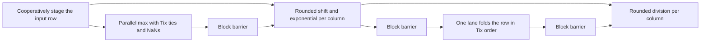
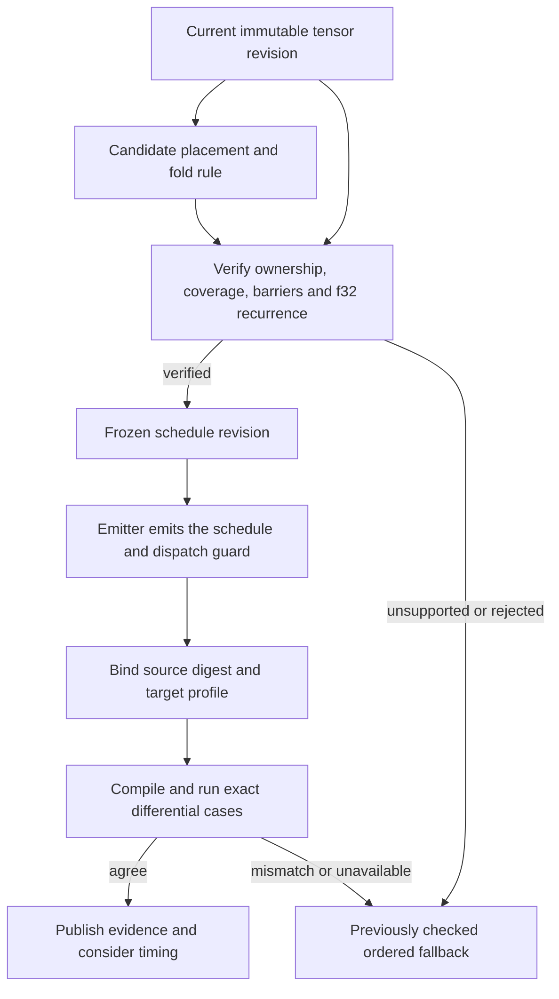

# Certified scheduling for Tix

## Decision

Tix should compete for the **fastest execution of an auditable ordered-f32 tensor program**. A user gets the output words of the selected Tix revision, a witness describing why the selected schedule preserves those words, and comparable timings for implementations with that promise. Start on the GB10 with affine dense kernels, normalization and attention. This is a narrow first class with enough diversity to test fusion, dependence reasoning and contractions.

| Rank | Compiler work | Evidence from this round | Decision |
| --- | --- | --- | --- |
| 1 | Keep affine producer chains resident in a row-owning block, with exact sums and a parallel ordered-by-value maximum | Schedule-generated softmax and layernorm ran 1.98× and 2.48× faster than stage 2 at 4096×1024. Handwritten post-score attention ran 1.36× faster. Every compared word matched. | Build the row schedule and its checker together. Extend ownership to query rows with a distinct output width next. |
| 2 | Verify a small schedule artifact and bind the generated CUDA to the verified revision | A v6 postcondition accepted two symbolic plans, rejected 16 deliberate mutations, and was followed by GPU execution. The existing sampled CUDA postcondition accepted a modeled omitted-tail defect. | Make schedule evidence and executable conformance part of the optimization interface. |
| 3 | Tile general contractions in order. Permit integer tensor cores when a checked grid already exists. | Exact FP32 tiling reduced 512³ from 0.210656 to 0.055456 ms. Prepacked INT8 reached 0.049472 ms, while a fresh guard and pack cost more than the tiled FP32 fallback even on a hit. | Ship ordered FP32 tiling first. Hold INT8 to a provenance and amortization gate. |

The cross-cutting idea is that index notation exposes independent points even when their reductions are sensitive to order. The compiler can certify *where* a rounded value lives, which threads see it, and which algebraic identities its particular operation and domain support. Some transformations then need no numerical model beyond congruence. Others need a theorem with a runtime hypothesis. Putting both through one v6 verification path is more valuable than declaring a single global floating-point mode.

### How to tell whether Tix leads

Use a two-board evaluation. The **ordered board** admits engines that agree on the same input conversion, operations, fold tree, output extent and observation. Its baseline is the generated stage-2 implementation. Add independently written CUDA kernels with explicitly rounded primitives, including a tuned ordered SIMT contraction. Compare the fastest accepted implementation for each shape. The **application board** reports vendor and conventional fused baselines and their numerical differences from Tix. The coordinator's 0.0329 ms SGEMM at 512³ and conventional fused softmax belong here. A nominal FP32 configuration says little about contraction, summation order or transcendental fidelity. Neither board alone establishes a class lead. This round measured one generated baseline, independent handwritten controls and two schedule-generated kernels.

Pre-register the shape grid and mix common with deliberately awkward extents. Include tiny and ragged widths, fewer rows than active blocks, large resident rows, rows beyond the resource guard and distinct attention Q/K/D/V. For contractions include tall, wide and square outputs across short and long reduction extents. Test all four provenance conditions for a grid path: a proved packed hit, a fresh scanned hit, a late single miss and a dense miss. Reserve a held-out size and value distribution for final tests. Report median and p90 for warmed device time and host-to-host invocation time, with cold compile, schedule check, tuning trials and transfer time reported separately. Report workspace peak, covered input and shape volume, fallback frequency by reason, and rejection latency. Pair candidates on the same buffers. Rotate order, retain individual samples, repeat on separate runs and report uncertainty across runs before claiming a steady advantage.

Initial engineering gates are zero mismatches in the held-out exact differential suite, detection of every named certificate mutant, and under 10 ms p95 to verify an eligible schedule without the GPU. Require at least 1.3× paired improvement on the full-size normalizations and at least 1.25× at 512³ for ordered contractions. For eligible production shapes, measure p90 against the faster verified baseline too, with a 5% regression budget on fallback and an explicit dispatch boundary wherever a candidate misses it. These are targets for the next implementation. The prototypes do not establish transfer-inclusive latency, a population-wide p90 or an independently tuned leaderboard.

### The observation that every claim names

An invocation observes a shape and a row-major sequence of f32 results. Propose a versioned relation that compares all non-NaN words literally and observes all NaNs as one class. Negative zero, positive zero and signed infinity stay distinguishable. Every Tix operation that consumes a NaN yields NaN, with no payload inspection in the language. This lets the observer act as a congruence through intervening computations. The Stage 2 final report recorded different CUDA and Node NaN payloads for `sqrt(-2^-149)`, both NaN. If a client needs payload bits, it needs a different explicitly canonicalized contract. The design assumes the Stage 1 input domain and target memory, address and launch checks. [Stage 1 design](../../IRWB-020-B--tix-language-tensor-ir-evaluators-meaning-contract-and-checked-passes/design-doc/01-tix-semantics-and-checked-tensor-rewrites.md) · [Stage 2 final report](../../IRWB-022-I--lowering-tix-to-cuda-with-checked-execution-on-the-gpu-machine/reference/02-report.md)

The selected revision matters. Stage 1's `inline` gate samples exact equality with the incoming tree and `split-sum` tests a new grouped tree against the origin in f64. Stage 2's `checkLowering` samples a tolerance against the *current* f64 tree. The proposed backend identity relates candidate execution to the *current* f32 tree. The pipeline can advertise source-to-binary identity only if every earlier meaning-changing edge already has a proof of the needed relation. A split tree needs its own provenance. Record a sampled numerical deviation as sampled evidence even when every checked word agrees. The f64 budget can still serve deliberate accuracy experiments. [Stage 1 final report](../../IRWB-020-B--tix-language-tensor-ir-evaluators-meaning-contract-and-checked-passes/reference/02-report.md) · [Current lowering invariant](../../../../../../src/tensor/cuda-contract.ts)

## 1. Keep rounded values in their row

### Why it works

Under current lowering, every tensor definition owns a global buffer, and every thread evaluates one output element. In softmax, each reduction thread walks one row serially, and a different launch evaluates the columns. Consider the projection `h(i,j) = i`. Every consumer of a softmax temporary reads the producer point in the same fiber of h. This property is visible in the resolved affine index maps and binding identities, even when the source uses different names for the row. A block can own the fiber and store the temporary in shared memory. The rounded scalar travels through a different address space. It still has the same value because the producer already emits f32. A barrier establishes that the pointwise producers finish and their stores become visible before the scalar lane walks the row or other lanes consume a shared scalar. [NVIDIA, CUDA C++ Programming Guide 13.0, 2025, synchronization functions](https://docs.nvidia.com/cuda/archive/13.0.0/cuda-c-programming-guide/index.html#synchronization-functions)

A successful proof has three parts. The block map partitions the rows exactly. Within a block, `j = lane + q·lanes` with `j < C` assigns every column to a unique lane and treats tails uniformly. Each producer is available with the correct coordinate before its consumer executes. An induction over those phases gives the same scalar leaves; induction over each fixed reduction's index tuple gives the same rounded carry. Reordering unrelated output points and hoisting a pure invariant expression are both eligible. A stage-2 split sum, if accepted upstream, retains both carries and their block/tail domains. The first checker supports single ordinary reductions. It declines grouped or nested reductions and selects the stage-2 kernel in those cases.

The max in softmax has more freedom. Under the proposed observation, rank the numeric f32 values with `-0 < +0` and put the one NaN class above positive infinity. The Tix maximum is the join of this total order with negative infinity as identity. A parallel tree therefore preserves every observed result, including an empty max or ties at zero. Use a combiner that propagates NaNs and picks positive zero in a mixed-zero maximum. Ordinary sum is a recurrence `a_(j+1) = RN32(a_j + t_j)` rooted at +0. A tree over the same multiset can yield a different final word. For softmax inputs `[0,-17,-17,-17]`, the ordered denominator is 1 and a two-chunk calculation gives `1 + 2^-23`. The difference reaches the returned quotient of the leading exponential. The [denominator replay](../scripts/06-prefix-witness.mjs) demonstrates this with Tix's operations.



Apply the same construction to layernorm. Keep the mean and variance as ordered carries. Store the individually rounded centered values. The variance squares a centered value with its own rounding and then adds it to the carry. Per-column output rounds the divide, the multiply by gamma and the addition of beta. Computing a reciprocal and multiplying generally changes the operation tree. Hoisting the already rounded denominator into one scalar per row is eligible.

For attention, choose an output owner by query. In the first extension, materialize scores using the existing contraction. Afterward, a block consumes its score row and materializes local weights, in place if it proves each last read and overwrite safe. A feature lane folds weights times V down K, in the original order and with a separate rounding for each weight division before the multiply. The resulting phase width is V, while the row temporary width is K. Further fusion can compute scores into shared memory without materializing the matrix, and should first test score layout and occupancy. In the long-row limit, a three-sweep exact algorithm can bound scratch by a tile. Sweep one finds the global maximum, sweep two recomputes scores and obtains the ordered denominator, and sweep three recomputes scores and weights for the ordered output contraction. It trades up to two extra score passes for storage. At large V, keep or tile feature carries so score replay stays bounded across feature groups. Measure score work as well as scratch before choosing it. Online normalization and FlashAttention change the arithmetic tree by rescaling local probabilities and partial sums. Their mathematical equivalence does not enforce the exact rounded denominator, per-weight division or final fold order of the Tix fixture. [Maxim Milakov and Natalia Gimelshein, Online Normalizer Calculation for Softmax, 2018](https://arxiv.org/abs/1805.02867) · [Tri Dao, Daniel Y. Fu, Stefano Ermon, Atri Rudra and Christopher Ré, FlashAttention: Fast and Memory-Efficient Exact Attention with IO-Awareness, 2022](https://proceedings.neurips.cc/paper_files/paper/2022/hash/67d57c32e20fd0a7a302cb81d36e40d5-Abstract-Conference.html)

Row residency itself is well established. Triton's tutorials fuse the same row operations and have efficient parallel and approximate arithmetic choices. The Tix work is to derive the ownership and barriers from the index program, then select permission to parallelize at the level of the particular fold. A program with an extra row-local stage or a pure producer reused several times should pass the same analysis without a library pattern named after an ML operator. Conversely, an affine cross-row read defeats per-row ownership even when the tensor shapes are identical. [Triton Project, Fused Softmax and Layer Normalization, living documentation accessed 2026-11-26](https://triton-lang.org/main/getting-started/tutorials/02-fused-softmax.html) · [Layer Normalization](https://triton-lang.org/main/getting-started/tutorials/05-layer-norm.html)

### Causal measurements

The runner compiles the corpus with the workbench and invokes the emitted stage-2 kernels in the same CUDA process as the candidate. Its event brackets contain each launch sequence. A comparison launch and synchronization occur first, followed by four discarded timing rounds and 21 measured ones with rotation of candidate order. Device allocations, input transfers and results downloads are outside the bracket. Full-sized runs use finite seeded inputs derived from MT19937. Separate validity cases use a width of 131 and a width of 17 with zeros of both signs, subnormals, cancellation terms and large finite values. The untimed attention cases use distinct Q/K/D/V. Measurements use the shared GPU timed lock. Raw logs retain events, runner hashes, exit status and word counts. The lock coordinates other timed callers, and the runner allows untimed calls to overlap. [Harness](../scripts/01-row-bench.mjs) · [Handwritten comparison events](../scripts/results/01-row-gb10.jsonl) · [Generated comparison events](../scripts/results/07-certified-row-gb10.jsonl)

| Handwritten experiment at corpus sizes | Stage 2 ms | First fused variant ms | Best fused variant ms | Full-size agreement |
| --- | ---: | ---: | ---: | ---: |
| Softmax, 4096×1024 | 0.746688 | 0.710880 | 0.389248 | 4,194,304/4,194,304 |
| Layernorm, 4096×1024 | 0.439968 | 0.301056 | 0.171328 | 4,194,304/4,194,304 |
| Attention, Q=K=1024 and D=V=64 | 1.047776 | — | 0.770176 | 65,536/65,536 |

Softmax's first variant still computes the maximum serially with a global load. Fusion alone gave a 1.05× gain. Cooperative loading and the parallel max reduce the interval almost by half relative to that fused control. For layernorm, a single lane computing the mean directly from global input gives 1.46× against stage 2. Cooperatively staging that input into shared memory, then using the *same ordered carry*, reduces its time by another 43%. This is a scheduling benefit at fixed arithmetic. The attention candidate leaves one 4 MiB score matrix in global memory and avoids two 4 MiB temporaries for exp and weight, taking the pipeline from six launches to two. It leaves score contraction as a plausible remaining cost. No size-independent speedup follows from these results.

| Emitted schedule | Shape | Stage 2 median / p90 ms | Candidate median / p90 ms | Median speedup |
| --- | --- | ---: | ---: | ---: |
| Softmax | 4096×1024 | 0.767328 / 0.791168 | 0.387232 / 0.389088 | 1.98× |
| Softmax | 4096×63 | 0.042816 / 0.047008 | 0.029920 / 0.031520 | 1.43× |
| Softmax | 16×1024 | 0.083392 / 0.084512 | 0.012672 / 0.012768 | 6.58× |
| Layernorm | 4096×1024 | 0.444576 / 0.446880 | 0.179456 / 0.181280 | 2.48× |
| Layernorm | 4096×63 | 0.021504 / 0.023776 | 0.014592 / 0.014720 | 1.47× |
| Layernorm | 16×1024 | 0.048512 / 0.048544 | 0.012640 / 0.012704 | 3.84× |
| Both, over prototype cap | 1024×4096 | 1.404192 softmax, 1.066944 layernorm | 1.380608 softmax, 1.069312 layernorm | Stage-2 fallback |

The p90 is the 19th sorted observation of 21, with the same interpretation for every row. Every compared output word matched in this replay, including fallback. At width 4096 the handwritten parallel variants still ran in 0.566528 ms for softmax and 0.298304 ms for layernorm. The serial-max fused softmax was slower than the baseline at that width, 1.859648 vs 1.404192 ms. The emitted schedule's 2048 cap was a conservative way to exercise dispatch. There is measurable opportunity above it. The few-row shape makes stage 2's scalar reductions especially expensive and is a check against assuming residency needs thousands of rows to win.

For the standard softmax shape, six full-size logical tensor transfers in stage 2 amount to about 101 MB, aside from row-scalar reads and writes. They are two reads of inputs, one write of exp, two reads of exp and one write of output. Staging one input and writing one output instead gives about 33.6 MB. At the coordinator's streaming 244 GB/s, these volumes correspond to 0.413 ms and 0.138 ms if every logical byte traversed that memory interface at the streaming rate. Caches, uncoalesced reads, synchronization, ordered carry latency and correctly rounded divide and exp all matter. The measured reduction from 0.767 to 0.387 ms is consistent with removal of expensive traffic and control. The estimate does not give a DRAM counter or a causal partition of time. The generated layernorm retains separate centered and input slots for a simple proof of nonaliasing. Its median is about 6% slower than the fastest handwritten variant. This makes in-place storage a candidate for a checked lifetime optimization.

### A failed route to faster ordered sums

I tested optimistic carries as a possible way to reduce the critical path. Guess the boundary words from independently accumulated chunks. Each chunk re-runs from its proposed incoming word and checks the outgoing word against the next boundary. If the first word is +0 and every check holds, induction gives the exact sequential carry. The scheme admits arbitrary guesses, so faster guess generation could fit the same checker. Kapre and DeHon demonstrated an iterative optimistic algorithm with parallel residual repair on an FPGA. The experiment here tests a one-shot subset as a practical filter before a Tix GPU kernel. [Nachiket Kapre and André DeHon, Optimistic Parallelization of Floating-Point Accumulation, 2007](https://nachiket.github.io/publications/fp-accum_arith-2007.pdf)

The CPU probe built 384 rows in each width and profile cell, and tested lengths 128, 1024 and 4096 with chunks of 8, 32, 128 and 256 when smaller than the row. Uniform exp rows passed all checks. At width 1024 the three varying or adversarial profiles produced one full pass out of 4,608 chunk proposals. At width 4096, they produced zero out of 4,608. At width 128, the larger tested chunk of 32 passed 6/384 narrow rows and 25/384 broad rows, while the peaked rows never passed. Several incorrect guesses happened to reach the final reference word. At width 1024 and chunk 256, 31/384 narrow rows matched the final reference word even though zero of those rows proved all carries. This was a decision to keep exact ordered carries, with no GPU timing claim for the speculative approach. The probe uses a deterministic left fold of chunk totals as guess generation. It does not falsify every iterative scheme. [Replay](../scripts/06-prefix-witness.mjs) · [Counts](../scripts/results/06-prefix-node.jsonl)

**Implementation and risk.** Represent the schedule in `src/tensor` as a separate artifact from Tix IR. The framework's core and IR own revision identity and graph inspection. The domain owns projection, access and numeric rules. Use the v6 transformation postcondition in proposal 2 as its gate. Shape and hardware guards decide resource fit. A profiling pass can distinguish launch cost, dependent-add latency, shared-bank pressure and register spills. Occupancy tuning should enumerate row placements only after the shape proof. Oversized rows, inner dependencies that need inter-block communication, undefined address arithmetic and unhandled reduction nests go to the baseline until their own obligations are implemented.

## 2. Make the schedule a checked v6 artifact

### The proof boundary

The first certificate is a finite recipe for every admitted shape. A candidate names the source revision and the function, fixes lane count and symbolic dimensions, describes the optional input staging, and lists phases. A phase names the result tensor, storage and index mapping, exact scalar expression, fold mode and block-uniform barrier after the phase. The verifier independently reads the source tensors and binders. It rejects stale revisions, verifies operation and index identity, and checks that all shared readers have preceding visible producers in their own block. It derives the shared memory bound from the declared shape cap and slot count. A schedule builder can err or behave arbitrarily without changing these obligations.

For the initial subset, verify coverage by a syntactic residue-class rule. A scalar phase has one writer per block, and a column phase covers the integers below its width exactly once. Storage is disjoint by slot, with immutable external inputs and fresh output. A phase using the ID of a prior statement is a proof obligation about that statement's full index tuple, including the producer's actual row coordinate. Relation identity over arithmetic trees covers both data flow and order of rounding sites. Avoid a general solver at this boundary. Extend to symbolic affine ownership and disjoint layouts only when a supplied derivation can discharge implications such as `consumer_owned_row = producer_owner(read_indices)` and prove all intermediate integer computations in range. Generated addresses use their own integer types. A proof of final in-bounds coordinates alone is insufficient if the emitted arithmetic can overflow along the way.



The trusted base currently contains the input validator, schedule interpretation, checker implementation, emitter, launch wrapper and the target toolchain. Each has a named role. This round's verifier checks the abstract phases under a specified semantics. The emitted candidate's local function and source hashes give a verifiable link to those phases. The compiled executable and hardware are tested together by differential conformance. A mismatching binary cannot reuse a passing receipt. Raising assurance beyond this needs either proof of the canonical emitter or a translation check at a restricted target IR, and target validation for the selected primitive profile. Compile primitives with the explicit separate rounded intrinsics and no changing FTZ/contraction settings. Store the exact Node/V8, libdevice, compiler, driver and target identities in a production receipt. The coordinator's exhaustive unary check is powerful evidence for its profile, and separate from the scheduling theorem.

The approach follows translation validation and the separation of schedule and algorithm in Halide. Halide's formal semantics already reasons about reorderings and preserving reduction order. Li, Liang and Feng demonstrate verified affine scheduling validation parameterized by instruction semantics. This work narrows the normal form to Tix's resolved f32 trees and uses separate ownership and numerical proofs as versioned pass evidence. GPUVerify offers a model and tooling for race and divergence freedom. Alive-FP applies bit-precise checks to LLVM scalar rewrites. Both are relevant at a later target translation boundary. VeriTile is a close contemporary comparison, with selected exact kernel-pair and ordered-carry proof models and a stated separate compiler/GPU conformance boundary. Its coverage and concurrency docs explicitly describe modeled slices and the current scope of overlapping writes, barriers and shared memory. The proposed distinction is automatic per-Tix-pass validation of a simple block-private phase model and source-revision linkage, with negative and performance experiments attached to the same workflow. [Amir Pnueli, Michael Siegel and Eli Singerman, Translation Validation, 1998](https://link.springer.com/chapter/10.1007/BFb0054170) · [Jonathan Ragan-Kelley, Andrew Adams, Sylvain Paris, Marc Levoy, Saman Amarasinghe and Frédo Durand, Decoupling Algorithms from Schedules for Easy Optimization of Image Processing Pipelines, 2012](https://people.csail.mit.edu/jrk/halide12/) · [Alex Reinking, Gilbert Louis Bernstein and Jonathan Ragan-Kelley, Formal Semantics for the Halide Language, 2022](https://arxiv.org/abs/2210.15740) · [Xuyang Li, Hongjin Liang and Xinyu Feng, Verified Validation for Affine Scheduling in Polyhedral Compilation, 2024](https://plax-lab.github.io/publications/polyhedral/index.html) · [Adam Betts, Nathan Chong, Alastair F. Donaldson, Shaz Qadeer and Paul Thomson, GPUVerify: A Verifier for GPU Kernels, 2012](https://www.doc.ic.ac.uk/~afd/papers/2012/OOPSLA.pdf) · [David Menendez, Santosh Nagarakatte and Aarti Gupta, Alive-FP: Automated Verification of Floating Point Based Peephole Optimizations in LLVM, 2016](https://www.cs.rutgers.edu/~santosh.nagarakatte/papers/alive-fp-sas16.pdf) · [VeriInfra-Lab, VeriTile documentation, accessed 2026-11-26](https://veriinfra-lab.github.io/VeriTile/proofs/coverage/) · [VeriTile Concurrency Semantics Boundary](https://veriinfra-lab.github.io/VeriTile/architecture/concurrency-semantics/)

### What the checker changed in practice

`02-schedule-certificate.mjs` tests the independent structural checker and its typed postcondition. It accepted softmax and layernorm's plan, with 11 and 23 checked scalar-tree visits and 8,724 bytes of conservatively bounded shared state for each without input staging. The launch compiler variant adds a second vector slot and caps its bound at 16,916 bytes. Fresh analysis managers reported `checked`. Verification had 0.133 ms median and 0.342 ms p95 for softmax and 0.138 ms median and 0.203 ms p95 for layernorm. Direct verification averaged 0.0086 and 0.0152 ms per call at the batch median. Measurements used 40 batches of 100 direct calls and 40 fresh-manager calls per plan with prebuilt artifacts. They exclude shape scanning, GPU work, artifact construction and TypeScript compilation. Node wall measurements establish submillisecond overhead on these two small plans. [Verifier and replay](../scripts/02-schedule-certificate.mjs) · [Raw measurements and rejection reasons](../scripts/results/02-certificate-node-current.jsonl)

Each of eight mutants per admitted function changed one proposition. The checker rejected a stale revision, missing barrier, omitted tail, changed expression, invalid writer map, wrong sum recurrence, excessive memory guard and a reversed dependence. One missing-barrier mutant also failed through the real v6 gate. Attention was refused at matcher entry because the output is Q×V and the input row domain in this first model is the query feature width. The post-score handwritten experiment is a reason to extend the model. It supplies no certificate for attention.

Three local tests exercised the **actual** Stage 2 invariant with an injected executor. Returning exact output from the interpreter for `(x+16777216)-16777216` failed the f64 tolerance when x was 0.5052213072776794 and f32 returned 0. Giving only negative zeros for `x-x` passed. A modeled binding that dropped columns from 128 on passed all 32 softmax cases, whose concrete widths never exceeded 7. In a 1×131 row of zeros, column 130 should be 0.007633587811142206 and the mutant would return 0. The tests isolate the assurance and sampling gap. They use no GPU execution. [Current check harness](../scripts/02-schedule-certificate.mjs)

A further experiment actually emitted two checked plans. It uses the same verifier as a typed postcondition, then maps the accepted load tree and fold mode to CUDA. The harness records the source revision, schedule revision and digest of the emitted kernel header alongside the runner build hash and compares every result for the exercised inputs. The over-cap case caught an error in the harness's first layernorm fallback wiring. The owning baseline launch wrote to the reference buffer instead of the candidate buffer, and the differential comparison rejected every output. Fixing that destination restored equality. This is a concrete reason to keep executable checks even after the algebra and phase checks pass. [Emitter](../scripts/07-emit-certified-row.mjs) · [Generated run and receipts](../scripts/results/07-certified-row-gb10.jsonl)

### Framework boundary and acceptance

`core` and `ir` already canonicalize artifact values and track revision and correspondence. Use a typed output for `tensor.rowSchedule` and then for `tensor.cuda-source`. Reuse `defineTransformation` and an `ensures` invariant for the heterogeneous source-to-schedule and schedule-to-target edges. `applyNativePassSync` remains the path for same-kind source rewrites such as inlining. It can use a domain-local structural checker when the pass retains expression order. Use `defineAnalysis` for use maps and shape facts if they pay for their cache, and checked transfer only when the actual touched kinds and correspondence justify it. The first two regions are small enough to derive the schedule facts on every verification.

Give each relation evidence a validated method, code version, source and subject revisions, shape and scalar domain, observation, and target profile as appropriate. The current `assuranceOf` helper maps absent or unrecognized method to `checked-exact`. That default cannot serve as the proof policy. The current manager's `checked` means a checker ran, and the property API already has `proofVerifier` and `recordProof` for externally verified certificates. Use typed domain evidence first. If multiple clients need a generic assurance classifier, require an explicit validated method registration and default unknown to unavailable. A relational verifier should be attached to a subject containing both revision references when using the property API. Keep proof consumption at the publishing gate and let sampling reuse stay a distinct asynchronous cache with a key that includes the real executable profile. Avoid framework changes until a domain-level implementation and a second consumer demonstrate a common need.

Use `strategy` to enumerate checked alternatives, require invariants before they enter the timing objective, and retain rejected candidates and fallback reasons in the trace. Pin the algorithm versions. Cache shape-only proof results by source, schedule, method and target profile. A timed measurement is a fact about a specific execution protocol and device, with a separate cache key. An unavailable remote call is not affirmative evidence about the tested output. Typed assurance, proof reuse and publication are useful v6 work only when they enforce this separation in actual callers. Success means a changed artifact or profile forces a fresh check, non-affine or unsupported schedules retain the ordered fallback, deliberately defective generated CUDA is caught independently, and the check overhead remains below the registered threshold.

## 3. Tile ordered contractions and use proved grids for integer MMA

### A reliable baseline

Matrix multiplication's `[i,j]` outputs are independent. Tile and reuse input blocks, keep several output carries per lane, and sweep the K tiles and positions monotonically. Each lane reads the same values, rounds each product and adds it in the same sequence as the original dot. The GPU can advance unrelated carries between instructions and reuse shared loads. A schedule proof can partition output tiles by quotient and remainder, track loaded input coordinates and coverage, and show the generated carry consumes the same ordered interval from one tile to the next. This needs a distinct reduction-order rule from row normalization, though it shares the symbolic access, coverage and barrier contracts. The prototype uses 32×32 output tiles, K-depth 16, 128 threads and eight f32 carries per thread. Full tile guards are explicit. Shape tails and resource dispatch are the first gaps to fill in a product implementation.

### The conditional theorem and why it matters

For a matched contraction `sum(k) a[i,k] * b[k,j]`, suppose the input f32 words already equal `a[i,k] = qa[i,k]·2^ea` and `b[k,j] = qb[k,j]·2^eb`, with signed int8 coefficients. Certificates can refine this to a scale per row of A and per column of B as long as each output has one common exponent e for every k. Let `e = ea + eb` and let B bound the sum of absolute coefficient products for that output. For B>0, check

```text
B <= 2^24
e >= -149
e + floor(log2(B)) <= 127
```

Every integer in the resulting magnitude range has at most 24 significant bits after any trailing zeros are removed, including 2^24 itself. All products and sums of any subsets have coefficient magnitude at most B by the triangle inequality. Scaling by `2^e` yields a representable binary32 number, possibly subnormal. The exponent checks ensure no product or possible partial sum crosses the lower grid or overflow boundary. In the source, each nonzero product is therefore rounded to itself. Every sequential partial sum is exact by induction. The integer result scaled once gives the same observed f32 word. The bound also prevents s32 overflow for any integer accumulation order the GPU chooses. Zero has its own reasoning. The source starts at +0 and nearest-even addition leaves +0 at exact cancellation and when adding any signed zero to +0. Any nonzero exact partial sum is representable and cannot underflow to zero. A B=0 dot therefore returns +0, and the integer route may erase input zero signs **only** for this matched reduction. An exposed product or other identity requires a separate proof. [IEEE, IEEE Standard for Floating-Point Arithmetic, 2019](https://standards.ieee.org/ieee/754/6210/) · [NVIDIA, PTX ISA 9.0, 2025, warp matrix multiply-accumulate](https://docs.nvidia.com/cuda/archive/13.0.0/parallel-thread-execution/index.html#warp-level-matrix-instructions-mma)

The global bound `K·128²` works through K=1024. A tighter bound can use `min(max|qa|·sum|qb|, sum|qa|·max|qb|)` from per-operand reductions, with checked integer arithmetic. Alignment, identity, multiplication order, both exponent limits and empty K belong to the entry proof. An unguarded conversion rounds or clamps off-grid inputs and changes the Tix program. An exact scan can decode each f32 word into an odd signed integer mantissa and a power of two. The coarsest common grid is the smallest exponent of all nonzero values. If the coefficients do not fit on that grid, using a finer grid only increases their magnitudes. The fixed GPU experiment can do less work. It multiplies by 128 exactly if the result is in range, then requires exact equality with the converted integer before use.

Integer matrix acceleration for floating-point accuracy has established precedent in Ozaki-style slicing. Multi-slice methods use exact low-precision subproducts and choose how to combine them to meet a high-precision accuracy target. Binned reproducible accumulation addresses agreement across orders, sometimes with much better accuracy. Both goals differ from reproducing an arbitrary given left fold. Here a one-grid theorem proves identity with that fold on a conditional domain. The useful compiler question is *where the proof comes from* and how often it can avoid packing in the critical path. A result chain that already owns an immutable packed grid is better evidence than an annotation on a raw f32 pointer. [Hiroyuki Ootomo, Katsuhisa Ozaki and Rio Yokota, DGEMM on Integer Matrix Multiplication Unit, 2024](https://arxiv.org/abs/2306.11975) · [Ahmad Abdelfattah, Jack Dongarra, Massimiliano Fasi, Mantas Mikaitis and Françoise Tisseur, Analysis of Floating-Point Matrix Multiplication Computed via Integer Arithmetic, arXiv revision 2026](https://arxiv.org/abs/2506.11277) · [Willow Ahrens, James Demmel and Hong Diep Nguyen, Algorithms for Efficient Reproducible Floating Point Summation, 2020](https://willowahrens.net/assets/documents/ahrens_algorithms_2020.pdf)

### What survived the CPU and GPU experiments

A Node probe decoded f32 words and tested 1,200 dots per input family with K from 3 to 1024. All 1,200 fixed-grid and all 1,200 varied-scale grid examples were accepted and matched the ordered output words. All 1,200 ordinary bounded-f32 and all 1,200 mixed-exponent random examples missed the int8 grid. There were 32 cross-checks against the Tix interpreter. In one 4×4 contraction, neither entire input fit a global grid, but 16/16 outputs matched Tix using row and column exponents. These are synthetic distributions for sensitivity testing. They establish neither production prevalence nor the cost of finding per-axis scales on the GPU.

Dropping either arithmetic guard produced real errors. For 1,042 terms of 127×127, the ordered answer is 16,806,416 and a once-rounded integer route returns 16,806,418 despite the integer sum fitting s32. Two products of `2^-75 × 2^-75` individually round to zero, while accumulating before rounding yields one minimum subnormal. Two opposite-signed products of magnitude `2^130` give NaN through the source and 0 if computed as exact wide products first. By contrast, an eligible subnormal grid yielded f32 word `0x00000002`, and the signed-zero witness yielded `0x00000000`. [CPU proof probes and witnesses](../scripts/05-dyadic-domain.mjs) · [Raw results](../scripts/results/05-dyadic-node.jsonl)

The GB10 WMMA smoke test produced 256 results of −96 for signed int8 fragments and s32 accumulation. The first GPU prototype used full 64×64 output tiles and depth 32 for signed WMMA with scale 2^-7 on both operands. Inputs and baseline stage-2 output were on the same device. At 512³ the first run gave 0.207040 ms stage 2, 0.049440 ms prepacked, and 0.069984 ms including scan and pack. One off-grid subnormal near the end of B made the candidate fall back to an ordered dot inside the WMMA mapping. It matched all words, but took 0.484224 ms against 0.209024 ms stage 2. The fallback kernel had only 64 blocks on these dimensions and 32 output dots per thread, with no shared operand staging on the miss branch. Correctness by fallback can hide a serious performance failure. [Initial GPU events](../scripts/results/04-integer-gb10.jsonl)

The second run added an ordered FP32 tile control, a separate correctly mapped fallback kernel, and per-block reduction of guard misses before flagging a global miss. The routed plan launches the pack and both kernel variants on one stream. Each reads the now-stable flag and only one computes the output. This measures device-side fallback without a host round trip. [Current CUDA kernels](../scripts/04-integer-kernels.cu) · [Paired events](../scripts/results/04-integer-routed-gb10.jsonl)

| Case | Stage 2 ms | Exact tiled ms | Prepacked ms | Guarded inline ms | Guarded routed ms |
| --- | ---: | ---: | ---: | ---: | ---: |
| 512³ grid hit | 0.210656 | 0.055456 | 0.049472 | 0.070016 | 0.072000 |
| M=N=512, K=64 grid hit | 0.023904 | 0.010560 | 0.010592 | 0.016736 | 0.018752 |
| 512³ single late miss | 0.209248 | 0.053888 | — | 0.484448 | 0.076448 |
| 512³ many misses | 0.213440 | 0.055584 | — | 0.485696 | 0.080128 |

All 262,144 words matched for every executed variant in each row. Untimed rectangular 256×192×96 and maximal K=1024 coefficient cases agreed in all variants on 49,152 and 4,096 words respectively. The second run confirmed that routing fixes the large inline fallback penalty. It also falsified a speed claim based on the stage-2 reference alone. At 512³ even the hit is slower with a fresh check than the exact tiled baseline. At K=64 prepacked and exact tiled are effectively tied on this run. The measured ordinary tile reaches 4.84 TFLOP/s in the usual separate multiply/add operation count, 3.80× stage 2 and about 59% of the coordinator's 8.15 TFLOP/s cuBLAS result. The coordinator measured cuBLAS at 19.2 TFLOP/s at 4096³. No 4096³ Tix result is available here.

The 512³ prototype reads 2 MiB of f32 inputs and writes 0.5 MiB of int8 packed operands. At 244 GB/s that much interface traffic takes roughly 10.7 μs, before launches, flag work or transpose effects. The observed difference from resident packed to guarded inline is about 20.5 μs. Its prepacked advantage over the 512³ exact tile is about 6.0 μs. On that idealized reuse model, at least four calls must share the full pack cost to break even, and any mutation, repacking, layout mismatch or extra launch raises the bar. A fixed matrix shared across invocations only eliminates part of the cost when activations also need packing. Treat 1.25× versus the best exact tile as the target for further work, including proof, pack and reuse on a chosen real workload. The observed prepacked 512³ result alone reaches just 1.12×.

### Framework support and risk

Keep the theorem and grid domain in Tix. Define a versioned conditional contraction artifact and a checked invariant that binds three things. The matched source dot and both operand identities, the guarded shape and numeric hypotheses, and the two dispatch branches with an exhaustive predicate. Only positive evidence from an immutable buffer identity can move execution to the integer branch. Runtime certificates belong to a device allocation, slice, layout and write epoch, with completed producer events before launch. A static v6 program revision by itself cannot attest mutable device values. A property proof can attest how the dispatcher uses an exact provenance token. Its dynamic verifier must still observe the actual allocation or verify a typed producer's exact guarantee. Alias or mutation invalidates the token. A runtime flag from an incomplete scan cannot be cached by source revision.

Use domain analyses or the framework's versioned `dataflow` hook for later propagation of grid facts from trustworthy producers, with a conservative unknown element at merges. A constant rule can prove an operand exactly on-grid and propagate a proven value bound, with multiplies and additions carrying their own representability obligations. Reuse checked transfer and invalidate on changes to loads, operations or layout. The initial ordered tiler needs no such analysis and covers finite inputs throughout the supported source domain. A later integer backend can compare with library INT8/S32 using the checked alignment, layouts and accumulator contract. Floating MMA precision settings cannot supply a proof of this ordered f32 operation. [NVIDIA, cuBLAS API Reference 13.0, 2025, cuBLASGemmEx integer compute types](https://docs.nvidia.com/cuda/archive/13.0.0/cublas/index.html#cublasgemmex)

## Staged implementation

1. **Publish a precise observation and test the baseline.** Name the f32 observer and track the relation of each edge in the pipeline. Preserve seeded cases and add targeted shapes at every tile threshold, signed-zero witnesses and nonfinite intermediates from finite inputs. Re-run primitive conformance for the pinned target profile. Keep the original f64 tolerance available for modes that use it. Measure check time both warm and cold with recorded cases and test mutation sensitivity alongside matching outputs.
2. **Land the small row schedule and trusted emitter together.** Start with softmax and layernorm. Require row-owner coverage, depth-one reduction bounds, slot disjointness and explicit barriers. Exercise a valid generated fallback and deliberately broken targets. Keep tuning outside semantic acceptance. Try separate versus reused slots and one block versus a few rows per block under the same proof. Re-run the full grid to decide cap and occupancy thresholds. This gets the measured gains with the smallest checking surface.
3. **Extend the same evidence path to ordered contraction tiles and attention.** Derive safe tails and buffer arithmetic for 32×32 tiles before extending to arbitrary affine stencils. Lift output width and reduction support for query rows, starting with post-score attention. Test whether avoiding the score matrix pays for its coalescing changes and workspace. Use the exact tiled contractions as the representative performance floor for any later specialized implementation.
4. **Test provenance-led integer dispatch.** Start with one exact producer and fixed layout so the evidence can replace scanning. Measure over real reuse sequences, comparison against ordered tiles and vendor INT8, and the whole miss path. Include hostile input edits and aliasing in token invalidation tests. If the p90 gain and miss budget fail, keep the grid theorem and probes as research and select the exact tile for general execution.
5. **Extend proof reach when the pattern justifies it.** Add more symbolic access forms and schedule families with their own obligations. A restricted lowering proof or target validator is worth more than another confidence label. Use the v6 strategy trace to identify how much of a user's compilation is proved structurally, checked by testing, or selected by performance.

The rejected directions are part of the plan. Simple fusion with a serial global max regressed at wide softmax widths. Optimistic one-shot sum boundaries almost never verified the measured nonuniform rows. Whole-input scanning lost to exact FP32 tiling on both contraction sizes even at a synthetic grid hit. Conditional fallback needed its own tuned dispatch, and the row shape fallback needed executable testing to expose a wrong destination. An exact scheduling compiler makes these alternatives cheap to propose and hard to mislabel.

## Replay

Run from the worktree root after `npm run build`. The first two CUDA smoke checks use the remote runner without timing. The benchmark scripts use its timed lock. The archived initial integer build is reproduced at commit `f2809f4`. The current integer script also retains its inline fallback for the within-run comparison.

```sh
ticket=ttmp/2026/11/26/IRWB-023-A--certified-scheduling-for-tix
node tools/cuda-remote.mjs "$ticket/scripts/00-gpu-smoke" --host manuel@bling
node "$ticket/scripts/01-row-bench.mjs"
node "$ticket/scripts/02-schedule-certificate.mjs"
node tools/cuda-remote.mjs "$ticket/scripts/03-mma-smoke" --host manuel@bling
node "$ticket/scripts/04-integer-bench.mjs"
node "$ticket/scripts/05-dyadic-domain.mjs"
node "$ticket/scripts/06-prefix-witness.mjs"
node "$ticket/scripts/01-row-bench.mjs" --certified --sweep softmax layernorm
```

The focused local tensor suite passed all 19 tests on the same base revision. The [diary](../reference/01-research-diary.md) includes failed attempts and the exact validation commands. All experimental changes are in this ticket.
