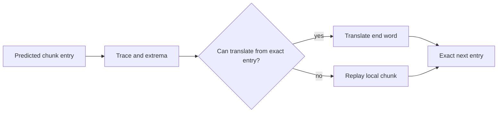

# Parallel execution of the ordered f32 fold

Take the source-order f32 fold as a performance contract. A fast tree reduction that gives a reproducible answer still owes us the *particular* answer computed by the Tix interpreter. My first target is a row of softmax. Its parallel max and exponential surround a scalar sum whose roundings influence every output. It has enough independent work to make honest controls possible.

## Research design

1. Place a whole row in a cooperative GPU block. Parallelize pointwise work and the maximum, then let one owner perform the sum in lexical order. This gives an exact competitor for any numerical innovation. Compare word by word, and compare CUDA event samples at the same shape on the same data.
2. Evaluate adjacent chunks concurrently from predicted starting values. Within a fixed normal exponent range, translating an accumulator by an even number of representable steps preserves round-to-nearest-even decisions. Record the extrema of the entire predicted path. If the true entry has matching parity and both paths stay in the interior, adjust the end by the same displacement. Otherwise replay from the known entry. Count actual replay, dependence length and GPU time separately.
3. Bind that choice to a checked schedule artifact. Check coverage, ordering, local rounded operations, the guard and its fallback; retain a GPU comparison against the current f32 tree. Test the gate with real wrong candidates outside the shapes exercised by the public lowering contract.

## Evidence and decision rule

The local build and public evaluator ran on Node 24.18.0. For the three-term row `[1, 2^-24, 2^-24]` the public evaluator returned 1. The untimed CUDA probe on NVIDIA GB10 sm_121 produced `0x3f800000` for the half-ULP tie. These are feasibility observations. For the proposed optimization the acceptance criteria are zero changed finite words, agreement on signed zeros, an explicit NaN policy and a speed advantage over a competitive exact control. A frequent translation hit with worse end-to-end time would favor the control.

Kapre and DeHon already solved sequential-equivalent parallel accumulation by guessing a whole prefix and relaxing errors until neighboring entries agree. Their measured FPGA results establish that strict summation can expose parallelism. Here the candidate is a local transfer function with a bounded fallback and a compiler-checkable validity interval. Demmel, Ahrens and Nguyen target order-independent reproducibility, a useful distinct accuracy contract. [Kapre and DeHon, *Optimistic Parallelization of Floating-Point Accumulation*, 2007](https://nachiket.github.io/publications/fp-accum_arith-2007.pdf). [Demmel, Ahrens and Nguyen, *Efficient Reproducible Floating Point Summation and BLAS*, 2016](https://www2.eecs.berkeley.edu/Pubs/TechRpts/2016/EECS-2016-121.html).

Build the exact control and replay checker first. Promote the speculative method only on data and shapes where the savings repay prediction and validation. Limit the first implementation to one contiguous reduction axis, one output owner and finite, well-defined calls. Unhandled cases execute the existing source-order emitter. More aggressive fusion and contraction schedules can then reuse the same obligations.

## First measurements

On 4096 × 1024 finite uniform logits spanning two units, the fused single-owner kernel matched the generated CUDA output at all 4,194,304 coordinates. Its median was 0.362 ms against 0.741 ms for the actual generated kernels in the same executable. The translation kernel took 0.363 ms and also matched every word. The conventional tree changed 3,822,368 outputs but took 0.356 ms. At 127 × 997 over an 80-unit input range, those times were 0.0208, 0.1079, 0.0249 and 0.0188 ms respectively (owner, generated, translated, tree). This puts row-local fusion first. It weakens the case for publishing speculative folds on this workload. The small gain available even to the wrong tree motivates a separate experiment on the exponential.

The finite-word transfer follows from translation symmetry of nearest-even rounding on a uniform grid. The low significand bit decides a half-way tie. An even shift preserves that bit at every intermediate state. A four-significand-bit model checked 8,444 nonidentity relocations with no wrong endpoints. Admitting odd shifts caused 7,680 errors. Checking only the trajectory endpoints caused 2,180 errors. Including the low power-of-two boundary without a direction proof caused 644. On 4,138 width-32 chunks of positive random data, 427 replayed. On the same number of signed chunks 2,458 replayed. These frequencies motivate source-level sign information, and the GPU measurements put a price on using it. Raw counts, mutation witnesses and all event samples are in the ticket scripts.
