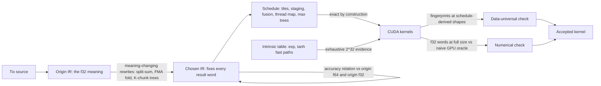
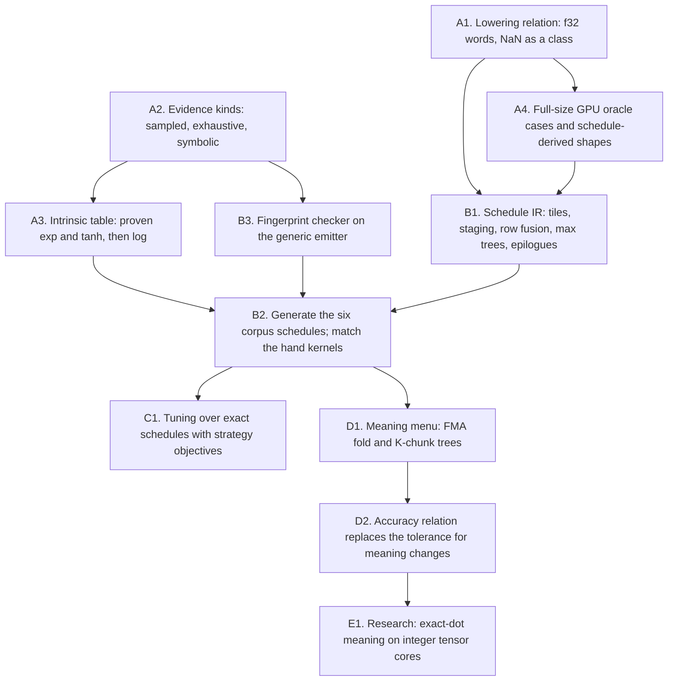

# Exact-meaning performance for Tix

## 1. Summary

Tix specifies the result of a tensor program bit for bit. Every operator rounds to f32. Each `sum` folds its terms in increasing lexicographic binder order, starting from +0. `max` has a specified treatment of NaN and signed zero, and `exp`, `log` and `tanh` mean `Math.fround` of the JavaScript double functions. Vendor libraries specify none of this. cuBLAS promises run-to-run bit equality only on the same architecture, with the same SM count and toolkit version [NVIDIA cuBLAS]. On the GB10 I measured that its result for a row depends on how many other rows are in the problem. Tix's meaning has no such dependency, and Stage 2 has already shown that the GPU can reproduce it exactly.

I therefore define best in class for Tix as **the fastest code that is bit-identical to a portable, exactly specified meaning, with every step carrying evidence of that equality as strong as the step allows.** Raw speed is still measured, but against the ceiling that the meaning itself imposes. This document argues for that definition, measures the ceiling on the GB10, and proposes four lines of work, ranked:

1. **Exact-meaning scheduling.** Use a schedule space in which no transformation can change a result word: tiling and binding of free indices, staging, register blocking, fusion of pointwise and row-local producers, and tree reduction of the exactly associative `max`. Lowering is then judged by f32 word equality. Hand-written kernels in this space were bit-identical to the unmodified Stage 2 code on all six corpus programs at full size. They were 2.0× to 7.6× faster (geometric mean 3.76×), and the six programs together took 0.887 ms instead of 3.763 ms.
2. **Exhaustively proven intrinsics.** These are fast f32-only paths for `exp` and `tanh` that use a Ziv rounding test with a double-precision fallback. On the GPU I checked every one of the 2^32 inputs against the meaning in under a second: 0 mismatches. They are 2.4× (exp) and 4.9× (tanh) faster than the double routine Stage 2 uses, and they halve softmax and MLP time.
3. **Data-universal exactness checks.** The *same kernel source* is compiled at a symbolic scalar type whose loads are hashes and whose arithmetic hashes the expression tree modulo the laws IEEE rounding obeys. Equal fingerprints at a shape mean equal words for every input of that shape. This caught a reassociation bug that numerical checks missed on two of three data streams. The current sample recipe exercises no tile at all. A residue-complete recipe caught every seeded schedule bug in 1.2 s, where my first tile-aware recipe missed two.
4. **A menu of exactly specified contraction meanings.** These are a sequential FMA fold and K-only chunk trees, together with a scale-covariant accuracy relation for meaning changes. cuBLAS's own 4096³ result equals a sequential FMA fold word for word. The FMUL+FADD meaning has half the FFMA ceiling. In one tuned kernel, the FMA fold ran 1.45× faster than the current meaning and came within 1.22× of cuBLAS at 4096³. The Stage 1/2 tolerance accepts an all-zero output once results are small.

| Program (Stage 2 sizes) | Stage 2 kernels | Exact optimized | Speedup | Words different |
|---|---:|---:|---:|---:|
| matmul 512³ | 0.216 ms | 0.062 ms | 3.50× | 0 |
| softmax 4096×1024 | 0.796 ms | 0.168 ms | 4.73× | 0 |
| layernorm 4096×1024 | 0.481 ms | 0.166 ms | 2.90× | 0 |
| attention Q=K=1024, D=V=64 | 1.048 ms | 0.139 ms | 7.56× | 0 |
| mlp 1024·256·1024·256 | 1.058 ms | 0.270 ms | 3.93× | 0 |
| conv2d 8·16·64·64 → 32, 3×3 | 0.164 ms | 0.083 ms | 1.98× | 0 |

Stage 2 times are the generated program's own benchmark mode (median of three runs after a warmup). Optimized times are medians of 21 runs. All were taken in one `--timed` run on the GB10 (`scripts/results/03-fused-exact.jsonl`). The comparison is with the Stage 2 output words on the same seeded inputs.

## 2. What "best in class" should mean for Tix

### 2.1 The argument

There are four candidate definitions.

*Fastest code.* By this measure Tix competes with cuBLAS, cuDNN and Triton on their own terms, and it would have to give up the property that distinguishes it. A compiler that may reassociate sums can use split-K, tensor cores and atomics. Its outputs then vary with problem shape, algorithm heuristics and library version.

*Strongest guarantee, regardless of speed.* Stage 2 already satisfies this at 0.5–1 TFLOP/s, which no user would accept.

*Most expressive.* Tix is a small index-notation language, and growing it does not by itself use what is distinctive about it.

*The fastest code whose result is a function of the program and its inputs alone.* Here the result does not depend on the GPU, batch composition, library version or interpreter, and every compiler step comes with evidence of that. This is the definition I defend, for three reasons.

First, there is demand, and no vendor supplies it. He and Thinking Machines Lab trace nondeterminism in LLM inference to kernels that are not *batch invariant*, where a row's reduction order depends on the batch size. They rewrote matmul, RMSNorm and attention by hand to fix this, at about a 20% matmul cost relative to cuBLAS [He 2025]. Gond et al. report that batch-invariant kernels can be much slower still against cuBLAS on large GPUs, and they build a system around avoiding them [Gond 2026]. cuBLAS guarantees bit-wise reproducibility only for "GPUs with the same architecture and the same number of SMs" from one toolkit version [NVIDIA cuBLAS].

Second, Tix already owns the hard part: the specification. Batch invariance is a *theorem* of the Tix meaning. The fold order of `y[i,j] = sum(k) …` depends only on k, never on the extents of i or j. Any implementation that is exact is therefore batch invariant, run-to-run deterministic and identical across devices. This holds without any per-kernel engineering.

Third, speed remains measurable and honest. It is measured against the exact ceiling, which is the fastest any implementation of the meaning could be on the hardware. The definition names the price of exactness and does not hide it.

### 2.2 How it is measured

| Axis | Metric | Current | Target |
|---|---|---|---|
| Exactness | Fraction of output words equal to the meaning (NaN compared as a class), on full-size random inputs | 100% (Stage 2) | 100% |
| Evidence strength, per pass | Proof (exhaustive) > data-universal per shape (fingerprint) > sampled numerical | Sampled, at extents ≤ 7 | Exhaustive for intrinsics, data-universal for schedules, sampled only for meaning changes |
| Speed | Kernel time against Stage 2, cuBLAS, and the exact ceiling | 0.5–1.1 TFLOP/s on contractions | ≥ 85% of the exact ceiling |
| Invariance | Row-0 words of an M×N result versus the same row as a 1×N problem | Not measured | 0 differences by construction |
| Checking cost | Seconds per accepted pass | ≈ 2.5 s per CUDA check (Stage 2 evaluation) | ≤ 1 s per kernel |

### 2.3 The exact ceiling on the GB10

The meaning of `sum(k) a*b` is `v = RN(v + RN(a·b))`, two roundings per term. A fused multiply-add rounds once and so computes a different function. Measured with eight independent chains per thread (`scripts/02-exact-exp`, mode `peak`):

| Operation | Throughput |
|---|---:|
| FFMA (`__fmaf_rn`) | 26.98 TFLOP/s |
| FMUL + FADD (`__fadd_rn(__fmul_rn(…))`, the Tix meaning) | 14.39 TFLOP/s (53% of FFMA) |
| DFMA | 0.386 TFLOP/s (1/70 of FFMA) |
| Streaming `y = 2x` (coordinator) | 244 GB/s |
| cuBLAS SGEMM 4096³ (this ticket, median of 3) | 18.6 TFLOP/s |

Two consequences shape every proposal.

- **Compute-bound contractions pay at most 2×.** No implementation of the current meaning can exceed 14.39 TFLOP/s. That is 77% of cuBLAS at 4096³, so exact matmul at that size is at best 1.29× slower than cuBLAS. Tensor cores (TF32, BF16) cannot produce the meaning either, since they round differently. Proposal 4 is the response.
- **Memory-bound kernels pay nothing, except for transcendentals.** FP64 runs at 1/70 of the FP32 rate, so Stage 2's correct way of computing `exp` costs more than the memory traffic. A streaming exp kernel runs at 92 GB/s. Proposal 2 removes that cost without changing a single word.

## 3. What the meaning fixes, and where the freedom lies

The diagram separates two kinds of step that the current pipeline mixes. A *meaning change* produces a new IR whose f32 interpretation differs from the origin's. Stage 1's split-sum is one, and so are an FMA contraction or a chunked K tree. Such a step is machine independent, is judged once by an accuracy relation, and leaves behind an IR that fixes every result word again. A *lowering* step must reproduce exactly the words of the IR it receives. The Stage 2 report reached the same conclusion: its final section recommends f32 equality with NaN compared as a class instead of the f64 tolerance (IRWB-022-I report, "What I would do differently").

Under that split, the schedule is free wherever it leaves each element's expression tree unchanged. The schedule decides which thread computes an element, where operands are staged, which elements share a block, which producers are recomputed or fused, and in what bracketing an *exactly* associative operation is evaluated. It may not change the tree of a `sum`.

## 4. Proposals

### 4.1 Proposal 1: exact-meaning scheduling (rank 1)

**Idea.** Give the Tix backend a schedule space whose every point is bit-identical to the meaning, and judge lowering by f32 word equality. The space contains:

- tiling and thread binding of free axes;
- shared-memory staging and register blocking of operands;
- fusion of pointwise producers, and of row-local producers into one block per row;
- recomputation and common-subexpression elimination of pure expressions;
- tree evaluation of `max`/`min` reductions;
- fusion of epilogues into contractions.

It excludes anything that changes the tree of a `sum`. Splitting K, using multiple accumulators or contracting into FMA are meaning changes and go through Proposal 4.

**Why it works (theory).** Fix a function, an input and a result element e. The meaning computes e as an expression tree T_e over loads, literals and RN operations. Every RN operation is a deterministic function of its operand words. A kernel that evaluates a tree K_e equal to T_e therefore produces the same word for every input. Only one caveat applies: NaN payloads, which IEEE leaves unspecified, so NaNs are compared as a class. Trees may be identified modulo a small set of laws that hold *for words*, not just for real numbers:

- **L1, commutativity.** RN(a+b) = RN(b+a) and RN(a·b) = RN(b·a).
- **L2, the +0 identity on folds.** RN(+0 + s) = s whenever s is not −0. A Tix fold starts at +0, and RN(x+y) = −0 only when both x and y are −0. A fold value is therefore never −0, and wrapping a fold in an outer `+0 +` changes nothing. The same fact makes zero-padding of a reduction exact, *provided* the padded partner is finite. RN(0·∞) is NaN, and intermediate Tix tensors can hold infinities, so my GEMM kernel shortens its K-tail loop instead of padding it.
- **L3, max is a join.** The Stage 2 `minmax` returns a canonical NaN if either operand is NaN. For equal-comparing operands it returns the bitwise AND (max) or OR (min) of the words, so +0 beats −0 for max. Otherwise it returns the larger value. This is the join of a semilattice: associative, commutative and idempotent on words. Any bracketing of a `max` reduction, including a warp-shuffle tree, gives the sequential fold's word.

Tiling a free index changes which thread evaluates T_e and nothing else. Staging changes where a load's word comes from, not its value. Fusion replaces a store followed by a load with the value itself, as in Stage 1's argument for `inline`. CSE evaluates an identical pure subtree once. All of these preserve K_e = T_e, which is why the experiments below found 0 differing words.

The same view yields **batch invariance as a theorem**. T_e depends on the reduction extents and on the words e reads, never on the extents of free axes. An exact kernel's row 0 is therefore the same whether M is 1 or 4096. He et al. had to design that property into each kernel [He 2025]. In Tix it follows from the meaning.

It also makes **autotuning semantically inert**. Every point in the exact schedule space has the same outputs, so a tuner choosing per-shape configurations cannot introduce a numerical difference between shapes. That kind of difference is exactly the vendor failure measured below: cuBLAS chooses kernels per shape, and the bits change with the shape.

**What is new.** Tensor compilers treat floating-point reductions as reassociable. Halide's `rfactor` is defined for associative reductions [Suriana 2017; Ragan-Kelley 2013], TVM and Triton expose split-K, and polyhedral GPU compilers model reductions so that their dependences can be relaxed [Reddy 2016]. Tix inverts the default: a reduction dependence is real unless a checked meaning change removes it. What I add is (i) the measured price of that choice on real hardware, (ii) the observation that batch invariance and inert autotuning come with it for free, and (iii) corpus-wide evidence that this exact space already reaches large speedups.

**Evidence.**

*Experiment 01 (GEMM, `scripts/01-exact-gemm`).* The experiment uses a register-blocked shared-memory SGEMM in the style of Boehm's kernel 5 [Boehm 2022], keeping `__fmul_rn`/`__fadd_rn` and strictly increasing k. It is compared with a naive kernel shaped like the Stage 2 emission, the same tiled kernel with `fmaf`, a split-K variant whose chunk size depends only on K, and cuBLAS SGEMM loaded through `dlopen`. Results are from two `--timed` runs (`results/01-exact-gemm-perf*.json`; the table shows the second):

| Size | Naive (Stage 2 shape) | Exact tiled, best tile | FMA tiled, best tile | cuBLAS | Exact / cuBLAS |
|---|---:|---:|---:|---:|---:|
| 512³ | 0.246 ms | 0.0617 ms (4.35 TFLOP/s) | 0.0513 ms | 0.0349 ms | 1.77× |
| 1024³ | 2.051 ms | 0.308 ms (6.97) | 0.244 ms | 0.139 ms | 2.21× |
| 2048³ | 17.02 ms | 2.044 ms (8.40) | 1.696 ms | 1.059 ms | 1.93× |
| 4096³ | 271.2 ms | 15.27 ms (9.00) | 17.89 ms | 7.38 ms | 2.07× |

- The exact tiled kernels differed from the naive kernel in **0 of 262,144 to 16,777,216 words** at every size, on random data in [−1, 1].
- At 4096³ my first exact kernel reached 9.00 TFLOP/s, which is 63% of the 14.39 exact ceiling. cuBLAS reached 18.6, which is 69% of the FFMA ceiling.
- A second kernel (experiment 09) adds float4 global and shared loads to the 128×128×8 layout. It reached **10.32 TFLOP/s at 4096³**, 72% of the exact ceiling, still with 0 words different, and 9.62 TFLOP/s at 2048³. That is 1.76× of cuBLAS's time at 4096³. Of that factor, 1.29× is forced by the semantics and the rest is engineering.
- **cuBLAS is not batch invariant on the GB10.** Row 0 computed as a 1×N problem differs from row 0 of the N×N problem in 471/512, 924/1024, 1928/2048 and 4014/4096 words. The exact kernels and the K-only split-K kernel differ in 0.
- cuBLAS differs from the Tix meaning in 93% of words at every size. At 4096³ it equals my sequential-k FMA kernel in every word (0 of 16,777,216 differ), whereas at 512³ to 2048³ it differs from that kernel in 92–96% of words. cuBLAS thus computes a different function at different sizes. That is the property Tix forbids.

*Experiment 03 (corpus, `scripts/03-fused-exact.mjs`).* A generator builds one translation unit from the **unmodified Stage 2 output** of `cudaSource()` for all six programs. Each program sits in its own namespace, and its `run_case` is driven through in-memory streams. The same unit holds hand-written schedules from the space above. The Stage 2 code is therefore both the oracle and the baseline, on identical inputs. The table in §1 gives the results. The schedules used were:

- matmul: the experiment-01 kernel, 64×64 tiles with a 4×4 micro-tile.
- softmax and layernorm: one block per row. Max is a warp-shuffle join tree, each sum is folded in order by one thread from shared memory, and the epilogue runs in parallel. They reached 199 and 202 GB/s, 82% of the streaming bandwidth.
- attention: three kernels. The first is the score contraction q·kᵀ with the exact GEMM (after a bit-copy transpose of k). The second is a row kernel for scale, max, exp, ordered sum and divide. The third is the weight·v contraction with the exact GEMM.
- mlp: the exact GEMM, a fused bias+GELU epilogue, the exact GEMM again, then a bias epilogue.
- conv2d: an implicit GEMM whose reduction index k = (c·3+dy)·3+dx enumerates (c, dy, dx) in the Tix fold order, with outputs stored in NCHW.

All six were bit-identical to Stage 2 at full size.

*What the measurements say about where the time goes.* In softmax the fused kernel with Stage 2's double exp took 0.352 ms, and it took 0.168 ms with the proven exp of Proposal 2. Half of the gain is the intrinsic. In the MLP the bias+GELU epilogue alone took 0.211 ms with the double tanh and 0.040 ms with the proven tanh. The one-thread ordered row sum is not a bottleneck at these sizes: the softmax kernel runs at 82% of streaming bandwidth.

**Risks.**

- *The sequential-fold wall.* A fold is a dependent chain of FADDs, about 4 cycles each, or about 0.6 G terms/s per output at 2.4 GHz. A reduction of 2^20 terms into one output takes at least 1.7 ms however the rest is scheduled. Programs with few outputs and long reductions need a meaning-level tree (Proposal 4); scheduling cannot remove this limit.
- *Engineering distance to cuBLAS.* The exact ceiling is reachable only with cuBLAS-class tiling, double buffering, warp tiling and vectorized loads. My best kernel sits at 72% of the ceiling. The 128-tile kernel is poor at 512³ (0.090 ms, 16 blocks for 48 SMs), where the 64-tile kernel took 0.062 ms. Tile choice has to depend on shape, which is safe precisely because every tile choice has the same meaning.
- *Fusion granularity.* My single-kernel attention, one block per query row, was *slower* than Stage 2 at first (1.69 ms against 1.05 ms). After three fixes it still took 0.72 ms, against 0.139 ms for the three-kernel version (§6). A schedule space needs a cost model or a tuner, not a fixed "fuse everything" rule.

**How success is measured.** The compiler, rather than a human, generates schedules for the six programs that are bit-identical at full size and at least 3× faster than Stage 2 in geometric mean. The hand-written result is 3.76×. Contractions reach at least 85% of the exact ceiling, which is about 12 TFLOP/s on the GB10, or within 1.5× of cuBLAS at 4096³. Batch-invariance differences are 0 in a standing test.

**What it needs from `src/framework`.**

- A *schedule* artifact kind, so that the lowering's inputs are (Tix IR, schedule, function name) and its output is CUDA source. `defineTransformation` already takes multiple heterogeneous input ports: Stage 2 used `{ baseline, fn }`. No framework change is needed for that.
- An *exact* relation with NaN compared as a class. This is domain code in `src/tensor/cuda-contract.ts`. The framework's `differential()` already accepts an arbitrary `compare`.
- Full-size cases decided on the GPU against the naive Stage 2 emission as oracle. `decide` batching and the `baselineKey`/`subjectKey` memo in `differential.ts` already support this. The 4,096-element cap lives in `src/tensor/contract.ts`, not in the framework.
- For tuning, the strategy IR's objectives and plans (`src/framework/strategy`, `defineObjective`) can drive a search whose points all share one meaning. The search then minimizes time and nothing else.

### 4.2 Proposal 2: exhaustively proven intrinsic fast paths (rank 2)

**Idea.** For each unary transcendental in Tix (`exp`, `tanh`, `log`), ship an f32-only fast path that is accurate to about 2^-38. A rounding test returns the f32 word only when it is determined, and otherwise falls back to the double routine. The equality is then *proved* by running the fast path and the meaning's GPU implementation on all 2^32 inputs. On the GB10 this takes about half a second per function.

**Why it works (theory).** Let v be the true value that the reference rounds, and let y be an approximation with |y − v| ≤ E. RN is monotonic. If RN(y − E) = RN(y + E), every value in the interval, including v, rounds to the same word. This is Ziv's rounding test [Ziv 1991]. In float-float arithmetic I compute `lo = RN(hi + RN(lo_part − E))` and the matching `hi`. Rounding `lo_part ± E` adds one tiny error, absorbed by taking E as twice the estimated error. When the test fails, the lane calls the double routine.

Two facts make the result a proof rather than a sample. First, the domain is finite: 2^32 words, and the GPU enumerates them in about 0.6 s. Second, the reference is available on the GPU. The meaning of `exp(x)` is `Math.fround(Math.exp(x))`, which is not necessarily the correctly rounded exp. The coordinator found that CUDA's `__double2float_rn(exp((double)x))` equals the meaning on every input. The chain *fast path ≡ CUDA double path ≡ JS meaning* therefore holds on all inputs for this compiled binary.

**The fast exp** (`scripts/02-exact-exp`) works in four steps:

1. Reduce the argument by ln2/64 with a Cody–Waite pair. The first step `fma(−n, L_hi, x)` is exact: n·L_hi is a multiple of 2^-30, x is a multiple of 2^-31 wherever n ≠ 0, and the difference is below 2^-7.
2. Look up 2^(j/64) in a 64-entry float-float table.
3. Evaluate a degree-5 polynomial for exp(r) − 1 − r.
4. Combine with FMA error terms.

Inputs outside (−87, 88.5), where results are subnormal or overflow, and NaNs take the fallback.

**The fast tanh** (`scripts/07-exact-tanh`) returns ±1 for |x| ≥ 9.25. For |x| < 2^-6 it uses a series. Elsewhere it computes 1 − 2/(e^{2|x|} + 1) with the exp core in float-float, a one-step float-float division and TwoSum.

**What is new.** Exhaustively verified correctly rounded libraries exist: CORE-MATH proves binary32 functions correct on all inputs [Sibidanov 2022], and RLIBM-32 generates polynomials that are correct on all inputs [Lim 2021]. Ziv's strategy underlies most such libraries. Three things are specific to Tix here.

- The target is the *language meaning*, not the mathematical function. The proof obligation is equality with `fround` of JavaScript's double routine, a function that can differ from the correctly rounded one. The oracle is a GPU routine already certified against JS.
- The proof becomes pass evidence. A one-second exhaustive run, keyed by the compiled binary and toolchain, is stronger than any sampled differential check, and it can be re-run when the toolchain changes.
- The exhaustive run also *calibrates* the error bound E. The sweep below found the smallest sound bound empirically and caught a genuine algorithm bug that my error analysis had missed.

**Evidence.**

| Function | Check | Result |
|---|---|---|
| exp, E = 2^-36 | all 2^32 words, NaN as a class | **0 mismatches**; 200,354 undecided in-range inputs (1 in 11,168) take the fallback |
| exp bound sweep | 2^-38 / 2^-40 / 2^-42 / 2^-44 / 2^-52 / 2^-64 | 0 / 66 / 705 / 861 / 882 / 882 mismatches |
| tanh, E = 2^-34 (series) and 2^-36 (exp path) | all 2^32 words | **0 mismatches**; 745,846 finite undecided inputs (plus 16,777,214 NaN words) |
| tanh bound sweep | (34, 38), (36, 38) sound; (34, 40) | 6 mismatches |

| Streaming, `--timed` | Stage 2 double routine | Proven fast path | CUDA single-precision function | Fast-path words ≠ meaning | CUDA function's words ≠ meaning |
|---|---:|---:|---:|---:|---:|
| exp, 2^26 args in [−12, 0] | 5.83 ms (92 GB/s) | 2.47 ms (218 GB/s) | `expf` 2.17 ms | 0 | 20,444,397 (30.5%) |
| tanh, 2^24 args in [−3, 3] | 3.30 ms | 0.668 ms | `tanhf` 0.544 ms | 0 | 3,397,679 (20.3%) |

The first exp sweep point that fails, at 2^-52, is x = 2^-24. There exp(x) lies just above the midpoint between 1 and 1 + 2^-23, so a fast path without a test returns the even neighbour. A fast path without the test is more accurate than `expf`, yet it is wrong on 882 inputs. "Accurate" and "exact" are different properties, and only the exhaustive check tells them apart.

**Risks.**

- *Toolchain dependence.* The proof covers one compiled binary. A different `nvcc`, a different architecture or a fast-math flag invalidates it. The mitigation is cheap: key the evidence by binary hash and re-run (0.5–0.6 s).
- *Divergence.* An input that takes the fallback costs its warp one double-routine evaluation. Adversarial inputs near midpoints could make every warp fall back, so the worst case equals Stage 2's cost, never worse.
- *Constant-memory table reads diverge across lanes.* The streaming kernel still reached 218 GB/s, so this is not currently binding.
- *`log` is not done yet.*

**How success is measured.** Fast paths for `exp`, `tanh` and `log` each have 0 mismatches over 2^32 inputs and run at 0.8× or more of the throughput of the non-exact CUDA function. Exp is at 0.88× and tanh at 0.81×. Softmax and the MLP epilogue already show the system-level effect.

**What it needs from `src/framework`.** `DifferentialEvidence.method` is the literal `'sampled'` (`src/framework/contracts/differential.ts`, lines 82–95). An exhaustive check is not a sample and should not be reported as one. I would widen it to `'sampled' | 'exhaustive' | 'symbolic'`, with a domain descriptor (for example `{ words: 2**32 }`) and the identity of the checked binary. `AnalysisManager` already records evidence per check, and the memo keys already allow "decided once per toolchain". The intrinsic table itself is domain code that maps each function to an implementation and its evidence, consumed by the emitter.

### 4.3 Proposal 3: data-universal exactness checks by symbolic fingerprints (rank 3)

**Idea.** Write the emitted kernels generically in their scalar type (a C++ template, which the emitter can produce at no cost). Instantiate them a second time at a type `Sym`. Its loads are hashes of (tensor, flat index), its `mul` and `add` are commutative hash combiners, and it carries one bit recording "may be −0". Run that instantiation on the GPU at the shapes to be checked and compare per-element fingerprints with the naive kernel's. Equal fingerprints mean that the trees are equal modulo L1–L3, and hence that the words are equal **for every input of that shape**, up to a 2^-64 collision probability per comparison.

**Why it works (theory).** This is translation validation [Pnueli 1998; Necula 2000] specialized to a domain where the semantics of an element *is* a term. The validator does not need to reason about loops, because it executes them, on the same source that will run. The term algebra holds only laws that are valid for IEEE binary32 words under RN: L1 by symmetric combination, L2 by the −0 bit, and L3 by a commutative-associative join, which the GEMM kernels here do not need. The check is sound and deliberately incomplete. Associativity of `+` is absent, so any reassociation shows up as a tree difference, which is the intended outcome.

It is also *data universal*. A numerical differential check sees a bug only if the sampled data expose it. The reassociation bug below is invisible on integer-valued data, because all products and partial sums are exact, and on zeros. The fingerprint check needs no data.

**Shapes from the schedule.** Fingerprints decide one shape at a time, so the shape recipe matters. The Stage 1/2 recipe uses extents 0, 1, 3, 4, 7 and a 3/5/7 mix, with at most 4,096 elements per tensor. A schedule with tile T is exercised only at extents ≥ T, so the recipe has to be *derived from the schedule*. My first proposal was T−1, T, T+1 and 2T+3 per tiled axis. Experiment 08 refuted it, as recorded below. What works is a *residue-complete* recipe. Take one axis at a time and give it every extent r, T + r and 2T + r for r = 0…T−1, with the other axes at T + 1. That is 3·T shapes per axis, cheap with fingerprints: 600 shapes in 1.2 s for the 64×128×8 GEMM.

The open part is the small-model hypothesis. Suppose the control flow of a schedule depends on extents only through comparisons with multiples of tile sizes. Then the tree of an element depends on the shape only through the quotient class of each extent (0, 1 or at least 2 tiles) and its residue. The residue-complete recipe then covers all shapes, if behaviour is separable by axis. I have not proved this. Experiment 08 is consistent with it for six variants, and full-size numerical checks remain in the pipeline until it is proved.

**What is new.** Translation validation and symbolic execution are standard. The specific combination is to reuse the *very kernel source* at a symbolic scalar type, on the GPU, with an algebra containing exactly the word-level laws of RN arithmetic. I have not seen it for tensor compilers. It turns "exact" into a decidable per-shape property that takes milliseconds to check.

**Evidence** (`scripts/06-fingerprint`, `results/06-fingerprint.json`). Mutant `pair` adds products in pairs inside full K tiles, a common ILP rewrite. Mutant `rowstride` uses the block-row stride BN instead of BM. Each cell gives the number of output words, or fingerprints, that differ from the oracle.

| Shape M,K,N | Exact tiled: numbers / fingerprint | `pair` on signed data | `pair` on small integers | `pair` on zeros | `pair` fingerprint | `rowstride` (all streams / fingerprint) |
|---|---|---:|---:|---:|---:|---:|
| 7,7,7 | 0 / 0 | 0 | 0 | 0 | 0 | 0 / 0 |
| 5,3,7 | 0 / 0 | 0 | 0 | 0 | 0 | 0 / 0 |
| 64,64,64 | 0 / 0 | 3,352 | 0 | 0 | 4,096 (all) | 0 / 0 |
| 65,9,129 | 0 / 0 | 3,431 | 0 | 0 | 8,385 (all) | 129 / 129 |
| 129,17,257 | 0 / 0 | 19,002 | 0 | 0 | 33,153 (all) | 16,448 / 16,448 |
| 65,300,70 | 0 / 0 | 4,058 | 0 | 0 | 4,550 (all) | 70 / 70 |

Without L2, the K-only chunk tree differed from the naive fold in fingerprint at every shape with K ≤ 128 (49/49 at 7³), although its words are equal. With L2 it matches exactly when K ≤ 128, which is one chunk, and differs at K = 300, a genuine reassociation. The split-K kernel matched its own chunk-tree oracle in fingerprint at every shape.

The *numerical* check with the Stage 1/2 tolerance never caught `pair` at any shape (`results/01-exact-gemm-shapes.json`): the worst case used 15% of the budget. At the recipe shapes, neither bug is exercised at all, because no extent reaches the tile.

*Which shapes?* (`scripts/08-residues`, `results/08-residues.json`, fingerprints only). Experiment 08 adds three shape-dependent mutants of the kind that unrolled or vectorized tails produce. `tail1` drops a one-term K tail in a later tile (K mod 8 = 1). `tail5rev` folds a five-term tail in reverse (K mod 8 = 5). `edge5` skips the last column when N mod 128 = 5. Each cell counts the shapes at which the mutant's fingerprints differ from the oracle's; a mutant is caught if the count is nonzero.

| Recipe | Shapes (check time) | exact | pair | rowstride | tail1 | tail5rev | edge5 |
|---|---|---:|---:|---:|---:|---:|---:|
| R1: Stage 1/2 recipe | 8 (12 ms) | 0 | 0 | 0 | 0 | 0 | 0 |
| R2: {T−1, T, T+1, 2T+3}³ | 64 (137 ms) | 0 | 48 | 32 | 16 | **0** | **0** |
| R3: residue-complete, one axis at a time | 600 (1.2 s) | 0 | 593 | 536 | 578 | 2 | 2 |

R3 caught every mutant and raised no false alarm on the exact kernel at any of 672 shapes. R2 missed both residue-specific mutants: its residues are 7, 0, 1 and 3, never 5.

**Risks.** The check is incomplete. A legal rewrite outside the algebra is rejected: for example, zero-skipping is exact only for finite partners. Each such case needs a proved law. A symbolic instantiation doubles shared-memory and register use, which is acceptable for checking. The small-model hypothesis is unproved. Hash collisions occur with probability around n²/2^64 for n distinct subterms, negligible for n < 10^9.

**How success is measured.** At residue-complete shapes, every seeded mutant that changes a tree is rejected, with zero false alarms on the exact schedules and a check time of about 1 s per kernel. Experiment 08 meets this for six variants of one GEMM: 1.2 s, all mutants caught. The measure should be extended to fused row kernels, a transposed-load mutant and generated (not hand-written) schedules.

**What it needs from `src/framework`.** The same widening of `DifferentialEvidence.method` (`'symbolic'`, plus the laws assumed). A differential spec whose `run` returns fingerprints instead of numbers already fits `differential()`, since `Outcome` is generic. Shape recipes derived from the schedule are domain code.

### 4.4 Proposal 4: a menu of exactly specified contraction meanings, and a scale-covariant accuracy relation (rank 4)

**Idea.** Keep exactness, but let a program choose among exactly specified meanings for a contraction:

- the current sequential RN–RN fold;
- a *sequential FMA fold*, `v = RN(v + a·b)` with one rounding per term, in the same order;
- *K-only chunk trees*: chunks of a fixed width C folded in order, then the chunk sums folded in order.

Moving between them is a meaning change, judged once at the IR level. The judge is an *accuracy relation* that, unlike the Stage 1/2 tolerance, is covariant under scaling.

**Why it works (theory).**

- *The FMA fold* doubles the exact ceiling, from 14.39 to 26.98 TFLOP/s, and is more accurate, since there is one rounding per term instead of two. Its interpreter meaning can be computed exactly in JavaScript. For f32 a and b, a·b is exact in f64: at most 48 significant bits, with exponents between 2^-298 and 2^256. TwoSum gives s + e = a·b + c exactly. RN32(s + e) equals `Math.fround(s)` unless s is an f32 midpoint, in which case the sign of e decides. The midpoint argument holds because f32 midpoints are f64 numbers, so a non-midpoint s is at least one f64 ulp away from any midpoint, while |e| ≤ ulp64(s)/2. Rounding to odd is the classical alternative [Boldo 2008].
- *K-only chunk trees* depend only on K and C, so they keep batch invariance. He et al. reach the same conclusion for split-KV decoding: use a fixed split size, not a fixed number of splits [He 2025]. They also restore parallelism where M·N is small, which is the sequential-fold wall from Proposal 1.
- *Scale covariance.* Linear programs are homogeneous: scaling the inputs by 2^s scales every f32 and f64 result exactly, absent underflow and overflow. A relation R(candidate, origin, reference) should give the same verdict after scaling, but the Stage 1/2 tolerance `|C−R| ≤ 2e-6 + 2e-5|R|` does not, because of its absolute term. I propose, per case, `max|C−R| ≤ k·(max|O−R| + ulp32(max|R|)/2)`. Here O is the origin's exact f32 result and R its f64 result. In words: the meaning change may not make the program more than k times less accurate than it already was. Tix is the setting where this is possible, because the origin's f32 behaviour is exactly specified and computable.

**What is new.** cuBLAS's own result at 4096³ is a sequential FMA fold, measured word for word. A Tix FMA meaning would therefore be *bit-compatible with cuBLAS where cuBLAS runs at full speed*, and would keep that meaning at the shapes where cuBLAS changes its algorithm. The JavaScript reference needs care: the obvious implementation passes random testing and is wrong on every hard case (below). The accuracy relation uses the origin's exact f32 error as the yardstick, which no tolerance chosen in advance can do.

**Evidence.**

*Ceilings and cuBLAS* (§2.3 and experiment 01). FMUL+FADD runs at 53% of FFMA, and cuBLAS at 4096³ equals the sequential FMA fold in 0 differing words.

*The price, measured on one kernel* (experiment 09, `results/09-gemm-v2.json`). The same 128×128×8 float4 kernel was compiled twice, differing only in the inner operation, and each version was checked against a naive oracle of its own meaning:

| Size | RN–RN (current meaning) | FMA fold | cuBLAS | RN–RN / FMA | FMA / cuBLAS | Words ≠ own oracle |
|---|---:|---:|---:|---:|---:|---:|
| 1024³ | 0.299 ms (7.17 TFLOP/s) | 0.205 ms (10.48) | 0.138 ms (15.61) | 1.46× | 1.49× | 0 / 0 |
| 2048³ | 1.787 ms (9.62) | 1.209 ms (14.21) | 1.020 ms (16.85) | 1.48× | 1.19× | 0 / 0 |
| 4096³ | 13.31 ms (10.32) | 9.21 ms (14.92) | 7.56 ms (18.18) | 1.45× | 1.22× | 0 / 0 |

The measured price of the current meaning in a realistic kernel is therefore about 1.45×, below the 2× instruction-count bound, because the kernel also spends issue slots on shared-memory loads and addressing. The FMA fold, an exactly specified and batch-invariant meaning, comes within 1.2× of cuBLAS at large sizes, and at 4096³ it is cuBLAS's own function. The K-only split-K kernel (chunk 128) equalled its tree oracle in 0 words at every size and was batch invariant. My implementation of it was slower than the unsplit kernel (29.4 ms at 4096³), because I wrote the partials to global memory without tuning. At 512³ it was faster than the 64-tile exact kernel: 0.0546 ms against 0.0617 ms.

*The FMA meaning reference* (`scripts/04-fma-meaning.mjs`, GPU `__fmaf_rn` as oracle):

| Triples | Exact EFT reference: mismatches | `Math.fround(a*b + c)`: mismatches |
|---|---:|---:|
| 1,048,576 random 32-bit words (NaN, inf, subnormal) | 0 | 0 |
| 262,144 random normals, exponents ±60 | 0 | 0 |
| 65,536 constructed: a·b = ±h(1 − 2^-46), c odd, h = ulp(c)/2 | 0 | **65,536 (all)** |

*The tolerance and the accuracy relation* (`scripts/05-accuracy-relation.mjs`). Part A drives the real Stage 1 gate on `y[i] = sum(k) x[i,k] * S`, with a candidate that returns zeros. The gate rejects it for S = 1e-3, 1e-5 and 2e-6, and **accepts** it for S = 1e-7 and 1e-9. Part B evaluates the six corpus programs: split-sum, the Stage 1 floor-split mutant that drops a tail, and all zeros, at the gate's own cases plus one large case per program. It does so unscaled and with inputs scaled by 2^-20:

| Program, input scale | Split-sum: tolerance / norm relation (k = 2) | Floor mutant: tolerance / norm | Zeros: tolerance / norm |
|---|---|---|---|
| matmul, 1 | **reject** (K = 4093 case) / accept (max ratio 0.66) | reject / reject | reject / reject |
| matmul, 2^-20 | accept / accept | **accept** / reject | **accept** / reject |
| softmax, both | accept / accept | reject / reject | reject / reject |
| layernorm, 2^-20 | accept / accept | **accept** / reject | **accept** / reject |
| attention, 2^-20 | accept / accept | **accept** / reject | **accept** / reject |
| mlp, 2^-20 | accept / accept | **accept** / reject | **accept** / reject |
| conv2d, 2^-20 | accept / accept | (mutant has no effect) | **accept** / reject |

Across all programs and both scales, split-sum's largest norm ratio was 0.95. Split-sum is never less accurate than the origin by more than that factor. This is consistent with theory: blocked summation has a smaller worst-case error constant than recursive summation [Higham 2002, ch. 4], and typical errors grow like the square root of the length [Higham 2019]. The Stage 1/2 tolerance falsely rejects split-sum on a 4,093-term matmul. On small-magnitude programs it accepts both bugs.

**Risks.** This proposal changes the language: users must choose meanings, and the interpreter's FMA path is slower. The accuracy relation is still sampled. An *elementwise* version of it failed (§6), and the norm version's constant k = 2 is fitted to six programs. Tensor cores remain out of reach for every meaning on the menu. An Ozaki-style meaning, the correctly rounded dot product computed exactly with integer tensor cores [Ozaki 2012], is a research direction, not a proposal.

**How success is measured.** An FMA-meaning matmul runs within 1.2× of cuBLAS at 4096³ and is bit-identical to cuBLAS wherever cuBLAS uses a sequential fold. K-chunk trees give 1×N problems the same row words as M×N. The accuracy relation has no false rejections on the corpus at any power-of-two input scale and rejects every seeded mutant.

**What it needs from `src/framework`.** Mostly domain changes in `src/tensor`:

- an `fma` operation, or a contraction attribute, in `model.ts`;
- the EFT reference in `evaluate.ts`;
- a per-reduction chunk width, since `width` is the constant 4 today;
- the accuracy comparator in `contract.ts`.

The framework's `differential()` already accepts any outcome and comparison. The one framework-level gap is that a meaning change's evidence should name the relation used and the origin it compares against. Stage 1 keeps this in a closure, so it is not visible in the evidence.

## 5. Staged plan

**Stage A, first.** A1 is a few lines in `cuda-contract.ts`. It turns every later backend step into a bit-for-bit check, and the Stage 2 report recommended it on independent grounds. A2 is the only framework change most proposals need. A3 is the cheapest large win: it is local to the emitter, already proven, and halves softmax, attention rows and the MLP epilogue. A4 fixes a measured blind spot: no current case reaches a tile.

**Stage B** is the core engineering. The order is the schedule representation first, then the fingerprint gate, so that every generated schedule is checked data-universally from day one, and only then generation of all six programs. The hand kernels of experiment 03 are the acceptance targets: equal words and equal or better time.

**Stage C** comes after B because tuning is only safe once the space is exact. The payoff is that tuning can never cause numerical regressions.

**Stage D** comes last because it changes the language. It needs B's schedules to show its value: the FMA fold matters only once a contraction is near the exact ceiling. It also needs A2's evidence kinds, so that a meaning change records the relation that judged it.

## 6. What I tried that did not work

- **A single fused attention kernel.** One block per query row, holding scores, exponentials and weights in shared memory, took 1.69 ms, slower than Stage 2's 1.05 ms. Removing a runtime 64-bit division from the tile loads gave 1.49 ms. Four rows per block with staged K and V tiles gave 0.96 ms, and unrolling gave 0.72 ms. A phase probe showed the score phase alone took 0.475 ms (0.28 TFLOP/s): one dependent chain per thread with too few warps per SM is latency-bound. The working design is the three-kernel version at 0.139 ms. Fusion is a choice for a cost model, not a default.
- **An unsound first fast tanh.** The exhaustive check found 85,400 wrong words, the first at x = 0x3c952178. A high-precision analysis traced the cause. The float-float exp result was unnormalized: its low word carried the whole polynomial tail, about 8e-6. The one-step division correction assumed a low word below one ulp of the high word, and that produced an error of about 1.5e-11, above the rounding-test bound. Renormalizing the denominator with Fast2Sum fixed it: 0 mismatches. My error analysis had not caught this, and only the exhaustive check did.
- **Rounding-test bounds that were too small.** exp is unsound at 2^-40 and below (66 to 882 mismatches), and tanh's exp path is unsound at 2^-40 (6 mismatches).
- **An elementwise accuracy relation.** `|C−R| ≤ 8(|O−R| + ulp(R))` per element falsely rejected split-sum on matmul (ratio 12.6) and layernorm (ratio 127). Wherever the origin happens to be very accurate at one element, any legitimate change looks infinitely worse there. The per-case norm relation fixed this.
- **The obvious FMA reference.** `Math.fround(a*b + c)` passed 1.31 million random triples and failed all 65,536 constructed near-midpoint triples. Random testing cannot validate a reference for a fused operation.
- **Fingerprints without the +0 law.** The plain tree hash flagged a K-only chunk tree as different from the sequential fold when K fits in one chunk (49/49 outputs at 7³), although the words are equal. That is a false alarm, removed by L2.
- **My first FMA GEMM as evidence for the price.** At 4096³ the fma variant of the experiment-01 kernel was *slower* than the exact one (17.9 ms against 15.3 ms), so it said nothing about the semantic price, which the kernel's other bottlenecks masked. Experiment 09's tuned kernel replaced it: about 1.45× at every size from 1024³ to 4096³.
- **The K-only split-K kernel at large sizes.** It took 29.4 ms at 4096³, against 15.3 ms for the 128-tile exact kernel, because the partial sums go through global memory without tuning. It won only at 512³.
- **My first schedule-derived shape recipe.** T−1, T, T+1 and 2T+3 per axis caught the tile-threshold bugs, but it missed both mutants that depend on a residue (`tail5rev` at K mod 8 = 5, `edge5` at N mod 128 = 5). The residue-complete recipe replaced it.
- **Bugs that exact comparison caught immediately.** These are worth recording because each would have been easy to miss under a tolerance. A transposed index in the three-kernel attention made all 65,536 words differ. A stale output buffer would have hidden the `rowstride` mutant, until the kernels' outputs were NaN-filled.

## 7. Experiments

All scripts are in this ticket's `scripts/`, and their outputs are in `scripts/results/`. GPU runs used `tools/cuda-remote.mjs` on the GB10 (sm_121, CUDA 13.0, `nvcc -O3`). Measurements took the GPU lock (`--timed`). Each command runs from the worktree root after `npm run build`.

| # | Script | Question | Result |
|---|---|---|---|
| 00 | `00-device/main.cu` | Device facts | GB10, 48 SMs, 2.418 GHz, 24 MB L2 |
| 01 | `01-exact-gemm/main.cu` (`perf`, `shapes`) | Exact GEMM speed, cuBLAS numerics and batch invariance, sample-shape adequacy | 0 words different at 512–4096³; exact / cuBLAS 1.77–2.21×; cuBLAS row-0 batch differences 471–4014; cuBLAS = sequential FMA at 4096³; recipe shapes miss both mutants |
| 02 | `02-exact-exp/main.cu` (`peak`, `exhaust [b]`, `stream`) | Price of FP64 exp; proven fast exp | FFMA 26.98, FMUL+FADD 14.39, DFMA 0.386 TFLOP/s; 0 mismatches over 2^32; 2.4× streaming |
| 03 | `03-fused-exact.mjs` + `03-fused/fused.cuh` | Exact schedules for the corpus against unmodified Stage 2 | All six bit-identical; 1.98–7.56×, geometric mean 3.76× |
| 04 | `04-fma-meaning.mjs` + `04-fma-meaning/main.cu` | Can the interpreter specify FMA exactly? | EFT reference: 0 mismatches on 1.38M triples; naive: 65,536/65,536 wrong on hard cases |
| 05 | `05-accuracy-relation.mjs` | Tolerance versus accuracy relations | Gate accepts zeros at S ≤ 1e-7; tolerance vacuous at 2^-20; norm relation separates everywhere |
| 06 | `06-fingerprint/main.cu` | Data-universal per-shape exactness | Exact schedules 0 fingerprint differences; `pair` caught at every shape with K ≥ 8, invisible numerically on integers and zeros |
| 07 | `07-exact-tanh/main.cu` (`exhaust s e`, `stream`, `debug w`) | Proven fast tanh | First version 85,400 mismatches; fixed: 0; 4.9× streaming |
| 08 | `08-residues/main.cu` | Which shape recipe exposes shape-dependent schedule bugs? | Stage recipe catches none; T−1/T/T+1/2T+3 misses residue bugs; residue-complete (600 shapes, 1.2 s) catches all, no false alarms |
| 09 | `09-gemm-v2/main.cu` | The price of exactness on one tuned kernel | RN–RN 10.32 TFLOP/s and FMA fold 14.92 at 4096³ (1.45×); FMA fold within 1.22× of cuBLAS; both 0 words different from their own oracles |

Example commands:

- `node tools/cuda-remote.mjs <ticket>/scripts/01-exact-gemm --timed -- perf 512 1024 2048 4096`
- `node tools/cuda-remote.mjs <ticket>/scripts/02-exact-exp --timed -- exhaust 36`
- `node <ticket>/scripts/03-fused-exact.mjs --timed`
- `node <ticket>/scripts/04-fma-meaning.mjs`
- `node <ticket>/scripts/05-accuracy-relation.mjs`
- `node tools/cuda-remote.mjs <ticket>/scripts/06-fingerprint`
- `node tools/cuda-remote.mjs <ticket>/scripts/07-exact-tanh --timed -- exhaust 34 36`
- `node tools/cuda-remote.mjs <ticket>/scripts/08-residues`
- `node tools/cuda-remote.mjs <ticket>/scripts/09-gemm-v2 --timed -- 512 1024 2048 4096`

Caveats. My Stage 2 timings come from the generated program's own benchmark mode, with a median of three runs. The coordinator's single runs (0.197, 0.785, 0.563, 1.81, 1.05 and 0.341 ms) differ by up to 2× for attention and conv2d. Optimized kernels used medians of 21 runs. Exactness claims are per input (seeded random data) and per shape (the corpus sizes), except the exhaustive and fingerprint results, which cover every input of the stated domain. The exhaustive proofs cover the binaries built by the runner's `nvcc` 13.0 at `-O3 -arch=sm_121`.

## 8. References

- [Boehm 2022] Simon Boehm, "How to Optimize a CUDA Matmul Kernel for cuBLAS-like Performance: a Worklog", December 2022. https://siboehm.com/articles/22/CUDA-MMM
- [Boldo 2008] Sylvie Boldo and Guillaume Melquiond, "Emulation of FMA and Correctly Rounded Sums: Proved Algorithms Using Rounding to Odd", IEEE Transactions on Computers 57(4), 2008. https://doi.org/10.1109/TC.2007.70819
- [Collange 2015] Sylvain Collange, David Defour, Stef Graillat and Roman Iakymchuk, "Numerical reproducibility for the parallel reduction on multi- and many-core architectures", Parallel Computing 49, pp. 83–97, 2015. https://doi.org/10.1016/j.parco.2015.09.001
- [Demmel 2015] James Demmel and Hong Diep Nguyen, "Parallel Reproducible Summation", IEEE Transactions on Computers 64(7), pp. 2060–2070, 2015. https://doi.org/10.1109/TC.2014.2345391
- [Gond 2026] Raja Gond, Aditya K. Kamath, Ramachandran Ramjee and Ashish Panwar, "LLM-42: Enabling Determinism in LLM Inference with Verified Speculation", arXiv:2601.17768, 2026. https://arxiv.org/abs/2601.17768
- [He 2025] Horace He and Thinking Machines Lab, "Defeating Nondeterminism in LLM Inference", Thinking Machines Lab: Connectionism, September 2025. https://thinkingmachines.ai/blog/defeating-nondeterminism-in-llm-inference/
- [Higham 2002] Nicholas J. Higham, *Accuracy and Stability of Numerical Algorithms*, 2nd ed., SIAM, 2002. https://doi.org/10.1137/1.9780898718027
- [Higham 2019] Nicholas J. Higham and Theo Mary, "A New Approach to Probabilistic Rounding Error Analysis", SIAM Journal on Scientific Computing 41(5), pp. A2815–A2835, 2019. https://doi.org/10.1137/18M1226312
- [Lim 2021] Jay P. Lim and Santosh Nagarakatte, "RLIBM-32: High Performance Correctly Rounded Math Libraries for 32-bit Floating Point Representations", PLDI 2021. https://arxiv.org/abs/2104.04043
- [Necula 2000] George C. Necula, "Translation Validation for an Optimizing Compiler", PLDI 2000. https://doi.org/10.1145/349299.349314
- [NVIDIA cuBLAS] NVIDIA, cuBLAS documentation, section "Results reproducibility". https://docs.nvidia.com/cuda/cublas/index.html
- [Ozaki 2012] Katsuhisa Ozaki, Takeshi Ogita, Shin'ichi Oishi and Siegfried M. Rump, "Error-free transformations of matrix multiplication by using fast routines of matrix multiplication and its applications", Numerical Algorithms 59(1), pp. 95–118, 2012. https://doi.org/10.1007/s11075-011-9478-1
- [Pnueli 1998] Amir Pnueli, Michael Siegel and Eli Singerman, "Translation Validation", TACAS 1998, LNCS 1384. https://doi.org/10.1007/BFb0054170
- [Ragan-Kelley 2013] Jonathan Ragan-Kelley, Connelly Barnes, Andrew Adams, Sylvain Paris, Frédo Durand and Saman Amarasinghe, "Halide: A Language and Compiler for Optimizing Parallelism, Locality, and Recomputation in Image Processing Pipelines", PLDI 2013. https://people.csail.mit.edu/jrk/halide-pldi13.pdf
- [Reddy 2016] Chandan Reddy, Michael Kruse and Albert Cohen, "Reduction Drawing: Language Constructs and Polyhedral Compilation for Reductions on GPU", PACT 2016, pp. 87–97. https://doi.org/10.1145/2967938.2967950
- [Sibidanov 2022] Alexei Sibidanov, Paul Zimmermann and Stéphane Glondu, "The CORE-MATH Project", 29th IEEE Symposium on Computer Arithmetic (ARITH 2022), p. 26 ff. Project site: https://core-math.gitlabpages.inria.fr/
- [Suriana 2017] Patricia Suriana, Andrew Adams and Shoaib Kamil, "Parallel Associative Reductions in Halide", CGO 2017, pp. 281–291. https://researchr.org/publication/SurianaAK17
- [Ziv 1991] Abraham Ziv, "Fast Evaluation of Elementary Mathematical Functions with Correctly Rounded Last Bit", ACM Transactions on Mathematical Software 17(3), pp. 410–423, 1991. https://scilit.com/publications/13a1fa96ab831f15ee81eeaafd0186a3

Related work I used for background but did not rely on for a claim: Demmel and Nguyen's and Collange et al.'s reproducible summation (order-independent sums with binned or superaccumulator arithmetic), which would be the alternative to Proposal 4's chunk trees if Tix adopted an order-independent `sum` meaning; and Higham and Mary's probabilistic bounds, which explain why split-sum's error ratios are below 1.
