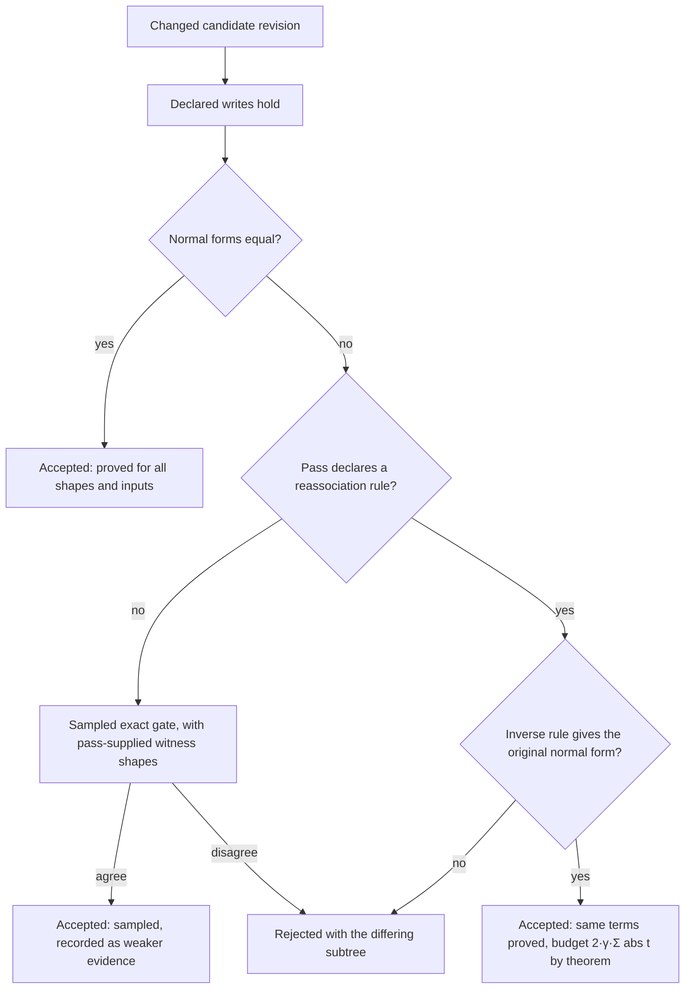
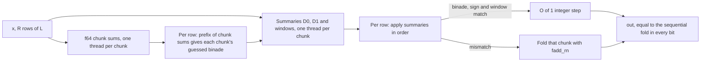
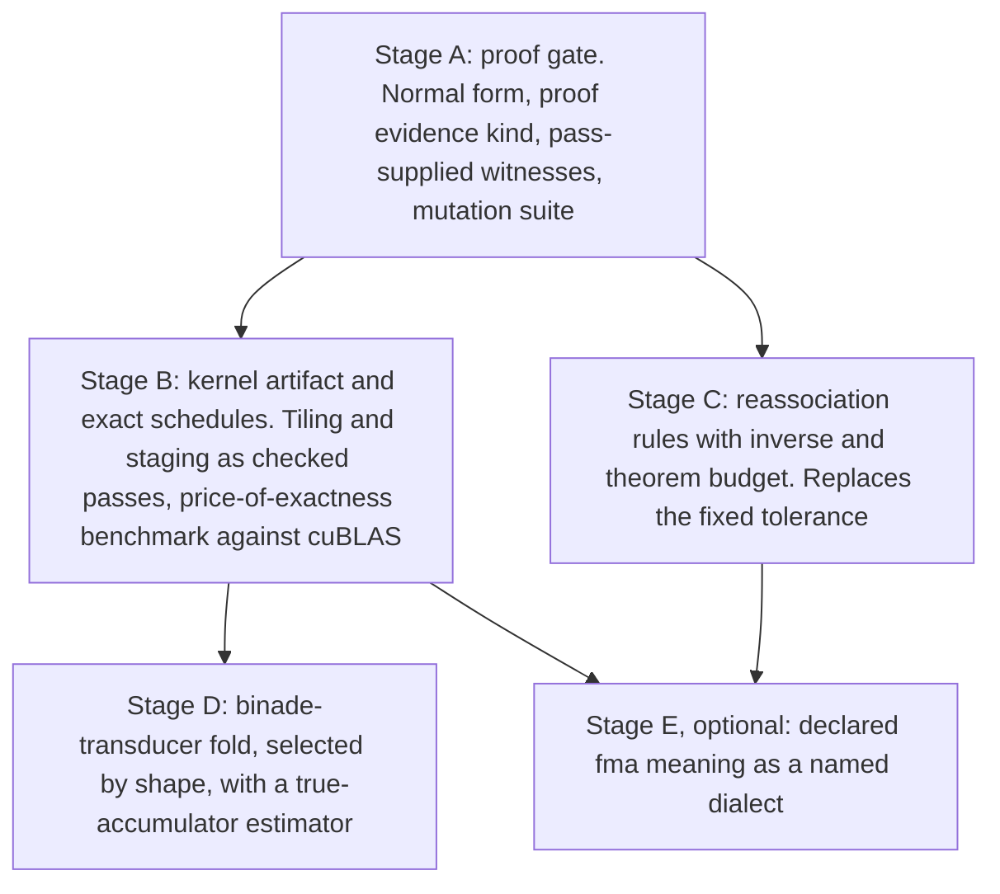

# Bit-exact Tix at parallel speed

Tix defines every bit of its f32 result: each product rounds, each sum visits its terms in index order, and the accumulator rounds after every addition. Stage 2 showed that a GPU can reproduce those bits. This document asks what that property is worth and what it costs, and proposes the compiler work that would make Tix the best compiler of its kind.

The short version, with every number measured in this round:

- **A schedule that keeps each element's fold is free to do everything else.** A tiled matmul kernel that stages operands in shared memory and computes 16 outputs per thread is bit-identical with the stage-2 kernel on 262,144 of 262,144 words at 512³, and runs in 0.058 ms against 0.202 ms. cuBLAS takes 0.034 ms. The exact meaning costs a factor of 1.7 against the vendor library at that size, of which 1.33 is the fused multiply-add the meaning forbids.
- **The sequential fold can be computed in parallel without changing a bit.** While the accumulator stays in one binade, a rounded addition is an integer addition whose only dependence on the accumulator is its parity. A chunk of the input therefore has a two-entry summary. On the GB10 this turns a 16.7-million-element sum from 446 ms into 13 ms (positive data), with every row bit-identical. It does not help the corpus shapes: with 4,096 rows of 1,024 the sequential kernel is already near the memory bound and the summary scheme is 2.1 times slower.
- **The exact meaning makes equivalence a syntactic question.** A 60-line normalizer proves the `inline` pass correct on all six corpus programs for every shape and input in 0.02 to 0.15 ms. It rejects a mutant that the merged sampled gate accepts.

## What "best in class" means for Tix

The class is **tensor compilers whose result is a specified function of the input bits**, the same on the interpreter, on this GPU, and on the next one. Most of the field is outside it. cuBLAS promises the same bits from run to run only for one toolkit version on one GPU architecture ([cuBLAS documentation, section 2.1.4, "Results Reproducibility"](https://docs.nvidia.com/cuda/cublas/index.html#results-reproducibility)). PyTorch states that "completely reproducible results are not guaranteed across PyTorch releases, individual commits, or different platforms", nor between CPU and GPU ([PyTorch reproducibility notes](https://docs.pytorch.org/docs/stable/notes/randomness.html)). Intel's conditional numerical reproducibility fixes MKL's own order for one executable, and its documentation puts the cost at 10 to 20 percent, or more than half when a code path is pinned ([oneMKL developer guide](https://www.intel.com/content/www/us/en/docs/onemkl/developer-guide-linux/2025-2/obtaining-numerically-reproducible-results.html)).

The closest neighbour is RepDL (Xie, Zhang, Chen, "RepDL: Bit-level Reproducible Deep Learning Training and Inference", 2025, [arXiv:2510.09180](https://arxiv.org/abs/2510.09180)). It fixes the summation order, uses correctly rounded math functions, and gives different orders different API names. It is a library, it reports no overhead figure (the paper says only that performance "can degrade ... mildly"), and it enables FMA contraction. Tix differs in two ways that this round tries to turn into advantages: the meaning is an interpreter that a checker can run, and every transformation is a pass with a contract.

Best in class then has three measurable parts.

| Metric | Definition | Today | Target |
|---|---|---|---|
| **Exactness** | Output words that differ from the f32 meaning, per backend | 0 on every measured case (stage 2) | 0, as a gate on every pass |
| **Price of exactness** | Tix time divided by the vendor library's time for the same contraction; and divided by the time of the same kernel with reassociation allowed | matmul 512³: 5.9 against cuBLAS | at most 2 against cuBLAS; at most 1.5 against the free kernel |
| **Proof coverage** | Share of accepted, changed revisions whose acceptance holds for all shapes and inputs, not for sampled cases | 0 of 2 passes | every bit-preserving pass; reassociating passes get a proved term set and a theorem for the budget |

Speed alone is the wrong target. cuBLAS reached 19.2 TFLOP/s at 4096³ on this machine with FMA and a free choice of order, and Tix will not beat it while computing two roundings per term. The defensible claim is the smallest price for a specified result, and a stronger acceptance argument than any competitor offers.

## Proposal 1: exact schedules

### The idea

The meaning of `y[i,j] = sum(k) a[i,k] * b[k,j]` constrains one thing per output element: the tree of rounded operations and the order of the fold. It says nothing about which thread computes the element, how many elements a thread computes, or where the operands are read from. Stage 2 fixed all three (one thread, one element, global memory). A **schedule** is a choice of these, and any schedule that leaves each element's tree alone is bit-exact by construction.

For a GPU this is nearly the whole optimization space. A CPU vectorizer has to break the accumulator chain to use its SIMD lanes, because the chain's latency bounds the loop. That is why strict reductions are known to be slow there: LLVM's in-order reductions keep the result but "are typically less efficient than traditionally vectorized reductions" ([LLVM vectorizer documentation](https://llvm.org/docs/Vectorizers.html)). A GPU gets its parallelism across output elements. The chain inside one element costs little as long as there are enough elements to fill the machine.

### Evidence: experiment 4

`scripts/04-gpu-exact-matmul/main.cu` compares four kernels for square row-major matmul on the GB10. Times are medians of 21, 5 and 3 event-timed runs at the three sizes, after one warm-up, under the GPU lock.

| n | naive (stage 2 shape) | tiled, exact | tiled, `fmaf` | cuBLAS SGEMM | exact / cuBLAS | exact / fma |
|---|---:|---:|---:|---:|---:|---:|
| 512 | 0.202 ms | 0.0576 ms | 0.0434 ms | 0.0342 ms | 1.68 | 1.33 |
| 2048 | 16.89 ms | 2.007 ms | 1.541 ms | 1.026 ms | 1.96 | 1.30 |
| 4096 | 132.6 ms | 18.01 ms | 17.14 ms | 7.27 ms | 2.48 | 1.05 |

The tiled kernel uses a 64×64 output tile per 256-thread block, 4×4 outputs per thread, and 16-wide `k` tiles staged in shared memory. Each element still folds `k = 0 … K-1` in order with `__fmul_rn` and `__fadd_rn`.

- **Exactness held.** The tiled exact kernel differs from the naive kernel on 0 of 262,144, 0 of 4,194,304 and 0 of 16,777,216 words.
- **The schedule is worth 3.5 to 8.4 times** over the stage-2 kernel shape, without touching the meaning.
- **FMA costs between 1.05 and 1.33.** At 4096 the kernel is limited by something other than arithmetic (my kernel is untuned; cuBLAS is 2.4 times faster there), so the remaining gap to cuBLAS is mostly schedule quality, which exact schedules can still close.
- **The FMA kernel changes 85 to 91 percent of the output words** (221,798 of 262,144 at 512). Allowing contraction is a change of meaning, and it would have to be a declared one.
- **An observation I did not expect:** at n = 4096 the cuBLAS result equals my in-order `fmaf` kernel on all 16,777,216 words. At 512 and 2048 it differs from it on 92 and 96 percent of the words. So cuBLAS itself uses different summation orders at different sizes, and at one size its order is the in-order FMA fold. This is one input at one size; I did not check the return status of `cublasSgemm` (the timing, 18.9 TFLOP/s, matches the coordinator's figure, so the call ran).

cuBLAS was loaded with `dlopen` because `tools/cuda-remote.mjs` passes no link flags. My naive time (0.202 ms) and cuBLAS time (0.0342 ms) agree with the coordinator's 0.197 ms and 0.0329 ms.

### What is new

Halide separates algorithm from schedule (Ragan-Kelley, Barnes, Adams, Paris, Durand, Amarasinghe, "Halide: A Language and Compiler for Optimizing Parallelism, Locality, and Recomputation in Image Processing Pipelines", PLDI 2013, [paper](https://people.csail.mit.edu/jrk/halide-pldi13.pdf)). Its schedule-independence theorem was proved for an integer-only formalization; the authors note that the practical system "faces standard semantic issues" with floating point (Reinking, Bernstein, Ragan-Kelley, "Formal Semantics for the Halide Language", 2022, [arXiv:2210.15740](https://arxiv.org/abs/2210.15740)). Exo checks user-directed rewrites for equivalence (Ikarashi, Bernstein, Reinking, Genc, Ragan-Kelley, "Exocompilation for Productive Programming of Hardware Accelerators", PLDI 2022, [doi:10.1145/3519939.3523446](https://doi.org/10.1145/3519939.3523446)); I could not confirm how it models floats.

The new statement here is narrow and measured: for an f32 meaning with fixed fold order, the set of bit-preserving GPU schedules is large enough to come within a factor of 1.7 to 2.5 of the vendor library, and membership in that set is a structural property a checker can decide (proposal 2).

### Risks, and how success is measured

- **The tiled kernel was written by hand.** A schedule language that can express it (tile sizes, outputs per thread, staging) is real design work, and autotuning it is more.
- **Matmul is the friendliest case.** Softmax and layernorm are limited by memory traffic and double-precision `exp`; I did not measure exact schedules for them. The one data point I have: a sequential row sum over 4,096 × 1,024 f32 runs in 0.113 ms, which is 148 GB/s against the 244 GB/s streaming bound.
- **Success:** price of exactness at most 2 against cuBLAS on matmul at 512 and 2048, at most 1.5 against the same schedule with FMA, and 0 differing words on every corpus program at stage-2 sizes.

### What it needs from `src/framework`

A kernel-level artifact kind between Tix and CUDA text. Stage 2's lowering artifact is a translation unit with no graph, so a schedule cannot be a checked pass on it. The cross-kind transformation machinery (`defineTransformation`, `AnalysisManager`) already exists and stage 2 used it unchanged. The new kind needs entities for kernels, thread-to-element maps and staging buffers, so that "this pass changed only the thread map" is a declared write the framework can enforce.

## Proposal 2: acceptance by proof

### The idea

A compiler for real-number tensor algebra must reason modulo associativity, commutativity and distributivity. Equivalence checkers for affine programs spend much of their machinery there: Shashidhar, Bruynooghe, Catthoor and Janssens treat associativity and commutativity as declared operator properties ("Verification of Source Code Transformations by Program Equivalence Checking", CC 2005, [doi:10.1007/978-3-540-31985-6_15](https://doi.org/10.1007/978-3-540-31985-6_15)), and Verdoolaege, Janssens and Bruynooghe describe theirs as the first implementation "to fully support commutative operations" ("Equivalence checking of static affine programs using widening to handle recurrences", TOPLAS 2012, [doi:10.1145/2362389.2362390](https://doi.org/10.1145/2362389.2362390)).

Tix's exact meaning has no such laws. Rounded addition is not associative, so the only way two programs can agree on all inputs *for a structural reason* is to compute the same tree of rounded operations over the same reads. That turns a hard problem into an easy one. **Giving up the algebra makes equivalence decidable by normalization.**

The normal form of a function is the result tensor's expression with every definition inlined (affine addresses substituted, reduction binders made fresh), binders renamed in order of first appearance, and literals replaced by their f32 values. Equal normal forms imply equal bits for every shape and every in-domain input. The argument is two lines: a stored element is already an f32, so replacing a load by the expression that produced it changes no rounding site; and renaming binders changes nothing. The check is sound and incomplete: it rejects some correct rewrites (for instance exchanging the arguments of a commutative `+`, which a later version could canonicalize).

For a pass that is *meant* to change bits, such as `split-sum`, the proof has two parts.

1. **Same terms.** Apply the inverse of the declared rule to the candidate (a nested block/lane sum whose addresses depend on the pair only through `4·block + lane` becomes a flat sum) and compare normal forms with the original. This proves the candidate adds the same terms and differs only at declared reassociation sites. The rule itself carries a one-time obligation: lexicographic `(block, lane)` enumerates `0 … K-1` exactly once for every `K`.
2. **A budget from a theorem.** For any order of summation the computed sum of `n` terms is within `γ(n-1)·Σ|t|` of the exact sum, with `γ(m) = m·u/(1 − m·u)` and `u = 2⁻²⁴` (Higham, "The Accuracy of Floating Point Summation", SIAM J. Sci. Comput. 14(4), 1993, [doi:10.1137/0914050](https://doi.org/10.1137/0914050); and *Accuracy and Stability of Numerical Algorithms*, 2nd ed., SIAM 2002, chapter 4). Two orders therefore differ by at most `2·γ(n-1)·Σ|t|`. This bound holds for all inputs, and `Σ|t|` can be computed next to the sum. I am quoting the bound's form from memory of the book; my literature check could confirm the paper and the related running bound `u·Σ|ŝ_k|`, not the exact equation number.



### Evidence: experiment 5

`scripts/05-normal-form-proof.mjs` imports the built compiler from `dist/` and runs the real passes and the real gate.

| Program | `inline` changed the IR | proved | proof time | sampled gate time | `split-sum` proved by inverse rule |
|---|---|---|---:|---:|---|
| attention | yes | yes | 0.15 ms | 6.5 ms | yes |
| conv2d | no | yes | 0.04 ms | 0.3 ms | yes (unchanged) |
| layernorm | no | yes | 0.07 ms | 0.5 ms | yes |
| matmul | no | yes | 0.02 ms | 0.2 ms | yes |
| mlp | yes | yes | 0.11 ms | 8.3 ms | yes |
| softmax | no | yes | 0.03 ms | 0.3 ms | yes |

Where the pass changed the program, the proof is 43 to 75 times faster than the sampled gate, and it covers every shape. The speed matters less than the coverage; both gates are fast in absolute terms.

**A mutant the merged gate accepts.** The case generator assigns sizes 1, 3, 4, 7 to all symbols at once, and one "mixed" assignment that gives 3, 5, 7 cyclically in sorted name order. A function with four or more shape symbols therefore has pairs of symbols that are equal in every sampled case: `D` and `O` in `mlp`, `D` and `V` in `attention`, `C` and `O`, `H` and `W` in `conv2d`. I wrote a mutant pass that shortens `mlp`'s first contraction from extent `D` to extent `O`, and ran it through `applyNativePassSync` with `meaningGate(origin, 'exact')`.

- The sampled gate **accepted** the changed revision.
- The normal-form check **rejected** it.
- At `D = 4, O = 2` the original returns `[1.0934, −0.3150, 1.1499, −0.2684]` and the mutant `[1.0366, −0.7704, 0.8219, −0.8959]`.

**The split rule.** The inverse-rule check accepts the genuine split on all six programs. It rejects the floor-rounding mutant (the tail-dropping bug from stage 1's tests) and a stride mutant that reads `3·block + lane`, both structurally and without running anything.

**The budget.** Over 1,220 trials (lengths 7 to 65,536, scales 2⁻²⁰ to 2²⁰, with outliers) the theorem bound was never violated; the worst observed difference was 16 percent of it. In the same trials a *correct* split exceeded the fixed tolerance `2e-6 + 2e-5·|r|` by a factor of up to 2.49. The fixed tolerance is tied to the output magnitude, which says nothing about a sum that cancels. The merged gate did not meet such data because its streams are benign. So the fixed budget can reject a correct reassociation, as the stage-2 report already suspected, and the theorem budget cannot.

### Risks, and how success is measured

- **Incompleteness.** Every future exact pass must either keep the normal form or bring an inverse rule. Fusion, tiling and loop interchange of output loops keep it. Common-subexpression extraction keeps it (inlining undoes it). A pass that the normalizer cannot follow falls back to sampling and is recorded as weaker evidence.
- **Blow-up.** Full inlining duplicates shared producers. The corpus stays small (the largest normal form took 0.15 ms). Hash-consing fixes the general case.
- **The normal form covers the Tix-to-Tix half only.** The CUDA text is still checked by sampling on the GPU. Proposal 1's kernel artifact is what would let a schedule be proved.
- **Success:** every accepted changed revision of a bit-preserving pass is accepted by proof; a mutation suite of at least 20 mutants (including shape-symbol aliasing) has no survivor; the split tolerance has no fixed constants.

### What it needs from `src/framework`

- **An evidence kind for proofs.** `CheckResult` evidence today is differential evidence. A gate needs to return "proved, certificate = normal-form hash" so that reports can count proved against sampled acceptances. The gate signature of `applyNativePassSync` (before, candidate) already fits; I ran the checker beside the gate and did not wire it in.
- **Rules with one-time obligations.** A registry entry for a reassociation rule: the forward rewrite, its inverse, and the index-set lemma it relies on.
- **Canonical serialization.** My first run failed to prove the genuine split because two passes build the same extent with different property orders, and I compared `JSON.stringify` output. The framework's content-derived revisions already solve this; the normalizer should use that path, not its own.
- **Pass-supplied witnesses** for the sampled fallback, so that a pass about chunks of 32 is not judged on sizes up to 7.

## Proposal 3: the binade transducer, a parallel sequential fold

### The idea

Tix's fold `s ← fl(s + x_i)` looks inherently serial. Reproducible-summation work avoids the problem by defining a different, order-independent result: Demmel and Nguyen's pre-rounded binned sum ("Parallel Reproducible Summation", IEEE Trans. Computers 64(7), 2015, [doi:10.1109/TC.2014.2345391](https://doi.org/10.1109/TC.2014.2345391); Ahrens, Demmel, Nguyen, "Algorithms for Efficient Reproducible Floating Point Summation", ACM TOMS 46(3), 2020, [doi:10.1145/3389360](https://doi.org/10.1145/3389360)) or the correctly rounded exact sum (Collange, Defour, Graillat, Iakymchuk, "Numerical reproducibility for the parallel reduction on multi- and many-core architectures", Parallel Computing 49, 2015, [doi:10.1016/j.parco.2015.09.001](https://doi.org/10.1016/j.parco.2015.09.001)). Adopting either would change Tix's meaning and discard two stages of bit-identity evidence.

The alternative is to compute the *sequential* result in parallel. The general technique exists. Raychev, Musuvathi and Mytkowicz parallelize sequential aggregations by summarizing each chunk as a function of its unknown incoming state ("Parallelizing User-Defined Aggregations using Symbolic Execution", SOSP 2015, [doi:10.1145/2815400.2815418](https://doi.org/10.1145/2815400.2815418)). Mytkowicz, Musuvathi and Schulte do it for finite-state machines by enumerating transitions from all states ("Data-Parallel Finite-State Machines", ASPLOS 2014, [doi:10.1145/2541940.2541988](https://doi.org/10.1145/2541940.2541988)). What a chunk summary for a *rounded float accumulator* should look like is the open part.

### Why it works

**Lemma.** Let `s = σ·S·g` with `g = 2^(e−23)`, `S` an integer in `[2²³, 2²⁴)`, `σ = ±1`. If the exact value of `s + x` has magnitude in `[2^e, 2^(e+1)]`, then `fl(s + x) = σ·(S + d)·g` where `d = ±q`, and `q` is `|x|/g` rounded to an integer, with a tie (`|x|/g` exactly half-way) resolved so that `S + d` is even.

*Why.* In that binade the representable values are exactly the multiples of `g`, so rounding the sum to nearest is rounding `x/g` to an integer and adding it to `S`. Round-half-even looks at the last bit of the result, which is the parity of `S + q`.

**Consequence.** The step depends on `S` only through `S mod 2`. Parity after the step is determined by parity before it. So a whole chunk `x_lo … x_hi` acts on the accumulator as

```text
S  →  S + D[S mod 2]
```

for two integers `D[0], D[1]`, as long as no intermediate value leaves the binade. A chunk summary is `(e, σ, D[0], D[1])` plus, for each parity, the least and greatest prefix offset, which give the window of incoming `S` for which the summary is valid. Summaries are computed independently per chunk with integer shifts on the f32 bit patterns; applying one is a compare and an add.

Summaries also compose: chunk 1 then chunk 2 is `D[p] = D₁[p] + D₂[p ⊕ (D₁[p] mod 2)]` with the windows intersected after shifting. They form a monoid, so a tree of them gives logarithmic depth. I implemented the sequential apply only.

The scheme is **speculative and self-checking.** Each chunk guesses its incoming binade. At apply time the true accumulator is known; if its exponent, sign or window does not match, that chunk is folded sequentially. The result is the sequential fold in every case; only the speed depends on the data.



### What is new, and the prior art

There is direct prior art for the goal. Kapre and DeHon parallelize floating-point accumulation on an FPGA while "obtaining results identical to the sequential ordering": they compute an associative approximation and iteratively propagate corrections until the sequential sum is reached, for a reported average speedup of 6 on random data ("Optimistic Parallelization of Floating-Point Accumulation", ARITH-18, 2007, [abstract and PDF](https://ic.ese.upenn.edu/abstracts/fpaccum_arith2007.html)). Their scheme is hardware relaxation; it has no closed-form chunk summary.

My literature search (about six targeted queries, so absence is weak evidence) found no use of the parity-transducer formulation: a two-entry summary with a validity window, computable per chunk without iteration, and composable. That, and its use as a checked compiler pass whose contract is bit equality with the unoptimized fold, is what I believe is new.

### Evidence: experiments 1, 2, 3, 6, 7

**Experiment 1 (Node), correctness and hit rate.** `scripts/01-binade-transducer.mjs`. 5,376 configurations (eight input streams, including half-ULP ties and raw exponents over 2⁻²⁰ to 2²⁰; lengths 1 to 65,536; chunk sizes 1 to 256; two guess sources) all equal the sequential fold bit for bit. A direct test applied the summary without fallback on tie-dense data: 199,573 of 200,000 summaries applied, 0 mismatches. Serial steps fell by 4.0×, 23× and 79× on positive data at lengths 1,024, 65,536 and 2²⁰, and by only 1.3×, 2.5× and 3.0× on zero-mean data.

**Experiment 2 (Node), tree of summaries.** `scripts/02-hierarchical-transducer.mjs`. A failed chunk is retried as two halves. 1,440 configurations, 0 mismatches.

| Stream | n | binade or sign changes of the true accumulator | serial steps | reduction |
|---|---:|---:|---:|---:|
| positive U[0.25, 1) | 1,024 | 11 | 122 | 8.4× |
| positive U[0.25, 1) | 1,048,576 | 21 | 1,364 | 769× |
| squares of N(0,1) | 1,048,576 | 21 | 1,790 | 586× |
| mean 0.1, sd 1 | 1,048,576 | 107 | 1,764 | 594× |
| signed U[−1, 1) | 1,024 | 188 | 642 | 1.6× |
| signed U[−1, 1) | 1,048,576 | 13,837 | 70,865 | 14.8× |
| products of N(0,1) pairs | 1,048,576 | 9,853 | 64,644 | 16.2× |

The number of binade changes is the floor for this summary. A sum that grows crosses about log₂ n binades. A zero-mean sum is a random walk that keeps returning toward zero, and crosses thousands.

**Experiment 3 (GB10), one level.** `scripts/03-gpu-exact-sum/main.cu`. `seq` is one thread per row with `__fadd_rn`; `exact` is the scheme above; `free` sums chunks independently and then sums the chunk sums, a reassociated result. Medians of 7 event-timed runs. In all 27 configurations `exact` equals `seq` on every row, and the first rows equal a host-side C++ fold.

| data | rows × length | chunk | seq | exact | free | exact vs seq | hit rate |
|---|---|---:|---:|---:|---:|---:|---:|
| positive | 1 × 2²⁴ | 4,096 | 446.3 ms | 13.36 ms | 0.61 ms | 33× faster | 97.2% |
| positive | 16 × 2²⁰ | 1,024 | 37.20 ms | 2.23 ms | 0.59 ms | 17× faster | 98.9% |
| positive | 256 × 2¹⁶ | 256 | 7.06 ms | 1.69 ms | 0.60 ms | 4.2× faster | 96.5% |
| positive | 4,096 × 4,096 | 64 | 0.566 ms | 1.261 ms | 0.535 ms | 2.2× slower | 89.1% |
| positive | 4,096 × 1,024 | 32 | 0.113 ms | 0.239 ms | 0.047 ms | 2.1× slower | 81.3% |
| ties | 1 × 2²⁴ | 4,096 | 446.5 ms | 4.75 ms | 0.62 ms | 94× faster | 99.7% |
| signed | 1 × 2²⁴ | 512 | 446.4 ms | 49.56 ms | 0.92 ms | 9.0× faster | 90.7% |
| signed | 16 × 2²⁰ | 1,024 | 37.20 ms | 30.59 ms | 0.59 ms | 1.2× faster | 68.3% |
| signed | 4,096 × 1,024 | 32 | 0.122 ms | 0.306 ms | 0.046 ms | 2.5× slower | 26.3% |

Three things follow.

- **A single GPU thread is very slow**: 26.6 ns per element. A specified sequential order makes a scalar reduction 730 times slower than a free one. This is the case the transducer is for, and it recovers a factor of 33 to 94 on growing sums.
- **The crossover is a few hundred rows.** With thousands of rows the GPU is already busy with one thread per row, and `seq` at 4,096 × 4,096 (0.566 ms) is within 6 percent of `free` (0.535 ms). For the corpus shapes (softmax 4,096 × 1,024, layernorm) the idea is **refuted**: it adds work and gains nothing.
- **Zero-mean data gains little**, as experiment 2 predicted.

**Experiment 6 (GB10), two levels.** `scripts/06-gpu-exact-sum-two-level/main.cu`. Bit-identical again in all 18 configurations, and mostly a disappointment: 12.2 ms against 13.7 ms for the positive 2²⁴ sum, 52 ms against 78 ms for the signed one, and slower than one level wherever rows are short. The serial step count was 431,744 per row where experiment 2 predicted about 1,400.

**Experiment 7 (Node), the reason.** `scripts/07-guess-drift.mjs`. The guess came from an f64 prefix sum. The sequential f32 sum of 2²⁴ values in [0.25, 1) is 10,905,589; the f64 sum is 10,486,622.7. They differ by 4.0 percent, because once the accumulator's grid is 0.5 or 1, rounding each term to the grid is biased for this distribution. Near a binade boundary the two disagree about the binade for a long stretch: 419,255 elements, 2.50 percent of the input, although the true accumulator changes binade only 25 times. That matches the 2.5 to 2.8 percent of failed chunks. Experiments 1 and 2 did not show it. Their sums stop at 2²⁰ elements, where the accumulator's grid is still fine compared with the terms; I believe that is why, and did not test it. On the GPU the sub-chunk guesses inherited the same wrong base as the top-level ones.

So the estimator, not the summary, is the present limit on growing sums. The fix is to derive lower-level guesses from the *true* accumulator at the enclosing chunk's start (known after the top-level apply), or to summarize two adjacent binades per chunk. Neither is tested.

### Risks, and how success is measured

- **Applicability is narrow on this corpus.** The win is for reductions with fewer chains than the GPU has threads: a scalar loss, a norm, statistics over a batch for a few channels. None of the six programs has one. A CPU backend, where the accumulator chain is the vectorization blocker, is the more natural home, and I did not test one.
- **Data dependence.** Speed varies from 94× faster to 2.5× slower. A compiler must choose by shape (rows against device threads) and fall back; a wrong choice costs a factor of 2, never a wrong bit.
- **The lemma covers `sum` over loaded values.** A reduction body such as `a*b` is computed first and rounded, then summarized, which is how the kernels above would be generated. `max` reductions are exactly associative and need none of this.
- **Success:** 0 differing words against the sequential fold on adversarial streams (binade crossings, ties, cancellation, subnormals, infinities); at least 100× over `seq` and at most 5× over `free` for a 2²⁴-element growing sum; automatic selection that never loses more than 10 percent against `seq`.

### What it needs from `src/framework`

Nothing structural: it is a same-kind pass with the exact contract. It needs the pass-supplied witness cases of proposal 2, because sizes up to 7 exercise neither chunking nor a binade crossing, and it needs the kernel artifact of proposal 1 to express multi-kernel lowering of one reduction.

## Ranking

1. **Acceptance by proof (proposal 2).** It closes a hole I could demonstrate in the merged gate, costs little, and every later pass depends on it. Schedules multiply the number of passes; sampled acceptance does not scale with them.
2. **Exact schedules (proposal 1).** The largest measured gain on the corpus (3.5× on matmul at 512, bringing Tix to 1.7× of cuBLAS) and the one that defines the headline metric.
3. **The binade transducer (proposal 3).** The most original idea and the one with the weakest case for the present corpus. It removes the worst cliff in the language (a 730× penalty for long scalar reductions), and I would build it when a program needs it.

## Staged plan



- **Stage A first** because it is small (the prototype is 60 lines), it fixes the shape-aliasing hole in the case generator today, and it gives stages B to D a gate strong enough to trust generated schedules.
- **Stage B second** because it carries the performance metric. Its first milestone is the tiled matmul kernel generated from the IR and proved, with 0 differing words.
- **Stage C** can run beside B. It replaces `2e-6 + 2e-5·|r|` with the proved term set and the `2·γ(n−1)·Σ|t|` budget.
- **Stage D** waits for a program with a long, narrow reduction and for the estimator fix.
- **Stage E** is a question for the language owner: whether an in-order FMA fold should be a second named meaning. It made the tiled kernel 1.05 to 1.33 times faster, and at one size it happened to match cuBLAS bit for bit. It must never be a silent contraction.

## What did not work

- **One level of summaries on zero-mean data:** 1.3× to 3× fewer serial steps, and 1.2× on the GB10 at 16 × 2²⁰. One crossing costs a whole chunk.
- **The transducer on the corpus shapes:** 2.1× to 2.5× slower than the sequential kernel at 4,096 rows. The sequential kernel was already near the memory bound.
- **Two levels on the GPU:** little gain and often a loss, because of the f64 guess drift found in experiment 7. I had assumed the f64 prefix would name the accumulator's binade almost always; it is wrong for 2.5 percent of a growing sum.
- **Comparing normal forms with `JSON.stringify`:** the genuine split failed its proof on the first run because of property order. Fixed by an explicit canonical encoding of extents.
- **Reaching cuBLAS:** my exact kernel is 1.7× to 2.5× slower, and even with FMA it is 1.3× to 2.4× slower. The kernel is untuned, and I cannot say how much of the remaining gap an exact schedule can close.
- **Not attempted:** exact schedules for softmax, layernorm, attention and conv2d; a CPU backend; summary composition as a tree on the GPU; a two-binade summary.

## Reproducing the experiments

All scripts are in this ticket's `scripts/` directory. Run `npm run build` first for experiment 5.

| # | Command | Result file |
|---|---|---|
| 1 | `node scripts/01-binade-transducer.mjs` | stdout |
| 2 | `node scripts/02-hierarchical-transducer.mjs` | stdout |
| 3 | `node tools/cuda-remote.mjs <ticket>/scripts/03-gpu-exact-sum --timed` | `scripts/03-gpu-exact-sum.result.json` |
| 4 | `node tools/cuda-remote.mjs <ticket>/scripts/04-gpu-exact-matmul --timed` | `scripts/04-gpu-exact-matmul.result.json` |
| 5 | `node scripts/05-normal-form-proof.mjs` | stdout |
| 6 | `node tools/cuda-remote.mjs <ticket>/scripts/06-gpu-exact-sum-two-level --timed` | `scripts/06-gpu-exact-sum-two-level.result.json` |
| 7 | `node scripts/07-guess-drift.mjs` | stdout |

The matmul table quotes the first of two timed runs of experiment 4; the stored result file is the second, which added the cuBLAS-against-FMA comparison and agrees within 8 percent on every time.
