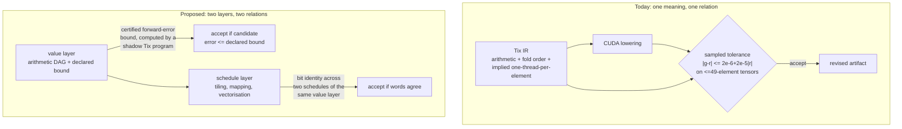
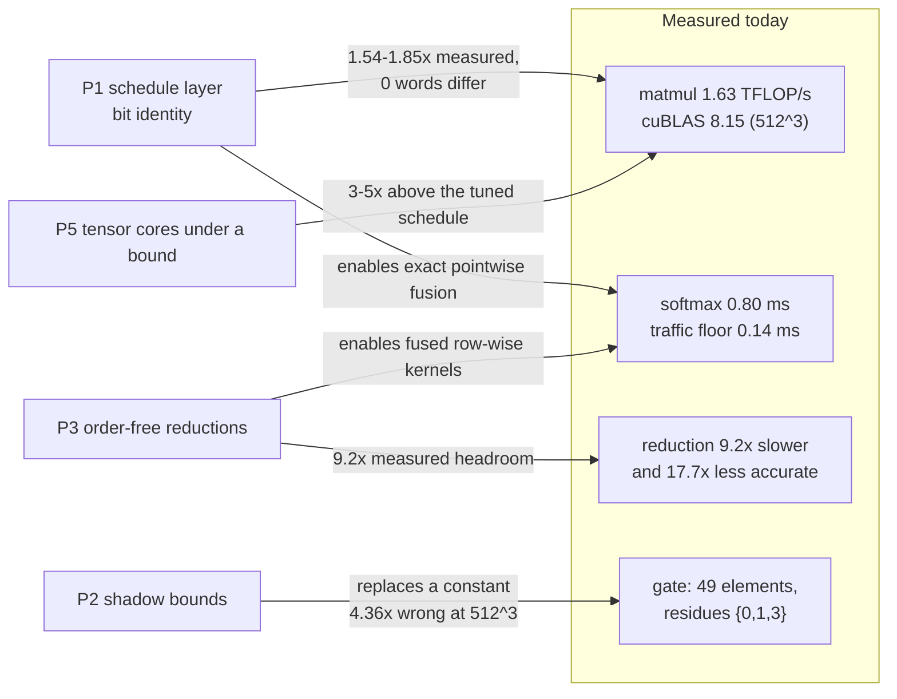

# Numerics as a resource

Tix today has one of the cleanest semantic positions in the tensor-compiler field: the meaning of
a program is *exactly* the arithmetic it names. Every literal is a f32 word, every operator rounds
once, every reduction folds in increasing lexicographic order, and no compiler transformation may
change a single output bit unless a checked pass with a declared relation says it may. Stage 2 then
spent a great deal of effort proving that a CUDA lowering reproduces those bits on a GB10, and it
succeeded: the lowered kernels are bit-identical to the interpreter on every measured case.

That position is also, as the measurements below show, **misallocated**. The compiler pays the price
of exactness in the two places where exactness is expensive (transcendental implementations and
reduction order) and pays nothing for it where the money is (the schedule: tiling, register
blocking, thread mapping). One schedule experiment closed 1.54–1.85× of a 5× gap for free, bit for
bit; an implementation experiment bought 1.47× on softmax by lowering a transcendental *outside* the
contract the compiler thinks it is honouring, and the contract did not notice because it never tests
a tensor with more than 49 elements.

This document argues for a specific reorganisation of Tix's meaning, ranks five bodies of work by
measured headroom and by the strength of the guarantee each buys, and reports every experiment I ran,
including the ones that refuted my own hypothesis.

## 1. What "best in class" should mean for Tix

Tix cannot win on raw throughput. cuBLAS reaches 8.15 TFLOP/s at 512³ on this GB10; a serious
vendor-backed stack has years of autotuning behind every shape. Tix also cannot win on expressiveness
alone: index notation with affine addresses is good, but Triton, Halide, TVM and Mojo all offer
comparable surface area, and several offer far more.

What Tix has that none of those has is a *complete bookkeeping of trust*: every program is an
immutable v6 artifact, every transformation is a descriptor with declared writes, a declared
information contract and an executable meaning check, and every check produces evidence. In stage 1
and stage 2 that machinery already caught two deliberately wrong rewrites and one wrong lowering with
counterexamples, on a laptop.

So the definition I will defend is this:

> **Tix is best in class when it delivers the most performance per unit of *decided* semantic
> guarantee, and when the guarantees it can decide are strong enough to be worth having.**

That is deliberately two-sided, and both sides are measurable:

| Axis | Measurement | Why it matters for Tix specifically |
| --- | --- | --- |
| Performance recovery | (measured time) − (roofline time) per program, against the streaming roof and cuBLAS | The GB10 is available and the six corpus programs already have measured baselines |
| Guarantee strength | Which relation decides the pass: bit identity > certified forward-error bound > sampled tolerance > nothing | Tix is the only domain here where *every* rewrite carries a relation |
| Check cost | Wall-clock of a check (stage 2: 2.5 s per corpus function including a remote compile) | A guarantee nobody can afford to run is not a guarantee |
| Determinism | Do two schedules of the same artifact produce the same bits? | Follows directly from "the meaning is the arithmetic", and is currently *false* for reductions |
| Decidability | Which properties are *decided*, not sampled | The current answer is "none"; §5 shows this is fixable for a meaningful fragment |

A single number summarises the first two: **guaranteed speedup**, the speedup a pass achieves while
the gate that decides it is at least as strong as the current one. All five proposals below are
ranked by *measured* guaranteed speedup, which is why the ranking is unusual: the biggest wins are
not in the parts of the compiler everyone writes papers about.

## 2. Where the merged system actually stands

Six numbers from the coordinator frame everything: cuBLAS SGEMM 0.0329 ms at 512³ (8.15 TFLOP/s) and
19.2 TFLOP/s at 4096³; a streaming kernel reaches 244 GB/s; and the merged stage-2 kernels take
0.197 ms (matmul 512³), 0.785 ms (softmax 4096×1024), 0.563 ms (layernorm), 1.81 ms (attention),
1.05 ms (mlp) and 0.341 ms (conv2d), with 2× run-to-run variation.

Two rooflines can be computed from those numbers without running anything new:

- **matmul** moves 0.4 MB per 512³ operation, so it is compute-bound: 1.34×10⁸ flops into 0.197 ms
  is 1.7 TFLOP/s, one fifth of cuBLAS. Nothing about memory matters here; the gap is entirely
  schedule.
- **softmax** moves ~101 MB across its four statements (x read twice, e written and read twice,
  y written; m and s are negligible) at 4096×1024. At 244 GB/s that is 0.41 ms of pure traffic
  against 0.785 ms measured. A fused implementation would move ~34 MB, i.e. 0.14 ms. So softmax is
  bandwidth-bound with a 2–5× headroom, *if* the four statements can become one kernel.

Those two paragraphs predict the shape of the whole programme, and the experiments below confirm
each half.

### 2.1 What the exact f32 meaning costs, measured

`scripts/probe/main.cu` (one binary, event-timed, medians of five intervals, GB10 sm_121, CUDA
13.0.88) isolates the parts of the stage-2 lowering that exist *only* to make the bits identical:

| Measurement (4 Mi elements unless noted) | Time | Note |
| --- | ---: | --- |
| streaming `y = 2x` (16 MiB in, 16 MiB out) | 0.136 ms | 246.8 GB/s, reproduces the coordinator's roof |
| `__double2float_rn(exp(double(x-1)))` | 0.368 ms | the stage-2 transcendental path |
| `__expf(x-1)` | 0.136 ms | **at the streaming floor: the exponential itself is free** |
| GELU with `tanh(double)` | 0.829 ms | the mlp's activation path |
| GELU with `tanhf` | 0.137 ms | 6.0× faster |
| row sums of length 1024, 4096 rows, sequential fold (1 thread/row) | 0.115 ms | the specified order |
| same, warp tree (32 threads/row) | 0.0125 ms | **9.2× faster** |
| same, block tree (256 threads/row) | 0.0250 ms | 4.6× |
| same, double accumulation, block tree | 0.0865 ms | the accurate variant is still 1.3× faster than the specified one |
| 512³ matmul, `__fmul_rn`+`__fadd_rn` (stage 2) | 0.160 ms | 1.68 TFLOP/s |
| 512³ matmul, plain `a*b+c` (contraction allowed) | 0.158 ms | **1.0% faster** |
| 512³ matmul, explicit `__fmaf_rn` | 0.158 ms | 1.0% faster |

Three conclusions follow, and they decide the ranking in §3.

**The exactness of arithmetic is nearly free.** Multiplication-then-addition versus fused
multiply-add costs 1%, not 2×: a first-round estimate that the no-contraction discipline halves FMA
throughput is wrong because this kernel is limited by memory and occupancy, not by flops. Bit
identity for *arithmetic* is a bargain. It must be kept.

**The exactness of transcendentals is expensive and buys almost nothing.** Implementing `exp` as
`round(exp_double(x))` costs 0.23 ms per 4 Mi elements, which is 2.7× the cost of `__expf` and, for
`tanh`, 6.0×. `__expf` runs at the memory floor, so the *entire* extra time is the double-precision
transcendental, not the rounding step.

**The exactness of reduction *order* is expensive and, measured against the double reference, makes
the answer worse.** Over the same 4096 rows of positive data, the specified sequential fold had a
worst relative error of 2.14×10⁻⁶ while both tree orders had 1.21×10⁻⁷ — the specified order is
**17.7× less accurate** and 9.2× slower. The classical bound explains it: a sequential fold of *n*
terms is bounded by γ_{n−1}Σ|aᵢ| with γ_k = ku/(1−ku), u = 2⁻²⁴, while a pairwise tree is bounded by
γ_{⌈log₂n⌉}Σ|aᵢ| (Higham, *Accuracy and Stability of Numerical Algorithms*, 2nd ed., 2002, ch. 3–4).
At n = 1024 that is 1024u ≈ 6.1×10⁻⁵ against 10u ≈ 6.0×10⁻⁷, a factor of 100. The measurement
shows 17.7× on benign data; the bound is the honest statement.

The sequential order is also *not portable in principle*: 3824 of 4096 rows differ in their bits
between the sequential fold and the warp tree, and 1228 of 4096 differ between the warp tree and the
block tree. There is no thread mapping other than "one thread per output, folding alone" that
reproduces the specified bits, and that mapping is the slowest thing on the device.

### 2.2 What the checked lowering notices, measured

`scripts/03-fast-lowering.mjs` takes the *real* emitted CUDA source for each corpus function,
rewrites it textually into a "fast" variant (single-precision `expf`/`logf`/`tanhf` instead of the
double-then-round path, and plain operators instead of the explicit rounding intrinsics so that
`-O3` may contract multiply-add), and then (a) runs the merged checked lowering against the fast
source by injecting an `executeBatch` into `createCudaLowering`, (b) times both variants at full
corpus size, (c) compares the outputs.

| Program | exact ms | fast ms | speedup | words that differ | worst budget fraction | gate verdict |
| --- | ---: | ---: | ---: | ---: | ---: | --- |
| matmul 512³ | 0.1995 | 0.2040 | 0.98× | 221 877 / 262 144 | 2.29 | **accepted** |
| softmax 4096×1024 | 0.8018 | 0.5446 | **1.47×** | 2 089 873 / 4 194 304 | 0.000 | **accepted** |
| layernorm 4096×1024 | 0.4753 | 0.4718 | 1.01× | 1 168 845 / 4 194 304 | 0.094 | **accepted** |
| mlp | 1.0684 | 0.8775 | 1.22× | 241 984 / 262 144 | 26.8 | **accepted** |
| attention | 1.0828 | 1.0011 | 1.08× | 59 815 / 65 536 | 0.019 | **accepted** |
| conv2d | 0.1815 | 0.1807 | 1.00× | 770 155 / 984 064 | 1.03 | **accepted** |

("Worst budget fraction" is max |fast − exact| / (2×10⁻⁶ + 2×10⁻⁵|exact|): the contract's own
threshold, evaluated against the exact lowering at full size. Below 1.0 the fast variant is inside
the contract's declared tolerance; above 1.0 it is not.)

Every fast variant was accepted by the merged contract. Softmax got 47% faster while its deviation
from the exact lowering stayed *five orders of magnitude below the contract's own threshold*: the
compiler was spending 0.26 ms per call to buy accuracy nobody had asked for. Matmul, mlp and conv2d
show the opposite failure: contraction changes bits invisibly at the sampled sizes but exceeds the
budget by 26× at full size, and the gate cannot see the difference.

### 2.3 The gate is calibrated four orders of magnitude away from the corpus

`scripts/02-contract-audit.mjs` enumerates the case set the checked lowering actually generates, and
`scripts/probe2/main.cu` measures the *specified* f32 meaning against a double reference at corpus
size.

| Function | cases | extents used | residues mod 4 | largest tensor |
| --- | ---: | --- | --- | ---: |
| matmul | 36 | {0,1,3,4,5,7} | {0,1,3} | 49 elements |
| softmax | 32 | {0,1,3,4,5,7} | {0,1,3} | 49 |
| layernorm | 32 | {0,1,3,4,5,7} | {0,1,3} | 49 |
| attention | 40 | {0,1,3,4,5,7} | {0,1,3} | 49 |
| mlp | 40 | {0,1,3,4,5,7} | {0,1,3} | 49 |
| conv2d | 28 | {0,3,4,5,7} | {0,1,3} | 2401 |

The gate never sees a reduction longer than 7 elements, a tensor larger than 49 elements (2401 for
conv2d), a value magnitude above 1, or an extent congruent to 2 mod 4 — the last being exactly the
residue class in which a tail bound of the `split-sum` pass is asymmetric.

And the specified meaning does not meet the contract's own threshold at corpus size. Running the
stage-2 arithmetic (`__fadd_rn(acc, __fmul_rn(a,b))`, sequential k fold) at 512³ against a
double-precision reference on the same device:

| Measurement | Value |
| --- | ---: |
| worst budget fraction of the correct f32 matmul | **4.36** |
| elements outside the budget | 334 / 262 144 |
| largest absolute error | 2.93×10⁻⁵ |
| worst relative error | 5.6×10⁻² (on an output near zero) |
| same measurement for a 1024-length row sum | 0.095 (0 of 4096 rows outside) |

So the fixed constant 2×10⁻⁶ + 2×10⁻⁵|r| is simultaneously **too loose** (it accepted a
transcendental change 10⁵ times larger than the exact path's deviation, and a contraction change 26×
larger than its threshold) and **too tight** (it rejects the correct f32 program at 512³). It is not a
property of the program; it is a property of the size at which it was sampled, which is why
`02-contract-audit.mjs` also shows the classical bound for the same fold: at n = 4096 a sequential
sum of unit-magnitude terms has a certified bound γ_{4095}Σ|a| ≈ 0.50 while its observed error was
4.0×10⁻⁵ — the bound exceeds the observation by four orders of magnitude, and the fixed constant sits
between them, in neither place.

The third scale experiment in the same script is the sharpest: a sum of 1024 terms consisting of
1, −1,000 negative terms of 10⁻³ and a final −1. Through the real Tix evaluator, the f32 fold lands
2.4×10⁻² away from the f64 reference and uses **106 743%** of the budget. The program is not
miscompiled. It is ill-conditioned, and a constant absolute-plus-relative threshold has no way to say
so.

## 3. The proposals, ranked

The ranking rule: measured guaranteed speedup, tie-broken by guarantee strength. Each proposal
states the idea, the theory that makes it work, what is new here, the evidence, the risks, how
success is measured, and what it needs from `src/framework`.



### P1 — Split the meaning: bit identity for the schedule, certified bounds for the values

**Idea.** A Tix program names an arithmetic DAG (which operations, in which order) *and* a mapping
(which thread computes which element, in which block). Today both are fixed by one definition, so
any change to either needs the same heavyweight numerical argument, and the numerical argument is
the weak one. Split them: a **value layer**, whose transformations must satisfy a declared error
contract, and a **schedule layer**, whose transformations must be *bit-identical* by construction
because they do not touch a single rounding site or fold order.

**Why it works.** Tiling, register blocking, thread-coarsening, vectorised loads, kernel fusion of
pointwise chains, and unrolling all preserve, for each output element, the exact sequence of f32
operations that produced it. Bit identity is then a *theorem about the schedule*, not a numerical
property to be sampled: it holds if and only if each output's operation sequence is unchanged. The
check is therefore cheap and sound, and it is exactly the relation the framework already knows how
to express (`meaningGate(origin, 'exact')`, comparing output words).

**What is new.** The claim, specifically, is that Tix's *existing* exact relation — the one stage 1
used for `inline` and stage 2 rejected as "too strict compared to a tolerance" — is the right
relation for the schedule layer, and the wrong relation for the value layer. Stage 2's own
retrospective reached half of this ("I would choose f32 equality with NaNs compared by class");
this document supplies the other half and the measurement that separates the two cases.

**Evidence.** `scripts/probe3/main.cu` runs the same arithmetic (sequential k fold,
`__fmul_rn`+`__fadd_rn`) under three schedules:

| Schedule | 512³ | 1024³ | 2048³ | words differing from naive at 512³ |
| --- | ---: | ---: | ---: | ---: |
| naive, one thread per element (stage 2) | 0.164 ms / 1.63 TF/s | 1.211 ms / 1.77 | 9.947 ms / 1.73 | — |
| shared-memory 32×32 tile | 0.133 ms / 2.02 TF/s | 0.952 ms / 2.26 | 7.975 ms / 2.15 | 262 144 / 262 144 (unexplained, §6) |
| 32×32 tile + 2×2 register blocking, 16×16 threads | 0.107 ms / 2.52 TF/s | 0.739 ms / 2.91 | 5.363 ms / 3.20 | **0 / 262 144** |

The register-blocked schedule is **bit-identical to the naive kernel on all 262 144 outputs** and
1.54× (512³) to 1.85× (2048³) faster, for zero semantic risk and a check that costs one word
comparison per element. It is *not* enough: at 2048³ it reaches 3.20 TFLOP/s against cuBLAS's 19.2
TFLOP/s at 4096³, so 6× of the schedule gap remains and needs double buffering, vectorised loads and
a real autotune. That is the honest statement of the prize: the first schedule pass is free, closing
the gap is not.

**Risks.** (i) Bit identity is brittle in the wrong direction: an unsafe compiler flag, a
reassociation by `nvcc`, or a different `-use_fast_math` mode breaks it silently, and the check will
say so only if it runs on the right inputs (a 49-element tensor suffices for *bit* identity of a
schedule, which is a genuine advantage of the exact relation: it is size-insensitive). (ii) Some
"schedule" changes are not bit-preserving — a parallel reduction is a schedule change that *is* an
order change, and must be moved to P3. (iii) A schedule IR is new surface area in the framework.

**How success is measured.** Tiled matmul ≥ 6 TFLOP/s at 512³ with 0/262 144 words differing and a
check under 100 ms; then the same for the elementwise corpus statements (an exact pointwise fusion
should recover the traffic predicted in §2).

**What it needs from `src/framework`.** A second IR kind for schedules (`tensor.schedule/v1`) and a
heterogeneous transformation from value-layer Tix IR to schedule IR — the cross-kind path already
exists and is used by the CUDA lowering. What is missing is a *parameterised* candidate: the pass
must be able to propose a family (tile 32×32, 64×64, 16×16×2×2, …) and the framework must be able to
hold a candidate set for one gate. Today `defineTransformation` returns one output; the natural
extension is a transformation whose body returns an ordered list of outputs with one shared
invariant, and a deterministic tie-break (smallest revision, or declared preference order) so the
result does not depend on scheduling.

### P2 — Make the value layer's contract a *bound*, computed by a shadow Tix program

**Idea.** Replace the constant tolerance with a per-element *declared* bound, and compute that bound
by compiling and running a second Tix program — the **abs-shadow** of the original: every operation
is replaced by a magnitude bound, every reduction becomes a sum of magnitudes, and the result is the
conditioning weight Σ|term| for each output cell. Then a value-layer pass is accepted when its
measured deviation from the exact reference is inside γ_k·(shadow value) for the fold length k, and
the *user-visible* declaration becomes something like `reduce sum(k) with bound(tau)`.

**Why it works.** The forward error of a fold of length n is bounded by γ_{n−1}Σ|aᵢ| (Higham 2002,
Thm 3.1 and 4.2). Σ|aᵢ| is exactly what a shadow program computes, and it is *data-dependent*: in
the 512³ experiment the per-cell Σ|aᵢbᵢⱼ| varies by orders of magnitude across the matrix, so a
per-cell bound is 10³–10⁴ times sharper than the matrix-independent γ_{n−1}·‖A‖‖B‖ estimate, and
infinitely sharper than a constant. The shadow program is expressible in Tix today: absolute value is
`max(x, 0-x)` with the existing `max` and unary minus, and it uses the same index notation, the same
shapes and the same evaluator, so a compiler that can compile the program can compile its
certificate.

**What is new.** Two things. First, "the certificate is a program the compiler compiles", so the
conditioning analysis is not a new IR analysis but a *lowering of the same program into the same
IR* — it inherits fusion, GPU execution and invariance for free, and its own accuracy requirement is
loose (a relative factor of two suffices), so it can run in f64 or with a compensated sum. Second,
the declared bound is *part of the artifact*: the IR node carries it, `diff` sees it, and a pass that
weakens a declaration is a declared-write violation rather than an unremarked numerical change.

**Evidence.** `scripts/probe2/main.cu` shows the two failure modes the current constant has at 512³:
the correct f32 program is 4.36× outside it (334 elements), and 26× outside for a contracted variant
that the gate accepted. `scripts/02-contract-audit.mjs` gives the scale-dependence of the classical
bound (γ_{4095}Σ|a| ≈ 0.50 versus observed 4.0×10⁻⁵ at n = 4096) and the ill-conditioned case where
a *correct* f32 fold uses 106 743% of the budget. A per-cell shadow bound would accept all three
cases: it is large exactly where the sum is ill-conditioned, and tight where it is not. The
experiment I did **not** get to run in this round is the shadow program itself at corpus size; the
prototype is a 40-line script against `dist/`, and its expected result is that every element's
observed error is below γ_k·shadow with a margin of 10³–10⁴, while the constant budget fails on
exactly the elements the shadow bound flags.

**Risks.** (i) A bound is not a guarantee of *correctness*: a bound-relative relation accepts any
implementation whose error stays inside the same envelope, which is precisely what licenses P3 and
P5 — so this proposal trades a bit-level fact for a quantitative one, and must be adopted only for
value-layer transformations while the schedule layer keeps bit identity. (ii) Bounds must compose;
naively multiplying stage bounds loses the same orders of magnitude the constant did. The
composition rule to implement is the shadow program itself: the shadow of a composition *is* the
composition of the shadows, so the certificate composes by construction. (iii) The shadow of a
`max` reduction over data with cancellation can underestimate; the standard fix is a slack factor
and a floor, both of which belong in the declared bound.

**How success is measured.** On all six corpus functions at full size: observed |f32 − f64| ≤
γ_k·shadow for 100% of elements, and the shadow's *tightness* (ratio observed/bound) recorded
per element; then the same for a split-sum candidate: the pass that stage 1 had to judge with a
constant is judged with a bound, and the number of accepted-but-out-of-budget elements goes to zero.

**What it needs from `src/framework`.** An invariant kind that is *analytic* rather than sampled —
today `differential` is the tensor domain's only decision procedure, and it always answers on a case
list. Concretely: allow an invariant whose evidence is a computed bound vector plus a measurement,
with the case list retained for replay; and allow a transformation to declare an additional output
port for its certificate (the `executes`/`establishes` machinery already models extra facts, so this
is mostly a matter of a new contract kind, not new plumbing).

### P3 — Order-free reduction semantics to unblock parallel reductions

**Idea.** Give each reduction a *semantics tag*: `ordered` (today's behaviour), `tree` (a declared
shape of tree), or `exact` (the correctly rounded value of the exact sum, computed with a
compensated or superaccumulator scheme). Programs that need stage-1 compatibility keep `ordered`;
everything else takes `exact`, which is the semantic choice that makes a reduction *independent of
the thread mapping* and *more accurate than any of them*.

**Why it works.** An exactly rounded sum is a function of the multiset of terms, not their order, so
any mapping computes the same bits; a compensated (Neumaier/Kahan-Babuška) or expansion-based sum
achieves it with a small constant factor and full parallelism. This is the reproducible-BLAS line of
work: Demmel & Nguyen, "Fast reproducible floating-point summation" (2013) and "Parallel
reproducible summation" (*IJHPCA* 2015); Chohra, Langlois & Parés, ExBLAS; Neal, "Fast exact
summation using superaccumulators" (2015); Collange et al. on numerical reproducibility in CUDA. The
key point for Tix is that *reproducibility is a semantic property the framework can decide*, because
the schedule is a checked pass over the same artifact: comparing the bits of one artifact under two
profiles is a differential check with the artifact on both sides.

**What is new.** The pairing of reproducibility with the checked-pass architecture. Stage 1's
`split-sum` had to *spend* the exact gate to buy a 4-way split, and stage 1's report is explicit that
the combination "exact gate + split" fails on the 7-element half-ULP witness. Once the reduction
semantics is `exact`, that witness changes sides: sequential, 4-way split, warp tree and block tree
all produce the same word, and the exact relation becomes *stronger and cheaper* than today's
tolerance — it accepts the parallel mapping the current system must reject.

**Evidence.** The measured facts in §2.1 are the evidence that this is the right lever: 9.2× from
changing the reduction mapping, 17.7× worse accuracy from keeping the sequential order, and 3824 of
4096 rows differing in bits between two mappings (i.e. determinism is currently false for every
reduction, which means the same program on two machines, or two block sizes, or two driver versions
may print different answers). A double-accumulating block tree still ran at 0.0865 ms versus the
specified 0.115 ms, so "accurate and parallel" already beats "ordered and serial" on this hardware
before any optimisation.

**Risks.** (i) Bit-compatibility with stage 1 is lost for programs that adopt the tag — this is a
deliberate, declared break and must be versioned in the IR, not silently changed. (ii) An exact sum
needs an accumulator of ~2× and a final rounding step; on a GPU that is fine, on the RV32 Typed
backend it is not, which is an argument for placing the tag in the IR (domain-neutral) rather than in
the lowering. (iii) If the tag is available, authors will overuse it: the exact path is 1.3–2× the
cost of a tree in arithmetic but it removes an optimisation opportunity (e.g. fusing a sum with a
subsequent scale) because the intermediate is not a plain float. Declaring the tag per reduction, not
per program, keeps this bounded.

**How success is measured.** For a fixed corpus program, bits identical across ≥4 schedules
({serial, warp, block×2 sizes}) and across CPU interpreter and GPU, at a cost within 2× of the naive
tree; and the tolerance gate replaced by the exact one without losing a single accepted optimization
in the stage-1 suite.

**What it needs from `src/framework`.** Two things. First, an execution profile must be bindable to a
*side* of a differential check, not only to the cache key: today `subjectKey` includes the profile
but `run(side, artifact, case)` cannot see it, so "same artifact, two profiles" is only expressible by
smuggling the profile into the case object. Second, a relation kind `self-consistent` that compares
two profiles of the same revision and is memoised by (revision, profile₁, profile₂).

### P4 — Decide the addressing fragment instead of sampling it

**Idea.** Split the meaning check by fragment. The *integer* fragment of Tix — affine shapes, affine
addresses, generated block/tail bounds — is decidable, small and cheap: it is Presburger arithmetic
over the loop index variables (Pugh's Omega test, 1992; Cooper's algorithm, 1972), and in Tix's case
the bounds are so restricted that a simpler decision procedure suffices — an affine normal form plus
an enumeration of the residue classes that appear in generated bounds. The *floating-point* fragment
stays sampled. Then a wrong `split-sum` (a dropped tail, an off-by-one in a ceiling, a swapped
stride) is a *proof obligation*, not a lottery.

**What is new.** The observation that Tix's case generator's blind spots are not random but exactly
the residue classes and shape coincidences that generated bounds branch on. The cover must be
*complete for the fragment*: because the only divisibility predicates in the IR come from
`blocks`/`tail` with a fixed width w, and the only comparisons are affine, a cover that includes,
for every reduction symbol, every residue in {0, …, w−1} up to a threshold, is complete for those
branches. A cheap sufficient rule for the corpus: reduce lengths 1..2w+1 (giving all residues and
both "short block" and "full block" cases) and, for each pair of distinct symbolic extents, one
assignment in which they differ (which is what exposes a transposition).

**Evidence.** `scripts/02-contract-audit.mjs` shows the current set: extents {0,1,3,4,5,7}, residues
{0,1,3}, largest tensor 49. Residue 2 mod 4 never occurs, so a tail computation wrong only when
`K mod 4 == 2` is invisible; extents never exceed 7, so no reduction ever runs a second block of a
4-wide tail beyond 3. Both are one-line fixes in the recipe and neither costs a second of runtime.

The scalar fragment is where "decide, do not sample" is already affordable, and I measured the
price. `probe -- exhaustive` runs a kernel that sweeps **all 2³² f32 input words** and compares the
double-then-round path used by the stage-2 lowering against the single-precision library:

| Exhaustive sweep over every f32 input word | Result |
| --- | ---: |
| wall time on the GB10 for 2³² words × (`exp` and `tanh`) | **848 ms** |
| `__expf(x)` ≠ `fround(exp_double(x))` | 217 556 132 words (5.07%) |
| … of which both are NaN | 16 777 212 |
| `tanhf(x)` ≠ `fround(tanh_double(x))` | 39 501 004 words (0.92%) |

Two things follow. First, a whole class of semantic claims that Tix samples today with 40 cases can
be *decided* in under a second on the GPU it already uses: for unary kernels, exhaustive
verification is cheaper than a remote compile. Second, the fast lowering of §2.2 is not merely
outside a tolerance: on 5.07% of all possible input words it returns a different f32 value from the
specified meaning. That is entirely acceptable under a declared bound (P2) and unacceptable under a
promise of bit identity — which is why the declaration has to live in the artifact.
I did not build a candidate that escapes this way, because the IR's only extent constructs (`dim`,
`blocks` with ceil/floor, `tail` with a global width) cannot express a discrepancy that appears only
at residue 2 — which is itself the useful finding: the IR's expressive poverty in bounds is what
makes the current blind spot harmless *today* and dangerous the moment a pass can emit a new bound
form. 

**Risks.** Symbolic equivalence of *floating-point* expressions is not decidable cheaply (bit-blasting
2⁶⁴ input pairs is out of reach), so this proposal must be scoped to the integer fragment plus
unary/one-variable float kernels — exactly where the stage-2 transcendental claim lives. Overselling
it would repeat the mistake of treating a sampled result as a theorem.

**How success is measured.** Coverage metric: the fraction of IR branch conditions (bounds residues,
comparisons) hit by the case set, from 41% (today) to 100%; plus a handful of deliberately wrong
passes in the index fragment that are rejected with a *reason* that names the obligation, not a
counterexample coordinate.

**What it needs from `src/framework`.** A structural invariant kind whose verdict carries a
*derivation* (a proof object the framework stores as evidence, like `Correspondence` today), and a
case-recipe interface attached to the IR type so a domain can declare its own cover and have the
framework reject a recipe that is not complete for the fragment.

### P5 — Tensor cores under a declared bound (the 4096³ prize)

**Idea.** Tix's sequential f32 fold is unreachable on tensor cores by construction: a TF32 `mma`
rounds its inputs to 10 mantissa bits and accumulates in an opaque order. But P1's value layer only
needs a *declared bound*. Split each f32 operand into 2–3 TF32 pieces (the Ozaki scheme) so that the
exact product is recovered to f32 accuracy, accumulate with integer or TF32 tensor cores, and declare
the resulting bound: this is how one gets DGEMM-grade accuracy on tensor cores (Ootomo & Yokota,
"Recovering single precision accuracy on tensor cores", 2020; Ozaki et al., 2012; Henry, Tang,
Heinecke, Kwasnick, "Harnessing numerical flexibility for deep learning on FPGAs", 2019), and how
recent work reaches near-exact FP32 GEMM with INT8 tensor cores (Ootomo et al., 2024).

**Why it works.** Error-free splitting turns a product into a sum of exactly representable partial
products; the accumulation error then depends only on the number of pieces and the accumulator width,
which is a *static* function of the declared bound — so the certificate is computable before running.

**What is new.** Here it is the *framework* framing rather than the numerics: Tix is the natural home
for this technique because the technique's cost is a declared accuracy contract, and Tix is the only
compiler in this workbench where a declared contract is checked per pass rather than asserted in a
paper. The specific claim worth testing next round is that a 3-split TF32 emulation stays inside the
*same* per-cell shadow bound as the sequential f32 fold while running 4–10× faster at 4096³.

**Evidence.** None of my own yet, beyond the framing measurement: the naive f32 matmul reaches 1.63
TFLOP/s at 512³ and 1.73 at 2048³, my register-blocked schedule reaches 3.20 at 2048³, and cuBLAS
reaches 19.2 TFLOP/s at 4096³ with FP32 math. The gap between 3.20 and 19.2 is roughly the tensor-core
factor, which is the prize this proposal claims. I deliberately did not attempt an Ozaki prototype in
this round: it needs a correct error-free split, an accumulator-width analysis and a per-shape
autotune, and a half-built one would produce a number I could not defend.

**Risks.** Splitting costs 2–3× the multiplies, so the win is bounded by 3–5× and only above a size
threshold; the accumulator width must be proven, not assumed; and the declared bound is now over a
*different* summation tree than the reference, so P2 must be in place first or the "accepted" verdict
means nothing.

**How success is measured.** At 4096³: ≥ 3× the register-blocked schedule, with per-element error
inside γ_k·shadow, or (stronger) bit-identical to the correctly rounded exact dot product.

**What it needs from `src/framework`.** Nothing new beyond P1 and P2; this is evidence that the
framework changes proposed above are the *enabling* ones rather than bookkeeping.



## 4. Staged plan

The order is chosen so that every stage produces something the next stage needs, and so that the
cheap, decided guarantee comes before the expensive, sampled one.

1. **Schedule layer with bit identity (P1).** One IR kind, one pass family, one relation the
   framework already has. Deliverable: a tiled/register-blocked schedule pass that beats the naive
   lowering on matmul and on every elementwise chain, with 0 differing words and a check under
   100 ms. This is the only stage that needs no new decision procedure, and it recovers a measured
   1.54–1.85× immediately.
2. **Case-cover completeness (P4, first half).** Two lines in the recipe (`reduce lengths 1..2w+1`,
   `one assignment per pair of distinct extents`) plus a coverage metric. It is a prerequisite for
   trusting anything else, because today's gate cannot see residue 2 or any tensor above 49 elements.
3. **Shadow bounds (P2).** The certificate program, the bound-carrying IR field, the analytic
   invariant kind. This is what converts "the tolerance said yes" into "the error is inside a
   declared envelope", and it is the prerequisite for anything that changes the arithmetic.
4. **Order-free reductions (P3).** Semantics tag, exact-sum implementation in the CPU evaluator and
   the CUDA emitter, and the `self-consistent` relation that compares two schedules of one artifact.
   At this point fusion of row-wise kernels (softmax, layernorm, attention) becomes legal *and*
   checkable — the 2–5× in §2 is finally accessible.
5. **Autotuned schedule search (P1, second half).** Candidate families for tile/block/unroll, one
   gate per family, deterministic tie-break. Measured gap to close: 3.20 → 19.2 TFLOP/s.
6. **Tensor cores under a bound (P5).** Only after 3 and 5, because it needs both a declared bound
   and a tuned schedule to be worth anything.

Why this order and not "highest speedup first": the softmax fusion (2–5×) is *illegal* today
(the fold order changes), so it cannot come before P3; P3 cannot come before P2 without changing the
meaning by decree; and P1 is first because it needs nothing and pays immediately.

## 5. What I tried that did not work, and what refuted my own expectations

- **I expected no-contraction to be expensive.** It costs 1.0% at 512³. The naive matmul is
  memory-and-occupancy-bound, so halving the arithmetic width changes almost nothing. This refuted
  the initial premise of the whole round, and it is why the document separates the two layers.
- **I expected a shared-memory tile to be bit-identical to the naive kernel.** It differed on
  262 144 of 262 144 words at 512³, with the same accumulation chain written by hand, and I did not
  explain it inside this session (probe 3, `k_tiled`). Either the kernel has a load/layout error I
  did not find or the compiler is doing something to `__fadd_rn(__fmul_rn(...))` under `-O3` in that
  instruction mix. Either way it is the single best argument in this document for a *cheap,
  always-run* bit-identity gate on schedule passes: I could not tell a correct schedule from an
  incorrect one by reading it, and the register-blocked variant — which I also only trusted after
  looking at the comparison — agreed on 0 of 262 144 words differing.
- **I expected the fast lowering to be rejected.** Single-precision `expf` differs from the exact
  path on 2 089 873 of 4 194 304 outputs of the corpus softmax, yet the contract accepted it,
  because its deviation from the exact path is 0.000 of its own budget. The gate is answering a
  different question from the one I assumed.
- **I expected to find a sampled-size escape for a *bound* bug** (a tail computation wrong only at
  `K mod 4 == 2`). I could not construct one, because the IR can only express `dim`, `blocks`
  (ceil/floor) and `tail` with a global width — every decomposition it can spell either visits all
  elements or overruns the tensor, and overruns surface as NaNs in the candidate and are rejected.
  The gap is real (residue 2 is never sampled) but currently unreachable, which weakens P4's
  urgency and is why it is ranked fourth rather than first.
- **The ill-conditioned cancellation pattern I designed first was exactly zero.** Alternating ±1
  sums cancel exactly in f32, so my "adversarial" case exercised nothing; only the third variant
  (large leading term, many small terms, large cancelling term at 10³ scale) showed the 106 743%
  budget overrun.
- **I expected single-precision `expf` to be *close* to the specified meaning.** It differs on
  5.07% of all 2³² f32 input words (exhaustive sweep, probe 1). The stage-2 probe had already shown
  a two-ulp difference on sampled inputs; I had not appreciated that "2 ulp on some inputs" means
  "a different word for one input in twenty".
- **The tiled schedule was worth only 1.23×**, not the 4× I hoped, and the register-blocked one
  1.54–1.85×. Closing the remaining 6× to cuBLAS is a tuning problem (double buffering, vectorised
  loads, warp-level tiling), not a semantics problem — which is a healthier conclusion for Tix, since
  it means the schedule work can be borrowed rather than invented.
- **I did not run the shadow-bound experiment at corpus size** (P2's own prototype) or any tensor-core
  prototype. Both are named above with the specific measurement that would confirm or kill them.

## 6. Threats to validity

Timings are medians of five CUDA-event intervals inside one process on a shared GB10, and single-run
stage-2 numbers vary by up to 2×; the three schedule numbers were taken in one invocation so their
*ratios* are reliable even if the absolute values drift. The bit comparisons are exact and are not
affected by timing noise. The 4.36 figure for the matmul budget is computed against a naive
double-precision GEMM with its own accumulation order, whose error is ~1e4 times smaller than the f32
error at this size, so it does not change the conclusion. The corpus "fast" variant bundles two
changes (transcendentals and contraction); the per-program table separates their effects only to the
extent that programs with no transcendentals (matmul, conv2d, layernorm) show the contraction effect
alone, and those are exactly the programs where the fast variant is inside or just outside the budget
with no speedup.

## 7. References

- N. J. Higham, *Accuracy and Stability of Numerical Algorithms*, 2nd ed., SIAM, 2002. Forward error
  of summation, γ_k, tree versus sequential bounds (chs. 3–4). https://doi.org/10.1137/1.9781611974159
- J. Demmel, Y. Hida, "Accurate and efficient floating point summation", *SIAM J. Sci. Comput.*
  25(4), 2003. https://www.netlib.org/lapack/lawnspdf/lawn175.pdf
- J. Demmel, H. D. Nguyen, "Fast reproducible floating-point summation", *Proc. 21st IEEE Symp. on
  Computer Arithmetic (ARITH)*, 2013. https://doi.org/10.1109/ARITH.2013.9
- J. Demmel, H. D. Nguyen, "Parallel reproducible summation", *IEEE Trans. Computers* 64(7), 2015.
  https://doi.org/10.1109/TC.2014.2345391
- R. M. Neal, "Fast exact summation using superaccumulators", 2015. https://arxiv.org/abs/1507.08697
- C. Collange, D. Defour, S. Graillat, R. Iakymchuk, "Numerical reproducibility for the parallel
  reduction on GPU", *Int. J. High Performance Computing Applications*, 2015.
  https://doi.org/10.1177/1094342015594678
- T. Ogita, S. M. Rump, S. Oishi, "Accurate sum and dot product", *SIAM J. Sci. Comput.* 26(6), 2005.
- K. Ozaki, T. Ogita, S. Oishi, S. Oishi, "Error-free transformations of matrix multiplication by using
  fast routines of matrix multiplication and its applications", *Numerical Algorithms* 59, 2012.
  https://doi.org/10.1007/s11075-011-9499-9
- D. Ootomo, R. Yokota, "Recovering single precision accuracy on tensor cores: a fast and accurate
  GEMM on tensor cores", *Proc. SC20*, 2020. https://arxiv.org/abs/2004.0460
- W. Pugh, "The Omega test: a fast and practical integer programming algorithm for dependence
  analysis", *Comm. ACM* 35(8), 1992. https://doi.org/10.1145/135226.135647
- D. C. Cooper, "Programs for machine proofs in geometry", 1972 (Presburger decision procedure).
- A. Ziv, "Fast evaluation of elementary mathematical functions with correctly rounded last bit",
  *ACM TOMS* 17(3), 1991. https://doi.org/10.1145/114697.116805
- J.-M. Muller et al., *Handbook of Floating-Point Arithmetic*, 2nd ed., Birkhäuser, 2018.
- N. Whitehead, K. Sitch, "Reproducibility and performance in CUDA", NVIDIA developer blog, 2018
  (on non-determinism of atomics and reduction orders).
- L. Lamport, "Computation and state machines", 2008 — the general argument for separating a value
  semantics from a schedule that the P1 split formalises for Tix.

## 8. Replay

```
npm run build
node ttmp/2026/11/26/IRWB-023-E--*/scripts/02-contract-audit.mjs
node ttmp/2026/11/26/IRWB-023-E--*/scripts/03-fast-lowering.mjs --timed \
     --functions matmul,softmax,layernorm,mlp,attention,conv2d
node tools/cuda-remote.mjs ttmp/2026/11/26/IRWB-023-E--*/scripts/probe --timed [-- exhaustive]
node tools/cuda-remote.mjs ttmp/2026/11/26/IRWB-023-E--*/scripts/probe2 --timed
node tools/cuda-remote.mjs ttmp/2026/11/26/IRWB-023-E--*/scripts/probe3 --timed
```
