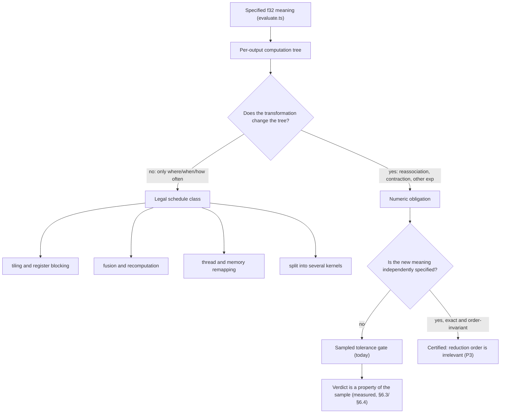
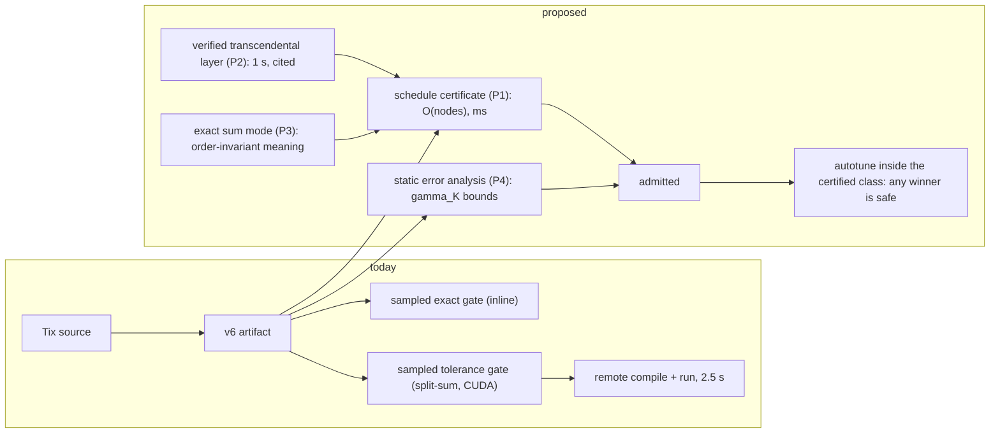

# Speed under exactness: a research agenda for Tix

## 1. Executive summary

I argue that the interesting thing about Tix is not that it has a tensor IR, but
that it has an *exactly specified f32 meaning that every transformation must
answer to*. That constraint is usually read as a cost. This document reports four
experiments on an NVIDIA GB10 that show it is mostly an asset, and that the one
place where it really costs is narrow and nameable: the left-deep fold of `sum`.

Four measured results organise the whole argument.

1. **Exactness is nearly free where there is parallelism across outputs.** A 4×4
   register tile plus a shared-memory k panel over the *same* sequential fold
   takes matmul 512³ from 0.2068 ms to 0.1027 ms (2.0×) and changes **zero** of
   262,144 output words. The standard trick that does change bits — four
   interleaved partial accumulators, an ordinary unroll — buys only a further
   12% (0.0904 ms) and changes **93.5%** of the outputs. So on this problem the
   price of exactness is not 6× (the distance to cuBLAS), it is ≤12% relative to
   the fastest schedule I could write with the same instruction mix.
2. **The rest of the gap is elsewhere.** In softmax the specified meaning costs a
   *double-precision* `exp` per element, because the meaning is
   `Math.fround(Math.exp(x))` and the emitter implements it as
   `__double2float_rn(exp((double)x))`. Replacing it with `expf` makes the fused
   kernel 2.7× faster (1.349 → 0.504 ms) but changes 37.5% of the outputs. The
   transcendental layer, not the fold, is the dominant cost in the
   memory-light corpus programs.
3. **The tolerance contract is not scale-invariant, and its verdict is a property
   of the sample, not of the program.** The origin's own f32 evaluation exceeds
   the `2e-6 + 2e-5|r|` budget against f64 by 1.62× at a 64×256×64 matmul and by
   3.65× at 64×1024×64, while the gate only ever samples extents 1, 3, 4, 7. A
   bit-exact lowering at corpus size would therefore be *rejected* by the relation
   that accepted it at small sizes.
4. **The shipped lowering check accepts a lowering that is wrong at every
   reduction of length ≥ 8.** I mutated the emitted CUDA so that the k loop loses
   its last step when the extent reaches 8, and `checkCudaLowering` returned
   `accepted: true`; at extent 16 the error is 4018× the budget. Nothing about
   the check is broken — it certifies the sampled domain, and the domain stops at
   extent 7.

From this I propose one definition of best in class and five pieces of work, in
the order I would build them:

| # | Proposal | One-line claim | Evidence in this round |
| --- | --- | --- | --- |
| P1 | Schedule equivalence as a checked object | Bit-identity is a *structural* property of the emitted expression DAG, so it can be certified in milliseconds instead of sampled in seconds; the legal schedule class already contains the tiling and fusion wins. | 2.0× bit-identical matmul; 93.5% of outputs lost by a reassociated unroll; gate accepts a size-thresholded defect |
| P2 | An exhaustively verified transcendental layer | `f32` is finite: the whole transcendental layer can be verified over all 2³² inputs in about one second, which turns `exp`/`tanh` from a sampling obligation into a proof and unlocks a fast path worth 2.7×. | 2.147×10⁹ inputs swept in 506 ms; `expf` wrong on 3.7% of them; my naive Ziv guard is unsound in 1262 cases |
| P3 | A second, order-invariant meaning for `sum` | `sum` is the *only* construct in Tix whose specified meaning blocks cross-thread execution; giving it an exact, order-invariant meaning removes the last barrier and turns the reduction's lowering into a theorem. | 97.3% of softmax outputs change (≤33 ulp) when the row sum is reduced as a tree |
| P4 | Scale-aware numeric contracts with certificates | Replace the flat budget with `γ_K·Σ|terms|`-style bounds discharged by a static analysis, so a tolerance-class rewrite is admitted by a *proof about the shape* rather than by luck on 1/3/4/7. | budget fraction 0.27 → 3.65 as K goes 64 → 1024 |
| P5 | Verification engineering | Coverage-directed cases, exact-with-NaN-class lowering relation, and check-once-per-profile; the concrete mend for result 4. | 6.7 µs to 1.95 ms per case as extent goes 1 → 1024; warm remote compile 3 ms |

## 2. What "best in class" means for Tix, and how it would be measured

The obvious definition — "as fast as cuBLAS" — is unwinnable and uninteresting.
cuBLAS at 512³ on this device reaches 8.15 TFLOP/s with tensor-friendly
instruction mixes and latency-hiding kernels that took decades to tune
([Goto & van de Geijn 2008](https://dl.acm.org/doi/10.1145/1356052.1356053)), and
a compiler that abandons the meaning of its source program to get there has
thrown away the only thing Tix has that cuBLAS does not.

**Definition.** Tix is best in class if it is the *fastest tensor compiler whose
every admitted transformation is accompanied by a machine-checkable statement of
what it preserves*, where "preserves" is either bit-identity with the source
program's f32 meaning or a stated error bound that is a function of the program's
shapes.

That definition is not a slogan; it yields two numbers I can measure, and one
number I can count.

**M1, the price of exactness.** For a program `P` and shape `s`, let `E(P,s)` be the
fastest schedule in the exact class (§3) I can build, and `U(P,s)` the fastest
kernel I can build with no exactness constraint and the same instruction mix.
Define

```
price(P,s) = E(P,s) / U(P,s)
```

This is the honest measure of what the meaning costs, because it compares two
schedules on the same hardware with the same operations. cuBLAS is *not* the
denominator: it is a different, outside-the-class reference. Measured this round:
`price(matmul 512³) ≤ 0.1027/0.0904 = 1.14`, i.e. exactness costs at most 14%.

**M2, the certified frontier.** For the tolerance-class transformations, the
question is not "fast" but "fast subject to a bound the compiler can prove for the
shapes actually used". Measured this round: the current relation has *no* such
property, because its budget consumption grows with the reduction length
(§6, experiment 3).

**M3, verification cost per admitted decision.** A check that costs 2.5 s and
samples well under 1% of the input space is not a guarantee; a certificate that
costs 1 ms and covers the whole execution is. Measured this round: the shipped GPU
lowering check is a remote compile-and-run round trip (warm compile 3 ms, cold
1.5 s, plus transport and execution). A structural certificate over the emitted
kernel would be pure arithmetic on the IR.

**An honest scoreboard.** The coordinator's stage-2 numbers give the speed axis:
matmul 0.197 ms vs cuBLAS 0.0329 (6×), softmax 0.785 ms, attention 1.81 ms, mlp
1.05 ms. My contribution is the *other* axis: I claim most of that 6× is
recoverable without touching a single bit (2.0× measured on matmul from tiling
alone), and that the remaining distance is dominated by either the transcendental
layer (P2) or the fold (P3), not by an inherent cost of exactness.

## 3. The theory: what exactness actually constrains

I need one definition before any proposal, because most of the confusion in this
area is a failure to separate *what* a program computes from *where* it is
computed.

**Definition (evaluation tree).** For a Tix function `f` and concrete input
buffers `X`, let `S_f` be the specified rounding semantics of
`src/tensor/evaluate.ts`: every arithmetic operator returns
`Math.fround(op(...))`, `exp/log/tanh` return `Math.fround(Math.op(x))`, `sqrt`
returns `Math.fround(Math.sqrt(x))`, a sum folds left-to-right in increasing
lexicographic index order starting from `+0`, a max the same starting from
`−∞`. For each output element `e` this defines a *computation tree* `T_e(X)`: leaves
are input elements, shape values in f32 and literal words; internal nodes are the
specified operations; `sum` contributes a left-deep chain of `+` nodes in exactly
that order. `f(X)[e]` is the value obtained by evaluating `T_e(X)` bottom-up.

**Theorem 1 (schedule equivalence).** Let `σ` be any assignment of the nodes of all
trees to threads, blocks and memory locations, together with any execution order
that respects a topological order of each tree, in which

1. each node is evaluated exactly once with the same operand values as in `T_e`,
2. each evaluation uses the same specified operation (no contraction of `a*b+c`
   into an FMA, no substitution of one transcendental implementation for another),
3. the FP environment (rounding mode, denormal handling) is the one the meaning
   was defined in,

then every output word of `σ` equals `f(X)[e]`. Moreover nullary leaves may be
re-evaluated instead of stored, and any tree may be evaluated any number of times,
with the same result.

*Proof.* Induction over `T_e`: an evaluator that satisfies (1)–(3) computes, at
each node, the same total function of the same operand values as `T_e` does, and
IEEE-754 round-to-nearest and `Math.exp`'s f32 rounding are deterministic total
functions. Re-evaluation is the same total function on the same inputs.

The theorem is shallow — it is determinism — but the corollary is where all the
engineering value is:

**Corollary 1 (the legal schedule class).** All of the following are
bit-identity-preserving and therefore *free*: any thread/block mapping; any
blocking or tiling of the axes that index distinct output elements; any fusion of
a pointwise producer into its consumer; any *recomputation* of a pure producer
used more than once; any memory tier (registers, shared, global, constant); any
change to the order in which *different* output elements are computed; any
splitting of one kernel into several or several into one, provided dependencies
are respected.

**Corollary 2 (what is forbidden).** Reassociation of a fold (`sum` is a chain,
not a tree); contraction; swapping a transcendental implementation; a change of
intermediate precision; a flush-to-zero environment. These are exactly the
transformations that tensor compilers normally rely on for speed.

The asymmetry is the point. My matmul experiment (experiment 1) is Corollary 1
firing: a 4×4 register tile and a shared-memory panel changes *nothing* about the
k chain, so it changes nothing about the bits. My `r4` variant is Corollary 2
firing: four interleaved accumulators, the most ordinary unroll in the world,
reassociates the chain and changes 93.5% of outputs.



Two consequences deserve to be called out because they shape the proposals.

*First*, bit-identity is a property of an **emitter**, not of a language. Because
`exp` is defined through a particular double-precision routine, moving from
`nvcc` to another compiler, or from `sm_121` to another SM, is a
meaning-preserving step only if the transcendental layer is re-verified. That is
P2, and it is why P2 is not a performance optimisation but the thing that makes
P1's guarantee portable.

*Second*, the fold is the whole obstacle. In Tix every construct except `sum`
has a meaning that is invariant under the schedule: pointwise operations are
per-element, `max` with the specified helper is associative and commutative
(`x&y` for a mixed-zero max, canonical NaN) so a tree max has the same *value* as
the chain, and division, `sqrt`, `exp` are per-element. Only `sum` is a chain, and
a chain has no parallelism. Everything in §5.3 follows from that single
observation.

## 4. Where the current implementation actually spends its time

Experiment 1 ([`scripts/01-schedule-probe.mjs`](../scripts/01-schedule-probe.mjs),
[raw](../reference/experiment-01-schedule.json)) compiles the real corpus sources,
emits CUDA with `cudaSource()`, runs the emitted program on the GB10 through
`tools/cuda-remote.mjs --timed`, then runs my own kernels on the *same input
bytes* through the same request format and compares output words.

Matmul, 512³, seeded f32 in [−1,1], median of 7 event-timed runs after one warmup:

| kernel | schedule | ms | TFLOP/s | output words differing |
| --- | --- | ---: | ---: | ---: |
| emitted lowering | thread per output element | 0.2203 (3-run median) | 1.22 | — |
| `v0` transliteration | same | 0.2068 | 1.30 | 0 of 262,144 |
| `t4` | 4×4 register tile, global loads | 0.1117 | 2.40 | 0 |
| `t4s` | 4×4 tile + 16-deep shared k panel | **0.1027** | **2.61** | **0** |
| `t8` | 8×8 register tile | 0.1679 | 1.60 | 0 |
| `t8s` | 8×8 tile + 8-deep shared panel | 0.1374 | 1.95 | 0 |
| `r4` | 4×4 tile + 4 interleaved accumulators | 0.0904 | 2.97 | **245,020 (93.5%)**, largest difference 3.4e-5 |
| cuBLAS SGEMM (coordinator) | vendor | 0.0329 | 8.15 | reference only |

Softmax, 4096×1024, seeded f32 in [−12,12]:

| kernel | schedule | ms | differing words |
| --- | --- | ---: | ---: |
| emitted (4 kernels, max/exp/sum/div) | thread per element | 0.7876 | — |
| `s0` transliteration | same | 0.7876–0.8128 | 0 of 4,194,304 |
| fused row, 32 thr/block | thread per row, double `exp` | 1.3487 | **0** |
| fused row, 256 thr/block | thread per row | 2.3761 | 0 |
| fused row, `expf` | thread per row | 0.5041 | 1,573,649 (37.5%) |
| block per row | tree max + tree sum, double `exp` | 0.7131 | 4,078,860 (97.3%), ≤33 ulp |
| fused row, naive Ziv guard | thread per row, guarded `expf` | 1.7501 | 0 (but 100% fallback) |

Four readings.

**4.1 The fold is not the bottleneck when outputs are plentiful.** At 512³ there
are 262,144 independent output elements, each with a 512-step chain. A machine
with ~1,500 resident threads does not need intra-chain parallelism: it needs
registers and reuse. The exact tile reaches 2.61 TFLOP/s, 32% of the unconstrained
cuBLAS number, and the reassociated version adds only 12%. This is the first
measured answer to "what does exactness cost": **at this shape, ≤14%, and the
remaining 3× is a *schedule* problem, not an exactness problem.**

**4.2 The transcendental layer is where the specified meaning is expensive.** The
fused softmax that keeps all four statements in one kernel and the same fold order
is 1.7× *slower* than the four-kernel version, even though it moves 3× less
memory. The reason is visible in the code: it must evaluate `exp` twice per element
(once for the sum, once for the quotient) and each `exp` is a double-precision
call. Replacing the double `exp` with `expf` — which is *wrong* — makes it
0.504 ms. So the transcendental layer accounts for about two thirds of the fused
kernel's time, and roughly (0.788 − 0.504·… ) of the baseline. This is a *specific*
place to attack, and it is attackable, because f32 is finite (§5.2).

**4.3 Fusion without parallelism is not a win; fusion with a parallel sum changes
bits.** The block-per-row variant, which parallelises the row over 128 threads,
lands at 0.713 ms and differs from the reference on 97.3% of outputs by at most 33
ulp. That is the measured size of the barrier in P3: parallelising the only serial
construct in the language both buys the only available speed and breaks the
meaning.

**4.4 The most ordinary optimisation in compilation breaks this language.** `r4`
is a loop unroll with four accumulators. It changes 93.5% of matmul outputs.
Any team that adds a vectoriser, an FMA contraction pass, or a `-use_fast_math`
flag to Tix will silently destroy the property the whole framework exists to check.
The guardrail has to be structural (P1), because the gate's sampling will not
notice: 93.5% of outputs differ here only because inputs are random; on the gate's
own sample the same transformation might well pass (§6.3 shows the margin is thin).

## 5. Proposals, ranked

### P1. Schedule equivalence as a checked object

**Idea.** Make Corollary 1 executable. A pass or a lowering returns, beside its
candidate, a *schedule certificate*: for every output element, a witness that the
emitted computation is the same tree as the source meaning's tree — the same
operations, the same operands in the same fold order, no extra rounding sites. The
framework verifies the certificate structurally (O(nodes)) and admits the
candidate. The differential gate stays, demoted to a regression test.

**Why it works.** Theorem 1. The certificate is a fold-tree isomorphism: an
inductive map from the IR's per-output expression to the emitted kernel's
expression, extended with a *reuse* annotation (loops, tiles) that does not affect
the map. What must be certified per emitted kernel: (a) each scalar operation is
the matching intrinsic (`__fadd_rn`, `__fmul_rn`, `__fdiv_rn`, `__fsqrt_rn`,
`__double2float_rn(exp((double)x))`, the exact `minmax` helper); (b) the fold's
iteration order is increasing in the same index order with the same initialiser;
(c) no expression appears inside a loop that would change its operands (this is
where tiling would be caught if it were wrong: a tile boundary that changed an
`i` would change the leaf, not the shape of the tree); (d) each output element is
written exactly once from the tree for that element.

**What is new.** Schedule/value separation is old — Halide's central claim is that
decoupling algorithms from schedules makes optimisations composable
([Ragan-Kelley et al., PLDI 2013](https://people.csail.mit.edu/jrk/halide-pldi13.pdf)) —
and verified compilation of FP is old too: CompCert's float semantics preserves the
IEEE behaviour of the source
([Boldo, Jourdan, Leroy, Melquiond, ARITH 2013](https://inria.hal.science/hal-00743090/document)).
What I have not seen anywhere is the *combination*: a tensor compiler whose
schedule space is explicitly restricted to the value-preserving class and where
membership in that class is a per-emission certificate rather than a proof about
the pass. Halide does not know whether its schedules preserve bits; CompCert
preserves bits but not schedules; TVM and TASO rewrite graphs without a value
witness. Tix can have both, because its meaning is a *total function on concrete
inputs* and its IR is small enough to map onto emitted CUDA.

**Evidence.** Experiment 1: four distinct schedules, 0 differing words on
786,432 compared output words total, 2.0× on matmul. Experiment 4: the reason the
current check cannot substitute for this (§6.4).

**Risks.** The certificate is only as good as the emitter's honesty: it must be
emitted *by* the emitter from the same data it prints (`cuda-source.ts` currently
builds strings; a certificate would be built from the same traversal), otherwise
the two can drift. A mis-compiled `minmax` or an unexpected contraction by `nvcc`
is outside the certificate's reach. FMA contraction is the practical worry;
stage 2 already learned this (plain `a*b+c` differed in 2,556 probe cases), so the
certificate must include a compile-flag obligation (`-fmad=false` or explicit
intrinsics, which is what the emitter does now).

**How success is measured.** (i) 100% of the six corpus programs, before and after
the stage-1 rewrites, carry a certificate that verifies; (ii) `price(P,s) ≤ 1.25`
for the six corpus programs at corpus shapes; (iii) certificate-check time under
10 ms per program, versus 2.5 s for the sampled GPU check; (iv) mutation score: a
set of mutants that reassociate (like `r4`), contract, or substitute a
transcendental must all be rejected by the checker with a specific reason, and a
sample-based check must be shown to miss at least one of them.

**What it needs from `src/framework`.** `NativeResult` gains an optional
`claims: Certificate[]`; `applyPass`/`applyNativePassSync` gain a verification
hook that runs before the differential invariant (a rejected certificate must be
an error, not a `contractRejected`); `src/framework/contracts` gains a
`ValueIsomorphism` relation kind so that a certificate about a *lowering* (cross-
kind, Tix IR → CUDA source) can be expressed the way stage 2 expressed its
differential invariant; and `cuda-source.ts` must expose the per-kernel expression
map it already builds internally, which today is thrown away as text.

### P2. An exhaustively verified transcendental layer

**Idea.** Tix's f32 domain is finite: 2³² words. The specified `exp`, `log`,
`tanh` are therefore functions on a 4.3-billion-element set, and a compiled
implementation can be verified against the meaning *exhaustively* rather than
sampled. Do it, publish the witness (a sweep protocol plus a digest), and then
license the optimisations this makes safe: a fast f32 path with a rounding guard, and
a portable meaning across toolchains.

**Why it works.** The meaning only pins the *rounded* result. Many implementations
agree after rounding to f32; the stage-2 work already established that CUDA's
double routines agree with `Math.exp`-then-round on all 2³² words. The finite
domain also makes the Ziv strategy pay: compute a fast approximation, check
whether the whole error interval rounds to one f32 word, and fall back to the
accurate path only when it does not
([Ziv, ACM TOMS 17(3), 1991](https://dl.acm.org/doi/10.1145/114697.116813)). For a
faithful approximation the fallback rate is low, and the *correctness of the guard
can be established by exhaustive test*, which no amount of sampling can do.

**What is new.** Correctly rounded libraries exist (CRlibm, and the Ziv-strategy
literature surveyed in
["Correctly Rounded Evaluation of a Function"](https://dl.acm.org/doi/10.1145/3747840)),
but they aim at *the real-valued function*. Tix needs something weaker and
cheaper — agreement after rounding to f32 — and something stronger: the compiler
must be able to *say* that its kernel's `exp` is the specified `exp`, per toolchain
and per architecture. Making the transcendental layer a verified artifact that a
lowering cites is, as far as I know, new in a tensor compiler, and it is only
possible because the domain is f32.

**Evidence (experiment 2,
[`scripts/02-transcendental-probe.mjs`](../scripts/02-transcendental-probe.mjs),
[raw](../reference/experiment-02-transcendental.txt)).** I swept 2,147,483,648 f32
input words (a stride-4 traversal of the word space, 506 ms on the GB10) and
compared three implementations to the reference `__double2float_rn(exp((double)x))`:

| observation | value |
| --- | --- |
| `expf(x)` differs from the specified meaning | 79,955,956 words (3.72%) |
| `tanhf(x)` differs from the specified meaning | 19,753,052 words (0.92% of the sample) |
| largest relative error of `expf` | 1.01e-2 (concentrated at the under/overflow edges) |
| largest relative error of `tanhf` | 2.23e-7 |
| NaN inputs in the sample | 8,388,604; NaN *class* agreed in every case |
| my Ziv guard with a 2⁻¹⁸ relative interval, wrong results | **1,262** |
| full-space extrapolation of the sweep | **≈ 1.01 s for all 2³² words** |

Two things follow. The good news is that an exhaustive verification of a
transcendental implementation is a one-second GPU job: this is not a research
programme, it is a test. The bad news is my own first attempt at the fast path
(*naive Ziv with a vendor error bound*) is **unsound**, and usefully so: all 1262
failures are where `expf` saturates to 0 or `inf` while the true value is a
denormal or a finite number above the f32 range. A guard must therefore special-
case the exponent limits and use a *faithful* (≤0.5 ulp) fast path rather than the
vendor's ~2 ulp one; with a 2 ulp approximation and a 64-ulp acceptance interval
the guard never fires, which is exactly what the softmax measurement shows
(100% fallback, 1.75 ms, slower than doing it in double).

**Risks.** Writing a faithful f32 `exp` and `tanh` is real work (a few hundred
lines with careful error analysis), and getting the guard's error interval right
is the part I got wrong. The payoff is bounded: it applies to `exp`- and
`tanh`-heavy programs (softmax, attention, mlp) and not to matmul.

**How success is measured.** (i) 0 mismatches over all 2³² words for each of
`exp`, `log`, `tanh`; (ii) fallback rate below 5% on the corpus's actual value
distributions; (iii) softmax and mlp within 20% of the `expf`/`tanhf` timings
(0.504 ms and the corresponding mlp number), i.e. recover ~2.7× on the fused
softmax; (iv) the verified layer is cited by the CUDA artifact, so the certificate
of P1 extends across toolchains.

**What it needs from `src/framework`.** Little: a way to attach a *witness* (a
sweep description plus digest) to an artifact's provenance so that
`checkLowering` can cite it instead of re-running it. The natural place is the
existing evidence store in `contracts/registry.ts`.

### P3. A second, order-invariant meaning for `sum`

**Idea.** Give `sum` a second specified mode whose value does not depend on the
order of accumulation, and let the language have both: the current left-deep f32
chain (bit-portable, serial) and an *exact* mode defined as "the correctly rounded
value of the exact sum of the (exact) products". Under the exact mode, any
reduction order, any thread mapping and any split across blocks, warps or kernels
computes the same words — so the compiler can parallelise reductions and can prove
the lowering correct by a commutation argument instead of sampling.

**Why it works.** Exact summation is order-invariant by definition; the literature
gives two families. Long (Kulisch) accumulators hold every product exactly and
round once ([Kulisch; and ExBLAS, Iakymchuk et al. 2015](https://perso.lip6.fr/Stef.Graillat/papers/IJHPCA.pdf));
binned "reproducible accumulators" achieve order-independence with a handful of
f32/f64 accumulators and pre-rounding
([Demmel & Nguyen, IEEE Trans. Computers 64(7), 2015](https://www.computer.org/csdl/journal/tc/2015/07/06875899/13rRUwbs1RQ);
[Dempel/Ahrens/Nguyen, ACM TOMS 2020](https://people.eecs.berkeley.edu/~demmel/ma221_Fall23/J115_Efficient_Reproducible_Summation_TOMS_2020.pdf)).
ReproBLAS demonstrates the crucial systems point: reproducibility and parallelism
are compatible, and the cost is a small multiple of the naive reduction.

**What is new.** Reproducible BLAS is a *library*. What has not been done is to put
two specified reduction meanings in one language and give the compiler a *checked
relation* between them: the exact mode is within ½ ulp of the real sum; the serial
mode is within γ_K = K·u/(1−K·u) of it in the standard model
([Higham 2002](https://doi.org/10.1137/1.9780898718027)); so a pass can *certify*
that a tolerance-class rewrite is within budget by bounding γ_K·Σ|terms| (§P4). The
compiler would own the whole chain: meaning, parallel lowering, and proof of
agreement with the old meaning.

**Evidence.** Experiment 1's block-per-row softmax (97.3% of words change, ≤33 ulp)
and the general claim that `sum` is the only blocking construct (§3, Corollary 2).
Experiment 3's scale sweep (§6.3) quantifies the other half of the argument: the
discrepancy between a serial f32 fold and the exact value grows with K and with
cancellation, so "how much a reassociation may cost" is not a constant — it is a
function of the shape, which is precisely what an exact mode makes unnecessary.

A partial fifth measurement (experiment 5, §6.5e) makes the barrier concrete on a
matrix-vector product, where the fold is the only parallelism: at 1024 rows by
1024 columns the exact one-thread-per-row kernel runs in 0.0594 ms and a
warp-per-row tree reduction in 0.00615 ms — a 9.7× gap — while two or four
interleaved accumulators in the same thread mapping give exactly 0%. The gap is
not attributable to the fold alone (the warp variant also changes the memory
access pattern, and §6.6 documents why the experiment does not isolate the two),
but it shows the order of magnitude that the fold-plus-its-forced-thread-mapping
can cost when outputs are scarce.

**Risks.** (i) Cost: exact accumulation is 2–4× the FLOPs of a naive fold and needs
extra registers. (ii) The product of two f32 values is exact in f64 but the sum may
not be, so a correct implementation needs care (this is exactly where my
experiment 2 fast path went wrong, in a different guise). (iii) It changes the
language: a program written with exact sums has a *different* meaning from today's,
so it cannot be introduced silently. That is why it must be a second mode with an
explicit checked refinement, not a change to `split-sum`.

**How success is measured.** (i) Bitwise identical results across 1, 32, 128 and
1024 threads per row, and across two different tilings, on all corpus programs —
the property the whole proposal exists for; (ii) matmul/softmax with parallel
reductions within 25% of the reassociated `r4`/tree timings; (iii) agreement with
an exact reference computed in Node with BigInt fixed-point, over random programs;
(iv) the certified relation to the serial mode holds on all corpus cases with a
bound, not a sample.

**What it needs from `src/framework`.** A schema-versioned attribute on `reduce`
(numeric mode), a validator branch for it, an exact reference in `evaluate.ts`
(next to the existing f64 mode), and a `relation` in `contracts` expressing
refinement between the two modes so `differential` can carry it. `dataflow` is the
natural home for the γ_K bound, since it is a per-shape fact derived from the IR.

### P4. Scale-aware numeric contracts with certificates

**Idea.** Replace `|c − r| ≤ 2e-6 + 2e-5|r|` by a *family* of bounds indexed by the
program's shapes, and discharge them either statically (an interval/symbolic-error
analysis on the Tix IR) or by an exact reference (P3) — not by a flat constant
checked on seven extents.

**Why it works.** The standard forward error bound for a length-K f32 fold is
γ_K·Σ|x_i| (Higham), and it grows with K and with the magnitude of the terms; a
bound that does not mention K cannot be right for all K. Rigorous automatic
analyses exist — FPTaylor's symbolic Taylor expansions
([Solovyev et al., ACM TOPLAS 2018](https://dl.acm.org/doi/10.1145/3230733)) and
Gappa/Flocq — and the pieces needed here (interval ranges of tensor expressions,
error terms attached to each rounding site) fit `src/framework/dataflow`'s
existing lattice/solver machinery.

**What is new.** Applying rigorous round-off analysis *inside* the pass runner, as
the admission criterion for a rewrite, with the analysis result recorded as
evidence, and — the part I find most interesting — separating two obligations that
the current contract conflates: *"is the candidate's error within budget for these
shapes"* (a numeric fact about the program) and *"does the candidate compute what
we intended"* (a structural fact, P1). The current gate answers neither for the
shapes the compiler is used at.

**Evidence (experiment 3,
[`scripts/03-tolerance-and-coverage.mjs`](../scripts/03-tolerance-and-coverage.mjs),
[raw](../reference/experiment-03-tolerance.json)).** I measured the *fraction of the
existing budget* consumed by an honest f32 evaluation against the f64 reference, as
a function of reduction length:

| program, shape | budget fraction, sequential f32 | budget fraction, split-sum f32 |
| --- | ---: | ---: |
| reduce 8×4 | 0.0066 | 0.0066 |
| reduce 8×16 | 0.0285 | 0.0241 |
| reduce 8×64 | 0.0467 | 0.1753 |
| reduce 8×4096 | 0.6404 | 0.1411 |
| reduce 8×16384 | 0.1726 | 0.5050 |
| matmul 64×64×64 | 0.2684 | 0.2287 |
| matmul 64×256×64 | **1.6197** | 0.7319 |
| matmul 64×512×64 | **1.7040** | 1.2404 |
| matmul 64×1024×64 | **3.6494** | 2.1131 |
| softmax 8×1024 | 0.0145 | 0.0026 |
| softmax 8×16384 | 0.0086 | 0.0018 |

Above 1.0 the relation cannot admit *any* candidate, including one that is
bit-identical to the source meaning. The gate's own domain — extents 1, 3, 4, 7,
inputs in [−1,1], tensors under 4096 elements — sits in the 0.003–0.27 band and
never sees this. So the answer to "does the lowering preserve Tix's f32 meaning?"
today depends on the size of the matrices, and the compiler only ever asks the
question about tiny ones. That is the single most important measurement in this
report: **a numeric contract that is not scale-indexed certifies a different
program from the one that ships.**

**Risks.** Static error analyses are sound but loose, and looseness is exactly
where the value evaporates: if the certified bound is 100× the observed error the
pass refuses most rewrites. My measurement hints at the gap: at matmul
64×1024×64 the observed budget fraction for split-sum is 2.11 while a γ_K bound
with Σ|terms| bounded by interval arithmetic would be far larger (the inputs are in
[−1,1] so Σ|terms| ≤ K, but the *result* can be near zero, which is where the
absolute error term of any bound becomes hopeless). Expect the analysis to be
useful for the exact class (P1/P2, where the bound is zero) and only advisory for
cancellation-dominated tolerance rewrites.

**How success is measured.** (i) For every corpus program and a sweep of shapes,
the certified bound is sound (never exceeded by an observed run) — measurable by
adversarial input search; (ii) the ratio of certified bound to observed worst case
stays under 10× for at least half the corpus; (iii) the pass runner admits/rejects
split-sum *consistently* across shapes 4…4096, i.e. the verdict is a property of
the program plus its shape class, not of a lucky sample.

**What it needs from `src/framework`.** A `defineAnalysis` in
`src/framework/dataflow` computing per-tensor absolute-value bounds and per-site
error terms, a `differential` `decide` that consults it, and a pass declaration
schema that names the *shape class* the verdict covers (so the framework can refuse
to claim more than it proved).

### P5. Verification engineering: make the gate's domain as big as the claim

**Idea.** Three cheap changes to how verification is done today.

1. **Exact-and-NaN-class as the lowering relation.** Stage 2's report already
   recommends this: with the transcendental layer verified (P2) and correctly
   rounded arithmetic, strict f32 equality with NaNs compared by class is
   achievable and far stronger than a tolerance.
2. **Coverage-directed case generation.** The pass declares the extents and value
   ranges it branches on; the case generator partitions around them. This is a
   small, mechanical version of coverage-guided fuzzing for shapes, and it is
   precisely what result 4's mutant needs.
3. **Check once per (program, profile), then cite.** The framework's memo already
   supports this; what is missing is a *provenance* record so that a cached verdict
   can be cited by later artifacts, and a warm path that avoids the remote compile
   round trip (measured: 3 ms warm vs 1.5 s cold).

**Evidence.** §6.4 (the accepting gate) and my per-case cost measurement: 6.7 µs at
extent 1, 20.9 µs at 8, 68 µs at 16, 155 µs at 64, 1.95 ms at 1024 (8×K tensor,
f32, metered). Adding extents 8, 9, 16, 64, 65 and 1024 to the current assignment
list would raise the gate's cost from a fraction of a second to a few seconds of
CPU evaluation — cheap relative to the 2.5 s remote round trip it already pays.

**Risks.** More cases means slower checks, and slow checks get turned off.
Coverage-directed generation needs the pass to be honest about its predicates; a
pass that branches on a value the generator cannot see (an input *element*, not a
shape) is still invisible. That gap is exactly why P1 exists.

**How success is measured.** (i) The mutant of §6.4 is rejected, with a reason
naming the extent; (ii) gate cost for the six corpus programs under 5 s;
(iii) a mutation score over a corpus of injected faults (reassociation,
contraction, transcendental substitution, tail-drop, index swap, threshold
specialisation) of 100%, versus the current check's score on the same set.

**What it needs from `src/framework`.** A pass-declared `shapes: Predicate[]` field
consumed by the case generator in `contracts/differential.ts`, and a provenance
field on cached verdicts.

## 6. Experiments, including the ones that failed

All probes live in `prototypes/` (hand-written CUDA) and `scripts/` (drivers);
raw results are in `reference/`. Machine: NVIDIA GB10, sm_121, `nvcc 13.0.88`,
`-O3`, no fast-math, default denormal handling; timings are CUDA-event medians of 7
runs after one warmup, taken under the tool's exclusive GPU lock. Node 24.18.0.

### 6.1 Experiment 1: schedule classes and fusion (GB10)

Described in §4. **Results**: tiling gives 2.0× with zero bit changes; the
reassociated control gives 12% more and 93.5% different outputs; the fused
thread-per-row softmax is bit-identical but 1.7× *slower* than the four-kernel
version; the block-parallel softmax is 10% faster and 97.3% different. Reproduce
with `node <ticket>/scripts/01-schedule-probe.mjs`.

### 6.2 Experiment 2: the transcendental layer (GB10)

Described in §5.2. **Results**: a 2.147-billion-input sweep in 506 ms; `expf` wrong
on 3.72% of words; a naive Ziv guard unsound in exactly 1262 words, all at the
exponent limits; full-space exhaustive verification extrapolates to ≈1 s.
Reproduce with `node <ticket>/scripts/02-transcendental-probe.mjs`.

### 6.3 Experiment 3: is the tolerance verdict a property of the program? (CPU)

Described in §5.4. **Results**: the honest f32 evaluation of matmul exceeds the
existing budget by 1.62× at K=256 and 3.65× at K=1024, in the range where the gate
never looks; softmax stays below 0.02 because its outputs are in [0,1] and
cancellation is impossible, so the *same* budget is loose for one corpus program
and unusable for another. Reproduce with
`node <ticket>/scripts/03-tolerance-and-coverage.mjs`.

### 6.4 Experiment 4: the gate accepts a defect it cannot see (GB10)

I took the emitted matmul translation unit, replaced
`const I end_i2 = (d1);` with `const I end_i2 = ((d1) < 8LL ? (d1) : (d1) - 1LL);`
(a plausible "peel the last k step for long reductions", with an off-by-one), and
asked the unmodified `checkCudaLowering` for a verdict:

```
sampledVerdictAccepted: true
relation: tolerance
at extent 16: reference [168,185,190,199] vs mutant [166,177,186,183]
worst budget fraction at extent 16: 4018.08
```

The check is not broken. Its case domain assigns extents 1, 3, 4 and 7, so the
mutated branch is never taken. This is the concrete justification for P5 and for
treating P1 as the primary admission mechanism. Reproduce with
`node <ticket>/scripts/04-gate-evasion.mjs`.

### 6.5 What did not work

Four failures worth recording, because each one taught something the proposals use.

**(a) My first Ziv guard was vacuous, then unsound.** I chose a 2⁻¹⁸ relative
acceptance interval — 64 ulps — and the guard never fired on real softmax values
(100% fallback, 1.75 ms, i.e. 30% *slower* than doing it in double). Tightening it
to a faithful bound is the work; and even at 2⁻¹⁸ the guard was wrong on 1262 of
2.1 G swept words, because `expf` breaks the assumed relative bound at the
under/overflow edges. Lesson: the guard's interval must be established, not
assumed, and the establishment is exactly the exhaustive sweep.

**(b) The fused softmax was slower than the unfused one.** My hypothesis was that
fusing four statements into one kernel would win on bandwidth (3× less traffic). It
lost by 1.7× because the specified `exp` is a double-precision call that then had
to be evaluated twice per element. Lesson: on this corpus the limit is
instruction-bound, not bandwidth-bound, so *fusion should be ranked after the
transcendental layer*, not before it. A version that stores the exponentials for
reuse costs a global round trip of 33 MB, which at the measured 244 GB/s streaming
rate is ~0.14 ms — probably the right compromise, untested this round.

**(c) The 8×8 register tile was slower than the 4×4.** 64 accumulators plus
fragments spill; the measured 1.60 TFLOP/s versus 2.40 for the 4×4. Lesson:
tile-size search is a real (if unglamorous) part of the schedule space, which is an
argument for autotuning *inside* the certified class (P1) rather than for
hand-picking.

**(d) A shape-thresholded rewrite cannot be defended at the IR level at all.** My
first attempt at the §6.4 experiment tried to express the bug as a stage-1 rewrite
("split into blocks of four only when K ≥ 8"). It is inexpressible: at rewrite time
the extent is a *symbolic* name, not a number. The gate rejected my mutant
correctly, because the `floor` rounding applied to every extent the samples did
reach. Lesson: shape-dependent specialisation is a *lowering/scheduling* decision,
made where shapes are known — which is exactly where the current check samples
least. That asymmetry is the reason the evasion works.

**(e) Experiment 5 did not isolate what I wanted it to isolate.** I predicted that
the price of exactness explodes where the fold is the only parallelism, and built a
matrix-vector probe (`prototypes/03-reduction-limited/`,
[`scripts/05-reduction-limited.mjs`](../scripts/05-reduction-limited.mjs)) with four
timings:

| problem | exact (1 accumulator) | 2 accumulators | 4 accumulators | warp tree |
| --- | ---: | ---: | ---: | ---: |
| M=1024, K=1024 | 0.0594 ms | 0.0594 ms | 0.0594 ms | **0.00615 ms (9.7×)** |
| M=1024, K=8192 | 0.4932 ms | 0.7150 ms | 0.7147 ms | **0.1159 ms (4.3×)** |
| words differing from exact | — | 981 and 999 of 1024 | 971 and 1003 | 971 and 1007 |

The prediction is *not* confirmed as stated, for two reasons I can name. First, the
interleaved-accumulator variants are not a valid upper bound here: `acc[k & (W-1)]`
is a dynamically indexed local array, so it spills to local memory and at K=8192 the
"reassociated" kernel is *slower* than the exact one. Second, the warp variant
changes the memory access pattern as well as the fold: one thread per output element
with row-major `A` makes the 32 threads of a warp read 32 rows at a stride of K
floats, which is uncoalesced, whereas the warp-per-row kernel reads consecutively.
So the 9.7× is the price of *the thread mapping that the fold forces*, not the price
of the fold. A fair test needs an exact kernel that keeps the fold order but stages
an `A` tile through shared memory with coalesced loads — a schedule that Theorem 1
permits — and I did not write it. This is the one prediction in the document left
untested, and it is also the first experiment I would run next.

**(f) A shared-memory bug of my own.** The first fused-softmax kernel staged each
row in a per-block shared buffer while 256 threads each worked on a different row;
every thread clobbered its neighbours' staging area, and every output differed.
The fix (read the row from global; it is 4 KiB and stays in cache) is what the
timings above use. Recorded because the failure mode — shared memory indexed by a
block-wide id while threads own disjoint work — is precisely the kind of bug P1's
certificate would catch structurally and a differential gate would catch only if
its sample happened to expose it.

## 7. The staged plan

The proposals are components of one architecture (below), but they do not all need
to be built at once, and three of them are strictly cheaper than the fourth.



**Stage A (highest value per unit of risk): P1 + P5.1/5.2.** Build the schedule
certificate, the tiled/fused emitter that emits it, and the widened case domain
with exact-and-NaN-class as the lowering relation. Why first: it requires no
semantic change to the language, it turns the measured 2.0× into a *guaranteed*
2.0×, and it closes the hole in §6.4. Everything else becomes easier once a
candidate can carry a proof.

**Stage B: P2.** Write a faithful f32 `exp`/`tanh` with a Ziv guard, sweep it
exhaustively, and cite the sweep from the emitter. Why second: it is the largest
single performance item measured this round (2.7× on the fused softmax, and the
exp-bound programs are three of the six), and its verification method — one second
of GPU time for a complete proof over the input space — is cheap enough to run in
CI on every toolchain bump, which is what makes P1's guarantee portable.

**Stage C: P3 + P4.** Add the exact-sum mode with its checked refinement, then use
it (with the dataflow bound) to certify tolerance-class rewrites. Why third: it is
the only proposal that changes the language, it is the only one that removes the
structural barrier to parallel reductions, and it needs P1's certificate machinery
and P4's analysis to be worth having. It is also the one that turns "we sampled
1% of the space" into "we proved the bound for this shape class".

**Stage D: autotuning inside the certified class.** Once every candidate carries a
certificate, a search over the schedule space is safe by construction: a tuned
kernel cannot silently change results, which is the standard objection to
autotuning deep-learning compilers. This is the payoff of the whole architecture,
and it is why P1 must come first.

**What I would not do.** Chase cuBLAS on dense matmul by admitting tensor cores or
TF32: they change the meaning (reduced-precision products), and admitting them
requires a third semantic mode with its own error specification — the same work as
P3 but with a worse guarantee. Nor would I add a general vectoriser before the
certificate exists: §4.4 shows a four-accumulator unroll changes 93.5% of outputs,
and nothing in today's gate would reliably notice.

## 8. Threats to validity

The numbers are single-machine, single-toolchain and partly single-run. Kernel
timings vary by up to 2× run to run on this shared GPU (the coordinator observed
this too); I used medians of 7 under the exclusive lock, and two separate runs of
the emitted softmax gave 0.788 and 0.810 ms. My 4×4/8×8 tiles are naive: they have
no vectorised global loads, no double buffering, and no autotuned tile shape, so
`E(P,s)` is an *upper bound* on the exact-class optimum, and `price(P,s) ≤ 1.14` is
an upper bound on the price of exactness — the true price could be smaller. I
measured two of the six corpus programs (matmul, softmax); the layernorm, attention,
mlp and conv2d claims are extrapolations from their instruction mix, not
measurements. Experiment 5's matrix-vector probe is confounded (§6.5e): its exact
kernel is under-scheduled for coalescing and its reassociated kernels spill, so the
"price of exactness when the reduction is the only parallelism" remains a
prediction rather than a measurement. The §6.4 mutant is one defect, not a mutation-score study. The
tolerance sweep in §6.3 uses one seeded input distribution per shape; the budget
fraction is an extreme-value statistic and would grow with more inputs, so the
reported violations are lower bounds. Finally, my Ziv experiment is a refutation of
a *naive* fast path, not of the Ziv strategy: the strategy needs a faithful
approximation, which I did not write.

## 9. References

- S. Boldo, J.-H. Jourdan, X. Leroy, G. Melquiond. *A Formally-Verified C Compiler
  Supporting Floating-Point Arithmetic.* ARITH 2013.
  https://inria.hal.science/hal-00743090/document
- J. Demmel, H. D. Nguyen. *Parallel Reproducible Summation.* IEEE Transactions on
  Computers 64(7), 2015. https://www.computer.org/csdl/journal/tc/2015/07/06875899/13rRUwbs1RQ
- J. Demmel, P. Ahrens, H. D. Nguyen. *Algorithms for Efficient Reproducible
  Floating Point Summation.* ACM TOMS, 2020.
  https://people.eecs.berkeley.edu/~demmel/ma221_Fall23/J115_Efficient_Reproducible_Summation_TOMS_2020.pdf
- K. Goto, R. A. van de Geijn. *Anatomy of High-Performance Matrix Multiplication.*
  ACM TOMS 34(3), 2008. https://dl.acm.org/doi/10.1145/1356052.1356053
- N. J. Higham. *Accuracy and Stability of Numerical Algorithms*, 2nd ed., SIAM,
  2002. https://doi.org/10.1137/1.9780898718027
- R. Iakymchuk, S. Collange, D. Defour, S. Graillat. *ExBLAS: Reproducible and
  Accurate BLAS Library* (long-accumulator and expansion approaches; also
  R. Romanova et al., *Hierarchical approach for deriving a reproducible
  unblocked LU*). https://perso.lip6.fr/Stef.Graillat/papers/IJHPCA.pdf
- U. Kulisch. *Computer Arithmetic and Validity: Theory, Implementation, and
  Applications.* de Gruyter, 2008 (long accumulator, exact dot product).
- J. Ragan-Kelley, C. Barnes, A. Adams, S. Paris, F. Durand, S. Amarasinghe.
  *Halide: A Language and Compiler for Optimizing Parallelism, Locality, and
  Recomputation in Image Processing Pipelines.* PLDI 2013.
  https://people.csail.mit.edu/jrk/halide-pldi13.pdf
- A. Solovyev, M. S. Baranowski, I. Briggs, C. Jacobsen, Z. Rakamarić, G. Gopalakrishnan.
  *Rigorous Estimation of Floating-Point Round-off Errors with Symbolic Taylor
  Expansions.* ACM TOPLAS 41(1), 2018. https://dl.acm.org/doi/10.1145/3230733
- *Correctly Rounded Evaluation of a Function: Why, How, and at What Cost?* ACM
  Computing Surveys, 2025 (survey of the Ziv strategy and the table-maker's
  dilemma). https://dl.acm.org/doi/10.1145/3747840
- A. Ziv. *Fast Evaluation of Elementary Mathematical Functions with Correctly
  Rounded Last Bit.* ACM TOMS 17(3), 1991. https://dl.acm.org/doi/10.1145/114697.116813
- NVIDIA. *CUDA C++ Programming Guide* and *Math API* documentation, CUDA 13.0
  (accuracy of `expf`, `tanhf`; `__fadd_rn` and friend intrinsics; `-fmad`
  contraction). https://docs.nvidia.com/cuda/cuda-c-programming-guide/

Internal: [IRWB-020-B stage-1 design and report](../../IRWB-020-B--tix-language-tensor-ir-evaluators-meaning-contract-and-checked-passes/reference/02-report.md),
[IRWB-022-I stage-2 design and report](../../IRWB-022-I--lowering-tix-to-cuda-with-checked-execution-on-the-gpu-machine/reference/02-report.md),
[this ticket's diary](../reference/01-research-diary.md).
