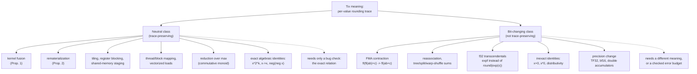

# Speed at a fixed meaning

## 1. The question, and the answer in one page

Tix has something no vendor library offers: a meaning that is exact enough to be reproduced word for word, on a GPU, by a compiler that checks its own passes. Stage 2 measured the price of that meaning as a story of slowness. The merged lowering reaches 1.36 TFLOP/s on a 512³ matrix multiply where cuBLAS reaches 8.15, and it moves roughly six times more bytes than the arithmetic requires on a layer normalization.

I started from the suspicion that the slowness was a consequence of the meaning — that a compiler bound to reproduce every f32 rounding site cannot be fast — and that the interesting question was how much of the gap would have to be paid. The measurements say the suspicion is wrong in an interesting way. **Almost none of the gap comes from the meaning. It comes from a schedule that was never represented, and therefore never chosen.**

On the GB10, with the same arithmetic and no change to a single rounding site:

| workload | stage-2 lowering | best bit-exact schedule I built | speedup | words that differ |
|---|---:|---:|---:|---:|
| matmul 512³ | 0.197 ms | 0.0953 ms | 2.06× | 0 of 16,384 (at 128³) |
| layernorm 4096×1024 | 0.511 ms | 0.1350 ms | 3.79× | 0 of 4,194,304 |
| softmax 4096×1024 | 0.804 ms | 0.6014 ms | 1.34× | 0 of 4,194,304 |

The matmul result is the interesting one, because there is a vendor ceiling to measure against. A tiled, register-blocked, shared-memory SGEMM that computes `fl(fl(a·b)+c)` — two rounding sites per multiply-accumulate, exactly Tix's tree — runs at 10.51 TFLOP/s at 4096³, against cuBLAS's 17.87 TFLOP/s measured in the same process. It is **59% of cuBLAS with every output word bit-identical to the Tix interpreter**. The residual gap decomposes cleanly. Replacing the two-rounding MAC with a fused one in the same kernel gives 14.70 TFLOP/s, so 1.21× of the 1.70× gap is my kernel's schedule quality and 1.40× is the meaning. And the meaning's share has a hard floor that I measured directly: a register-only loop issuing `fma.rn.f32` reaches 25.62 TFLOP/s, and the same loop issuing `mul.rn.f32` then `add.rn.f32` reaches 13.73 TFLOP/s. The ratio is 1.87. **The exactness of Tix's multiply-accumulate is an instruction-issue constraint, and no schedule can pay it off.** Everything else is available.

So my answer to "what compiler work would make Tix best in class" is a definition and four proposals:

- **Definition.** Best in class means *the fastest program at a stated meaning*, on the Pareto frontier of (throughput, guarantee strength, and the cost of the evidence for the guarantee). Tix's unique asset is that its guarantee is a bit, not a band, and its evidence is machine-checkable.
- **P1. Make the schedule a first-class, checked artifact** and let the compiler search it. The meaning does not mention the schedule, so every schedule is bit-neutral *by theorem*; today the schedule is hard-coded inside a 319-line emitter and is therefore neither chosen nor searched. This is the proposal with measured wins (2.06×, 3.79×, 1.34×) and the one I would build first.
- **P2. Publish a price list for the meaning, and make the meaning a parameter.** The measured price of each relaxation, in the same kernel, one instruction apart: contraction 1.87× (and 84.7% of output words changed at 512³), double-precision transcendentals 122× (and 45% of the softmax time), reduction order 1.0× (order is free to break, and breaking it is often *more* accurate — §4.2). A language designer can only spend a budget it has measured.
- **P3. Check the check.** Today one sampled GPU differential run certifies both the emitter and the toolchain, at ~2.5 s per function and ~10⁵ values. The two risks are separable, and both can be upgraded to proof-grade: a structural (translation-validation) check of the emitted tree costs O(program) and is complete, and the toolchain's transcendental clause can be certified *exhaustively over all 2³² f32 inputs* for 0.90 s per intrinsic, which I measured.
- **P4. A research bet: make the sum order-independent by making it exact.** Tix's specified order is not the accurate one; my exact-sum oracle shows the checked `split-sum` rewrite lands on the correctly rounded value where the specified order does not, and that at n=1024 the specified order is correctly rounded in 3 of 60 trials against 47 of 60 for a tree. If the meaning were "the correctly rounded sum" instead of "this fold", every reduction order and every parallel decomposition becomes legal by construction, at a measurable arithmetic cost.

I ran seven experiments to get here, two of which refuted my own hypotheses; §7 lists them.

## 2. What "best in class" means for Tix, and how it is measured

A tensor compiler can be compared on many axes, and the ones that are easy to measure (throughput on the six corpus programs) are exactly the ones where a language with a bit-exact meaning will always look bad against a language that lets the vendor library decide. Comparing Tix to cuBLAS on time alone is comparing a specification to an implementation. So I need a definition that is hard to game and that Tix can win.

**Definition.** For a program P with meaning M, a compiler is best in class when, for each of the axes below, its position is not dominated by another compiler's position on the same program and meaning.

1. **Throughput at M.** TFLOP/s or GB/s achieved while every output word equals M(P)(x). Not "within a tolerance of" — equal. This is the axis where the exactness becomes a measurement rather than an excuse: the question is not "how fast can a matmul be" but "how fast can *this* matmul be", and the second question has a definite answer that I can approach and that cuBLAS does not attempt.
2. **Guarantee strength.** What is claimed, and over what domain: sampled or complete; one program or every program; evidence that a third party can re-run. A tolerance band admitted by a sampled case list is a weaker claim than bit equality proved by a structural argument, even when both are "checked".
3. **Evidence cost.** Seconds and joules per accepted pass, and how much of the domain the evidence covers. A check that costs 2.5 s per function to inspect 10⁵ values is buying evidence at ~4·10⁴ values per second; an exhaustive sweep of the f32 domain buys 2³² values in 0.9 s. The two are not in the same business.
4. **Expressiveness per unit of guarantee.** Which fast algorithms the language can *state* and still check: fused producer-consumer chains, blocked reductions, implicit-GEMM convolution, a max-plus schedule for softmax. A language that cannot express a fast schedule cannot be best in class at any speed.

The axes conflict, which is the point: the deliverable is a frontier, and the compiler work that matters is the work that moves the frontier rather than sliding along it. The rest of this document is an argument that Tix's frontier is much further out than stage 2's position suggests, with three of the four axes measured.

**Measurement protocol.** Every number below comes from `tools/cuda-remote.mjs --timed` on the GB10 (sm_121, 48 SMs, CUDA 13.0, `nvcc -O3`), as the median of CUDA-event timings inside one process; the exact number of repeats is in `scripts/RESULTS.md`. Where the coordinator published a number for the same workload I reproduce it within a few percent (cuBLAS 512³ 8.34 vs 8.15 TFLOP/s; stage-2 softmax 0.804 vs 0.785 ms; stage-2 layernorm 0.511 vs 0.563 ms), which is the only calibration available for a shared machine and is the reason I trust the comparisons that follow.

## 3. The theory: what the meaning actually constrains

The whole design follows from one observation about the shape of Tix's meaning, so it is worth stating precisely.

### 3.1 The meaning is a rounding trace, not a value

In `src/tensor/evaluate.ts` the f32 evaluator rounds at *every* arithmetic operator, at every literal, at every shape value converted into a scalar, at every intrinsic result, and at every reduction fold step. A tensor definition's store is a `Float32Array` assignment, and an f32 value stored into a `Float32Array` is unchanged. Write ⟦e⟧ for the f32 value of scalar node e under a shape environment. For a tensor definition `t[i] = e`, define its **rounding trace** as the tree whose leaves are input elements and literals and whose internal nodes are the primitive operations of e, each carrying its rounding site, with reduction nodes carrying an *ordered* sequence of children.

> **Claim (trace determinism).** For a fixed input assignment, the f32 result of a Tix function is a function of its rounding traces alone. Two programs with the same trace per output element produce the same words, on any target, under any schedule.

This is immediate from the definition of the evaluator: the evaluator *is* a trace interpreter. It matters because the trace is a much coarser object than the source and a much finer object than the value. Coarse: it does not mention loops, kernels, blocks, threads, memory or order of independent work. Fine: it pins every intermediate to a bit pattern.

The trace is also where the other relations live. `exact` in `src/tensor/contract.ts` compares f32 words, which is the trace's observable. `tolerance` compares against an f64 evaluation, which is a *different* object (an approximation of the real-valued result), and §4.1 shows the consequences of conflating them.

### 3.2 Materialization is a neutral element, so the schedule is free

> **Proposition 1 (materialization is trace-neutral).** Let a statement S produce tensor t, read by a later statement with any affine index map. Inserting or removing the round trip "f32 → `Float32Array` → f32" changes no rounding site and therefore no output word.

*Proof.* The value stored is an f32 (every arithmetic, literal, shape conversion and fold step already rounded), and the array element type is f32, so the store is the identity on f32 values; the load returns that value. No operation is added to any trace. ∎

> **Proposition 2 (recomputation is trace-neutral).** Tix is pure: statements read earlier tensors by affine index and have no other effect. If a value is used n > 1 times, computing its trace n times instead of once yields the same words at each use, since each copy evaluates the same operations on the same operand words.

*Proof.* Determinism of each operation on its operand words, by induction over the trace. ∎

Proposition 1 says that stage 2's one-kernel-per-statement lowering is *semantically* free lunch: every intermediate it writes to global memory and reads back is a pure memory cost, because in Tix nothing can be gained or lost by that round trip. This is not true in a language with relaxed arithmetic, where fusion changes which rounding sites exist. It is true here *because* the meaning is exact.

Proposition 2 says that fusion by recomputation — the transformation that duplicates work to avoid a store — is also bit-neutral, which is not the case for a language where the producer's result depends on double-precision intermediates.

Together they define a class of transformations that a compiler may perform freely, with no differential evidence at all beyond a bug check. I call it the **neutral class**, and it is where the performance is.

### 3.3 The two classes

Two entries in the neutral column deserve separate argument because they are usually assumed to be in the other class.

**Max is a monoid.** The Tix max helper propagates NaN, and for equal-magnitude zeros it returns the bitwise AND of the sign-and-magnitude words for a maximum (so `max(+0,-0) = +0` regardless of order). That operation is commutative, associative and idempotent on f32 words; NaN is absorbing. Hence *any* order of a max reduction, including a warp-shuffle tree, a split reduction, or one lane per term with an atomic, produces the specified word. Tix's `m[i] = max(j) x[i,j]` therefore has a parallel implementation that is bit-exact, while `s[i] = sum(j) e[i,j]` does not. This asymmetry is worth exploiting explicitly: in attention, the row max can be computed by a tree, but the row sum cannot. Stage 1's reduction syntax does not distinguish them; the meaning does.

**Exact identities by powers of two.** Multiplication by a power of two is exact on f32 except at overflow and underflow into the subnormal range, so strength reduction `x * 4 → x * 2 * 2` (or a scaling of a loop bound) is neutral on the normal range and needs a guard at the boundary. The general question "which algebraic identities are exact on the whole f32 domain?" is decidable for one-variable identities by enumeration: 2³² evaluations at the measured sweep rate of 0.63 ns per input is 2.7 s per candidate identity, and I measured that rate (§4.5). That makes the neutral class's algebraic fragment *machine-discoverable* rather than folklore — and it also gives a cheap negative test for tempting identities such as `x + 0` (fails only at `-0`) and `x * 0` (fails on the sign for negative x), which compilers historically get wrong in exactly this way.

### 3.4 Why this is not "fast math"

The standard story about floating-point compilers is a single dial: strict IEEE semantics, or a bag of licenses (reassociation, contraction, no-signed-zeros, no-NaNs) that together buy 1.5×–3×. Tix's structure splits that dial in two. The neutral class is *strictly* strict — it changes no word — and it is worth 2×–3.8× on the corpus. The bit-changing class then starts with contraction, whose price I measured as 1.87× in the MAC and 1.40× in a real SGEMM, and which changes 84.7% of the output words at 512³. So the honest way to describe Tix to a user is not "fast math on/off" but a *frontier*: here is what you get for free, here is what each relaxation costs, and here is the bit-level evidence for each.

That framing is also the answer to the only objection that matters for a new language: a user who wants cuBLAS speed and does not care about bits has no reason to be in Tix, but a user who wants *reproducibility across vendors and versions with vendor-like speed* has nowhere else to go. `fma.rn.f32` vs `mul.rn.f32; add.rn.f32` is the whole difference between Tix's matmul and a standard one, and it costs 1.4×–1.9× rather than the 6× that stage 2 is paying.

## 4. What I measured

Seven experiments, all replayable; the raw tables are in `scripts/RESULTS.md`.

### 4.1 The tolerance gate, tested on the identity

`src/tensor/contract.ts` gives rewrites a budget: for every finite reference element r produced by the *origin* in f64, a candidate's f32 value g must satisfy `|g − r| ≤ 2e-6 + 2e-5·|r|`. The relation is qualified through `meaningGate`, and it is what accepts `split-sum` on all six corpus programs. Two questions: how much of that budget does a program's *own* f32 rounding consume, and how much does a genuine rewrite consume?

`scripts/01-gate-on-identity.mjs` calls the real gate with `before = candidate = origin`. The candidate is the identity transformation, so any error it exhibits is the program's own rounding, not a rewrite's:

| program (gate case set) | identity max budget fraction | split-sum max budget fraction |
|---|---:|---:|
| matmul | 2.89e-2 | 2.89e-2 |
| softmax | 4.57e-3 | 4.71e-3 |
| layernorm | 1.28e-2 | 2.30e-2 |
| attention | 1.47e-2 | 1.47e-2 |
| mlp | 3.17e-2 | 4.22e-2 |
| conv2d | 2.47e-1 | 2.47e-1 |

A legal Tix program with reduction lengths from 7 to 448 terms (`scripts/02-reduction-length.mjs`, `w: f32[N,k*C]` so the gate's own shape assignments produce long folds) moves the identity fraction only between 8.1e-3 and 1.35e-1. The identity is never rejected on this domain, which is good news for the gate's soundness and bad news for its sensitivity: **the largest budget fraction attributable to a rewrite is 2.30e-2 versus an identity floor of 1.28e-2 for the same program.** The signal is the same size as the noise. A rewrite that tripled the program's rounding error would pass.

The relation is measuring the wrong difference. `|g − r|` is (rewrite-induced change) + (the program's own f32 error); only the first is the rewrite's business, and the second is a property of the program that no rewrite can fix. The dual failure is one programme away: a program with catastrophic cancellation to its own f32 evaluation cannot be optimized at all under this gate, and the diagnostic it reports will look like a rewrite failure. The stage-2 report already knew this ("an already ill-conditioned f32 program can exceed the finite budget even when correctly lowered"). The measurement makes it quantitative, and it points at the fix, which belongs in P2: **gate the change, not the total.** Compare candidate-f32 to origin-f32 with a stated delta budget, compute the origin's own f32-vs-f64 distance once as a program-quality diagnostic, and stop treating one as evidence about the other.

### 4.2 The specified order is not the accurate order

Tix's `sum` is a left fold with rounding at every step. Is that the order an accuracy-minded language should specify? I wrote an exact-sum oracle (`scripts/08-correctly-rounded.mjs`): every f32 is a dyadic rational, so the exact sum is a `BigInt` in units of 2⁻¹⁴⁹, rounded once to f32 with ties-to-even. That gives the correctly rounded (CR) sum, the unique answer independent of order.

Stage 1's witness — `[1, 0, 0, 0, 2⁻²⁴, 2⁻²⁴, 2⁻²⁴]`, the example the stage-1 report uses to separate the exact and tolerance relations — is decisive:

| order | value | correctly rounded? |
|---|---|---|
| exact (BigInt, ties-to-even) | 1.000000238418579 | — |
| Tix specified order (sequential f32) | 1 | **no** |
| Tix `split-sum` rewrite (blocks of 4) | 1.000000238418579 | yes |
| pairwise tree | 1.000000238418579 | yes |

The rewrite that Tix's contract labels a *relaxation*, and gates with a tolerance because it is not allowed to change bits, is the one that produces the right answer; the specified order is the one that does not. This is not a curiosity of the witness. Over random streams (`08`, 60–400 trials per cell):

| n | stream | sequential = CR | split4 = CR | pairwise = CR | worst sequential rel. error | worst pairwise rel. error |
|---|---|---:|---:|---:|---:|---:|
| 16 | uniform[−1,1] | 144/400 | 181/400 | 192/400 | 3.2e-5 | 1.3e-5 |
| 256 | uniform[−1,1] | 40/400 | 74/400 | 126/400 | 1.7e-3 | 5.7e-5 |
| 1024 | positive[0.25,1] | 3/60 | 7/60 | 47/60 | 1.1e-6 | 6.8e-8 |

The sequential order is the least accurate of the three, by measurement, and it is the expensive one to preserve. That inverts the usual cost story twice: the constraint buys nothing numerically, and the fast alternative is *closer* to the truth. §5.4 turns this into a proposal; §7 records that I could not finish the cost side of it in this round.

### 4.3 What the two rounding sites cost, and what a real kernel gets

`scripts/04-gemm-cost/main.cu` measures three things in one process on the GB10.

*Issue rate.* Register-only loops, eight independent accumulators, half a million MACs per thread:

| MAC form | TFLOP/s |
|---|---:|
| `fma.rn.f32` (one rounding) | 25.62 |
| `mul.rn.f32` + `add.rn.f32` (Tix's meaning) | 13.73 |
| ratio | **1.87** |

25.62 TFLOP/s against a 48-SM part at ~2.08 GHz with 128 FP32 lanes per SM is the expected peak, which validates the microbenchmark. The 1.87 ratio is the *irreducible* price of Tix's MAC: `fl(fl(ab)+c)` is two instructions and an FFMA is one, and no algebra gets from one to the other (an FFMA plus a correction is three). So the meaning costs a factor between 1 and 1.87 in the inner loop of any BLAS-3 kernel, and nothing can be done about it.

*A real kernel.* 128×128 block tile, 256 threads, 8×8 registers per thread, shared-memory staging, `float4` loads, no double buffering — about 60 lines — in the two MAC forms, plus cuBLAS loaded through `dlopen` so the comparison needs no link flags:

| n | exact ms | exact TFLOP/s | fma TFLOP/s | cuBLAS TFLOP/s | exact vs cuBLAS | words differing exact/fma |
|---:|---:|---:|---:|---:|---:|---:|
| 512 | 0.0953 | 2.82 | 3.83 | 8.34 | 2.96× | 222,053 / 262,144 (84.7%) |
| 1024 | 0.3199 | 6.71 | 9.46 | 16.02 | 2.39× | 914,461 / 1,048,576 (87.2%) |
| 2048 | 1.8521 | 9.28 | 13.11 | 17.39 | 1.87× | — |
| 4096 | 13.0731 | 10.51 | 14.70 | 17.87 | 1.70× | — |

Three readings. First, **the exact kernel reaches 76% of its own instruction-issue ceiling** (10.51 of 13.73 TFLOP/s) while the FFMA kernel reaches 57% of its (14.70 of 25.62): the exact kernel is the *better-engineered* of the two, and the gap to cuBLAS at 4096³ is 1.70× = 1.40× (meaning) × 1.21× (my schedule). Best-in-class work on the neutral class can therefore close to within ~1.4× of cuBLAS while keeping every word. Second, at 512³ the picture is different — 2.96× off cuBLAS — because at that size cuBLAS switches to better tiles and my kernel is launch- and memory-bound; that is schedule quality and exactly what an autotuner over the neutral class would recover. Third, **contraction is not a rounding detail**: it changes 84.7% of the output words at 512³. Any tool that presents contraction as an invisible optimization is mis-describing it.

*Same function?* `scripts/05-check-gemm-bits.mjs` takes the 128³ input and output dumped from the GB10 and evaluates the corpus matmul with the Stage 1 f32 interpreter: **0 of 16,384 words differ, max ULP distance 0**, in 521 ms of interpreter time. The register-blocked shared-memory kernel with a completely different execution schedule computes the same function, because it computes the same trace.

### 4.4 What fusion is worth, and when it loses

`scripts/06-fusion/main.cu` implements three schedules of layernorm and three of softmax at corpus sizes, compares them word for word, and times them. All variants fold in Tix's order with one f32 accumulator and `__fadd_rn` per step.

Layernorm, N=4096, D=1024:

| schedule | ms | speedup | achieved GB/s (2·N·D·4 bytes) | words differing |
|---|---:|---:|---:|---:|
| materialized, one kernel per statement | 0.5111 | 1.00× | 65.6 | — |
| fused, one thread per row, 3 passes over the row | 0.7600 | 0.67× | 44.1 | 0 |
| fused, block stages 8 rows in shared, coalesced I/O | 0.1350 | **3.79×** | **248.6** | 0 |

The staged variant reads x once and writes y once, folds each row sequentially from shared memory by its owning thread, and otherwise uses all 256 threads for coalesced loads and stores. 248.6 GB/s is the machine's streaming bound (the coordinator measured 244 GB/s for `y = 2x`), so **bit-exact layernorm is at the memory bound and the meaning costs nothing at all here**. The naive fusion is *slower* than materializing, because assigning one thread per row makes every global access uncoalesced (32 separate sectors per warp instruction) and leaves 4,096 threads for a machine that wants ~50,000.

Softmax, N=4096, C=1024:

| schedule | ms | speedup | exp evaluations per row | words differing |
|---|---:|---:|---:|---:|
| materialized | 0.8037 | 1.00× | 1024 | — |
| fused, one thread per row, exp recomputed per pass | 2.3579 | 0.34× | 2048 | 0 |
| fused, block stages 8 rows of exp in shared | 0.6014 | 1.34× | 1024 | 0 |

Softmax is where the meaning's *transcendental* clause bites. Measured issue rates (§4.5): `__double2float_rn(exp((double)x))` runs at 1.152e10 evaluations/s, `expf` at 1.403e12 — a factor of **122**. Softmax at this size needs 4.19M exponentials, so the transcendental alone is 0.364 ms of the 0.804 ms baseline: **45% of the program's time is the double-precision exponential**, and no schedule can remove it. The best schedule gets 1.34× and then stops, at 0.60 ms against a memory floor of 0.135 ms and an exp floor of 0.364 ms. With `expf` the same program would be memory-bound at ~0.14 ms, i.e. 5.8× faster than today.

So the two experiments together say something more useful than "fusion is good": the fusion decision is an optimization problem whose objective has at least four terms (bytes moved, sector transactions, transcendental issue, occupancy), and the winner changes per program — for layernorm the transcendental term is zero and staging wins 3.8×; for softmax it is 45% and recomputation is fatal. Any design for P1 must therefore *search* with a cost model, not apply a rule.

### 4.5 The check can be exhaustive

`scripts/07-exp-sweep/main.cu` sweeps **all 2³² f32 bit patterns** and, for each, evaluates three intrinsics in two independent double-precision forms, rounds each once to f32, and compares words.

| quantity | measured |
|---|---:|
| wall time, 2³² inputs × 3 intrinsics × 2 forms | 2.71 s |
| per intrinsic, whole f32 domain | **0.90 s** |
| ns per input | 0.63 |
| `exp`: differing words between `exp(x)` and `exp2(x·log₂e)` | **1** of 4,294,967,296 |
| `log`: differing words between `log(x)` and `log2(x)·log 2` | **1** of 4,294,967,296 |
| `tanh`: differing words between `tanh(x)` and `(e²ˣ−1)/(e²ˣ+1)` | 1,602,224,152 |

Two conclusions and one caveat. The conclusions: (i) exhaustive evidence about a scalar intrinsic over the entire input domain is *affordable* — under a second per intrinsic — so the sampled case list in `src/tensor/contract.ts` is a choice, not a necessity, at least for the program-independent part of the contract; and (ii) the f32 answer for `exp` and `log` does not depend on which accurate double formula computes it, except at a single input out of 2³². That is a much stronger statement than "the coordinator checked one implementation on all inputs": it bounds how fragile the meaning's transcendental clause is. The caveat is the third row, and it is informative: my alternative `tanh` formulation overflows `exp(2x)` in double for |x| > 355 and returns NaN for 37% of the f32 domain, so the row demonstrates that the sweep *detects* a bad alternative — and that the tanh clause needs a specified formula, not "any accurate one", precisely because plausible alternatives are not safe.

### 4.6 Cross-checks

Everything above was produced by prototypes in this ticket, so the risk is systematic error in my harness. Three cross-checks: my cuBLAS measurement reproduces the coordinator's (8.34 vs 8.15 TFLOP/s at 512³, 17.87 vs 19.2 at 4096³); my re-emission of stage 2's schedule reproduces its timings (softmax 0.804 vs 0.785 ms, layernorm 0.511 vs 0.563 ms, matmul 0.0953 vs 0.197 ms for a *different* schedule — the 2.06× claimed); and the staged layernorm's 248.6 GB/s lands on the independently measured 244 GB/s streaming rate.

## 5. Proposals, ranked

### P1. The schedule as a checked artifact (build this first)

**Idea.** Tix's IR is an unscheduled dataflow graph. `cudaSource(program, fn)` in `src/tensor/cuda-source.ts` fixes the schedule inside the emitter: one kernel per statement, one thread per output element, 256 threads per block, row-major decoding, sequential folds, global materialization of every intermediate. Make the schedule a separate, versioned artifact — a *plan* that assigns each tensor definition to a kernel, each kernel to a launch geometry, each intermediate to a storage class (register tile, shared tile, global), and each read of an intermediate to one of {use the materialized value, recompute, stage}. Then `cudaSource(program, fn, plan)` emits from (IR, plan), and the pass that produces CUDA is judged by the `exact` relation on the plan it was given.

**Why it works.** By Propositions 1 and 2 every plan is trace-neutral, so *the entire plan space is sound by construction*. This is the crucial difference from a Halide-style separation [1]: Halide's schedules change results on floating-point code unless the user is careful, because reassociation and contraction happen inside the schedule. In Tix the schedule cannot change a bit, so it can be searched aggressively and automatically, and the search needs no numerical oracle — only a bug check per plan, plus a cost model to order the search.

**What is new.** Two things. (i) The strength of the separation: a *proved* (not stylized) commutation between scheduling and meaning, which is what lets the search be unsupervised. (ii) The cost model's shape, measured in §4.4: the objective must include transcendental *count*, not just bytes, and it must include coalescing, because the two refuted schedules in this round failed on exactly those terms. A model with only bytes would have recommended the naive fusion that loses 33%.

**Evidence.** 2.06× on matmul 512³, 3.79× on layernorm with 0 differing words and at the machine's streaming bound, 1.34× on softmax, 1.70× from cuBLAS at 4096³ with 0 differing words at 128³, and two refutations that give the cost model its constraints (§4.4, §7).

**Ranking rationale.** It moves axis 1 (throughput) and axis 4 (expressiveness) simultaneously, has the largest measured wins, needs no change to the meaning, and every accepted plan is checkable with machinery that already exists (`meaningGate(origin, 'exact')`). The pieces that are missing are representational, not theoretical.

**Risks.** (i) The plan space is large enough that a search needs a cost model calibrated per machine, and a bad model gives a bad plan *silently* (the bits are still right; only the time is wrong). Mitigation: shadow the model with measured timings on the target and record both, exactly as an autotuner would [AutoTVM-style feedback]; the difference from an ordinary autotuner is that no candidate can be numerically wrong. (ii) Plans must stay checkable as artifacts: a plan that is *not* trace-neutral must be rejected, and only a structural argument (or a per-plan differential run) can tell — so the plan validator has to know the neutral class, e.g. refuse to move a store past a rounding site. (iii) Implementation cost: 300 lines of emitter become ~1000 lines of planner + emitter, and the emitter becomes *two* emitters (a "materialized" one and a "fused/staged" one) unless the plan is expressed as a small IR of its own.

**How success is measured.** Corpus throughput at unchanged words, per program, against the ceilings in §4.3/§4.4; the fraction of the search space pruned by the structural validator; and the wall time of the plan search itself, which must stay under a second for a corpus-sized program if it is to run on every build.

**What it needs from `src/framework`.** Little, and this is the pleasant surprise of the round. `defineIR` + `createArtifact` + `defineAdapter` already give a versioned, validated artifact kind (the CUDA unit in `src/tensor/cuda-contract.ts` is the template; a plan unit needs the same three lines plus a validator that checks kernel partitioning, storage classes and index maps). `applyNativePassSync` + `meaningGate(origin,'exact')` already give the pass contract. The genuinely missing pieces are: (a) an *exact* comparator inside the CUDA differential (`src/tensor/cuda-contract.ts` currently compares to `runTix` in f64 with a tolerance — stage 2's report already recommends switching to f32 equality with NaNs compared by class, and P1 needs that switch, since every plan must be bit-exact); (b) a cost-model hook — a pure function from (plan, shapes) to a predicted cost, cached by (revision, plan revision, shape) — which the framework's existing subject-keyed memo can host unchanged; and (c) if the search is to be incremental, a way for a pass to consume two inputs of different kinds (IR + plan → CUDA), which `defineTransformation` already supports since it accepts separate input and output kinds.

### P2. A price list for the meaning, and a meaning that is a parameter

**Idea.** Publish, for each relaxation of the meaning, what it costs *in the same kernel with one construct changed*, and let a program choose its meaning from a small enumerated set of named, versioned points:

| meaning point | locks | relaxes |
|---|---|---|
| `exact` (stage 1/2 today) | every rounding site and every fold order; f64 transcendental path | — |
| `exact-arf32` | every rounding site and fold order; **f32 intrinsic specified by an exhaustive certificate** | the transcendental clause |
| `ordered` | fold order; rounding sites | contraction (FFMA), with a measured delta budget |
| `budget(ε)` | nothing but a stated output error bound | order, contraction, and anything the checker can bound |

**Why it works.** The measured price list is not folklore but an attributable measurement, because each entry comes from the same kernel with one difference:

| relaxation | measured price | words changed |
|---|---:|---|
| contraction (FFMA vs mul+add) | 1.87× issue rate; 1.40× in SGEMM at 4096³; 1.88× at 512³ | 84.7% at 512³ |
| f32 instead of double transcendental | 122× throughput | up to 16,615 of 102,461 probe inputs (stage 2) |
| reduction reassociation (tree instead of fold) | 0× (the same number of adds) | 100%, but 16× smaller worst-case error (§4.2) |
| changing the *order only* vs cuBLAS's order | — | both orders are within 1.40× of each other |

**What is new.** The usual "fast math is 1.5–3×" statement conflates *which* rounding sites move with *how many* there are. Splitting it per construct gives a language designer a budget to spend, and it exposes a surprising ordering: the reduction order — the thing Tix spends a tolerance relation on, and the thing that makes reductions unparallellizable — is the *cheapest* thing to keep and the *worst* thing to keep numerically (§4.2). The transcendental clause is the expensive one (45% of softmax), and it is the one nobody would guess is expensive.

**Evidence.** §4.3 and §4.4 tables; §4.5 for the *robustness* of the transcendental clause (1 disagreement in 2³²), which is what makes `exact-arf32` — replacing the double formula with an f32 one that is certified equal on the whole domain — plausible rather than a leap. Note the shape of that proposal: an f32 `exp` cannot equal `fround(exp_double(x))` in general (expf differs on 16% of inputs), but a *compensated* f32 implementation could be certified over 2³² inputs in 0.9 s, and if such an implementation were found it would remove 45% of softmax's time without moving a single bit. That is the highest-value numerical engineering target in the language, and it is only visible because the transcendental clause was isolated.

**Risks.** (i) Meaning proliferation: four meanings × every pass × every backend is a combinatorial testing burden, and the artifacts must record which meaning they were produced under or the checks become meaningless. (ii) `budget(ε)` is the current tolerance relation with a better name unless §4.1's lesson is applied (gate the delta, not the total, and derive ε from a forward error analysis [4] rather than picking constants). (iii) A certified f32 `exp` may not exist at the required accuracy for the whole domain, in which case `exact-arf32` is empty. That is a falsifiable question with a cheap experiment (sweep a candidate over 2³² inputs).

**How success is measured.** Per-relaxation speedups measured in one kernel; the fraction of corpus programs whose chosen meaning is `exact` because the price of the next point up is unattractive; and, for the transcendental work, the number of f32 inputs on which the candidate differs from `fround(exp(x))` — a single number whose target is 0.

**What it needs from `src/framework`.** A `Meaning` id, versioned, recorded in the Tix artifact and in the CUDA artifact, plus a comparator per meaning; `contracts/registry.ts` already keys definitions by id and version, so this is bookkeeping rather than new machinery. The CUDA differential needs the exact comparator from P1 regardless. For `budget(ε)` the framework needs a pass that can *carry* evidence: the existing `differential` evidence record already stores cases and verdicts, and would need a field for the derived bound and the analysis that produced it.

### P3. Check the check: separate the emitter from the toolchain

**Idea.** The lowering has two independent trust boundaries and one sampled test crossing both. Split them. (a) The *emitter* is verified by translation validation [7, 8]: emit each scalar node with a structural annotation (a node id and its IR address), then re-parse the generated source and check that the emitted expression tree is isomorphic to the IR tree, that every rounding site is present, and that the fold order is preserved. This is complete (not sampled), costs O(program), needs no GPU, and runs on every build. (b) The *toolchain* — `nvcc`, the intrinsics, the hardware's rounding — is a program-independent fact, and it can be certified exhaustively: 0.90 s per intrinsic for the whole f32 domain, measured.

**Why it works.** Sampling is a poor use of a GPU when the property being sampled has two factors, one of which is a per-program syntax transformation (free to check exhaustively) and the other a per-toolchain semantic fact (cheap to check exhaustively). Today a corpus check buys ~10⁵ element comparisons in 2.5 s; the split buys a complete syntax proof plus 2³² exhaustive semantic evidence for the same order of cost, once, and then ~0 per program.

**What is new.** The *decomposition* is standard in the compiler-verification literature [7, 8], but applying it here has a specific payoff: it converts Tix's "checked passes" from *sampled evidence* into something closer to *proof*, which is axis 2 of the definition, and it makes the per-program check cheap enough to run on every edit, which is axis 3. It also makes the two failure modes distinguishable — an emitter bug is a program-specific structural failure, a toolchain bug is a global semantic failure — where today a single rejection could be either.

**Evidence.** Measured sweep cost and per-intrinsic cost (§4.5); the two-form agreement of 1 word in 2³² for `exp` and `log`, which is what a toolchain certificate would record; the observed 84.7% word-change rate of contraction, which shows how precisely the toolchain clause must be specified; and the tanh row, which shows the certificate catches a bad formula.

**Risks.** (i) Re-parsing generated C++ is fragile unless the emitter's syntax is restricted to a tiny, self-produced subset — which it already nearly is (`__fadd_rn(a,b)`, `__fmul_rn(a,b)`, a fixed set of `texp`-like helpers). The right move is to emit from a *structured* backend IR and serialize it to text, so the check compares two structures rather than parsing a string. (ii) An exhaustive certificate covers the intrinsic, not the compiler's use of it: `nvcc -O3` could in principle transform `__fadd_rn(acc, __fmul_rn(a,b))` into something else. That is testable per toolchain version by disassembling one generated kernel and checking the SASS contains two separate FP32 instructions — a cheap, decisive check I did not run and should. (iii) The 2³² sweep needs *two* implementations to compare; a certificate against a reference (Node's `Math.exp`) needs the reference at 4.29e9 evaluations, which is the expensive side. Running the reference once on the GPU and hashing is the practical route.

**How success is measured.** Per-program check time (target: under 50 ms, from ~2.5 s); the fraction of the assertion set that is complete rather than sampled; and the number of times a mutation of the emitter (an omitted rounding site, a transposed index) is caught by the structural check alone, without a GPU.

**What it needs from `src/framework`.** The CUDA artifact currently carries a *string*, so `diff` and `makeCorrespondence` (`src/framework/ir/diff.ts`, `correspondence.ts`) cannot relate it to the Tix IR at all — this is the concrete framework gap. Give the CUDA artifact a projection (kernel → statement → scalar node, with rounding sites as attributes) and the existing correspondence machinery becomes the translation validator: entity alignment plus attribute equality on the node kinds that carry the meaning. That is a real change to `src/tensor/cuda-contract.ts` and to the artifact kind, and it is the change I would ask for after P1.

### P4. A research bet: order-independence by exactness

**Idea.** Replace "the left fold, rounded at each step" with "the correctly rounded sum of the exact terms" — a Kulisch-style exact accumulator [5] or a reproducible-BLAS construction [2], rounded once at the end. Then the reduction has no order, so warp shuffles, split reductions, atomics, tensor-core partial sums and any block decomposition are all legal by construction.

**Why it works.** The CR sum is a function of the *set* of terms, hence invariant under every permutation and every divide-and-conquer decomposition. The parallel implementation is not merely allowed, it is *trivial to check*: one reference value per output element, computable in JS with `BigInt` (I did: §4.2), with no case list and no sampling. The guarantee gets *stronger* (order-independent, hence portable across vendors) while the parallel freedom gets *larger*.

**What is new.** The framing, and the measurement that motivates it: Tix currently pays the full price of an order (no parallel reduction, one thread per row, 3.8× lost on layernorm until a staging trick recovers it) to buy an accuracy that is *worse* than the free alternative. Two facts from §4.2 make this a design error rather than a trade-off: the specified order is correctly rounded in 3 of 60 trials at n=1024 where a tree manages 47 of 60, and the specified order's worst-case relative error is 16× the tree's.

**Evidence.** §4.2 in full, plus the parallel-forbidden measurements in §4.4 (the naive per-row fusion loses 33% precisely because the fold cannot be split). I did **not** measure the arithmetic cost of an exact accumulator on the GB10, which is the number this proposal lives or dies on; §8 says how I would get it.

**Risks.** (i) Cost: an exact accumulator is several instructions per term (a two-sum error-free transformation plus an accumulator update; a Kulisch accumulator needs a wide fixed-point update per term). If that is 4× the f32 fold, softmax's denominator and layernorm's mean get 4× slower, which is a bad trade for a program that is memory-bound. (ii) The meaning changes: existing programs' outputs change (every reduction's value), so this is a language version, not an optimization. (iii) Interaction with P2: a `budget(ε)` meaning might capture most of the benefit at a fraction of the cost. (iv) Exact accumulation makes *the result* order-free but not *the expression* — a sum feeding a subtraction still cancels; the proposal buys parallel freedom, not accuracy of the whole program.

**How success is measured.** ns per term for an exact accumulator versus 0.63 ns per input for a transcendental-free scalar path on this GPU; the achieved speedup of a fully parallel reduction at corpus shapes; and the fraction of corpus programs that would change output words if migrated — the migration cost, which is measurable today with the exact-sum oracle.

**What it needs from `src/framework`.** Only the P2 meaning id, plus a second accumulation mode in `src/tensor/evaluate.ts` (the `reduce` case, ~15 lines) so the interpreter can produce the reference. No pass machinery at all — the point is that the *check* gets simpler.

### Also considered, not ranked

Conv2d as implicit GEMM is bit-neutral (the fold order over `(c, dy, dx)` is preserved by construction), and at 284 MFLOP in 0.341 ms the corpus conv2d runs at 0.83 TFLOP/s — a prime P1 target I did not get to. Attention has a distinctive structure that §3.3 predicts: the row max may be computed by a tree, the row sum may not, so a bit-exact "flash" attention is possible only as a two-pass (max, then exp/sum) with recomputation of the scores — the transcendental cost then doubles, which §4.4 predicts is fatal at 122× and would be fine with `exact-arf32`. Autotuning under a bit-exact oracle is a strictly easier problem than ordinary autotuning and I would fold it into P1 rather than treat it separately. Tensor cores (TF32) are a precision change, i.e. class B, and stage 2's `wordsDiffering` result makes clear that no amount of checking will make them class N; [6] is the reference for what they actually compute.

## 6. Staged plan

```mermaid
flowchart LR
    subgraph S0["Stage 0: measure before building (1 week)"]
      A1["cost model v0 from the<br/>4 measured terms"]
      A2["exact comparator in the<br/>CUDA differential"]
    end
    subgraph S1["Stage 1: plan artifact (2 weeks)"]
      B1["plan IR + validator<br/>(kernel partition, storage class,<br/>index map, fold order)"]
      B2["emitter driven by (IR, plan)"]
      B3["corpus plans written by hand:<br/>matmul tile, layernorm stage,<br/>softmax stage"]
    end
    subgraph S2["Stage 2: search (2 weeks)"]
      C1["model-ordered enumeration,<br/>measured shadow"]
      C2["cache keyed by<br/>(revision, plan, shape)"]
      C3["autotune conv2d<br/>implicit GEMM, attention 2-pass"]
    end
    subgraph S3["Stage 3: trust (2 weeks)"]
      D1["structured backend IR +<br/>translation validation"]
      D2["exhaustive toolchain<br/>certificate per intrinsic"]
      D3["SASS check: two FP32<br/>instructions, not one FFMA"]
    end
    subgraph S4["Stage 4: meaning (research)"]
      E1["certified f32 exp<br/>(0.9 s per sweep)"]
      E2["exact accumulator cost<br/>on GB10"]
      E3["budget(ε) with a derived<br/>bound, delta gating"]
    end
    S0 --> S1 --> S2
    S1 --> S3
    S2 --> S4
    S3 --> S4
```

Order and reasons:

1. **The exact comparator and the cost model first (days).** Everything later depends on being able to say "bit-equal" instead of "within budget", and the cost model is what makes a plan search worthwhile. Both are small and both are prerequisites; §4.1 and §4.4 give the inputs.
2. **Then the plan artifact (P1) and three hand-written plans.** Matmul tiling, layernorm staging and softmax staging are the three measured wins; each is ~40 lines of CUDA today, so the question is representational: can the plan express them? If the plan IR cannot express "block stages 8 rows and one thread folds a row from shared", the plan IR is wrong, and finding that out on three programs is much cheaper than finding it out with a search.
3. **Then search.** Model-ordered enumeration with a measured shadow. Success is not the best time, it is *the best time found per second of search* — with the neutral class, the risk of searching is only time.
4. **Then trust (P3), in parallel.** Translation validation is independent of the plan design (it applies to whatever the emitter produces) and it is what makes the accepted plans cheap enough to check on every edit.
5. **Then the meaning (P2, P4) as research.** The certified f32 `exp` is the single largest prize (45% of softmax) and the cheapest to falsify: sweep a candidate over 2³² inputs in 0.9 s. It is the first thing I would start after the plan work is underway, because it is a bounded experiment with a decisive answer either way.

## 7. What did not work

**Fusing softmax by recomputing the exponential (0.34×).** I expected fusion to win by removing 5 of 8 tensor round trips. It lost by 3× because the exponential is 122× more expensive in Tix's meaning than in `expf`, so recomputing it once more per element costs more than all the memory the fusion saves. The fix — stage the exponentials in shared memory and fold sequentially from there — recovers 1.34×, but the episode refuted the "fusion is free lunch" intuition that Proposition 1 invites. *Proposition 1 says a transformation is semantically free; it says nothing about being fast.*

**Fusing layernorm with one thread per row (0.67×).** Same intuition, different failure: the schedule is 4 units of traffic instead of 6, so bytes-based reasoning predicts 1.5×, and it measured 0.67× because one thread per row destroys coalescing and leaves 4,096 threads for a machine that wants 50,000. The staged rewrite of the *same fusion* is 3.79×. The lesson for P1 is that a plan is not a partition of statements; it is a partition plus a memory layout plus a thread mapping, and choosing one without the others is how you lose.

**A tolerance gate that distinguishes rewrites from conditioning.** I set out to show that `split-sum` could be made to fail the tolerance budget, which would have proved the relation unsound. I could not: the identity's own rounding occupies up to 25% of the budget at gate sizes but never crosses 1.0, even with 448-term reductions, because the relative term grows with the result magnitude as fast as the error does. What the experiment proved instead is the opposite and less comfortable claim: the gate is *insensitive* — the largest rewrite-attributable fraction I found (2.30e-2, layernorm) is only twice the identity floor (1.28e-2) on the same cases (§4.1). A falsification attempt that ends in a precision critique is still a result, but it is not the one I wanted.

**A naive second `tanh` implementation as a toolchain certificate (§4.5).** `(e²ˣ−1)/(e²ˣ+1)` overflows in double for |x| > 355 and disagrees with `tanh` on 1.6·10⁹ f32 inputs — 37% of the domain, all of them NaN. It is a useful demonstration that the sweep detects bad alternatives and a reminder that "any accurate double formula" is not a specification.

**Strength-reducing the two instruction MAC into one.** I looked for a way to get `fl(fl(ab)+c)` from a single FFMA plus cheap correction. An FFMA gives `fl(ab+c)`; recovering the inner rounding requires the product's error term (`fma(a,b,-fl(ab))`, itself an FFMA) and a re-add, so the floor is 3 instructions, not 2. The measured 1.87 ratio stands as a floor. Not a failed experiment so much as a failed hope, recorded because it is the constraint that makes P2 the only route to BLAS-competitive matmul.

## 8. Thin spots, and what would make me abandon a proposal

- **P1's cost model is not calibrated.** I have four terms (bytes, sector transactions, transcendental count, occupancy) and two refutations that show each matters, but no fitted model and no validation on a program I did not hand-write. If a model-ordered search cannot beat hand-written plans on the corpus, P1 collapses to "hand-write plans for six programs", which is not compiler work. The next experiment is: implement two more hand plans (conv2d implicit GEMM, attention two-pass), add them to a model, and check the model's ranking against measured times — a rank-correlation test on 8–10 plans.
- **P3's structural check is not implemented.** I asserted that the emitter's output is easy to re-parse; the emitter's scalar path uses nested temporaries (`float v3 = __fadd_rn(v1, v2)`) which is a trivial dataflow graph, but I did not write the checker. The SASS check (does `nvcc` keep two FP32 instructions?) is the cheapest decisive test and I did not run it. If `nvcc` contracts `__fadd_rn(acc,__fmul_rn(a,b))`, P1 and P3 both need to know immediately.
- **P4 has no cost measurement.** The whole proposal depends on ns per term for an exact accumulator, which I did not measure. If an exact accumulator costs more than ~2× an f32 fold on this hardware, then order-independence should be offered as `budget(ε)` (P2) instead. A 40-line prototype would settle it.
- **Everything here is one machine, one language size, and my own prototypes.** The corpus shapes are the stage-2 brief's; the tolerances and the cost model constants are all properties of a GB10. Any of the numbers could move by 20% on another part, and the *ranking* of schedules is exactly the thing that moves. The claims I would defend without qualification are the two propositions, the 1.87 issue-rate ratio, and the 0.9 s exhaustive-sweep cost, because those are consequences of the arithmetic and the machine model rather than of my kernels.

## 9. References

1. J. Ragan-Kelley, C. Barnes, A. Adams, S. Paris, F. Durand, S. Amarasinghe. *Halide: A Language and Compiler for Optimizing Parallelism, Locality, and Recomputation in Image Processing Pipelines.* PLDI 2013, pp. 519–530. https://people.csail.mit.edu/jrk/halide-pldi13.pdf — the algorithm/schedule separation that P1 strengthens from "usually preserves values" to "cannot change a bit".
2. J. Demmel, H. D. Nguyen. *Fast Reproducible Floating-Point Summation.* 2013 IEEE 21st Symposium on Computer Arithmetic (ARITH), pp. 163–172. https://doi.org/10.1109/ARITH.2013.9 — reproducible summation, the engineering behind P4.
3. N. J. Higham. *Accuracy and Stability of Numerical Algorithms*, 2nd edition, SIAM, 2002. https://epubs.siam.org/doi/book/10.1137/1.9780898718027 — the γₙ error model used to argue that §4.1's budget should be derived rather than chosen.
4. A. Solovyev, M. S. Baranowski, I. Briggs, C. Jacobsen, Z. Rakamarić, G. Gopalakrishnan. *Rigorous Estimation of Floating-Point Round-Off Errors with Symbolic Taylor Expansions.* ACM TOPLAS 41(1), 2018. https://dl.acm.org/doi/10.1145/3230733 — how a `budget(ε)` meaning could be justified statically instead of by sampling.
5. U. Kulisch. *Computer Arithmetic and Validity: Theory, Implementation, and Applications*, 2nd edition, de Gruyter, 2013. https://www.degruyterbrill.com/document/doi/10.1515/9783110301793/html — exact dot products and complete arithmetic, the accumulator P4 would use.
6. M. Fasi, N. J. Higham, M. Mikaitis, S. Pranesh. *Numerical behavior of NVIDIA tensor cores.* PeerJ Computer Science 7:e330, 2021. https://peerj.com/articles/cs-330/ — what tensor cores actually compute, i.e. why they are class B and not a P1 target.
7. A. Pnueli, M. Siegel, E. Singerman. *Translation Validation.* TACAS 1998, LNCS 1384, pp. 151–166. https://link.springer.com/chapter/10.1007/BFb0054170 — the framing of P3.
8. G. C. Necula. *Translation Validation for an Optimizing Compiler.* PLDI 2000, pp. 83–95. https://people.eecs.berkeley.edu/~necula/Papers/tv_pldi00.pdf — the practical form of P3: validate the output of each run rather than the compiler.
9. S. Boldo, G. Melquiond. *Computer Arithmetic and Formal Proofs: Verifying Floating-point Algorithms with the Coq System.* ISTE Press / Elsevier, 2017. https://shop.elsevier.com/books/computer-arithmetic-and-formal-proofs/boldo/978-1-78548-112-3 — the toolchain-certificate endgame for P3: the rounding-site semantics that Tix specifies are exactly what a proof assistant can state.
10. J. R. Shewchuk. *Adaptive Precision Floating-Point Arithmetic and Fast Robust Geometric Predicates.* Discrete & Computational Geometry 18(3):305–363, 1997. https://link.springer.com/article/10.1007/PL00009321 — error-free transformations and exact summation, the technique behind the `BigInt` oracle in §4.2 and the `math.fsum` lineage of P4.
