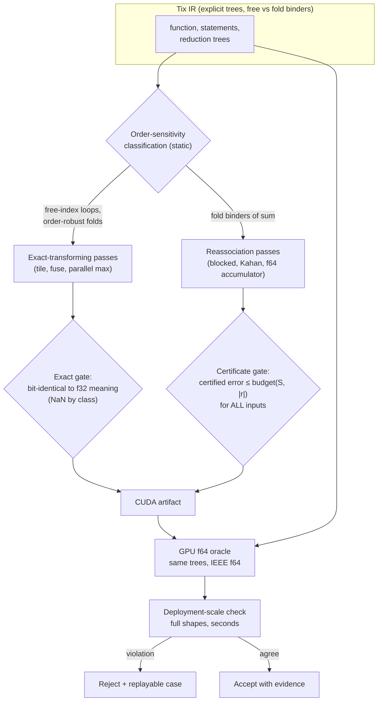
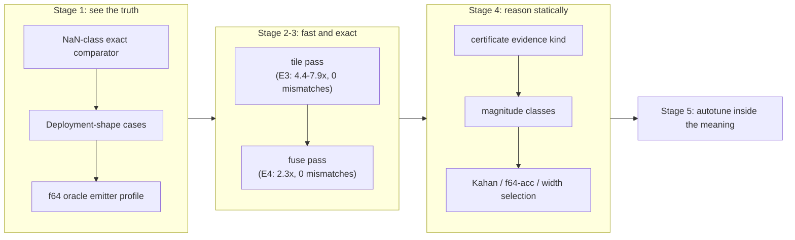

# Best in class for Tix: trustworthy speed

## 1. What "best in class" should mean for Tix

Tix will never out-vendor NVIDIA at raw kernel speed, and it should not try to by copying
vendor numerics: cuBLAS gets its last factor with tensor cores and fused multiply-adds, both
of which *change the meaning of the program*. The defensible axis is the one Tix already owns
and nobody else occupies: **an exactly specified f32 meaning that every transformation must
respect, enforced by checked passes in the v6 framework.** This document argues that the best
in class for Tix is **trustworthy speed**: performance within a small factor of vendor
libraries where the price of that performance is *zero unexplained numerical change*, and a
checking apparatus fast enough to run at deployment shapes rather than toy shapes.

Three measurable properties define the target:

| Axis | Metric | Vendor compilers (XLA, TVM, Triton, cuBLAS+fast-math) | Tix today | Tix after this plan |
| --- | --- | --- | --- | --- |
| Guarantee strength | What stands between an optimization and a wrong result | global fast-math flags; sampling tests written by the pass author | sampled tolerance ≤ 4096-element shapes | bit-exactness where provable, static error certificates where not |
| Speed | Fraction of vendor FP32 baseline on the GB10 | 1.0 (by definition) | 0.06–0.5 (naive one-thread-per-element kernels) | ≥ 0.4 at 512³ matmul, ≥ 2× on softmax-class programs |
| Check cost | Time to check one function at its deployment shape | n/a (unchecked) | infeasible (CPU interpreter: ~13 min for matmul 512³ alone) | seconds (GPU oracle) |

The positioning claim is a Pareto argument. Every production tensor compiler trades
numerical fidelity for speed with a *global, unquantified* flag: reassociation, FMA
contraction, and reduced-precision transcendentals are all-or-nothing and carry no per-program
statement of what changed. Tix's checked-pass framework makes each transformation state its
obligation — exact, or within a declared budget — and the framework's differential machinery
already produces replayable evidence. What Tix lacks is (a) transformations that exploit the
meaning instead of merely preserving it, (b) budgets that mean something at deployment scale,
and (c) a checker that can see deployment scale at all. The experiments in this ticket measured
all three gaps and found the third is the most urgent: **the current sampled gate accepts
programs that violate its own budget at deployment shapes, on three of the six corpus
programs** (§4, E5).

The rest of this document proposes the work in ranked order (§2–§4), gives the staged plan
(§5), and records what did not work (§6). Every quantitative claim below was measured on this
machine or on the GB10 with the scripts under `scripts/`; the diary records commands, hashes
and raw outputs.

## 2. Rank 1 — Meaning-preserving parallelization: checked tiling and fusion

### The idea

Add two transformation families, each a checked pass producing a CUDA artifact:

1. **Tile** — for a statement whose output axes are free binders and whose reads are affine,
   emit a shared-memory tiled kernel with register blocking instead of the one-thread-per-
   element kernel. The fold binders keep their sequential order *within one output element*.
2. **Fuse** — merge consecutive statements into one kernel when the producer's consumers are
   expressible in registers/shared memory, keeping every statement's arithmetic tree and
   rounding sites, and keeping the *order* of every fold.

Both passes are gated **exactly**: the candidate CUDA program must be bit-identical to the f32
meaning (with NaNs compared by class, per the Stage-2 report's recommendation), not merely
within tolerance. This is the step that turns "an exactly specified meaning" from a
description of the interpreter into an *optimization constraint* — and it is the property no
fast-math compiler can offer at any speed.

### Why it works (the theory)

The Tix IR separates two kinds of loop index, and that separation is exactly the information a
scheduler needs to know what it may parallelize without changing results:

- **Free binders** (output coordinates): each output element's value is an independent
  computation. Remapping which thread computes which element, tiling the free-index loops, and
  staging operands through shared memory change *memory access* only. Every arithmetic
  operation happens with the same operand bits, in the same per-element order. This is the
  same algorithm/schedule separation Halide exploits (Ragan-Kelley et al. 2013) and Triton
  formalizes for tiled programs (Tillet, Kung, Cox 2019) — but here the schedule space is
  *restricted to meaning-preserving points*, and the framework checks membership rather than
  assuming it.
- **Fold binders of `max`**: the Tix `minmax` semantics (NaN-propagating, +0 over mixed zeros)
  is associative, commutative and idempotent as a total function on f32 words, so any
  evaluation tree — including a parallel reduction tree — yields the identical result. The
  proof is a finite case analysis over the zero/NaN cases of the emitted helper; it belongs in
  the pass's rationale, and the exact gate then verifies it on sampled cases.
- **Fold binders of `sum`**: f32 addition is not associative; the fold order is part of the
  meaning. Exactness therefore *constrains* the parallelization: the sequential order must be
  preserved within each output element's fold. This sounds like a fatal restriction for
  reductions, and E4 shows it is not: the fold's dependency chain is cheap **when its operands
  are staged** — the serial chain must contain only register/shared-memory loads and f32 adds,
  never a double-precision transcendental.

Fusion preserves meaning for a second, independent reason: in the emitted program an f32
store followed by an f32 load is an exact round-trip, so materializing an intermediate tensor
adds no rounding sites. Removing the store/load (fusing) removes no arithmetic — unlike a
compiler that fuses by reassociating, Tix's fusion is an *addressing* transformation. That is
why inline is exactly checkable today, and statement-level fusion is the same argument
extended across kernels.

### What is new

Checked-pass frameworks usually gate *scalar* rewrites; GPU schedulers usually optimize
without semantic gates. The combination — a scheduler whose every schedule is validated
bit-for-bit against an exact meaning, on the actual GPU — is the new thing here, and it is only
available because Tix's IR keeps folds explicit and the framework keeps every transformation
behind a gate. The order-sensitivity classification is also new in this setting: today's
split-sum pass reassociates blindly and the gate *discovers* the error empirically; the
classification derives exactness from IR syntax before any execution.

### The evidence

**E3 — tiled matmul, bit-exact and fast (GB10, `--timed`, medians of 20 event-timed runs).**
A hand-written kernel with 64×64 block tiles, 4×4 register tiles, 32-deep k panels, and the k
walk kept sequential and in increasing order:

| Size | Naive stage-2 kernel | Tiled, exact gate territory | cuBLAS FP32 (coordinator) |
| --- | ---: | ---: | ---: |
| 512³ | 0.215 ms (1.25 TFLOP/s) | **0.0495 ms (5.43 TFLOP/s, 4.4×)** | 0.0329 ms (8.15 TFLOP/s) |
| 1024³ | 2.041 ms (1.05) | **0.262 ms (8.19 TFLOP/s, 7.8×)** | — |
| 2048³ | 16.789 ms (1.02) | **2.134 ms (8.05 TFLOP/s, 7.9×)** | 19.2 TFLOP/s at 4096³ |

**Bitwise mismatches vs the naive kernel: 0 of 262,144; 0 of 1,048,576; 0 of 4,194,304.**
At 512³ the exact tiled kernel is within 1.5× of cuBLAS; at 2048³ it reaches 42% of cuBLAS's
4096³ rate. The **exactness tax** — the same kernel with `fmaf` replacing the separate
multiply and add rounding sites — is only **14–21%** (6.2 / 9.5 / 9.7 TFLOP/s). Two
conclusions: bit-exact performance at 4–8× the current lowering is available *now*, and the
remaining gap to cuBLAS is implementation quality (deeper register tiles, double buffering,
warp specialization), not the meaning. Notably, contraction — the first thing a fast-math
flag would take — buys ~15%; a compiler that sells meaning for speed is selling it cheap
here.

**E4 — fused softmax (GB10, softmax 4096×1024, medians of 20).**

| Variant | Median | Bit-exact vs naive lowering? |
| --- | ---: | --- |
| naive 4 kernels (stage-2 shape) | 0.76–0.88 ms | (reference) |
| fused, fold with double-exp in the chain | **12.2 ms** | yes, but useless |
| fused, parallel max + staged e + exact sequential fold | **0.354 ms (2.3× faster)** | **0 / 4,194,304 mismatches** |
| fused, order-changing tree sum | 0.712 ms | no — 4,100,331 words differ (max 5.6e-8) |

The instructive failure is the second row, and the instructive comparison is the last two
rows: the variant that *breaks* the meaning to parallelize the sum is **slower** than the
variant that keeps it, because the exact variant computes `e` once into shared memory while
the tree variant recomputes the transcendental. Exactness cost nothing; sloppiness cost both
accuracy and time. (A confound is recorded in §6: the tree variant's extra exp is an artifact
of my prototype, not a law — the honest claim is "exactness need not cost", not "exactness is
always faster".)

The 12.2 ms row refuted my initial hypothesis that exact fusion is free. The refinement it
forced — **the fold's serial chain may contain loads and adds, never expensive ops** — is a
design rule the fusion pass can check statically: walk the fold body's tree; anything not
lifted out of the fold (loads of staged values, the accumulator add) must be an f32 add-class
operation. That rule, plus the order-independence proof for max, is the pass's preparation
check; the exact gate then verifies the emitted kernel on the GPU.

### Risks

- **Occupancy and tile-shape sensitivity.** The 32×32 first attempt reached only 1.08× (E3,
  §6); tile shapes need a small autotune. The save is that the search space is
  meaning-preserving by construction, so autotuning cannot silently break numerics.
- **Shared-memory capacity** bounds tile and fusion width; the pass must check capacity like
  it checks extents.
- **The exact gate needs the NaN-class comparator** on GPU outputs (stage-2 probe: GPU wrote
  `0x7fffffff`, JS `0xffc00000` for one NaN case). Without it, bit-exactness claims must be
  scoped to NaN-free executions — acceptable for the corpus but a real scope limit.
- **Fusion across reductions with wide extents** (e.g. layernorm's variance fold) hits the
  same serial-chain rule; staging cost grows with the fold extent and must be measured per
  program (conv2d's 3×3×C fold is short — likely easy; layernorm's D=1024 fold is the test).

### Success measures

- Bit-exactness: 0 mismatched words on every corpus program and every GPU test input, before
  and after other passes.
- Speed: matmul ≥ 4× at 512³ (met in prototype); softmax ≥ 2× (met); layernorm ≥ 2×
  (untested — first thing to measure).
- Check cost: each pass's exact gate runs on the GPU in the existing batch protocol (the
  Stage-2 runner already batches cases; the gate comparator changes, the transport does not).

### What it needs from `src/framework`

The heterogeneous transformation path (Stage 2) already accepts a Tix-IR input and a CUDA
artifact output with an awaited invariant. Three additions, all in the contracts layer:

1. An **exact comparator with NaN-by-class** for CUDA subjects (the differential spec's
   `compare` is application-defined today; the tensor domain supplies a strict comparator).
2. A **case-domain extension** so the gate's sampled cases can include deployment shapes
   (Proposal C supplies the oracle that makes large cases decidable).
3. Nothing in the pass runner: tiling and fusion are native transformations with declared
   writes, and the existing `defineTransformation` + `AnalysisManager.execute` flow carries
   them.

## 3. Rank 2 — Certified error budgets for reduction rewrites

### The idea

Replace the sampled tolerance gate for reassociation passes with a **static certificate**: for
a candidate reduction tree, compute a rigorous bound on

    |candidate(x) − exact(x)|  for all f32 inputs x with declared magnitudes,

and admit the rewrite iff the certificate fits a budget that is itself stated as a function of
the input magnitudes — not a fixed constant. The certificate is computed from the IR's explicit
reduction tree: for a sum of n terms with |x_i| ≤ B (so S = nB bounds Σ|x_i|), the classical
forward bounds (Higham 2002, ch. 3; unit roundoff u = 2⁻²⁴) are

| Tree | Certified forward error |
| --- | --- |
| sequential fold | ≈ (n−1)·u·S |
| blocked, width b (split-sum) | ≈ (b + n/b)·u·S |
| pairwise / cascade | ≈ (log₂n + 1)·u·S |
| Kahan / two-sum (Ogita–Rump–Oishi 2005) | ≈ 2·u·S, independent of n |
| f64 accumulator, single final round | ≈ u·S + final rounding |

The pass then has a *menu* of certified trees and picks by (certificate, measured GPU cost).
Two consequences: admission no longer depends on which toy shapes the sampler happened to
draw, and the budget can be stated to the user as "error ≤ c·u·Σ|xᵢ| for your declared input
range", which is a sentence about their program rather than a magic constant.

### Why it works

Every rounding site in a Tix program is explicit in the IR, so the error of a reduction tree
is a *compositional* function of the tree: standard backward/forward error analysis applies
term by term, and the only program-dependent quantity is the magnitude class of the inputs.
The existing tolerance gate is *empirical* — it compares candidate f32 against the f64
evaluator on generated cases — so it is blind to every input outside the sample domain. A
certificate is sound over all inputs in the declared class (given no overflow, which the
class also bounds). The two mechanisms are complementary and the design keeps both: the
certificate proves, the sampled gate spot-checks the proof's assumptions (magnitudes, no
overflow).

### What is new

Error certificates for floating-point programs are established technology — FPTaylor
(Solovyev et al. 2018) produces rigorous Taylor-interval bounds; Satire (Das et al. 2020)
scales them to large straight-line code; Herbie (Panchekha et al. 2015) *searches* for
accuracy-improving rewrites; Ahrens–Demmel–Nguyen (2020) make parallel summation reproducible.
What none of them integrate with is a **checked-pass compiler**: certificates here are not a
report printed by an external tool, they are the *evidence object* a pass must produce to have
its rewrite accepted, stored and replayed in the framework's evidence cache like any other
invariant result. And the certificate's *consumer* is the scheduler: block width, accumulator
precision and reduction shape are chosen to satisfy a declared budget at the cheapest measured
cost — an optimization problem the IR's explicit trees make well-posed.

### The evidence

**E1 (local, exact-real oracle via BigInt rationals).** For n=1024 sums (details in the
diary): measured max error vs exact over 200 random trials was 9.7e-5 (sequential), 2.7e-5
(blocked w=4, i.e. what split-sum emits), 8.2e-6 (w=32), 5.0e-6 (pairwise), 1.8e-6 (Kahan and
f64-accumulator). Under adversarial cancellation (exact sum ≈ 0) the ordering held and the
f64-accumulator variant was **exact** (error 0 beyond the final rounding). The certified
Higham bounds hold but are 100–300× looser than measured random-case error — sound
certificates, loose thresholds; the design consequence is that certificates *admit* rewrites
(guard against unsound ones) while measurement *ranks* them.

**The sampling gap, quantified twice.**

- E1: what the split gate actually compares (|blocked − sequential|) is ≤ 4.8e-7 at the
  sampled scale (n ≤ 7 — always inside the 2e-6 budget) but reaches **1.1e-4 at n=1024 under
  cancellation, exceeding the budget in 49/50 trials**.
- E5: at deployment shapes with the same [-1,1] input distribution, three of six corpus
  programs violate the Stage-2 budget outright (matmul 148 elements up to 3.2× budget;
  attention 15,552 of 65,536; mlp 2,340 up to 36×). The gate that accepted them saw only
  ≤ 7-term sums.

**E6 — the rewrites themselves mispriced.** The split-sum-optimized matmul at 512³ runs
**0.312 ms vs 0.214 ms original — 46% slower on the GPU** — and still shows 18 budget
violations at deployment scale (max 1.3×). The only numeric rewrite in the optimizer was
designed around a CPU witness, and neither its GPU cost nor its deployment-scale error was
visible to the gate that accepted it. A certificate-plus-cost-model pass would have selected
w=32 (E1: 3.3× smaller error than w=4, and one flat fold per 32 elements instead of two nested
folds per 4).

### Risks

- **Magnitude classes need surface syntax** (e.g. `@range(-1,1)`) or inference; without them
  the certificate is only as good as its assumption. This is product-code work in `src/tensor`
  (parser, checker) and belongs to a follow-up ticket; the prototype can use API-level
  declarations.
- **Certified ≠ tight.** Higham-style bounds are 100–300× loose on random data; FPTaylor-style
  interval refinement would tighten them at analysis cost. The staged plan (§5) starts with the
  cheap bounds and measures how often looseness actually blocks a rewrite the sampled gate
  would have accepted.
- **The f64-accumulator pass changes the meaning's *shape*** (a wider intermediate): it is
  admissible only under a tolerance/certificate relation, never the exact gate. Fine — but the
  optimizer's pass list must keep exact and certified rewrites distinguishable, which the
  existing `{pass, accepted}` step record does not surface; extend it with the relation kind.

### Success measures

- Soundness: for every admitted rewrite, measured error ≤ certificate on randomized
  adversarial inputs (the E1 harness, scaled up) — a property *tested by trying to break it*.
- Admission parity: on the six corpus programs plus a random-program suite, the certificate
  gate admits every rewrite the current sampled gate admits, plus rewrites whose advantage
  only appears at scale (Kahan, wider blocks).
- Deployment agreement: after P3 lands, no admitted rewrite violates its budget at deployment
  shapes.

### What it needs from `src/framework`

A new evidence kind beside `differential`: the invariant's `describe`/evidence record gains a
`certificate` payload (bound formula, parameters, assumed magnitude classes). The
`differential` invariant's structure (`decide`, replayable verdicts) already fits; what
changes is that some verdicts are *derived*, not sampled. No runner changes. Optionally, the
strategy layer (already present: builders, registry, validation) hosts the
certificate-vs-cost selection policy.

## 4. Rank 3 — The deployment-scale f64 oracle

### The idea

Check the lowering **at the shapes the user actually runs**, against an f64 oracle executed on
the same GPU. The oracle is generated from the same IR by the same emitter (float→double,
`__d*_rn` intrinsics; the transcendental path is already double), so oracle and candidate walk
identical trees. This decouples check cost from the Node interpreter — whose full-size matmul
f64 run costs ~13 minutes (781 s at f32; the stage-2 report's measurement) — and makes the
deployment-scale check of all six corpus programs cost **~7–11 s wall each, of which ~0.3 s is
GPU compute** (E5).

### Why it works

For +, −, ×, ÷ and sqrt, IEEE-rounded double arithmetic is uniquely determined, so a GPU f64
kernel that walks the same tree as the CPU f64 evaluator is **bit-identical** — measured, not
assumed: matmul 45/45, layernorm 65/65, conv2d 160/160 words identical (E5b). The only
divergence is double `exp`/`log`/`tanh`, where CUDA's libm and V8's differ by at most
**2.15 ulp** on the sampled domain (softmax 8/66, attention 4/20, mlp 1/12 elements). The
Stage-2 report already records the coordinator's exhaustive result for the *f32* path: for all
2³² f32 inputs, CUDA's double exp/log/tanh rounded to f32 equal the JS meaning — so the f32
candidate is exact; the residual question is only the oracle's own fidelity on transcendental
programs at f64, and 2 ulp is orders of magnitude below every budget in play.

### What is new

"Check at deployment scale" sounds obvious; what makes it non-obvious is that the reference
evaluation, not the candidate execution, is the expensive side. The insight specific to Tix:
**the oracle is just the lowering run in a different precision.** The same emitter, the same
tree, the same batch protocol — the oracle is a *profile* of the existing checked lowering, not
a second implementation to maintain. That is only true because the emitter reproduces rounding
sites explicitly; a fast-math compiler has no such oracle.

### The evidence

E5's table (§1 of the findings): full-scale element counts of 262,144–4,194,304 checked in
~0.3 s of GPU time per program; three budget-violation findings that the sampled gate cannot
see; oracle validated bit-identical on all arithmetic-only programs. E6 reuses the oracle for
the optimized revision.

### Risks

- **Oracle drift**: a CUDA libm update could change double-transcendental results; the sampled
  equivalence check (cheap, part of the check) catches it.
- **Memory**: f64 buffers double the footprint; 4096³ matmul f64 needs 3×512 MB — fine on the
  GB10's unified memory, but the case generator must respect a memory budget like it respects
  the 4096-element sampling cap today.
- **Managed-memory first-touch** costs are real on the GB10; the check's wall time is
  dominated by ssh/compile today anyway (~6 s), so this is not the binding constraint yet.

### What it needs from `src/framework`

Nothing structural: case generation gains a "deployment shapes" mode (the differential spec's
`cases` callback is already application-defined), and the batch protocol already carries
arbitrary case counts. The f64 emitter profile is `src/tensor` work. The one framework-shaped
change is conceptual: the baseline key must include the *case domain* (today it includes
revision, function, seed and checker version), so that a toy-domain verdict is never replayed
as a deployment-domain one.

## 5. Staged plan

| Stage | Content | Why this order |
| --- | --- | --- |
| 1 | NaN-class exact comparator; deployment-shape case mode; f64 oracle emitter profile; recalibrate the budget as a magnitude-aware function | Small, unblocks everything, and immediately changes what the gate can see. It will *reject* parts of today's corpus at [-1,1] — that rejection must land together with the magnitude-aware budget (stage 4's formula, plugged in early), or the corpus becomes unbuildable. |
| 2 | `tile` pass with exact gate (prototype exists in E3) | Largest measured win (4.4–7.9×), bit-exact, no new theory. Wire the existing prototype's kernel shape into the emitter; the pass chooses tile shape within capacity limits. |
| 3 | `fuse` pass with the order-sensitivity classification and the serial-chain rule (prototype exists in E4) | Second-largest win (2.3× on softmax), needs the classification from stage 1's IR analysis, and its gate reuses stage 2's exact comparator. |
| 4 | Certificates: evidence kind, magnitude-class API, Kahan and f64-accumulator passes, block-width selection | Needs stages 1–3's vocabulary and the deployment oracle to validate against. This is where reassociation stops being guesswork. |
| 5 | Variant autotuning inside the meaning-preserving space; check-time budget as a first-class metric | Only after the space is safe to search. |

The dependency logic: **make the checker able to see the truth first (stage 1), then give it
fast programs to check (2–3), then let it reason statically (4), then search (5).** Reversing
the first two stages would optimize kernels the checker cannot yet judge at scale; skipping
stage 1 entirely means every later speed claim rests on toy-shape evidence — the exact failure
mode E5 caught.

## 6. What did not work

- **Naive exact fusion of softmax (12.2 ms, 16× slower).** The first fused-exact kernel folded
  the row sum with the double-precision `exp` inside the sequential chain. The fold order was
  preserved and the result was bit-exact, but a 1024-deep dependency chain containing a
  transcendental per link is catastrophic. Fix: stage `e` in shared memory in parallel, fold
  only the adds. This refutation produced the design rule in §2.
- **32×32 tiled matmul (1.08×).** The first tiling had one accumulator per thread and 32
  FMAs between barriers: latency-bound, and bank conflicts on the B-tile reads. Register
  blocking (4×4) with padded shared tiles fixed it (4.4×). Lesson: meaning-preserving does not
  mean effort-free; the schedule space still needs normal GPU engineering.
- **My own harness's index decode.** The first E4 run reported 94% output mismatch; the bug
  was in my hand-written naive kernel (2-D coordinate decode applied to a 1-D output), not in
  the fused kernel. The lesson is the framework's reason to exist: a hand-ported kernel
  without a meaning check silently computes the wrong rows, and only a checked comparison
  turns "looks plausible" into "is the meaning".
- **The oracle's literal fidelity.** The first f64 oracle transform kept f32-rounded literal
  words (`__uint_as_float(0x…)`), so the mlp oracle disagreed with the CPU f64 evaluator by
  10⁸ ulp — the GELU constants matter at full precision. Fixed by mapping each emitted f32
  literal word back to its full-precision double via the IR's literal texts.
- **Higham bounds as acceptance thresholds.** Sound but 100–300× loose on random data; as a
  gate they would reject useful rewrites. They work as *certificates paired with declared
  magnitude classes and measurement*, which is what the design adopts.
- **The sampled gate's transferability (the central negative result).** E1 and E5/E6 both show
  the same thing from two directions: gate evidence collected at n ≤ 7 does not predict
  behavior at n = 512–1024, for either error (49/50 trials over budget) or speed (+46% kernel
  time undetected). Any future "we checked it on small shapes" claim in this framework should
  be treated as evidence about small shapes only.

## 7. Summary of measured results

| # | Experiment | Machine | Headline result |
| --- | --- | --- | --- |
| E0 | API probe | local | pipeline works end-to-end; split structure visible in emitted CUDA |
| E1 | exact-real summation study | local (BigInt oracle) | blocked-4 error 2.7e-5 → Kahan 1.8e-6 at n=1024; sampling gap 4.8e-7 (n=7) vs 1.1e-4 (n=1024) |
| E3 | tiled matmul | GB10 | bit-exact, 4.4–7.9× over naive, 5.4–8.2 TFLOP/s; exactness tax 14–21% |
| E4 | fused softmax | GB10 | exact fusion 2.3× faster AND bit-exact; naive exact fusion 16× slower (refuted, then fixed); tree-sum variant slower and inexact |
| E5 | f64 oracle at deployment scale | GB10 | oracle bit-identical (arithmetic) / ≤2.15 ulp (transcendentals); 3 of 6 programs violate budget at deployment shapes; check ~0.3 s GPU vs ~13 CPU-min |
| E6 | optimized program at scale | GB10 | split-sum: +46% GPU time, still 1.3× over budget — invisible to its own sampled gate |

## References

1. N. J. Higham. *Accuracy and Stability of Numerical Algorithms*, 2nd ed., SIAM, 2002.
2. T. Ogita, S. M. Rump, S. Oishi. "Accurate Sum and Dot Product." *SIAM J. Sci. Comput.*
   26(6), 2005. https://dl.acm.org/doi/10.1137/030601818
3. W. Ahrens, J. Demmel, H. D. Nguyen. "Algorithms for Efficient Reproducible Floating Point
   Summation." *ACM TOMS* 46(3), 2020. https://dl.acm.org/doi/10.1145/3389360
4. A. Solovyev, M. S. Jacobsen, Z. Rakamarić, G. Gopalakrishnan. "Rigorous Estimation of
   Floating-Point Round-off Errors with Symbolic Taylor Expansions." *ACM TOPLAS* 41(1), 2018
   (FPTaylor). https://soarlab.org/papers/2018_toplas_sbbjrg.pdf
5. A. Das, I. Briggs, G. Gopalakrishnan, P. Panchekha, S. Krishnamoorthy. "An Abstraction-guided
   Approach to Scalable and Rigorous Floating-Point Error Analysis" (Satire; also SC 2020 as
   "Scalable yet Rigorous Floating-Point Error Analysis"). arXiv:2004.11960, 2020.
   https://arxiv.org/abs/2004.11960
6. P. Panchekha, A. Sanchez-Stern, J. R. Wilcox, Z. Tatlock. "Automatically Improving Accuracy
   for Floating Point Expressions." *PLDI 2015* (Herbie).
   https://herbie.uwplse.org/pldi15-paper.pdf
7. P. Tillet, H. T. Kung, D. Cox. "Triton: An Intermediate Language and Compiler for Tiled
   Neural Network Computations." *MAPL 2019*. https://dl.acm.org/doi/10.1145/3315508.3329973
8. T. Dao, D. Y. Fu, S. Ermon, A. Rudra, C. Ré. "FlashAttention: Fast and Memory-Efficient
   Exact Attention with IO-Awareness." *NeurIPS 2022*.
9. J. Ragan-Kelley et al. "Halide: A Language and Compiler for Optimizing Parallelism,
   Locality, and Recomputation in Image Processing Algorithms." *PLDI 2013*.
10. J. Demmel, Y. Hida. "Accurate and Efficient Floating Point Summation." 2004 (compensated
    and cascade summation with input-size-independent bounds).
