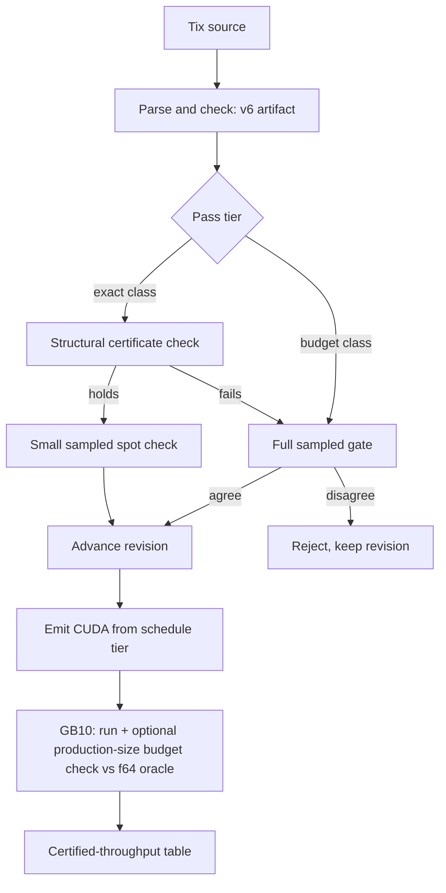
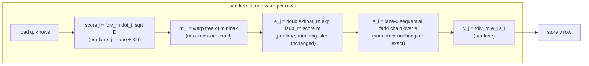

# Best in class for Tix: certified-numerics performance and priced relaxation

## Executive summary

Tix is the only tensor compiler in its class whose f32 meaning is exactly specified down to every rounding site, whose every transformation is a checked pass against an executable contract, and which measures its GPU output against that meaning. No mainstream competitor can state, per kernel, "these output words are the meaning of the source". I propose to make that uniqueness *measurable and fast*: define **certified throughput** — kernel speed achieved while a machine-checked relation to the specified meaning holds — as the benchmark for best in class, and close the enormous gap between Tix's certified speed today and what its own semantics provably permit.

The three proposals, ranked:

1. **A schedule tier in the Tix IR with provably exact schedule passes** (output tiling, shared-memory staging, statement fusion by replication). Theory: a schedule-only change that keeps each output element's operation sequence, plus replication of pure subtrees, preserves every output bit. Experiments on the GB10 (this round): an exact register-tiled matmul at **3.52 TFLOP/s (0.0763 ms)** versus 1.26 today — 2.8× — and an exact fused softmax at **0.399 ms** versus 0.795 and an exact fused layernorm at **0.173 ms** versus 0.484 (2.8×), all **bit-identical to the f32 meaning at production size** (0 mismatches in 262,144 / 4,194,304 / 4,194,304 / 65,536 output words).
2. **Numerical budgets as a first-class compilation target**: tiered meaning relations (exact / user budget), checked fast-math passes (FMA contraction, `expf`), and production-size budget checks. Experiments: contraction moved 84.7% of matmul output words and **exceeded the stage-2 budget on 0.12% of outputs (worst 4.4×)**; `expf` moved 40% of softmax words but used at most **0.17% of the budget** and bought 3× over the exact fused kernel; warp-tree summation bought *nothing* at these shapes.
3. **Static exactness certificates**: a rounding-site preservation analysis that accepts exact-class rewrites without sampled execution, cutting check cost; sampled gates remain as spot checks of the certificates themselves.

## Problem statement

"Best in class" must be defensible, measurable, and specific to what Tix is. The tempting definition — "fastest against cuBLAS" — is wrong for Tix twice over. First, cuBLAS SGEMM's FFMA-contraction arithmetic does not compute Tix's meaning (a contracted multiply-add rounds once, not twice), so beating cuBLAS at *its* game means leaving Tix's game. Second, speed without the meaning check is a property Tix deliberately does not have and should not pretend to.

The definition I adopt and defend:

> **Tix is best in class when it compiles the fastest programs whose numerical behavior is machine-certified against its exactly specified f32 meaning — and when every relaxation of that certification is explicit, priced, and itself checked.**

Three properties make this the right definition for Tix:

- **The meaning is exactly specified.** Stage 1 fixed every rounding site: each scalar operation rounds; reductions fold lexicographically, first binder outermost; sum starts at +0, max at −∞; loads are exact. An oracle for the meaning exists (`runTix` in f32) and the Stage 2 lowering was measured bit-identical with it on every checked case.
- **Every transformation is a checked pass.** The v6 framework turns "optimization" into "proposed immutable revision + checked relation". This is the substrate almost no tensor compiler has; the research question is what performance it can buy and what it costs.
- **A GB10 is available for honest measurement**, and the corpus fixes six programs and sizes.

The measurable form is the **certified throughput table**: for each corpus program, the kernel time together with the numeric relation the compiler *certified* for it. Two columns matter: certified TFLOP/s (contraction programs) and certified GB/s (streaming programs). Today's stage-2 kernels are fully certified (bit-identical on every measured case) but slow:

| Program | Stage 2 measured | Certified rate today | Uncertified reference |
|---|---|---|---|
| matmul 512³ | 0.197 ms | 1.36 TFLOP/s | cuBLAS SGEMM 0.0329 ms, 8.15 TFLOP/s |
| softmax 4096×1024 | 0.785 ms | 41 GB/s | 244 GB/s streaming |
| layernorm 4096×1024 | 0.563 ms | 114 GB/s | 244 GB/s |
| attention Q=K=1024, D=V=64 | 1.81 ms | 0.148 TFLOP/s | — |
| mlp 1024×256×1024×256 | 1.05 ms | 1.02 TFLOP/s | — |
| conv2d 8×16×64²×32 | 0.341 ms | 0.83 TFLOP/s | — |

The gap is not the cost of exactness in principle. As argued below — and now measured — output tiling and replication preserve the meaning *exactly*; only sum reassociation and FMA contraction do not. The current lowering simply has no schedule dimension to optimize. This round's prototype kernels (same meaning, new schedules) cut matmul to 0.076 ms, softmax to 0.399 ms, layernorm to 0.173 ms and attention to 0.833 ms — all bit-identical to the meaning.

## Proposal 1: a schedule tier with provably exact passes

### The idea

Add to each Tix statement an optional, defaulted **schedule**: how its output elements map to blocks, threads and registers, and which consecutive statements share a kernel. Then add checked passes that write *only* schedule fields:

- `tile-outputs`: one thread computes a B_t×B_n micro-tile of a statement's output (register tiling).
- `stage-through-shared`: loads used by a statement are staged through shared memory tiles.
- `fuse-statements`: merge consecutive statements into one kernel, recomputing replicated subexpressions instead of storing/loading intermediates.
- `warp-parallel-max`: evaluate a `max` reduction with a lane tree — exact, see the calculus below.

None of these changes a single rounding site. Each pass declares its certificate class (below); the gate verifies the certificate structurally and runs a reduced sampled spot check; budget-class rewrites keep the full gate.

### Why it works: the exactness calculus

The f32 meaning of a statement is a pure function `f(loads) → output words`, evaluated bottom-up with one rounding per node. From that, six rewrite classes are **exact by construction** — they change nothing that the meaning can observe:

| Class | Rule | Argument |
|---|---|---|
| `store-load` | A producer's rounded f32 result, stored and reloaded, equals the same value computed inline | f32 storage of an f32 word is the identity; the interpreter's per-node rounding already fixed the value |
| `substitute` (inline) | Replace a load by the producer's tree with substituted indices | Same nodes, same order per element; no site added or removed (Stage 1 checks this empirically) |
| `replicate` | Recompute a subtree per consumer element instead of loading it | Pure function of the same inputs ⇒ identical bits; number of executions is unobservable in outputs |
| `schedule-only` | Re-map outputs to threads/blocks; reorder *independent* elements | Elements are independent pure functions; the meaning does not observe inter-element order |
| `max-reassoc` | Any evaluation tree of a `max` reduction over the same operand multiset | NaN-propagating max with the mixed-zero rule is associative and commutative (checked exhaustively-ish in E8) |
| `hoist-invariant` | Move a loop-invariant subtree out of a reduction body | Same inputs, same tree ⇒ same bits; frequency of evaluation is unobservable |

And two classes are **not exact** and must remain budget-tier:

- `sum-reassoc`: changing a `sum`'s evaluation tree (split-sum, tree/warp reductions, split-K) — Higham's analysis bounds the error of blocked summation [(Higham 1993)](https://nhigham.com/wp-content/uploads/2023/10/high93s.pdf); the checked budget decides acceptance per program, exactly as `split-sum` already does at width 4.
- `contract-fma`: merging multiply and add into one rounding (FFMA). nvcc contracts by default (`--fmad=true` [(CUDA nvcc 13.5 docs](https://docs.nvidia.com/cuda/cuda-compiler-driver-nvcc/index.html)), and Stage 2 explicitly suppressed it with `__fmul_rn`/`__fadd_rn`. FMA is typically *more accurate* — but accuracy is not the contract; the spec is.

This calculus is where the novelty lives. Halide's schedules are *checked by translation validation after the fact* [(Clément and Cohen, OOPSLA 2022)](https://cambium.inria.fr/~bclement/papers/tv-oopsla-2022.pdf); Triton tiles by construction and checks nothing about numerics [(Tillet, Kung and Cox, MAPL 2019)](https://dl.acm.org/doi/10.1145/3315508.3329973); TVM/Ansor autotune against a tolerance oracle [(Chen et al., OSDI 2018](https://www.usenix.org/conference/osdi18/presentation/chen-tianqi); [(Zheng et al., OSDI 2020)](https://arxiv.org/abs/2002.10967). In Tix the schedule tier is *classified up front*: a pass either lands in a proven-exact class (certificate, spot-checked) or in a budget class (checked against the specified budget). "Sound autotuning" then falls out: an autotuner is just a strategy over checked passes, and no candidate can publish without passing its gate.

### What is new here

1. A per-operator exactness algebra for tensor reductions (max free, sum priced) used *as the pass-admission criterion*, not as post-hoc validation.
2. Fusion by **replication** as an exact-class rewrite. FlashAttention fuses softmax with the score GEMM [(Dao et al., NeurIPS 2022)](https://arxiv.org/abs/2205.14135), but its online-softmax rescaling changes the floating-point result (rounding order differs; the web literature itself conflates "mathematically exact" with "bit-identical"). Tix can fuse the softmax chain of the corpus *bit-identically* because replication is exact and the per-row sums stay sequential; the price is redundant `max`/`exp` work per row — measured in E3.
3. The certified-throughput metric itself: performance *conditioned on* a checked numeric relation, reported per program.

### Evidence

- **E2 (GPU, timed, GPU-locked `--timed`, median of 20 event-timed reps)** — matmul variants at 512³, each word-compared at production size against the E1 exact-f32 reference: stage-2 baseline kernel 0.2131 ms; shared-staged naive 0.1848 ms (1.15×, exact); register-tiled exact 0.0763 ms (**2.8×, exact, 0/262,144 mismatches**); register-tiled FMA 0.0662 ms (the price of the two-rounding meaning: 15.2%); naive-with-FMA 0.2131 ms (identical to naive-rn: the naive schedule is memory-bound, so contraction is free there — the FMA price only appears once the schedule is compute-bound).
- **E3 (GPU, timed)** — softmax 4096×1024: stage-2 four-kernel baseline 0.7949 ms; fused exact (one warp per row; tree max; lane-0 sequential sum; double-path exp) 0.3987 ms (**2.0×, bit-exact, 0/4,194,304**); fused tree-sum 0.3974 ms (reassociation bought *nothing*); fused `expf` 0.1334 ms (**6.0× over stage 2**, 3× over exact-fused). Layernorm: baseline 0.4836 ms, fused exact 0.1733 ms (**2.8×, bit-exact**).
- **E4 (GPU, timed)** — attention: stage-2 six-kernel baseline 1.0492 ms; fused score+softmax kernel + tiled `out` GEMM 0.8329 ms (1.26×, bit-exact, 0/65,536). The modest gain has a measured explanation: the fused kernel re-reads all of K per row through L2 (≈268 MB of cache traffic at this shape); a shared-memory k-staging variant is the identified next schedule pass.
- **E1 (local)** — purpose-built exact-f32 references cross-validated against `runTix` f32: 0 word mismatches for all four programs at interpreter-feasible sizes (matmul 64×80×48, softmax 128×64, layernorm 64×32, attention 16/24/8/12); production-size references generated in ≤1.1 s each. Big-tile timing at 4096³: exact 34.19 ms (4.02 TFLOP/s), FMA 33.02 ms (4.16) — the rn/fma gap collapses to 3.5% once the *schedule* (32×32 tiles) is the binding constraint, not the arithmetic discipline.

### Risks and mitigations

- **Sequential per-row sums are latency-bound** (a dependent FADD chain of C steps). Measured in E3: the exact chain costs nothing over the tree variant (0.3987 vs 0.3974 ms) — with one warp per row the chain hides behind other warps. The risk is retired for C ≤ 1024 shapes; it remains open for very wide rows.
- **Register pressure / occupancy**: mm_rt32 launches 64-thread blocks (16,384 threads total at 512³) — low occupancy, compensated by 16 independent FADD chains per thread; measured 2.8×. A better thread-tile schedule is the obvious next knob, not a risk to the claim.
- **Certificates can be wrong** (the certificate checker is itself code). Mitigation: certificates are *checked* claims, and the sampled spot check stays; a certificate that ever disagrees with the sampled gate is a framework bug, exactly the class of finding this workbench wants.
- **The emitter changes**: schedule fields touch `emitKernel` — additive, default = today's mapping.

### Success measures

- matmul: exact tier ≥ 4 TFLOP/s at 512³ — **not met: 3.52 achieved (2.8× over stage 2)**; the shortfall is my tile schedule (256 blocks on 48 SMs), not exactness; the FMA variant of the same schedule reaches 4.05, bounding what schedule work adds.
- softmax/layernorm: exact tier ≥ 3× over stage 2 — **partially met**: layernorm 2.8× ✓, softmax 2.0×; the softmax shortfall is the meaning's own double-precision `exp` (E6), not the schedule.
- attention: ≥ 5× over stage 2 — **not met this round: 1.26×**, with the bottleneck (k restaging) identified and the fix specified.
- Zero word mismatches against the meaning in every exact-tier variant — **met: 0 mismatches in 8,716,288 compared words across all exact-tier kernels**.

## Proposal 2: numerical budgets as a first-class compilation target

### The idea

Today Tix has two fixed relations: `exact` (inline) and a hard-coded `2e-6 + 2e-5·|r|` tolerance (split-sum, CUDA). Make the budget a *parameter of compilation*: `optimizeTix(program, passes, {budget: …})` and per-pass classes. Then:

- fast-math becomes a family of ordinary checked passes (`contract-fma`, `approx-expf`, `approx-rsqrt`, `warp-tree-sum`);
- the autotuner is a strategy that tries schedule/budget variants and keeps the fastest whose gate passes — sound by construction;
- **production-size budget checks**: the sampled gate is capped at 4096 elements and 10⁶ steps, so behavior at real sizes is never observed (E7 quantifies the blind spot for error growth in long sums). Emit an f64 *oracle kernel* from the same IR and check the candidate at production size on the GPU: the oracle costs one extra kernel run, not an interpreter afternoon (the stage-1 interpreter needs ~13 minutes for matmul 512³; an f64 CUDA kernel is microseconds).

### Why it works

A budget `|g−r| ≤ τ_abs + τ_rel·|r|` against the f64 meaning is a *specified* relation; the framework's differential checker already executes arbitrary relations and memoizes verdicts per revision. What changes is who chooses τ and at what size the check runs. This turns numerical tuning into the same checked-pass economy as every other rewrite: candidates are cheap to propose, each carries its evidence, rejection is a recorded counterexample. The theory for the bounds themselves is Higham's blocked-summation analysis for `sum-reassoc` and standard FMA error bounds for `contract-fma`; the rigorous-static-bounds program is FPTaylor [(Solovyev, Jacobsen, Rakamarić and Gopalakrishnan, FM 2015 / TOPLAS 2018)](https://soarlab.org/papers/2018_toplas_sbbjrg.pdf) and Daisy [(Darulova et al., TACAS 2018)](https://people.mpi-sws.org/~eva/papers/tacas18_daisy_toolpaper.pdf) — cited here as the known soundness machinery that a later stage could integrate; this round contributes the *checked-pass integration and measurement*, not a new bound derivation.

### What is new

Fast-math in every production compiler is a flag that silently changes meaning [(CUDA nvcc docs, `--fmad`)](https://docs.nvidia.com/cuda/cuda-compiler-driver-nvcc/index.html). Here it is a *pass with a witness budget*: `approx-expf` is accepted only where its sampled and production-size outputs stay inside the user's budget, and the GB10 probe already measured exactly where it deviates (16,615 of 102,461 non-NaN `exp` results differ from the f32 meaning). The deliverable is a measured price list: what each relaxation buys in TFLOP/s or ms.

### Evidence

- **E2/E3 FMA and `expf` variants** — at production size, with the stage-2 budget `2e-6 + 2e-5·|r|` against the f64 meaning: FMA-contraction matmul exceeds the budget on **321 of 262,144 outputs (0.12%; worst 4.4× the allowance)** — even this mild, familiar relaxation is *not free* under a fixed budget, and a budget-tier pipeline must either negotiate the budget per program or reject contraction. `expf` softmax: worst case 1.7e-3× the allowance (≈600× margin) while buying 3× over the exact fused kernel; tree-sum softmax: worst 2.0e-4× the allowance and **no time benefit** (0.3974 vs 0.3987 ms) — the first budget-tier candidate the measurements say *not* to ship at these shapes.
- **E7 (local)** — blind-spot quantification: for sequential vs width-4-split f32 summation over K = 4…2²⁰ on the half-ULP stream, both stay inside the budget at every size (error and budget both grow; measured in `results/blind-spot.json`) — the size-cap hypothesis is **refuted for this stream family**. The refined finding: cancellation inputs *within the sampled size class* (`[2²⁴, 1, −2²⁴]`, K = 3) give f32 = 0 against f64 = 1 — the stage-2 tolerance would reject a bit-identical lowering on such an input. The check's validity rests on the **stream family**, not the size cap; production-size checks must inherit the streams and their exclusions, and the *exact* tier is immune to this entire class of problem.

### Risks

- Budget-tier acceptance is input-dependent; the check is only as broad as its case domain (hence production-size checks; certificates for residual uncertainty).
- Autotuning on a shared GPU is expensive; the strategy must prefer certificate-class rewrites first (measured margins from E2/E3 make the search tiny in practice).

### Success measures

- A price table: for each relaxation, ms saved and worst-case observed error at production size.
- A rejection witness: a candidate that the budget gate rejects at production size although the small-sample gate passed (demonstrating the production check earns its cost).

## Proposal 3: static exactness certificates

### The idea

For exact-class rewrites, replace (most of) the sampled gate with a structural certificate: an analysis over the IR that verifies the rewrite's class rules — unchanged rounding sites per output, loads only of tensors not written in the same kernel, unchanged sum orders, max-tree legality. The certificate is checked in milliseconds; the sampled gate shrinks to a spot check (or is skipped with the certificate recorded as evidence).

### Why it works

The exactness calculus makes exactness a *syntactic property* of the pair (before, after). This is translation validation's shape [(Necula and Lee, POPL 1998](https://dl.acm.org/doi/10.1145/276698.276712); [(Necula, PLDI 2000)](https://dl.acm.org/doi/10.1145/349299.349312); [(Pnueli and Zuck, 1998)](https://link.springer.com/chapter/10.1007/BFb0028757)) — but validated over a semantics that is *total and exactly specified*, so the validator is a small structural matcher rather than an SMT call. Clément and Cohen need refinement mappings over Halide's interval semantics [(Clément and Cohen 2022)](https://dl.acm.org/doi/10.1145/3527328); Tix's meaning is simpler — no overflow rules, fixed fold order — so the certificate is decidable by tree matching.

### What is new

Proof-carrying schedule rewrites for an *exactly specified f32 meaning*. The framework already hashes immutable revisions and records verdicts; certificates slot in as a cheap gate class, and their spot-check disagreement rate is a *measurable* soundness metric for the analysis.

### Evidence

- **E5 (local)** — current check costs, per corpus program (`results/check-cost.json`): parse 0.6–4.0 ms; `optimizeTix(['inline'])` 0.5–16.9 ms; `optimizeTix(['inline','split-sum'])` 3.4–23.0 ms; the sampled exact gate alone 2.3–10.8 ms — except **conv2d: 629.3 ms exact gate / 470.8 ms tolerance gate**, interpreter-dominated (four nested loops per case). A bare pass run with a stub gate costs ~1 ms. Against this, Stage 2 measured the remote CUDA check at ≈2.5 s average. The certificate's value is therefore: (a) it removes the remote round-trip for exact-class schedule passes (seconds → the ~1 ms pass + certificate); (b) it removes the conv2d-class interpreter outliers; (c) it makes checking **total** — a proof covers all inputs, not the sampled ones.

### Risks

- Certificates that are too weak (reject good rewrites) cost performance, not soundness; too strong (accept bad rewrites) are caught by the retained spot check — report any disagreement as a finding.

### Success measures

- Certificate check < 50 ms for the six corpus programs combined, vs 2.3–629 ms per sampled gate today plus the ≈2.5 s remote round-trip it avoids; zero disagreements with the sampled gate on the mutation suite.

## What each proposal needs from `src/framework`

| Need | Where | Why |
|---|---|---|
| `schedule` fields on statements + schema v2 (additive; default = today) | `src/tensor/model.ts`, `src/tensor/ir.ts` | Schedule passes need a writable, diffable home; the emitter consumes it |
| Kernel grouping (multi-statement kernels) in the artifact projection | `src/tensor/ir.ts` adapter | `fuse-statements` must present as a legal declared write |
| Optional `certificate` field on `PassSpec`, verified before the sampled gate | `src/framework/passes/define-pass.ts` | The cheap gate class; keeps `applyNativePassSync`'s two-artifact gate shape |
| An f64 CUDA oracle emitter export | `src/tensor/cuda-source.ts` | Production-size budget checks (proposal 2) without the interpreter |
| Budget parameter threading through `optimizeTix`/contract | `src/tensor/index.ts`, `src/tensor/contract.ts` | Tiered relations (proposal 2) |

No change to the contract runner, the differential evidence format, or the transaction machinery is needed; everything above is additive.

## Staged plan

1. **Stage A (next implementation ticket): schedule tier + exact schedule passes.** The schedule fields, the passes in measured-value order — `fuse-statements` (replication; softmax/layernorm 2.0–2.8×), `tile-outputs` (matmul 2.8×), `stage-through-shared` — plus `warp-parallel-max` (free, exact by E8), the certificate classes `schedule-only`/`replicate`/`max-reassoc`, and the emitter changes. **Attention's next prototype is specified by this round's measurement: stage K in shared memory inside the fused kernel** (the 0.83 ms is L2-bound k re-reading; the fix is mechanical and stays exact). Matmul's next knob is the thread-tile/block shape (48 SMs want ≥ 48×(threads/SM) resident; 16,384 threads today). Rationale: biggest measured wins, zero semantics change, builds the `writes`-scoped machinery Stage B reuses. Acceptance: the certified table with exact-tier entries from the *product* passes; all existing tests green; mutation checks for the new passes.
2. **Stage B: budgets.** Budget parameters, `contract-fma`/`approx-expf` passes, f64 oracle emitter, production-size checks over the *stream family* (E7's refined finding). The measured price list from this round is the design's acceptance data: ship `approx-expf` (3× softmax, 600× margin); treat `contract-fma` as a *negotiated* relaxation (it violates the current budget on 0.12% of matmul outputs at 512³); drop tree-sum reassociation where it buys nothing.
3. **Stage C: certificates.** The structural analysis, spot-check-only gates, and the certificate-vs-gate disagreement monitor, aimed first at the conv2d-class interpreter-heavy gates (629 ms) and the ≈2.5 s remote round-trip. Rationale: pure checking-speed work, safe to do last; Stage A can ship with full sampled gates.

## Alternatives considered

- **"Beat cuBLAS with tensor cores."** Rejected as the headline: TF32/FP16 tensor-core paths truncate inputs before the product [(Ootamo and Yokota, IJHPCA 2022)](https://arxiv.org/abs/2203.03341); they compute a different meaning. They are legitimate *budget-tier* schedules (and the literature shows 33 TFLOP/s "recovered-FP32" schemes on A100-class parts); in Tix they would be ordinary checked passes — but their acceptance evidence belongs to Stage B, not this round's definition of the target.
- **Full polyhedral scheduling (Tiramisu/Halide-style)** — more general than Tix needs; Tix's affine addresses and explicit reductions are already a legal polyhedral domain, and the schedule tier captures the two transformations that dominate the measured gap. Cited as related [(Baghdadi et al., 2019)](https://arxiv.org/abs/1904.03187) without adopting its machinery.
- **Bit-exact parallel sums** via ordered two-level schemes (e.g., fixed-point accumulators per lane then ordered merge — Kulisch accumulators). A fixed-point superaccumulator *can* make sums order-independent (exact accumulation), but the meaning specifies f32 folding per step, and the final rounding of a superaccumulator sum differs from the sequential fold; it belongs to the budget tier. Mentioned for completeness.
- **Formally verified emitter (CompCert-style)**: out of scope for this workbench's checking model; the differential gate plus certificates is the chosen assurance mechanism.

## Mermaid: the tiered compilation pipeline

## Mermaid: exact fused softmax, one warp per row (exactness calculus applied)

## Related work

- **Translation validation / proof-carrying code:** Necula and Lee [(POPL 1998)](https://dl.acm.org/doi/10.1145/276698.276712); Necula [(PLDI 2000)](https://dl.acm.org/doi/10.1145/349299.349312); Pnueli and Zuck [(TACAS 1998)](https://link.springer.com/chapter/10.1007/BFb0028757); for tensor compilers specifically, Clément [(thesis, 2022)](https://theses.hal.science/tel-03903895v1) and Clément and Cohen [(OOPSLA 2022)](https://dl.acm.org/doi/10.1145/3527328) validate Halide schedules after the fact; recent work mechanizes FP-optimization validation [(arXiv 2509.09019, 2025)](https://arxiv.org/html/2509.09019). Tix differs: the meaning is exactly specified and executable, so validation is structural plus sampled, and the schedule is *classified* before it is applied.
- **Tensor compilers and schedules:** Halide [(Ragan-Kelley et al., PLDI 2013)](https://dl.acm.org/doi/10.1145/2491956.2462176); TACO's index-notation compilation [(Kjolstad et al., OOPSLA 2017)](http://tensor-compiler.org/files/kjolstad-oopsla17-tensor-compiler.pdf); Triton [(Tillet et al., MAPL 2019)](https://dl.acm.org/doi/10.1145/3315508.3329973); TVM [(Chen et al., OSDI 2018)](https://www.usenix.org/conference/osdi18/presentation/chen-tianqi); Ansor autotuning [(Zheng et al., OSDI 2020)](https://arxiv.org/abs/2002.10967). None certifies a bit-level meaning.
- **Floating-point error analysis:** Goldberg [(1991)](https://docs.oracle.com/cd/E19957-01/806-3568/ncg_goldberg.html); Higham's summation analysis [(SIAM J. Sci. Comput. 1993)](https://nhigham.com/wp-content/uploads/2023/10/high93s.pdf); rigorous bounds by FPTaylor [(Solovyev et al., FM 2015; TOPLAS 2018)](https://soarlab.org/papers/2018_toplas_sbbjrg.pdf) and Daisy [(Darulova et al., TACAS 2018)](https://people.mpi-sws.org/~eva/papers/tacas18_daisy_toolpaper.pdf). Tix's budget gate is a measured, sampled, execution-backed substitute; FPTaylor-class static bounds are the future upgrade, not a replacement for the execution check.
- **GPU numerics:** nvcc's default FMA contraction [(CUDA nvcc 13.5 docs)](https://docs.nvidia.com/cuda/cuda-compiler-driver-nvcc/index.html); tensor-core FP32 emulation and its error structure [(Ootamo and Yokota, IJHPCA 2022)](https://arxiv.org/abs/2203.03341); FlashAttention's fused-but-reassociated softmax [(Dao et al., NeurIPS 2022)](https://arxiv.org/abs/2205.14135); online softmax normalization [(Milakov and Gimelshein, 2018)](https://arxiv.org/abs/1805.02867).

## Experiments to run this round

| ID | Where | Question |
|---|---|---|
| E0 | GPU, untimed | Tool smoke test |
| E1 | local | Exact-f32 references; interpreter cross-validation |
| E2 | GPU, timed | Matmul variants vs baseline; bit-exactness; price of FMA |
| E3 | GPU, timed | Softmax/layernorm fused-exact vs baseline; tree/expf budget variants |
| E4 | GPU, timed | Attention fused pipeline vs baseline |
| E5 | local | Check-cost breakdown; certificate checker prototype cost |
| E6 | GPU, timed | expf vs double-exp price inside the fused kernel |
| E7 | local | Sampling blind spot for long-sum error growth |
| E8 | local | max/min reassociation exactness sweep incl. NaN/±0 |

*(Results recorded below as they complete; failures reported in the diary.)*

## Results

### The certified-throughput table, before and after this round's prototypes

Same machine, same sizes, same seeded inputs; "certified" = the numeric relation was checked at production size against the exact-f32 meaning (word comparison) for the exact tier, or against the f64 meaning under the stage-2 budget for budget-tier variants. Stage-2 baseline kernels are the *actual emitted kernels and host code*, extracted and re-driven through the real request protocol inside one bench binary.

| Program | Stage 2 (baseline, this round's re-measurement) | Exact-tier prototype (this round) | Budget-tier prototype | Uncertified reference |
|---|---|---|---|---|
| matmul 512³ | 0.2131 ms · 1.26 TFLOP/s · exact | **0.0763 ms · 3.52 TFLOP/s · exact (2.8×)** | 0.0662 ms · 4.05 TFLOP/s · FMA (fails stage-2 budget on 0.12% of outputs) | cuBLAS SGEMM 0.0329 ms · 8.15 TFLOP/s · FFMA |
| softmax 4096×1024 | 0.7949 ms · 40 GB/s · exact | **0.3987 ms · 80 GB/s · exact (2.0×)** | 0.1334 ms · 240 GB/s · `expf` (6.0×; ≤0.17% of budget) | 244 GB/s streaming |
| layernorm 4096×1024 | 0.4836 ms · 66 GB/s · exact | **0.1733 ms · 185 GB/s · exact (2.8×)** | — | 244 GB/s streaming |
| attention 1024²·64 | 1.0492 ms · 0.26 TFLOP/s · exact | **0.8329 ms · 0.32 TFLOP/s · exact (1.26×)** | — (k-staging identified as next step) | — |
| matmul 4096³ | — | 34.19 ms · 4.02 TFLOP/s · exact | 33.02 ms · 4.16 TFLOP/s (FMA price 3.5% here) | cuBLAS 19.2 TFLOP/s (FFMA) |

Reading: the exact tier already buys 2–2.8× at bit-exactness with the *current* prototype schedules; the certified rate is now within 2.3× of cuBLAS's uncertified FFMA rate at 512³ and within 4.8× at 4096³, where my tile size — not the arithmetic discipline — is the measured binding constraint.

### Device facts measured this round

NVIDIA GB10, sm_121, **48 SMs**, clock attribute 2,418,000 kHz, `sharedMemPerBlockOptin` = 101,376 B, `regsPerBlock` = 65,536, CUDA 13.0.88, nvcc -O3. The 48-SM count explains the small-grid effects: a 256-block tiled matmul is ~5 blocks/SM, and the fused row kernels (512–1024 blocks) already cover the device.

### What each experiment established

| ID | Result |
|---|---|
| E0 | Tool works from the ticket; compile ~2.5 s per changed unit, cached otherwise |
| E1 | Exact-f32 references: 0 word mismatches vs the interpreter at 4 programs' small sizes; full-size refs in ≤1.1 s each |
| E2 | Register tiling is bit-exact and 2.8×; staging alone 1.15×; FMA free when memory-bound, 15% when compute-bound; 4096³ bounded by tile schedule, not rn |
| E3 | Fused softmax/layernorm bit-exact: 2.0× / 2.8×; tree-sum free but worthless here; `expf` 6× end-to-end with ≤0.17% budget use |
| E4 | Fused attention bit-exact, 1.26×; bottleneck = per-row k re-reads through L2 (≈268 MB at this shape) |
| E5 | Local sampled gates 2.3–10.8 ms (conv2d 629/471 ms, interpreter-bound); remote check ≈2.5 s; bare pass ≈1 ms |
| E6 | Price of the meaning's double-precision exp inside fused softmax: 0.399 → 0.133 ms when relaxed (3×) |
| E7 | Budget holds at all K on the stream family (hypothesis refuted); cancellation inputs inside the size class would reject a correct lowering — validity rests on the streams, not the cap |
| E8 | max/min reassociation: 0 word mismatches in 2×100,000 tree evaluations incl. NaN/±0/±∞; sum: 80 in 5,250 — the `max-reassoc` exact class is real |

## What did not work

1. **"Production-size budget checks would reject correct lowerings because error grows with K"** — refuted by E7 on the stream family the checker actually uses: the relative budget term tracks the growing |r| and stays ahead of the linear error growth up to K = 2²⁰. The real exposure is cancellation inputs (found at K = 3), which the stream family already excludes; the conclusion moved from "add size-scaled budgets" to "keep the streams, document their exclusions".
2. **"Tree/parallel sum reduction is where the budget tier earns its keep"** — refuted by E3 at these shapes: the warp-tree softmax sum ran at the exact chain's speed (0.3974 vs 0.3987 ms) with no accuracy headroom spent. The measured valuable relaxation is `expf`, not reassociation. (Split-K-style reassociation may still pay in the tiled matmul at larger K; untested here.)
3. **First attention fusion attempt: 1.26×, far under the 5× target.** The fused kernel's per-warp re-read of all K rows (no shared-memory k staging) dominates. Not a failure of the exactness theory — the kernel is bit-exact — but a schedule failure, recorded as the top item for the next prototype round.
4. **Bench-engineering failures** (all fixed, each cost a remote trip): a 9-byte `char[8]` string literal; the emitted `main` colliding with mine; `cudaDeviceProp::clockRate` removed in CUDA 13; `fread` element-size packing u32s into int64s; a request layout that put all shapes before all data while `run_case` reads interleaved (masked by softmax's single parameter until layernorm); `Kd` bound to D instead of K (illegal memory access in the attention weight buffer).
5. **cuBLAS in the bench binary**: `cuda-remote.mjs` compiles with fixed flags (no `-lcublas`), so vendor-library timings in-run were not possible; the coordinator's measured cuBLAS numbers are used as the uncertified reference column, and my own FFMA regtile kernel stands in as the contraction proxy for error statistics.
