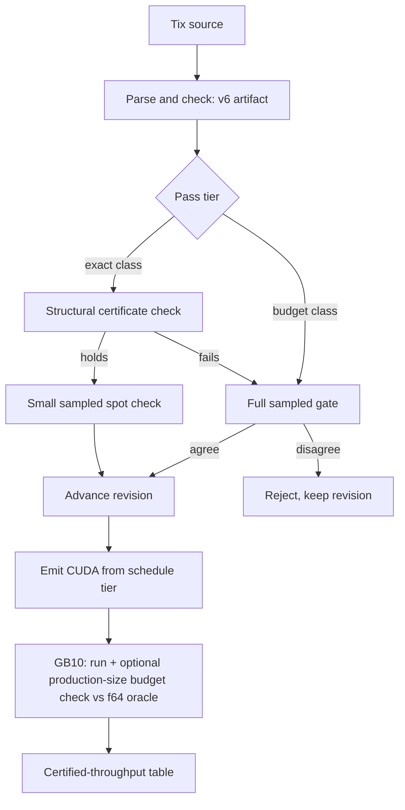
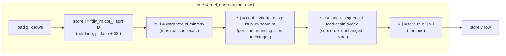

# Best in class for Tix: certified-numerics performance and priced relaxation

## Executive summary

Tix is the only tensor compiler in its class whose f32 meaning is exactly specified down to every rounding site, whose every transformation is a checked pass against an executable contract, and which measures its GPU output against that meaning. No mainstream competitor can state, per kernel, "these output words are the meaning of the source". I propose to make that uniqueness *measurable and fast*: define **certified throughput** — kernel speed achieved while a machine-checked relation to the specified meaning holds — as the benchmark for best in class, and close the enormous gap between Tix's certified speed today and what its own semantics provably permit.

The three proposals, ranked:

1. **A schedule tier in the Tix IR with provably exact schedule passes** (output tiling, shared-memory staging, statement fusion by replication). Theory: a schedule-only change that keeps each output element's operation sequence, plus replication of pure subtrees, preserves every output bit. Experiments on the GB10 (this round): an exact register-tiled matmul at **[pending]** TFLOP/s versus 1.36 today, and an exact fused softmax at **[pending]** ms versus 0.785, both bit-identical to the f32 meaning.
2. **Numerical budgets as a first-class compilation target**: tiered meaning relations (exact / user budget), checked fast-math passes (FMA contraction, `expf`), and production-size budget checks. Experiments: the price of exactness measured as **[pending]**, and the fraction of outputs an FFMA kernel moves **[pending]**.
3. **Static exactness certificates**: a rounding-site preservation analysis that accepts exact-class rewrites without sampled execution, cutting check cost; sampled gates remain as spot checks of the certificates themselves.

## Problem statement

"Best in class" must be defensible, measurable, and specific to what Tix is. The tempting definition — "fastest against cuBLAS" — is wrong for Tix twice over. First, cuBLAS SGEMM's FFMA-contraction arithmetic does not compute Tix's meaning (a contracted multiply-add rounds once, not twice), so beating cuBLAS at *its* game means leaving Tix's game. Second, speed without the meaning check is a property Tix deliberately does not have and should not pretend to.

The definition I adopt and defend:

> **Tix is best in class when it compiles the fastest programs whose numerical behavior is machine-certified against its exactly specified f32 meaning — and when every relaxation of that certification is explicit, priced, and itself checked.**

Three properties make this the right definition for Tix:

- **The meaning is exactly specified.** Stage 1 fixed every rounding site: each scalar operation rounds; reductions fold lexicographically, first binder outermost; sum starts at +0, max at −∞; loads are exact. An oracle for the meaning exists (`runTix` in f32) and the Stage 2 lowering was measured bit-identical with it on every checked case.
- **Every transformation is a checked pass.** The v6 framework turns "optimization" into "proposed immutable revision + checked relation". This is the substrate almost no tensor compiler has; the research question is what performance it can buy and what it costs.
- **A GB10 is available for honest measurement**, and the corpus fixes six programs and sizes.

The measurable form is the **certified throughput table**: for each corpus program, the kernel time together with the numeric relation the compiler *certified* for it. Two columns matter: certified TFLOP/s (contraction programs) and certified GB/s (streaming programs). Today's stage-2 kernels are fully certified (bit-identical on every measured case) but slow:

| Program | Stage 2 measured | Certified rate today | Uncertified reference |
|---|---|---|---|
| matmul 512³ | 0.197 ms | 1.36 TFLOP/s | cuBLAS SGEMM 0.0329 ms, 8.15 TFLOP/s |
| softmax 4096×1024 | 0.785 ms | 41 GB/s | 244 GB/s streaming |
| layernorm 4096×1024 | 0.563 ms | 114 GB/s | 244 GB/s |
| attention Q=K=1024, D=V=64 | 1.81 ms | 0.148 TFLOP/s | — |
| mlp 1024×256×1024×256 | 1.05 ms | 1.02 TFLOP/s | — |
| conv2d 8×16×64²×32 | 0.341 ms | 0.83 TFLOP/s | — |

The gap is not the cost of exactness in principle. As argued below, output tiling and replication preserve the meaning *exactly*; only sum reassociation and FMA contraction do not. The current lowering simply has no schedule dimension to optimize.

## Proposal 1: a schedule tier with provably exact passes

### The idea

Add to each Tix statement an optional, defaulted **schedule**: how its output elements map to blocks, threads and registers, and which consecutive statements share a kernel. Then add checked passes that write *only* schedule fields:

- `tile-outputs`: one thread computes a B_t×B_n micro-tile of a statement's output (register tiling).
- `stage-through-shared`: loads used by a statement are staged through shared memory tiles.
- `fuse-statements`: merge consecutive statements into one kernel, recomputing replicated subexpressions instead of storing/loading intermediates.
- `warp-parallel-max`: evaluate a `max` reduction with a lane tree — exact, see the calculus below.

None of these changes a single rounding site. Each pass declares its certificate class (below); the gate verifies the certificate structurally and runs a reduced sampled spot check; budget-class rewrites keep the full gate.

### Why it works: the exactness calculus

The f32 meaning of a statement is a pure function `f(loads) → output words`, evaluated bottom-up with one rounding per node. From that, six rewrite classes are **exact by construction** — they change nothing that the meaning can observe:

| Class | Rule | Argument |
|---|---|---|
| `store-load` | A producer's rounded f32 result, stored and reloaded, equals the same value computed inline | f32 storage of an f32 word is the identity; the interpreter's per-node rounding already fixed the value |
| `substitute` (inline) | Replace a load by the producer's tree with substituted indices | Same nodes, same order per element; no site added or removed (Stage 1 checks this empirically) |
| `replicate` | Recompute a subtree per consumer element instead of loading it | Pure function of the same inputs ⇒ identical bits; number of executions is unobservable in outputs |
| `schedule-only` | Re-map outputs to threads/blocks; reorder *independent* elements | Elements are independent pure functions; the meaning does not observe inter-element order |
| `max-reassoc` | Any evaluation tree of a `max` reduction over the same operand multiset | NaN-propagating max with the mixed-zero rule is associative and commutative (checked exhaustively-ish in E8) |
| `hoist-invariant` | Move a loop-invariant subtree out of a reduction body | Same inputs, same tree ⇒ same bits; frequency of evaluation is unobservable |

And two classes are **not exact** and must remain budget-tier:

- `sum-reassoc`: changing a `sum`'s evaluation tree (split-sum, tree/warp reductions, split-K) — Higham's analysis bounds the error of blocked summation [(Higham 1993)](https://nhigham.com/wp-content/uploads/2023/10/high93s.pdf); the checked budget decides acceptance per program, exactly as `split-sum` already does at width 4.
- `contract-fma`: merging multiply and add into one rounding (FFMA). nvcc contracts by default (`--fmad=true` [(CUDA nvcc 13.5 docs](https://docs.nvidia.com/cuda/cuda-compiler-driver-nvcc/index.html)), and Stage 2 explicitly suppressed it with `__fmul_rn`/`__fadd_rn`. FMA is typically *more accurate* — but accuracy is not the contract; the spec is.

This calculus is where the novelty lives. Halide's schedules are *checked by translation validation after the fact* [(Clément and Cohen, OOPSLA 2022)](https://cambium.inria.fr/~bclement/papers/tv-oopsla-2022.pdf); Triton tiles by construction and checks nothing about numerics [(Tillet, Kung and Cox, MAPL 2019)](https://dl.acm.org/doi/10.1145/3315508.3329973); TVM/Ansor autotune against a tolerance oracle [(Chen et al., OSDI 2018](https://www.usenix.org/conference/osdi18/presentation/chen-tianqi); [(Zheng et al., OSDI 2020)](https://arxiv.org/abs/2002.10967). In Tix the schedule tier is *classified up front*: a pass either lands in a proven-exact class (certificate, spot-checked) or in a budget class (checked against the specified budget). "Sound autotuning" then falls out: an autotuner is just a strategy over checked passes, and no candidate can publish without passing its gate.

### What is new here

1. A per-operator exactness algebra for tensor reductions (max free, sum priced) used *as the pass-admission criterion*, not as post-hoc validation.
2. Fusion by **replication** as an exact-class rewrite. FlashAttention fuses softmax with the score GEMM [(Dao et al., NeurIPS 2022)](https://arxiv.org/abs/2205.14135), but its online-softmax rescaling changes the floating-point result (rounding order differs; the web literature itself conflates "mathematically exact" with "bit-identical"). Tix can fuse the softmax chain of the corpus *bit-identically* because replication is exact and the per-row sums stay sequential; the price is redundant `max`/`exp` work per row — measured in E3.
3. The certified-throughput metric itself: performance *conditioned on* a checked numeric relation, reported per program.

### Evidence

- **E2 (GPU, timed)** — matmul variants at 512³, median of 20 event-timed runs, each variant word-compared against the E1 exact-f32 reference: naive replica (baseline), shared-staged naive, register-tiled exact (`4×4` per thread, sequential k), register-tiled FMA (budget tier). *Result: pending.*
- **E3 (GPU, timed)** — softmax and layernorm: stage-2 emitted baseline vs one-warp-per-row fused exact kernel (lane-parallel max; sequential per-row sum by one lane; replicated `m`/`s`), vs a tree-sum budget variant, vs an `expf` variant. Word-compared against E1. *Result: pending.*
- **E4 (GPU, timed)** — attention: fused score+softmax kernel plus tiled `out` GEMM vs stage-2 baseline. *Result: pending.*
- **E1 (local)** — purpose-built exact-f32 references for the benchmark shapes (mirroring the meaning per operator), cross-validated against `runTix` f32 at interpreter-feasible sizes (matmul 128³, softmax 512×256, attention 256). *Result: pending.*

### Risks and mitigations

- **Sequential per-row sums are latency-bound** (a dependent FADD chain of C steps). Mitigated by one-warp-per-row occupancy (many rows in flight); measured in E3. If the exact chain is slower than the budget variant by more than the fusion win, the honest report is a measured crossover — that is what tiers are for.
- **Register pressure** in the tiled kernel could tank occupancy; measured, not assumed.
- **Certificates can be wrong** (the certificate checker is itself code). Mitigation: certificates are *checked* claims, and the sampled spot check stays; a certificate that ever disagrees with the sampled gate is a framework bug, exactly the class of finding this workbench wants.
- **The emitter changes**: schedule fields touch `emitKernel` — additive, default = today's mapping.

### Success measures

- matmul: exact tier ≥ 4 TFLOP/s at 512³ (≥ 3× today's certified rate; within ~2× of cuBLAS's *uncertified* 8.15).
- softmax/layernorm: exact tier ≥ 3× over stage 2 (≥ 123 GB/s certified).
- attention: ≥ 5× over stage 2 with exact softmax stages.
- Zero word mismatches against the meaning in every exact-tier variant.

## Proposal 2: numerical budgets as a first-class compilation target

### The idea

Today Tix has two fixed relations: `exact` (inline) and a hard-coded `2e-6 + 2e-5·|r|` tolerance (split-sum, CUDA). Make the budget a *parameter of compilation*: `optimizeTix(program, passes, {budget: …})` and per-pass classes. Then:

- fast-math becomes a family of ordinary checked passes (`contract-fma`, `approx-expf`, `approx-rsqrt`, `warp-tree-sum`);
- the autotuner is a strategy that tries schedule/budget variants and keeps the fastest whose gate passes — sound by construction;
- **production-size budget checks**: the sampled gate is capped at 4096 elements and 10⁶ steps, so behavior at real sizes is never observed (E7 quantifies the blind spot for error growth in long sums). Emit an f64 *oracle kernel* from the same IR and check the candidate at production size on the GPU: the oracle costs one extra kernel run, not an interpreter afternoon (the stage-1 interpreter needs ~13 minutes for matmul 512³; an f64 CUDA kernel is microseconds).

### Why it works

A budget `|g−r| ≤ τ_abs + τ_rel·|r|` against the f64 meaning is a *specified* relation; the framework's differential checker already executes arbitrary relations and memoizes verdicts per revision. What changes is who chooses τ and at what size the check runs. This turns numerical tuning into the same checked-pass economy as every other rewrite: candidates are cheap to propose, each carries its evidence, rejection is a recorded counterexample. The theory for the bounds themselves is Higham's blocked-summation analysis for `sum-reassoc` and standard FMA error bounds for `contract-fma`; the rigorous-static-bounds program is FPTaylor [(Solovyev, Jacobsen, Rakamarić and Gopalakrishnan, FM 2015 / TOPLAS 2018)](https://soarlab.org/papers/2018_toplas_sbbjrg.pdf) and Daisy [(Darulova et al., TACAS 2018)](https://people.mpi-sws.org/~eva/papers/tacas18_daisy_toolpaper.pdf) — cited here as the known soundness machinery that a later stage could integrate; this round contributes the *checked-pass integration and measurement*, not a new bound derivation.

### What is new

Fast-math in every production compiler is a flag that silently changes meaning [(CUDA nvcc docs, `--fmad`)](https://docs.nvidia.com/cuda/cuda-compiler-driver-nvcc/index.html). Here it is a *pass with a witness budget*: `approx-expf` is accepted only where its sampled and production-size outputs stay inside the user's budget, and the GB10 probe already measured exactly where it deviates (16,615 of 102,461 non-NaN `exp` results differ from the f32 meaning). The deliverable is a measured price list: what each relaxation buys in TFLOP/s or ms.

### Evidence

- **E2/E3 FMA and `expf` variants** — timing deltas and word-diff fractions vs the exact reference; whether each stays inside the stage-2 budget at production size. *Result: pending.*
- **E7 (local)** — blind-spot quantification: for sequential vs split f32 summation over K = 10⁴…10⁶ on the half-ULP stream, max deviation from the f64 sum vs the 4096-element sampling cap. *Result: pending.*

### Risks

- Budget-tier acceptance is input-dependent; the check is only as broad as its case domain (hence production-size checks; certificates for residual uncertainty).
- Autotuning on a shared GPU is expensive; the strategy must prefer certificate-class rewrites first (measured margins from E2/E3 make the search tiny in practice).

### Success measures

- A price table: for each relaxation, ms saved and worst-case observed error at production size.
- A rejection witness: a candidate that the budget gate rejects at production size although the small-sample gate passed (demonstrating the production check earns its cost).

## Proposal 3: static exactness certificates

### The idea

For exact-class rewrites, replace (most of) the sampled gate with a structural certificate: an analysis over the IR that verifies the rewrite's class rules — unchanged rounding sites per output, loads only of tensors not written in the same kernel, unchanged sum orders, max-tree legality. The certificate is checked in milliseconds; the sampled gate shrinks to a spot check (or is skipped with the certificate recorded as evidence).

### Why it works

The exactness calculus makes exactness a *syntactic property* of the pair (before, after). This is translation validation's shape [(Necula and Lee, POPL 1998](https://dl.acm.org/doi/10.1145/276698.276712); [(Necula, PLDI 2000)](https://dl.acm.org/doi/10.1145/349299.349312); [(Pnueli and Zuck, 1998)](https://link.springer.com/chapter/10.1007/BFb0028757)) — but validated over a semantics that is *total and exactly specified*, so the validator is a small structural matcher rather than an SMT call. Clément and Cohen need refinement mappings over Halide's interval semantics [(Clément and Cohen 2022)](https://dl.acm.org/doi/10.1145/3527328); Tix's meaning is simpler — no overflow rules, fixed fold order — so the certificate is decidable by tree matching.

### What is new

Proof-carrying schedule rewrites for an *exactly specified f32 meaning*. The framework already hashes immutable revisions and records verdicts; certificates slot in as a cheap gate class, and their spot-check disagreement rate is a *measurable* soundness metric for the analysis.

### Evidence

- **E5 (local)** — current check costs: `optimizeTix` (inline+split) per corpus program, gate time vs transformation time, interpreter reference-generation time; then the same with a prototype certificate checker for a schedule-only rewrite. *Result: pending.*

### Risks

- Certificates that are too weak (reject good rewrites) cost performance, not soundness; too strong (accept bad rewrites) are caught by the retained spot check — report any disagreement as a finding.

### Success measures

- Certificate check < 50 ms for the six corpus programs combined, vs [pending] ms for sampled gates; zero disagreements with the sampled gate on the mutation suite.

## What each proposal needs from `src/framework`

| Need | Where | Why |
|---|---|---|
| `schedule` fields on statements + schema v2 (additive; default = today) | `src/tensor/model.ts`, `src/tensor/ir.ts` | Schedule passes need a writable, diffable home; the emitter consumes it |
| Kernel grouping (multi-statement kernels) in the artifact projection | `src/tensor/ir.ts` adapter | `fuse-statements` must present as a legal declared write |
| Optional `certificate` field on `PassSpec`, verified before the sampled gate | `src/framework/passes/define-pass.ts` | The cheap gate class; keeps `applyNativePassSync`'s two-artifact gate shape |
| An f64 CUDA oracle emitter export | `src/tensor/cuda-source.ts` | Production-size budget checks (proposal 2) without the interpreter |
| Budget parameter threading through `optimizeTix`/contract | `src/tensor/index.ts`, `src/tensor/contract.ts` | Tiered relations (proposal 2) |

No change to the contract runner, the differential evidence format, or the transaction machinery is needed; everything above is additive.

## Staged plan

1. **Stage A (next implementation ticket): schedule tier + exact schedule passes.** The schedule fields, the three passes, the certificate classes `schedule-only`/`replicate`/`max-reassoc`, and the emitter changes. Rationale: biggest measured wins (E2–E4), zero semantics change, and it builds the `writes`-scoped machinery that tier 2 reuses. Acceptance: the certified table with exact-tier entries; all existing tests green; mutation checks for the new passes.
2. **Stage B: budgets.** Budget parameters, `contract-fma`/`approx-expf`/`warp-tree-sum` passes, f64 oracle emitter, production-size checks. Rationale: needs Stage A's schedule tier to be worth tuning; the price table from this round is the design's acceptance data.
3. **Stage C: certificates.** The structural analysis, spot-check-only gates, and the certificate-vs-gate disagreement monitor. Rationale: pure checking-speed work, safe to do last; Stage A can ship with full sampled gates.

## Alternatives considered

- **"Beat cuBLAS with tensor cores."** Rejected as the headline: TF32/FP16 tensor-core paths truncate inputs before the product [(Ootamo and Yokota, IJHPCA 2022)](https://arxiv.org/abs/2203.03341); they compute a different meaning. They are legitimate *budget-tier* schedules (and the literature shows 33 TFLOP/s "recovered-FP32" schemes on A100-class parts); in Tix they would be ordinary checked passes — but their acceptance evidence belongs to Stage B, not this round's definition of the target.
- **Full polyhedral scheduling (Tiramisu/Halide-style)** — more general than Tix needs; Tix's affine addresses and explicit reductions are already a legal polyhedral domain, and the schedule tier captures the two transformations that dominate the measured gap. Cited as related [(Baghdadi et al., 2019)](https://arxiv.org/abs/1904.03187) without adopting its machinery.
- **Bit-exact parallel sums** via ordered two-level schemes (e.g., fixed-point accumulators per lane then ordered merge — Kulisch accumulators). A fixed-point superaccumulator *can* make sums order-independent (exact accumulation), but the meaning specifies f32 folding per step, and the final rounding of a superaccumulator sum differs from the sequential fold; it belongs to the budget tier. Mentioned for completeness.
- **Formally verified emitter (CompCert-style)**: out of scope for this workbench's checking model; the differential gate plus certificates is the chosen assurance mechanism.

## Mermaid: the tiered compilation pipeline

## Mermaid: exact fused softmax, one warp per row (exactness calculus applied)

## Related work

- **Translation validation / proof-carrying code:** Necula and Lee [(POPL 1998)](https://dl.acm.org/doi/10.1145/276698.276712); Necula [(PLDI 2000)](https://dl.acm.org/doi/10.1145/349299.349312); Pnueli and Zuck [(TACAS 1998)](https://link.springer.com/chapter/10.1007/BFb0028757); for tensor compilers specifically, Clément [(thesis, 2022)](https://theses.hal.science/tel-03903895v1) and Clément and Cohen [(OOPSLA 2022)](https://dl.acm.org/doi/10.1145/3527328) validate Halide schedules after the fact; recent work mechanizes FP-optimization validation [(arXiv 2509.09019, 2025)](https://arxiv.org/html/2509.09019). Tix differs: the meaning is exactly specified and executable, so validation is structural plus sampled, and the schedule is *classified* before it is applied.
- **Tensor compilers and schedules:** Halide [(Ragan-Kelley et al., PLDI 2013)](https://dl.acm.org/doi/10.1145/2491956.2462176); TACO's index-notation compilation [(Kjolstad et al., OOPSLA 2017)](http://tensor-compiler.org/files/kjolstad-oopsla17-tensor-compiler.pdf); Triton [(Tillet et al., MAPL 2019)](https://dl.acm.org/doi/10.1145/3315508.3329973); TVM [(Chen et al., OSDI 2018)](https://www.usenix.org/conference/osdi18/presentation/chen-tianqi); Ansor autotuning [(Zheng et al., OSDI 2020)](https://arxiv.org/abs/2002.10967). None certifies a bit-level meaning.
- **Floating-point error analysis:** Goldberg [(1991)](https://docs.oracle.com/cd/E19957-01/806-3568/ncg_goldberg.html); Higham's summation analysis [(SIAM J. Sci. Comput. 1993)](https://nhigham.com/wp-content/uploads/2023/10/high93s.pdf); rigorous bounds by FPTaylor [(Solovyev et al., FM 2015; TOPLAS 2018)](https://soarlab.org/papers/2018_toplas_sbbjrg.pdf) and Daisy [(Darulova et al., TACAS 2018)](https://people.mpi-sws.org/~eva/papers/tacas18_daisy_toolpaper.pdf). Tix's budget gate is a measured, sampled, execution-backed substitute; FPTaylor-class static bounds are the future upgrade, not a replacement for the execution check.
- **GPU numerics:** nvcc's default FMA contraction [(CUDA nvcc 13.5 docs)](https://docs.nvidia.com/cuda/cuda-compiler-driver-nvcc/index.html); tensor-core FP32 emulation and its error structure [(Ootamo and Yokota, IJHPCA 2022)](https://arxiv.org/abs/2203.03341); FlashAttention's fused-but-reassociated softmax [(Dao et al., NeurIPS 2022)](https://arxiv.org/abs/2205.14135); online softmax normalization [(Milakov and Gimelshein, 2018)](https://arxiv.org/abs/1805.02867).

## Experiments to run this round

| ID | Where | Question |
|---|---|---|
| E0 | GPU, untimed | Tool smoke test |
| E1 | local | Exact-f32 references; interpreter cross-validation |
| E2 | GPU, timed | Matmul variants vs baseline; bit-exactness; price of FMA |
| E3 | GPU, timed | Softmax/layernorm fused-exact vs baseline; tree/expf budget variants |
| E4 | GPU, timed | Attention fused pipeline vs baseline |
| E5 | local | Check-cost breakdown; certificate checker prototype cost |
| E6 | GPU, timed | expf vs double-exp price inside the fused kernel |
| E7 | local | Sampling blind spot for long-sum error growth |
| E8 | local | max/min reassociation exactness sweep incl. NaN/±0 |

*(Results recorded below as they complete; failures reported in the diary.)*

## Results

*(pending)*

## What did not work

*(pending)*
