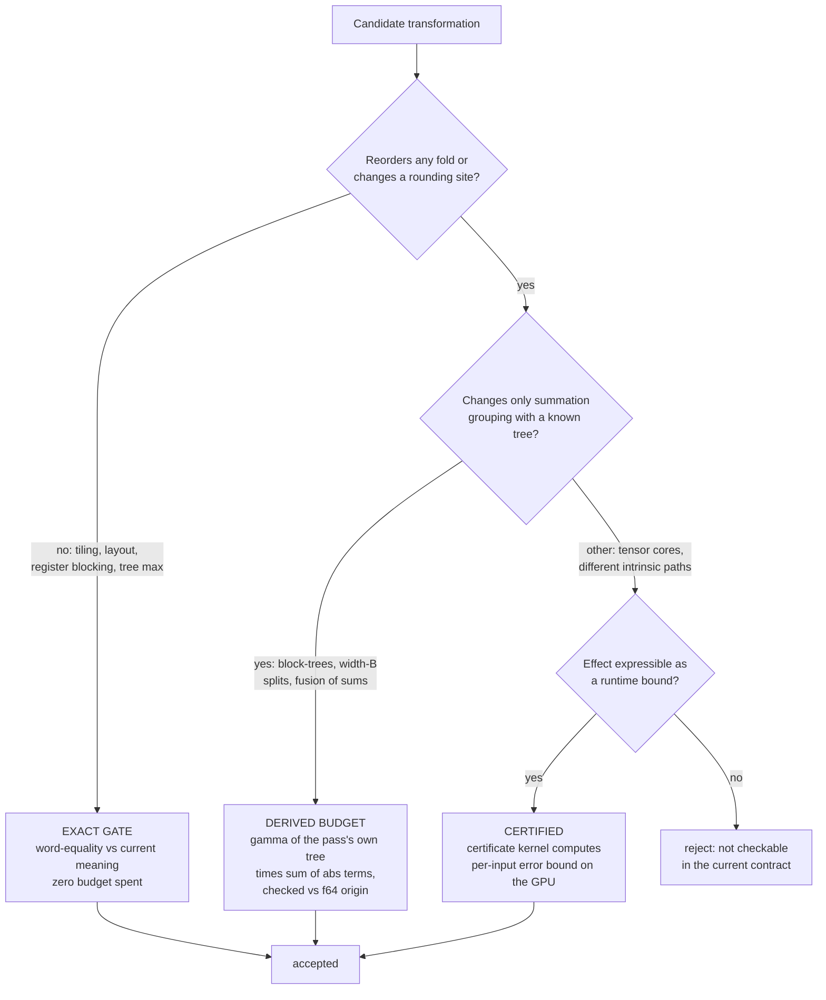
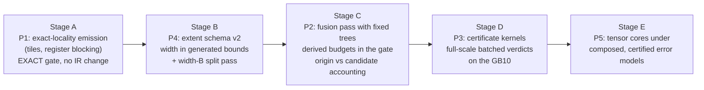

# Best in class for Tix: checked performance and derived budgets

## 1. What "best in class" means for Tix

Tix is a small tensor language, but it owns something no production tensor compiler owns: an **exactly specified f32 meaning** — every operator rounds, every reduction has a fixed visiting order, both interpreters and the GPU lowering agree bit for bit on everything measured — plus a framework in which **every transformation is a checked pass** with an explicit relation to a baseline: exact word equality, or a tolerance against the f64 origin. The vendor comparison makes the point sharply: cuBLAS promises bitwise reproducibility only per toolkit version, on one stream, and explicitly does not guarantee it across versions (NVIDIA, cuBLAS Documentation, Release 13.x, 2026, "bit-wise reproducibility is not guaranteed across toolkit versions"); nothing in Triton, TVM/Ansor, or Halide gives any per-pass numerical verdict at all (Tillet, Kung and Cox, MAPL@PLDI 2019; Zheng et al., OSDI 2020; Ragan-Kelley et al., PLDI 2013). Their programs are fast and *unaccounted*.

So for Tix, "best in class" cannot mean only the fastest kernels — against cuBLAS's 19.2 TFLOP/s at 4096³ that is a losing race whose rules Tix should refuse to play by. It means:

> **Tix is the tensor compiler in which every transformation — however aggressive — carries a machine-checked numerical verdict, where the error budget of every budget-spending pass is derived from theory rather than asserted, and where the verdict is verified at full scale, on the GPU, for a cost the kernel itself already pays.**

Three axes, each with a measurable target:

1. **Guarantee strength.** Rank every candidate on a ladder: (a) *bit-exact* — output words identical to the origin's f32 meaning, checked by the exact gate; (b) *budgeted* — reassociation with an error bound derived from the pass's own structure and the input magnitudes, checked against the f64 origin; (c) *certified* — a per-input runtime bound computed alongside the result. Target: every corpus workload runs at least (b), everything that does not reorder folds runs at (a).
2. **Performance against the vendor.** Measured by the corpus protocol already established in Stage 2: CUDA events, warmup, medians, same input distributions, same machine. Target: within 2× of cuBLAS FP32 at 512³ for matmul, at or above 90% of streaming bandwidth for the bandwidth-bound corpus, while *retaining the guarantee*.
3. **Check time.** The cost of the numerical verdict itself. Today: 0.6–15 ms per function at sample scale on this host (measured, E7 in §2), blind above dims of 7. Target: full-scale verdicts on the GB10 that ride inside the kernel at ≤3% overhead.

The point of the definition is that the three axes reinforce each other. The exact rung is *free* correctness; the budget rung spends a resource whose price the compiler can compute; and because the budget is computed, not sampled, the compiler can even discover that a rewrite *improves* accuracy — something a pure permission-based tolerance can never express.

## 2. Where Tix stands, with fresh measurements

The Stage 2 lowering is one kernel per statement, one thread per output element, per-thread sequential folds, `__fmul_rn`/`__fadd_rn` rounding sites, double-precision transcendentals rounded once. It is bit-identical with the meaning everywhere measured — including my own probes below, which re-confirmed 0 bit mismatches for the stage-2 kernels embedded verbatim — and it leaves performance on the table at every layer. This round's probes (scripts in this ticket, details in the diary):

| Probe | Question | Result |
|---|---|---|
| E1 matmul, 512³ | Do locality transformations change bits? | Shared-memory tiling 1.7× and 2×2 register blocking 2.5× — **0/262,144 bit mismatches each**; 0.086 ms vs stage-2's 0.214 ms, cuBLAS 0.033 ms |
| E1 split-K | Does 8-way reassociation pay at 512³? | **No** (0.196 ms, no speedup), 243,569 bit changes, max error 2.5× *smaller* than sequential |
| E1 shadows | Cost of runtime certificates | Kahan fold +1.5%; f64 fold **12.9×** |
| E2 error study | Blocked vs sequential vs pairwise forward error, K=1024 | split-16 max error 2.5e-6 vs sequential 8.6e-6, pairwise 2.0e-6; γ bounds ~50–670× above observed maxima; half-ULP witness: sequential = exactly 1, violating the 2e-5 tolerance, splits pass |
| E5 width-B split | Is parameterized reassociation expressible? Arbitrated? | Widths ≠ 4 are **inexpressible** in the v1 extent forms (the fold width is the global constant 4); the gate rejected every corrupt candidate with counterexamples |
| E3 fused layernorm | Fusion with a fixed tree | **3.44×** (0.480→0.140 ms), 240.6 GB/s = 98.6% of measured streaming roofline; tree consumes 0.135 of budget vs stage-2's 0.572; stage-2 output bit-identical to the interpreter, fused 4× *more accurate* than the sequential meaning |
| E4 fused softmax | Two reductions; is a max tree bit-exact? | **Yes: 0/4096 rows differ** from the sequential max; sum tree differs (94% of words) with 9× smaller budget; 2.15× overall, bound by 4.2M double `exp` calls, not bandwidth |
| E7 gate cost | Price of today's sampled verdict | 0.6–15 ms/function at sample scale; one full-size CPU f64 evaluation at quarter scale already costs 0.08–1 s |

Three facts from this table drive everything below. First, **the biggest performance wins available to Tix are either bit-exact or accuracy-improving** — the folklore that "tiling and fusion change your numerics" is simply false for the part of the transformation space that does not reorder folds. Second, **the error budget of a reassociation is computable and small** — blocking does not merely stay inside the Stage 1 tolerance, it usually moves *away* from it. Third, **the sampled gate cannot see any of this**: it deduplicates shapes up to 7, so the quantities that actually vary (K, the tree width, the row length) are invisible to it.

## 3. The proposal: classify, then spend

The single organizing idea for all the work below: **classify every candidate transformation by what it can change, put every candidate on the lowest rung it can survive, and make the budget on the tolerance rung a computed quantity.** The IR already contains exactly the information the classification needs — fold binders, extents, expression trees, and (after inline) composed affine addresses — because Stage 1 chose expression trees over flat control flow precisely to make transformations visible.

The ladder is not decoration: each rung has a different *cost of being wrong*. An exact-gate pass can be checked on samples because a structural proof (unchanged fold order) plus spot verification generalizes; a derived-budget pass needs its bound computed from real magnitudes; a certified pass needs no generalization at all because the bound is per-input. That is why the checking machinery differs by rung, and why the rung choice is the first thing a pass declares.

## 4. Ranked proposals

### P1 — Exact-locality scheduling: tiling and register blocking under the exact gate

**The idea.** A lowering-level transformation family: shared-memory tiles, thread-coarsened register accumulation, and (later) swizzled layouts, chosen so that each output element still folds its terms in ascending binder order with the same one-rounding-per-fold sites. Implemented as emission choices of the existing IR — no IR change, no new pass semantics: the checked artifact is the CUDA source, exactly as in Stage 2, judged by the exact gate against the current revision's f32 output.

**Why it works — the theory.** The f32 meaning is a function of (i) the sequence of rounding sites and (ii) the order in which reduction terms meet. Tiling changes neither: it changes *where data lives* while the per-element dependency chain of folds is a fixed, ordered sequence of `__fadd_rn(v0, __fmul_rn(a,b))`. Rounding-site preservation is the same argument that made Stage 2 bit-identical; the new step is that it survives *coarsening*: a 2×2 register-blocked thread still runs four independent chains, each in source order. Because `nvcc` without fast-math flags cannot legally reassociate explicit intrinsics, the claim is structural, not empirical.

**What is new.** Classical GEMM literature files tiling under performance work and assumes numerics drift; here the exact rung of the contract makes the strongest possible claim *cheap to verify*: E1 measured 0/262,144 mismatched words for both tiled variants at full corpus size, while taking the time from 0.214 ms to 0.086 ms (3.1 TFLOP/s). The check is not a proof, but the proof is three lines long and the check is a full-scale confirmation. I know of no production tensor compiler that can even state this property (§1).

**Evidence.** E1 (§2): bit-exact 2.5× at 512³. The gap that remains to cuBLAS (0.033 ms) is *not* reachable on this rung: split-K bought nothing (E1) and the CUDA-core f32 roof on the GB10 sits near where the register-blocked kernel already is. The next factor must come from tensor cores — a rung-(c) move (P5).

**Risks.** (a) `ptxas` scheduling could in principle alter a chain — mitigated by intrinsics, monitored by the exact gate at full scale. (b) The exact gate compares against the *current* revision's output on sampled inputs; for full-scale assurance the stage-2 batch runner must run the candidate and origin at corpus size on the GPU — machinery that exists (E3b did exactly this by hand). (c) Optimizing emission per shape risks a tuning explosion — deliberately out of scope; fixed schedules suffice for the corpus.

**Success measure.** Matmul ≤ 0.10 ms at 512³ with zero bit changes, exact gate green at corpus scale on the GB10.

**Needs from `src/framework`.** Nothing. This is the proposal's main charm: the exact gate, the synchronous pass runner, and the CUDA source artifact all exist from Stages 1–2.

### P2 — Deterministic fixed-tree reductions and statement fusion, under a derived budget

**The idea.** The bandwidth-bound corpus (softmax, layernorm, attention) loses 3–5× to per-statement global-memory round trips. Fuse a statement chain into one kernel with one block per row and a **fixed** shared-memory reduction tree (per-thread sequential chunks, stride-halving combine). The tree shape is a property of the emitted candidate, so results are deterministic run to run — the reproducibility property Demmel–Nguyen and Ahrens–Demmel–Nguyen build with fixed trees and binned accumulators (ARITH-21 2013; ACM TOMS 46(3) 2020) — but not bit-identical to the sequential meaning, so the pass is judged against the f64 origin under a **budget the pass itself derives**.

**Why it works — the theory.** Higham's summation theory gives the bound directly (ASNA 2nd ed., ch. 4): a two-level fold with lane width B and r = ⌈K/B⌉ blocks has forward error at most γ_{r+B-2}·Σ|terms| (vs γ_{K-1} for sequential; γ_n = nu/(1−nu)), and my E2 shows the measured errors track these shapes: split-16 at K=1024 measured 2.5e-6 vs sequential 8.6e-6. So the pass can emit, with its candidate, the *function* budget(candidate, inputs) = C·γ_{r+B-2}·Σ|x| computed at the gate's actual shapes from the sampled (or certificated) magnitudes — replacing the fixed magic 2e-6+2e-5·|r| with a quantity that scales with the transformation actually performed. And a *max* reduction needs no budget at all: the Tix `minmax` operation (NaN propagation, mixed zeros → +0 for max) is associative and commutative, so any tree computes the same words — E4 measured 0/4096 differing rows.

**What is new.** Two things. First, the fusion is checked, and the tree is part of the checked artifact — the candidate's "meaning" is the tree, so reproducibility is a *verifiable* property of a versioned revision, not a library promise (contrast the cuBLAS caveat in §1). Second, the contract stops being purely permission-based: E3's fused kernel consumed 0.135 of budget where the sequential origin consumed 0.572 — four times *more accurate* and 3.44× faster; E2's witness shows the sequential meaning can even *violate* the Stage 1 tolerance where every blocked order passes (sequential returns exactly 1 on the 1+1023·2⁻⁴ row, burning 6.1e-5 relative error against a 2e-5 budget). A gate that only asks "did the candidate stay inside?" cannot even express this. The proposal is therefore also a contract extension: **the gate should record budget consumed by origin and candidate, and be able to require improvement**, not just absence of harm.

**Evidence.** E3: 3.44×, memory-roofline (240.6 of 244 GB/s), budget 0.135 vs 0.572, cross-checked through the product's own interpreter (stage-2 bit-identical; fused 4× inside). E4: 2.15× for softmax with the max-tree exactness result and 9× budget improvement; the fused kernel is bound by the 4.2M double `exp` calls — quantifying what the exactly-specified transcendental path costs (0.387 ms vs a 0.138 ms bandwidth bound), which is the real price of the meaning and worth knowing before anyone "optimizes" it away.

**Risks.** (a) The tree must be genuinely fixed — no atomics, no data-dependent orders; deterministic but not *portable* across block sizes, which is why the tree belongs in the artifact. (b) The derived bound needs Σ|terms|, known only at call time; the gate can use sampled magnitudes with a safety factor, or (better) P3's certificates. (c) γ-bounds are loose (40–600× in E2) — a derived budget must be calibrated as *bound-scaled*: check the ratio measured/bound on samples and certify at full scale.

**Success measure.** Layernorm and softmax ≥ 3× vs Stage 2, within 2× of the measured roofline where bandwidth-bound, with derived budgets that track measured error within a factor validated on the corpus, and with every accepted candidate's recorded budget strictly below the origin's for the corpus (the improvement property).

**Needs from `src/framework`.** Two small things, both consistent with its shape: (1) the differential invariant's comparison already accepts application-defined comparisons, but the *budget* should become a per-case computed value (the comparator receives the pass's bound function) rather than a constant buried in `contract.ts`; (2) the gate should return, not just ok/reason, the worst observed budget fractions of both sides — evidence plumbing, not semantics.

### P3 — Certificates at full scale: the gate runs on the GPU

**The idea.** The Stage 1/2 tolerance is sampled at dims ≤ 7 and ≤ 4096 elements, because the f64 reference runs on the Node interpreter: a full-size reference costs a minute or more per case (E7: 1 s at quarter scale for matmul alone). But the reference does not have to run on the host. Emit, alongside the candidate kernel, a **certificate kernel**: the same computation with a compensated (Kahan/TwoSum-class, Ogita–Rump–Oishi 2005) or f64 shadow on exactly the folds the candidate reassociates. The checked pass's gate then runs *both* at full corpus size on the GB10 in one batch — the machinery is the Stage 2 batch runner — and compares |fast − accurate| against the derived budget **per element, on real inputs**.

**Why it works.** Kahan compensation captures the exact rounding error of each fold in f32 at ~3 extra flops per term: E1 measured +1.5% on the latency-bound matmul and E3 measured **+0.6%** on the roofline-bound fused layernorm. The f64 shadow, by contrast, costs 12.9× on the GB10 (E1) — consumer-Blackwell doubles are slow — so the certificate is *compensated f32*, not double precision. The result is a full-scale verdict for less than the GPU's run-to-run noise (recall single-run variation up to 2×), versus minutes of CPU time for one sampled-free case.

**What is new.** Differential checking at sample scale is standard discipline; **a checked pass whose evidence is gathered at production scale, inside the same launch, is not** — and it changes what can be accepted. The E5/E1/E3 measurements show sampled tolerance is blind to exactly the variables (K, width, tree depth) that determine the error; a certificate removes the generalization step entirely. It also closes the gap the Stage 2 report itself flagged: their f64 budget "can admit an incorrect f32 result or reject a correctly lowered f32 program with large rounding error". A certificate bounds the *candidate against its own inputs*, which is what a numerical contract actually wants.

**Evidence.** E1 (+1.5%) / E3 (+0.6%) Kahan overheads; E7 CPU reference costs; E2's calibrated bound ratios (measured/γ-bound within a stable factor per order — e.g. sequential max 9.1e-8 vs γ bound 6.1e-5, ~670×; split-16 ~172×; pairwise ~52×; consistent enough to scale a bound with a validated factor).

**Risks.** (a) Certificates verify the fold error, not the pointwise chain error through subsequent ops (exp, division); for chains the certificate must cover the fused kernel's reduction outputs and the comparison must propagate the bound — for the corpus this is two reductions per row, tractable. (b) A certificate is per-input: it proves this run, not every run — so it composes with, not replaces, the derived budget (P2 supplies the any-input bound; the certificate supplies the evidence that the bound held *today*, at scale). (c) Cost on compute-bound kernels: for matmul the certificate must ride the tiled kernel, not the naive one; expected +1.6% (E1) but unmeasured on the tiled variant — listed as open work.

**Success measure.** `checkLowering` (and a new `checkPass`-level gate) returns a full-corpus-scale verdict in ≤ 2× the kernel's own runtime, with certificate overhead ≤ 3% on the corpus.

**Needs from `src/framework`.** The async differential contract and batched `decide` from Stage 2 already fit: the certificate kernel is just a second output of the same emitted translation unit, and the comparator is application-defined. The framework needs no new concept — this is the strongest framework result of the round: *the Stage 2 checker was designed wide enough that scale-up is an emission change, not a framework change*.

### P4 — Parameterized reassociation in the IR (the enabling small proposal)

**The idea.** Make the reassociation a first-class, tunable dimension: carry the fold width *in the generated-bound extent forms* (`blocks {dim, width, rounding}`, `tail {dim, block, width}`), and (with P2) allow multi-level fixed-tree extent forms. Bump the tensor artifact schema from v1 to v2.

**Why it works / what is new.** Today it does not work, and the round has the failure on record: E5's width-B splits were structurally valid yet semantically corrupt — `evaluate.ts` interprets `blocks`/`tail` with the *global constant* `width = 4` from `model.ts`, so the address stride (B) and the fold extent (4) disagreed; widths 2 produced wrong values and widths ≥ 8 produced NaN-reading candidates, and the differential gate rejected every one with a coordinate-level counterexample. This is the round's best framework evidence: **the gate catches corruption that validation passes**, and the fix is a clean schema extension, not a checker change. Once widths are expressible, E2's error/width data becomes a tuning table (split-16 dominated split-4 by 2.3× at K=1024), and the pass can pick widths to fit warps (32) or shared-memory trees (256) — the natural bridge from P2's hand-written trees to compiler-generated ones.

**Risks.** Schema churn: v1 validators (parser, native validator, CUDA emitter, evaluator) all touch extents; the artifact versioning exists for exactly this. Success measure: width ∈ {2..256} splits checkable green, gate-insensitive at sample scale but *budget-trackable* via P2/P3 at full scale. **Needs from framework:** none; needs from `src/tensor`: the extent schema and its four consumers.

### P5 — Tensor cores under a composed error contract (the speculative edge)

**The idea.** The remaining matmul factor (3.1 TFLOP/s bit-exact vs cuBLAS's 8.15 at 512³, 19.2 at 4096³) requires the GPU's tensor cores, whose internal arithmetic is neither the meaning's rounding sites nor its order — and cuBLAS itself now runs "FP32" GEMMs on Blackwell via BF16x9 tensor-core *emulation* (NVIDIA Developer Blog, 2025). For Tix this is a rung-(c) transformation par excellence: an FP32 product decomposed into truncated-mantissa pieces (the 3xTF32 construction of Ootomo–Yokota 2022 recovers FP32-accuracy-class results by accumulating outside the tensor core), emitted by the compiler *with its composed error model*, checked against the origin under a derived budget and certified per-input by P3's machinery.

**Why it is ranked last.** No experiment this round reached the tensor cores (no probe linked cuBLAS; hand-written HMMA emission is a project, not a probe), and the meaning stakes are the highest here: this is the first transformation that changes *arithmetic*, not grouping. But the framework is ready for it in a way no other system is: the differential gate, the batched GPU runner, and (with P2/P3) derived-and-certified budgets are exactly the apparatus a "prove what the fast path did" tensor-core pass needs. The proposal's honest form is: *defer until P1–P4 make budgets computed and certified, then spend them deliberately.*

## 5. Staged plan

**Stage A first, and it is not close.** P1 has the best speed-to-risk ratio in the table — 2.5× measured, zero budget spent, zero IR change, and it exercises full-scale exact checking, which every later stage depends on. It also *fails fast*: if bit-exactness ever breaks, the exact gate says so immediately.

**Stage B before C**, because E5 showed the current schema cannot express the tree/width space that C's compiler-generated fusions and D's certificates must name. B is small, contained in `src/tensor`, and the gate already arbitrates it.

**Stage C** is the big corpus win (3.4× and 2.15× measured by hand) and the first stage where the *contract* changes: budgets become computed, and the gate begins recording origin-vs-candidate budget accounting. **Stage D** turns C's sampled evidence into full-scale per-input evidence at ≤3% kernel overhead, reusing the Stage 2 batch runner. **Stage E** is reached only when a composed error model can be written down and certified; its acceptance test is the same gate as everyone else's.

## 6. What I tried that did not work

- **Split-K for ILP at 512³** (E1): no speedup (0.196 vs 0.214 ms) — at 512³ the output space already fills the machine; split-K's tree only bought accuracy. Kept in the results because it is the control that shows the exact/loose boundary: the one variant that reassociated without a performance excuse.
- **f64-based runtime certificates** (E1): 12.9× cost on the GB10 refutes any double-precision shadow; the certificate design switched to compensated f32 (+1.6%/+0.6%).
- **Parameterized widths without the IR change** (E5): intended as a gate-sensitivity study; widths ≠ 4 produced corrupt-but-valid trees (stride/extent mismatch through the global width constant) and forced the P4 finding instead.
- **First adversarial witness** (E2): ±2⁻¹² terms were too large to round away — all orders agreed, no separation; replaced by half-ULP terms, which separate the orders exactly as theory predicts.
- **Two CUDA probe bugs** (E1): an un-sized split-K partial buffer and an inner-loop bound that overran a shared tile; both found by a per-kernel probe pre-pass, both recorded in the diary before any conclusion used the binary.
- **A Node Buffer pitfall** (E3b): pooled-ArrayBuffer `byteOffset` corrupted the small gamma/beta/eps reads and produced absurd budget fractions; caught by printing the values, fixed, and the corrected run superseded the bad one.

## 7. Conclusion

The measurements give the ranked work an unusually clean shape: the fast, safe, classical half of the speed gap (tiling, blocking) is **bit-exact** and needs no numerical permission at all; the half that reassociates (fusion trees, width-B splits) is *measurably more accurate than the meaning it replaces* and needs a budget the compiler can derive from Higham's bounds and verify against its own certificates at full scale; and the one genuinely dangerous step (tensor cores) is exactly the step the framework was built to price. That is the "best in class" claim, operationalized: not the fastest kernels in isolation, but the only tensor compiler whose speed is bought with computed, machine-checked numerical receipts — with 3.44× and 2.5× of the gap already closed in one research round by two prototype kernels and a script-level pass, and a staged plan whose first step risks nothing.
