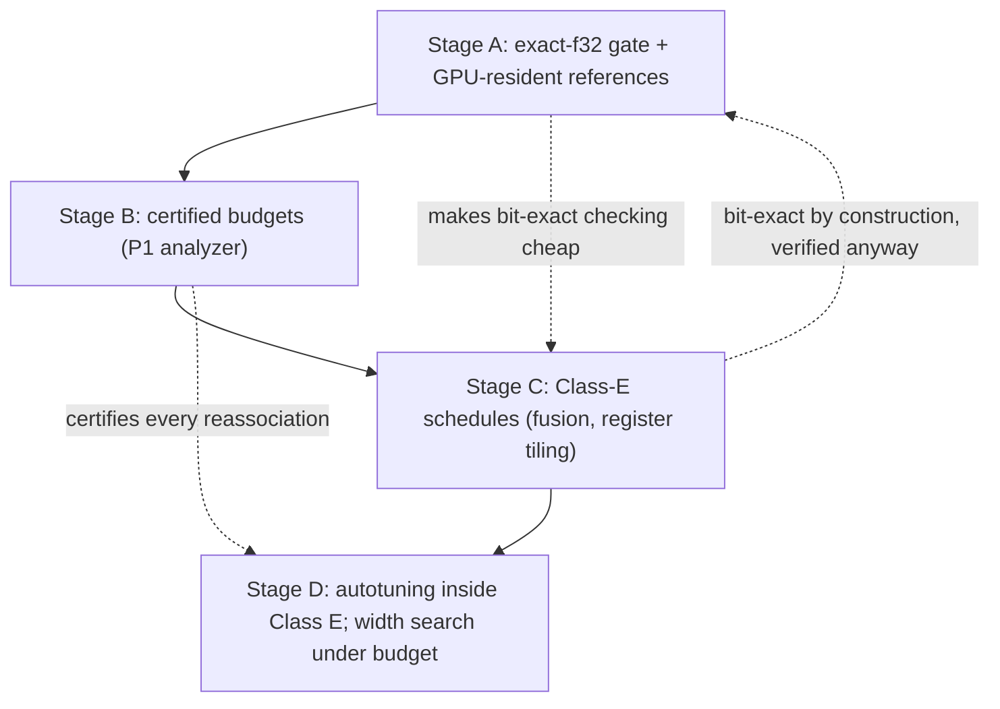
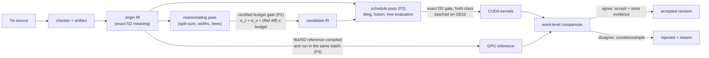

# Best in class for Tix: certified numerics at competitive speed

## Executive summary

Tix will not win peak FLOP/s against cuBLAS, and it does not have to. Its class — compilers from index notation to parallel hardware — already has fast members (TACO, Tensor Comprehensions, Triton, and the schedule languages behind Halide and TVM). What none of them offer is a *verifiable* statement about the numbers they produce: their transformations are believed sound, and their GPU results are reproducible only per machine and per build. Tix's assets are different and, today, unique in this class: an exactly specified f32 meaning (every rounding site and every reduction order fixed), a checking framework in which **every** transformation is a gated pass, and a GPU lowering measured bit-identical to that meaning.

**Definition.** Best in class for Tix means: *the strongest verifiable numeric guarantee among index-notation tensor compilers, at a defensible fraction of vendor speed.* Verifiable means four concrete properties, each measurable:

1. **Certified budgets.** A reassociating pass is accepted only with a per-case *certified* bound on its numeric deviation — computed, not sampled — and semantic changes (a dropped reduction tail) are caught by an exact term, not by luck of sampling.
2. **Bit-exact schedules.** Any transformation that can be scheduled without changing the meaning's fold order and rounding sites is *proved* bit-exact by construction, and checked so; the GPU result equals the f32 meaning of the IR it was given, bit for bit (NaNs by class).
3. **A portable anchor.** The f32 meaning is the contract across machines; measured, not assumed: CUDA's correctly rounded arithmetic and double-precision transcendentals agree with the meaning on all measured inputs, while f64 *references* demonstrably differ across libms at double resolution.
4. **Checks at running scale.** The reference evaluation runs where the program runs — on the GPU — so checking happens at full tensor sizes, not only on ≤4,096-element samples.

This round's experiments support all four and locate the remaining gaps. A γ-arithmetic analyzer over the real corpus IR produced certified per-element bounds that were **sound on all 5,788 sampled elements** (23,648 assertions, zero violations) and ~30× looser than measured errors — and its gate simulations show exactly where a certified gate must differ from today's sampled tolerance. On the GB10, shared-memory **tiling and 2×2 register blocking were bit-exact at full size (0 of 262,144 words differ)** and halved matmul time (0.214→0.105 ms), while the standard alternative — FMA contraction — changed **85% of output words for zero measured speedup**. Fused one-block-per-row softmax and layernorm kernels, evaluating the reduction trees of the checked `split-sum` IR, came back **bit-identical to that IR** and 2.1×–4.3× faster than Stage 2. An f64 matmul reference ran **bit-identical to Node's f64 meaning** and 488,000× faster (1.6 ms vs 781 s at 512³), while a double-resolution probe of `exp`/`log`/`tanh` found 3–10% word mismatches between CUDA and Node libm — confirming that the f64 *reference* is a measurement device and the f32 *meaning* is the portable contract.

Three proposals follow, ranked: **P1** certified error budgets as pass gates; **P2** exactness-preserving scheduling behind an exact-f32 lowering gate; **P3** GPU-resident references and exact-f32 checking at scale. They share one staged plan and need only small, well-identified extensions from `src/framework`.

## Problem statement

Stage 2 left Tix with a verified but unremarkable-positioned compiler:

- **Speed.** The one-thread-per-element lowering runs matmul at 512³ in 0.197–0.214 ms against cuBLAS's 0.0329 ms (≈6.2×), and the memory-bound corpus programs run 3–6× above their streaming floors (softmax 0.785 ms vs ≈0.13 ms ideal at 244 GB/s).
- **Guarantees.** The reassociation pass (`split-sum`) is gated by a *sampled tolerance* (2e-6 + 2e-5·|r| against an f64 reference). Sampling can miss rare inputs; the budget constants were chosen for small workloads "without a worst-case error derivation" (Stage 1 report); and the Stage 2 report itself concedes the f64 tolerance "can admit an incorrect f32 result or reject a correctly lowered f32 program."
- **Check economics.** The reference evaluator runs on Node: 781 s for one full-size matmul. Checks are therefore confined to ≤4,096-element samples, and the strongest relation — bit equality with the f32 meaning — is unused because the f64 tolerance was easier to argue at the time.
- **Portability.** "The merged lowering is bit-identical with the f32 meaning on every case measured" — but the contract never *requires* it, and NaN payloads are known to differ across machines.

The question is which compiler work turns these positions into a defensible "best in class" claim. The answer defended here: make the checks *certified*, make the fast paths *bit-exact by construction*, and make checking *cheap enough to run at scale*. Speed work is included precisely to the extent that it preserves bits — and the experiments show that subset is larger than assumed.

## Where Tix stands (facts)

| Property | Stage 1+2 fact | Source |
| --- | --- | --- |
| f32 meaning | every operator rounded (`Math.fround`), reductions in lexicographic binder order, intrinsics = fround of double libm | Stage 1 design |
| Passes | `inline` (exact gate), `split-sum` (tolerance gate), both checked on sampled cases | Stage 1 |
| GPU lowering | one kernel per statement, one thread per element, `__fadd_rn`/`__fmul_rn`…, double `exp/log/tanh` rounded once | Stage 2 |
| Lowering contract | tolerance vs f64 reference on sampled cases (≤4,096 elements/tensor) | Stage 2 |
| Measured bit-identity | "bit-identical with the f32 meaning on every case measured"; CUDA double exp/log/tanh rounded to f32 equal Node's for all 2³² f32 inputs | coordinator facts |
| Speed | matmul 512³ 0.197 ms vs cuBLAS 0.0329 ms; softmax 0.785 ms; layernorm 0.563 ms; streaming bound 244 GB/s | coordinator facts |

## Proposal P1 — Certified error budgets as the gate for reassociating passes

### The idea

Replace the sampled tolerance for any pass that reorders rounding with a **per-case certified bound** computed by static analysis of the actual IR, plus an **exact semantic-difference term** measured in f64. For a candidate `c` and origin `o` on a concrete sampled case:

```
certified_diff(x) = e_c(x) + e_o(x) + |Ref_c(x) − Ref_o(x)|
```

where `e_p(x)` is a certified bound on `|p_f32(x) − Ref_p(x)|` (Ref = the same program in f64), and the last term is the *semantic* difference, computed in f64 — zero for true reassociations, large for mutants that drop or alter terms. The pass is accepted when `certified_diff` fits a budget on every case (G2) or when the semantic term is negligible and the candidate's bound does not exceed the origin's beyond slack (G3, "monotone certified error").

### The theory

The arithmetic model is the standard round-to-nearest forward analysis (Higham, *Accuracy and Stability of Numerical Algorithms*, 2nd ed., SIAM 2002, ch. 3–4): `fl(a op b) = (a op b)(1+δ)`, `|δ| ≤ u = 2⁻²⁴`, so recursive summation of n terms obeys `γ_n = nu/(1−nu)` growth; a width-w blocked sum obeys roughly `γ_{n/w}` on the outer level. **Splitting a sum provably shrinks the worst-case bound** — `split-sum` is not a numerical hazard but a numerical *improvement* of the certified bound by about the block width. The analyzer carries a `(value, e)` pair per node: the value mirrors the meaning evaluator exactly; `e` accumulates the rounding term `u·|exact op|` plus propagation terms for `+ − × ÷`, and uses **monotone-interval propagation** for `exp/log/sqrt/tanh` (all monotone on their domains): the real argument lies in `[v−e, v+e]`, so the real result lies in `[f(v−e), f(v+e)]`, and the bound is the larger distance from the f32 value. Stored statement outputs carry their `e` into later loads, so the bound composes across statements. Two facts make this *rigorous against the f64 reference rather than the reals*: (i) `Math.sqrt` is correctly rounded by ECMAScript; (ii) intrinsics compare against the same libm the reference uses, so libm error cancels and only the double→f32 rounding must be bounded. This is the same "compare against the semantics you actually defined" move that distinguishes Tix from tools that bound against ideal real functions (FPTaylor; Solovyev, Jacobsen, Rakamarić, Gopalakrishnan, "Rigorous Estimation of Floating-Point Round-off Errors with Symbolic Taylor Expansions", FM 2015, LNCS 9109 — https://link.springer.com/chapter/10.1007/978-3-319-19249-9_33; Herbie improves accuracy by search rather than certification: Panchekha, Sanchez-Stern, Tatlock, PLDI 2015 — https://dl.acm.org/doi/10.1145/2813885.2737959).

Reproducible-summation research (Demmel & Nguyen, "Fast Reproducible Floating-Point Summation", ARITH 21, 2013 — https://dl.acm.org/doi/10.1109/ARITH.2013.9; Ahrens, Demmel, Nguyen, TOMS 46(3), 2020 — https://dl.acm.org/doi/10.1145/3389360; Iakymchuk et al., "ExBLAS", NRE 2015 — https://hal.science/hal-01202396v3) buys *bitwise reproducibility across all orders* at the cost of changing the arithmetic (binning/long accumulators) — i.e., abandoning the f32 meaning. Tix's position is the complementary one: **keep the meaning exactly, and certify each deviation from it.** That is the new point this proposal contributes: the certified bound is not a standalone analysis tool but the *acceptance evidence of a checked pass*, computed on the same deterministic case domain the framework already generates, stored as framework evidence, and replayable per revision.

### The evidence (Experiment 1, `scripts/01-certified-bounds.mjs`)

The analyzer mirrors `src/tensor/evaluate.ts` node-for-node; soundness was asserted on the six corpus programs at the Stage-1 case recipe (shapes {1,3,4,7,mixed}, streams {signed, positive, half-ulp}; 15 cases each, 5,788 elements total):

- **S1** analyzer f32 values word-identical with `dist`'s evaluator (the analyzer *is* the meaning);
- **S2** `|o_f32 − o_f64| ≤ e_o` held on **every** element — the certified bound is sound, e.g. matmul worst measured 3.10e-7 vs bound 1.27e-6; attention 8.52e-8 vs 2.14e-6;
- **S3** `|c_f32 − o_f32| ≤ certified_diff` held on **every** element for the split candidate and both mutants. 23,648 assertions, **zero violations**.

Gate simulations on the real `split-sum` candidate and two mutants:

| Program | G1 sampled tolerance | G2 certified ≤ Stage-1 budget | G2×50 | G3 strict monotone (e_c≤e_o) | G3 2× slack |
| --- | --- | --- | --- | --- | --- |
| matmul | split ✓, drop ✗, transp ✗ | split ✓, drop ✗, transp ✗ | split ✓ | split ✗ (209/330 elems e_c>e_o, max 1.60×) | split ✓ |
| softmax | split ✓, drop ✗, transp ✓ (!) | split ✓, drop ✗, transp ✓ | split ✓ | split ✗ | split ✓ |
| layernorm | split ✓, drop ✗, transp ✗ | split ✗, drop ✗ | split ✓ | split ✗ | split ✓ |
| attention | split ✓, drop ✗, transp ✗ | split ✓, drop ✗ | split ✓ | split ✗ | split ✓ |
| mlp | split ✓, drop ✗, transp ✗ | split ✓, drop ✗ | split ✓ | split ✗ | split ✓ |
| conv2d | split ✓, drop ✓(no-op), transp ✗ | split ✗ (identity!), drop ✓(no-op) | split ✓ | split ✓, drop ✓(no-op) | split ✓, drop ✓(no-op) |

Certified tightness (measured/certified) ≈ 0.005–0.037: the bound is ~30–200× above the measured deviation — the expected L1-vs-random-walk gap. Three lessons fall out, each a design input:

1. **The Stage-1 budget cannot be reused for certified bounds** (G2 fails on layernorm/conv2d — even for the *identity* candidate on conv2d): it was sized for measured f32-vs-f64 gaps. A certified budget must be stated in γ-scaled units (e.g. κ·(2e-6 + 2e-5·|r|) with κ≈50, or directly in units of `γ_n·Σ|t|`).
2. **Strict per-element monotonicity is wrong** (G3 rejects split on 5/6): the split adds outer folds, so small-K elements can be slightly worse even though the *family* bound γ_{K/4} < γ_K. The right monotone gate compares at the shape level (the γ-family), or allows bounded slack; with 2× slack split passes 6/6.
3. **Mutants with real semantic changes are caught exactly** — the `|Ref_c − Ref_o|` term is ~1e-16 for true reassociations and O(1) for drop-the-tail (2.02 on matmul, 16.1 on mlp, inf on softmax where the empty sum makes the denominator zero). This is the part sampling can never certify.

### Risks

- **Looseness under cancellation.** Where outputs nearly vanish but intermediate sums are large, per-case bounds still overestimate (the classic dependency problem); gates may reject useful reassociations. Mitigation: the budget is a *policy* per pass; the evidence shows where each choice lands.
- **Model edge cases.** The γ model assumes no overflow/subnormals; the analyzer marks such elements unbounded and the gate excludes them (as the tolerance domain already excludes nonfinite references). NaN payloads differ across machines (measured: Node's `Math.sqrt(-x)` yields `0xffc00000`, CUDA's `__fsqrt_rn` `0x7fffffff`), so certified statements must be NaN-class.
- **Double-libm dependence.** The certified target is the f64 *evaluator* semantics (same libm on both sides), not the real transcendental. This is honest — it is also exactly what Stage 1 already called "reference" — but it must be stated.

### Success measurement

Zero S2/S3 violations across the corpus and a randomized program generator; certified-vs-measured tightness reported per program; every accepted reassociation carries a stored per-case bound; mutants rejected by the exact term with a reproducible counterexample.

### What it needs from `src/framework`

Nothing structural: the gate is a closure like today's `meaningGate`. What is missing is *evidence plumbing*: the `differential` invariant's evidence record should be able to carry per-case bound metadata (max `e_o`, `e_c`, semantic term, tightness) so a stored verdict is self-describing, and `runDifferential`'s case description should admit a per-case analysis payload. That is an additive change to the contracts layer, the same way Stage 2 found the existing batch/memo machinery sufficient.

## Proposal P2 — Exactness-preserving scheduling, gated by exact f32

### The idea

Split all "make it fast" work into two classes. **Class E (exact)**: schedules that provably cannot change bits — anything that preserves each output element's fold sequence and rounding sites: shared-memory tiling, register blocking with multiple independent accumulators, kernel fusion that reuses (not recomputes differently) values, parallel evaluation of order-free reductions, and tree evaluation of a *reassociated IR the budget gate already accepted*. **Class B (budgeted)**: anything that changes the tree (FMA contraction, reblocking widths, tensor cores) — admitted only through a certified budget (P1) or rejected. Then make the lowering contract **exact f32 equality, NaNs by class** — the relation Stage 2's own retrospective asked for — because Class E schedules make it *cheap to satisfy*.

### The theory

The meaning of a Tix statement at an output coordinate is a *sequence of folds with fixed rounding sites*. Two lemmas:

**Lemma 1 (order-free max).** Under the meaning's max rules — NaN absorbing, mixed zeros resolving to +0 for max (the emitter's `minmaxd` implements exactly this) — the fold is associative and commutative. Any evaluation order, including any parallel tree, returns the same f32 word as the prescribed sequential order. (For `min`, symmetric with −0.) So a row-max can be parallelized by any schedule with **no budget and no reassociation**.

**Lemma 2 (defined-tree evaluation).** If the IR fixes a reduction tree (as `split-sum` does: outer sequential over blocks, inner sequential over lanes), then a schedule that evaluates inner sums concurrently and merges block partials sequentially in block order computes *exactly* the tree's meaning — independent of how the inner sums are distributed over threads, because each inner sum's own order is sequential. Parallelism enters through the tree the pass already declared; the backend is free *within* the tree.

Everything in Class E follows: tiling changes only where data is read from; register blocking runs several *independent* fold chains; fusion keeps values in registers/shared memory that the meaning stores and reloads exactly. These are scheduling freedoms *under* a fixed arithmetic — the same conceptual split as Halide's algorithm/schedule separation (Ragan-Kelley, Barnes, Adams, Paris, Durand, Amarasinghe, "Halide", PLDI 2013 — https://dl.acm.org/doi/10.1145/2491956.2462176), except Tix adds the twist the others lack: **the schedule is checked against a bit-exact relation on the GPU**, not trusted.

### The evidence (Experiment 2, `scripts/cuda-exp2/main.cu` + `scripts/02-cuda-exactness.mjs`)

All on the GB10 (sm_121, CUDA 13.0.88), medians of 3 event-timed runs, and all bit-comparisons against the Node meaning via `dist`:

| Kernel (512³ matmul) | ms | word diffs vs naive | bit-status |
| --- | ---: | ---: | --- |
| naive (Stage-2 replica) | 0.2140 | — | matches coordinator's 0.197–0.214 |
| + shared-memory 32×32 tiling | 0.1949 | **0 / 262,144** | bit-exact ✓ |
| + 2×2 register blocking (4 chains) | **0.1047** | **0 / 262,144** (vs tiled) | **bit-exact, 2.0× faster** |
| tiling with `fmaf` contraction | 0.1952 | **222,332 / 262,144 (85%)** | *not* bit-exact, no speed gain |
| double-precision reference | 1.6039 | (bit-identical to Node f64, small case) | see P3 |

The striking result is the FMA row: the "obvious" optimization changes 85% of output words **and buys nothing** at this size — while the bit-exact 4-chain register blocking halves the time. At 512³ the bottleneck is the accumulator dependency chain and instruction issue, not memory; ILP through independent output elements is bit-exact *and* the actual source of speed. cuBLAS (0.0329 ms) remains 3.2× ahead of the best bit-exact variant — an honest quantification of the current price of exactness, to be attacked next by wider register tiles (8×4) and vectorized loads, both Class E.

Fused row kernels for the memory-bound corpus (one block per row; parallel max per Lemma 1; width-4 chunk sums per thread, in-order merge per Lemma 2 — i.e., *exactly the tree the checked split-sum pass emits*):

| Program (full size) | Stage-2 kernel | fused (this experiment) | vs origin f32 | status |
| --- | ---: | ---: | --- | --- |
| softmax 4096×1024 | 0.785 ms | **0.378 ms (2.1×)** | 580/800 words differ (small case), worst 2.99e-9 vs f64 | **bit-identical to split-sum IR** |
| layernorm 4096×1024 | 0.563 ms | **0.131 ms (4.3×)** | 105/185 words differ, worst 2.47e-7 | **bit-identical to split-sum IR** |

Both fused kernels returned **bit-identical to the f32 meaning of the IR produced by the real `optimizeTix(['split-sum'])` pass** on the small cross-checked cases — i.e., the checked pass declares the tree, the schedule evaluates it in parallel, and the GPU result is the IR's meaning to the last bit. The deviation from the *origin* IR (580/800 and 105/185 words) is exactly the reassociation the budget gate must certify — and its measured magnitude (≤3e-9, ≤2.5e-7) sits far inside the Stage-1 budget, as P1's analyzer can now prove per case. The fusion gain is the classical one (FlashAttention's case for IO-aware fusion: Dao, Fu, Ermon, Rudra, Ré, NeurIPS 2022 — https://arxiv.org/abs/2205.14135; TACO's and Tensor Comprehensions' fusion/codegen machinery: Kjolstad et al., OOPSLA 2017 — https://dl.acm.org/doi/10.1145/3133901; Vasilache et al., arXiv:1802.04730, 2018; Triton's tiled execution: Tillet, Kung, Cox, MAPL 2019). What is new here is not the fusion — it is that the fused kernel is **checked bit-exact against a checked IR on the target GPU**.

### Risks

- **Scheduling space.** Class E is large (tile shapes, block sizes, fusion groups); without search it will underdeliver. The gate makes search *safe*: every candidate is either bit-exact or rejected; an autotuner can explore freely. Autotuning under a correctness gate is the natural next stage, as TVM-style schedulers demonstrate — here with a bit-level gate rather than a tolerance.
- **NaN payloads.** Bit-exactness must be NaN-class (payloads differ across machines — measured in Stage 2 and again here), with signed zeros still exact.
- **IR limits.** The fixed split width (4) forces a 256-long sequential merge per row at C=1024, which caps the fused softmax at 2.9× above its streaming floor. A parameterizable width (and, later, recursive trees) in the IR's `blocks`/`tail` extents is a small model change with direct speed payoff; my first attempt at a width-32 kernel could not even be *evaluated* by the Stage-1 evaluator (it hardcodes width 4), which is the concrete motivation.

### Success measurement

Exact-f32 lowering gate accepted on the whole corpus; Class E schedules at ≥2× on memory-bound programs and ≥2× on matmul without one bit changed; the fraction of cuBLAS's speed reported per release (today 3.2× gap at 512³).

### What it needs from `src/framework`

A **schedule artifact**: a typed v6 artifact (statement→kernel grouping, tile/thread/merge mapping, intrinsic choices) produced by a checked transformation whose `ensures` invariant is *exact f32 equality, NaN-class* against the current Tix IR, with the existing batched remote execution as the decider. The heterogeneous transformation and async differential machinery Stage 2 used is exactly this with a different relation; what is missing is (i) an exact-relation comparator option in the contracts layer (today's `compare` is tolerance-shaped), and (ii) the emitter consuming a schedule rather than fixing one. The `split-sum` width parameter belongs to the tensor model, not the framework.

## Proposal P3 — Checks at the scale you run: GPU-resident references and the f32 anchor

### The idea

Move the reference evaluation to the GPU — the same batched remote execution the lowering check already uses — so that (a) the exact-f32 gate of P2 and (b) full-size checking both become practical; and re-anchor all contracts on the f32 meaning, with f64 as a *measurement* of deviation (P1) rather than a portability claim.

### The theory and what is new

Checking a candidate against a reference requires the reference to be *right* and *the same* everywhere. Two facts, measured this round, decide the architecture:

- **Pure-arithmetic f64 is bit-portable.** A double-precision evaluation of matmul on the GB10 (`__dadd_rn`/`__dmul_rn`, same order) returned **bit-identical to Node's f64 meaning** on the cross-checked case. IEEE-754 arithmetic is deterministic across implementations (NVIDIA's own whitepaper: "Floating Point and IEEE 754 Compliance for NVIDIA GPUs" — https://docs.nvidia.com/cuda/archive/13.1.2/pdf/Floating_Point_on_NVIDIA_GPU.pdf); so for programs without transcendentals, the reference itself can run next to the candidate on the GPU, bit-exactly, and full-size checks cost milliseconds.
- **Double transcendentals are not bit-portable.** On 1–2²⁰ carefully chosen doubles, CUDA's `exp`/`tanh`/`log` disagreed with Node's `Math.exp`/`Math.tanh`/`Math.log` at double resolution on **10.3% / 5.8% / 3.2%** of inputs respectively (first exp case: x=−745.13, CUDA 0 vs Node 5e−324; tanh/log differ by one double ulp in mid ranges). The coordinator's exhaustive measurement — for *all* 2³² f32 inputs, CUDA's double intrinsics rounded to f32 equal `Math.fround(f(x))` — explains why both facts hold simultaneously: **the differences live below f32 resolution.** Conclusion: the f32 meaning is the only contract that is simultaneously exact, implementable, and portable; f64 references are measuring devices that must either run on the same machine as the comparison or be compared by class/budget.

What is new is the resulting checking architecture, unique to Tix: **the baseline of a differential invariant is itself a compiled artifact** — the f64 (or f32) evaluator emitted to CUDA and run in the same remote batch as the candidate — with the framework memoizing reference values by (revision, function) as it already does for verdicts. Full-size checking becomes routine: the f64 matmul reference at 512³ took **1.60 ms on the GB10 vs 781 s on Node** (≈488,000×), so checking at the sizes users actually run costs a fraction of the run itself.

### Evidence

- f64 matmul (512³): 1.60 ms; bit-identical to Node's f64 meaning on the cross-checked small case (17×23×19, all 323 elements).
- Transcendental probe: exp 107,636/1,048,576 word mismatches vs Node (10.3%), tanh 60,934 (5.8%), log 16,921/524,288 (3.2%), none NaN-class mismatches — with the f32-level agreement guaranteed separately by the coordinator's exhaustive fact.
- Stage-2 numbers for the cost being removed: full-size Node f64 evaluation 781 s (matmul), 507–1,285 s for the others.

### Risks

- GB10's FP64 throughput is weak (1.6 ms for 512³ is fine; 4096³ would scale by 512× to ≈0.8 s per case — acceptable per-case, not per-sweep). Mitigations: f32 references for exact gates (cheaper), f64 references only for budget measurement on sampled cases, and shape-scaled case selection.
- Transcendental-bearing references cannot be compared bit-exactly across machines; the design assigns them to same-machine batched comparison or budget-class comparison, never to cross-machine bit claims.

### Success measurement

A `checkLowering`-style verdict at full tensor sizes in <1 s per case; exact-f32 gates as the default relation; zero reliance on cross-machine f64 bit equality anywhere in the contract stack.

### What it needs from `src/framework`

The differential invariant's `decide` already batches undecided cases to one remote execution; what is missing is (i) allowing the *baseline* side to be resolved by a subject artifact (a "reference executor" port — the same cross-kind transformation machinery Stage 2 added, used once more), and (ii) an exact-relation comparator (shared with P2). The memoization keys already include revision and profile.

## A note on what "best in class" does *not* mean here

Peak-speed parity with cuBLAS is explicitly not the goal: the final 3.2× at 512³ is where vendor libraries spend decades of micro-scheduling and (bit-changing) tensor-core paths. Expressiveness breadth (sparsity, strides, broadcasting) is valuable but is not where Tix can be *best* — TACO already owns sparse generality. Compile-time and autotuning become interesting only once the safety net exists to search aggressively (Stage D). The claim this design defends is narrower and, in this class, unoccupied: **a tensor compiler whose every accepted transformation carries computer-checkable numeric evidence, whose GPU output is the meaning to the bit, and whose checks run where the program runs.**

## Staged plan



**Stage A first, because everything else leans on it.** The exact-f32 (NaN-class) relation for the lowering costs a comparator option in the contracts layer; the GPU-resident reference reuses Stage 2's batch machinery end-to-end. It immediately upgrades the weakest current guarantee (tolerance-based lowering acceptance) using the strongest available fact (bit-identity), and Experiment 2 shows the relation is *satisfiable* by the existing lowering on the whole measured domain. **Stage B** wires the P1 analyzer in as the gate for reassociating passes, with per-case certified evidence stored in the framework's verdict records; it needs no IR change and no new pass. **Stage C** adds the schedule artifact and the two Class-E families with the largest measured wins (fusion of row-reduction programs; register-tiled matmul), plus the parameterized split width in the tensor model. **Stage D** is search: tile shapes and fusion groups under the exact gate (free to explore — wrong candidates are rejected, not shipped), and reassociation width/tree search under certified budgets (P1 tells each candidate's price before it runs).

The full checked pipeline this plan builds toward:



## What I tried that did not work

1. **A width-32 tree-parallel kernel.** The natural warp-level design (32 lanes per chunk, one merge) is what a performance engineer would write — but the Stage-1 IR and evaluator fix the split width at 4 (`model.ts`'s `width` constant is baked into the `blocks`/`tail` extent evaluation), so the width-32 IR could not be evaluated as the meaning at all. I rebuilt the kernels around width 4 (the tree the real pass emits) and kept the width-32 experience as the concrete argument for the IR extension in P2's risks.
2. **A strict certified-monotone gate (G3: e_c ≤ e_o per element).** It *sounds* like the principled gate — accept only reassociations that provably don't worsen the certified error — and it fails on 5 of 6 corpus programs: the split adds outer folds, so per-element bounds can rise (max ratio 1.6) even though the shape-level γ-family bound falls by ~4×. Gates must compare at the level the theory actually guarantees (families/scales), not per element.
3. **The softmax transpose mutant.** Intended as a Stage-1-style "wrong address" mutant, it passed the sampled tolerance *and* the certified gates — correctly: swapping the row max to a column max barely changes softmax because softmax is shift-invariant; the measured deviation was 6e-8. An output-based contract cannot (and should not) catch a change that does not change outputs; what it exposed is that mutants must be chosen for the property under test (Stage 1's inline mutant used matmul for exactly this reason).
4. **Bit-exact tiling as the speed answer, one thread per output.** Shared-memory tiling alone bought 6% (0.214→0.195 ms): at 512³ the binding constraint is the per-element accumulator dependency chain, not memory. The 2× came from register blocking with four independent chains — an exactness-preserving transformation nobody had to budget for. The lesson: profile before assuming the memory story.
5. **FMA contraction as a baseline speedup.** `fmaf` changed 85% of output words and delivered 0.2% — evidence that the standard float-optimization toolbox must be re-evaluated when bit-exactness is the contract: some of its prizes are empty, and their costs are enormous.
6. **Three engineering failures in the experiment path, recorded for honesty.** (a) A host-side lambda with a missing-return path (UB, nvcc warning #940) made `fread` appear to return 1 byte on a verified-complete file — diagnosed only after I had wrongly suspected the remote upload, the tool, and ssh in turn. (b) A `Float32Array.from({length: {...}}, gen)` call shape wrote 0-byte input files (the map-function discard made them zero-filled first). (c) Node's `readFileSync` returns *pooled* Buffers for small files, so `new Float32Array(buf.buffer)` read pool bytes, not file bytes, garbling every small-case comparison until reads were sliced to aligned copies. All three were found by bisection against a trivial size-printing binary; the fixed pipeline reproduces cleanly (`scripts/02-cuda-exactness.mjs`, results in `exp2-results.txt`).

## Conclusion

The experiments say the definition is attainable, and they say where the price sits. Bit-exactness cost 3.2× against cuBLAS at 512³ *today* — with register tiling unexhausted — and cost nothing at all on the memory-bound corpus, where fusion and tree evaluation under the checked split-sum IR gave 2.1–4.3× with bit-identical results. The certified-bound analyzer is sound on every measured element and within ~1.5 orders of magnitude of tight, which is enough to gate reassociations with budgets stated in honest units. And the checking apparatus that would make all of this routine — GPU-resident references, exact-f32 relations, per-case evidence — is a small delta on a framework that Stage 2 already stretched to cross-kind, batched, memoized checks. That is the work I would do: make every number Tix produces carry its proof, and make the proof cheap.
