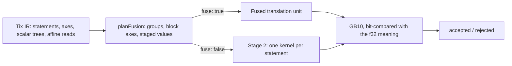

# Fusing Tix statements without moving a single result bit

Stage 2 launched one CUDA kernel per Tix statement. Every intermediate tensor made a round trip through global
memory, and every row reduction gave a whole thread to one element while a single thread walked the row. Stage 3
puts several statements in one kernel, and where a reduction needs it, gives a block a row and stages that row in
shared memory.

The condition is exact: **not one result bit may move.** Nothing in this stage reassociates a reduction, contracts a
multiply and an add, or changes a rounding site, so the relation that IRWB-019 landed for the lowering — bit equality
with the current revision's f32 meaning, NaN compared as a class — remains the acceptance test, and no tolerance had
to be justified. What follows is measured in this ticket's worktree on the GB10, unless marked as an argument.

## What fusion is, and where it lives

Fusion is a *lowering* decision, not a program transformation. The Tix IR says what each tensor's elements are; it
does not say which kernel computes them or on which thread. So the decision cannot live in the program: a Tix pass
would have to add a schedule to the meaning-carrying artifact, and the evaluator, the validator and the meaning gate
would all have to learn about a field that has no semantics. It also does not need a second artifact: everything a
kernel plan contains — the groups, the block axes, which values are staged — is a computable function of the Tix
revision, so as an artifact it would be a cache, with its own schema, validator and emitter input, not a checked
program.

So: `src/tensor/fusion.ts` holds `planFusion(fn)`, which returns the kernels of the fused lowering; `emitCuda(fn,
fuse)` consumes the plan. Legality is a predicate over the plan, evaluated from the IR before a line of CUDA is
written, and a group that fails any rule is simply not formed — those statements are lowered exactly as stage 2
lowers them. Fusion is never a precondition for correctness.



### The framework finding

The stage asked whether the framework's correspondence can express many statements becoming one kernel. The IR layer
can: `makeCorrespondence` accepts a grouped entry, and probe `scripts/01-correspondence-probe.mjs` records one.

```
grouped many-to-one entries: [{"from":["e","m","s"],"relation":"fused-into","to":["k0"]}]
```

What cannot express it is this lowering's output port. Its artifact is built with `createArtifact` over a
`defineIR<{fn, source}>`, so it has no adapter and no entities; the probe prints

```
CUDA artifact keys: contentHash id kind revision schemaVersion value
CUDA artifact carries an adapter: false
```

Kind, schema, value validator and identity exist; a logical projection does not. Naming kernels in a correspondence
therefore requires a kernel-IR artifact with an adapter over the emitted text, which is exactly the second artifact
rejected above. The lowering claims no correspondence and is judged on the *output* of the whole translation unit
instead — which is the stronger statement anyway: a correspondence says which statement became which kernel, while the
exact differential says the bits are unchanged.

**`src/framework/` is unchanged in this stage.** The existing surfaces were enough: `defineTransformation` with an
asynchronous `differential` invariant for the cross-kind lowering, the single batched `decide` call, and the memo keyed
by revision plus runner profile. One consequence worth recording: since the profile string is the only part of the
subject key that is not the artifact revision, the fused and unfused lowerings need different profiles
(`cuda-remote:sm_121:-O3:fused` and `…:plain`) so that each lowering's evidence is its own — even though, for a
single-statement program, both lowerings emit the same text.

## The two policies

Both are stated over the IR alone and both preserve order by construction.

**Flat.** A producer may be inlined into a later statement of the same group when every load of it addresses the
producer through plain binder names that are all *free* axes of the consumer and no two of them coincide. Then the
producer's element is a function of exactly one element of the consumer, so its tree is evaluated once per output
element — the number of evaluations of every rounding site is what it was in the producer's own kernel — and each
output element sees the same operations in the same order. The store/load pair that disappears carried no rounding,
because a producer's last arithmetic operation and its store round to the same f32 word. A producer with a reduction
in it is allowed: the sequential reduction loops then sit inside the consumer's per-element body.

**Row.** A block per row. The group's members share leading free axes (the block axes); each member has at most one
further free axis. A member with none is a per-row scalar, computed by one thread with the meaning's sequential folds
and published through a shared scalar with a barrier. A member with one is computed by the block's threads, strided
over that axis. Values whose address is `(row coordinates…, one free affine)` at every load — a row of a parameter, an
intermediate row, a per-row scalar — are staged in shared memory, so the row is read once, coalesced, and then
re-read as often as the bodies like. Staging copies f32 words and nothing else; the folds keep their order; no value
moves between threads. That is the whole legality argument for the mapping change.

At each group start both policies are tried and the one covering more statements wins; a tie goes to flat, which needs
no barrier and keeps one thread per output element.

### Which fusions applied

From `scripts/07-fusion-ledger.mjs`:

| Program | Statements → kernels | What the fused kernel does |
| --- | --- | --- |
| matmul | 1 → 1 | nothing to fuse; stage 2's kernel, byte for byte |
| softmax | 4 → 1 | block per row: stage `x`'s row → thread 0 folds the row max into a shared scalar → `e = exp(x - m)` across the block → thread 0 folds the row sum → `y = e / s` |
| layernorm | 4 → 1 | block per row: stage `x`'s row → thread 0 folds `sum(x)/D` → `centered` across the block into a shared row → thread 0 folds `sum(centered²)/D` → `y = centered/sqrt(v+eps)*gamma+beta` |
| attention | 6 → 1 | block per query row: stage `q`'s row → `score` (one lane per key, folding over `d`) into a shared row → thread 0 folds the max → `e` → thread 0 folds `z` → `weight` → `out` folding over the staged `weight` row |
| mlp | 3 → 1 | block per row: stage `x`'s row → `h` (one lane per hidden unit, folding over `d`) into a shared row → `g` (GELU over the staged `h`) into a shared row → `y` folding over the staged `g` row |
| conv2d | 1 → 1 | nothing to fuse; stage 2's kernel, byte for byte |

The odd detail worth stating: on the corpus the **row** policy produced every fusion, including `mlp`, whose first two
statements look like the flat policy's epilogue case. Flat would have merged `h` and `g` and left `y` alone (two
kernels); row merges all three and keeps `g` in shared memory instead of global. The flat policy is what fuses pure
elementwise chains and epilogues — `a[i]=x[i]*2; b[i]=a[i]+1; c[i]=exp(b[i])` becomes one kernel, and the fused text
contains no reference to `a` or `b` at all — but the corpus has no such program.

### Which legal-looking fusions were refused, and why

| Fused? | Shape | Reason |
| --- | --- | --- |
| no | `m[i] = max(j) x[i,j]` inlined into `e[i,j] = exp(x[i,j] - m[i])` | The map from `m`'s one free axis onto `e`'s two is not a bijection, so inlining would re-evaluate the whole row once per element — `C` times the work. Bit-identical, but not a fusion anyone wants. The row policy stages `m` as a shared scalar instead, which is what makes softmax one kernel. |
| no | mlp's `g` inlined into `y`'s `sum(k) g[i,k] * v[k,j]` | The load sits at a reduction binder, so its coordinates are not among `y`'s free axes and the map is not onto them: inlining re-evaluates a `D`-term reduction `H` times per output element. The row policy stages `g`'s row instead. |
| no | `m[i] = max(k) x[i,k]` read as `m[j]` by `y[i,j]` (square input) | No layout serves another row inside one block, and no inlining is possible at rank 1 into rank 2. Two kernels. |
| no | a staged member read transposed, `p[i,j]` as `p[j,i]` | Staging assumes the reader addresses the row's own coordinates. If the producer is also read twice, flat declines too (single-use rule), so the program keeps two kernels. |
| not staged | `gamma[j]`, `beta[j]`, `eps[0]`, `bias[j]`, `w[d,j]`, `v[k,c]`, `k[j,d]` | These are indexed by a constant, by a column, or by a reduction binder, so a row copy would not describe their addresses. They stay global loads, exactly as stage 2 had them — coalesced for `gamma`/`beta`, L2-resident for `w`, `v` and `k`. This is a staging decision refused, not a fusion. |
| no | matmul, conv2d | One statement each. `conv2d`'s read is `x[n,c,y+dy,x+dx]`: an affine row window, not a row, so even a multi-statement version would have to tile, which this stage does not do. |

A consequence of the single-use rule that I did not expect and that the tests now record: a producer read **twice**
is not inlined, but the row policy stages it once and both reads share the staged value, so
`p[i]=x[i]*2; y[i]=p[i]+p[i]` is still one kernel — by staging, not by duplicating the tree.

## Measurements

Sizes are the brief's: matmul M=K=N=512; softmax N=4096, C=1024; layernorm N=4096, D=1024; attention Q=K=1024,
D=V=64; mlp N=1024, D=256, H=1024, O=256; conv2d N=8, C=16, H=W=64, O=32 with a 3×3 kernel. Timing is
`runTixCuda(…, {benchmark: true})`: one warm-up launch, then the median of three CUDA-event intervals around the
kernels only, under `tools/cuda-remote.mjs --timed`. Kernel counts are counted from `cudaSource`.

| Program | Kernels | GPU ms, unfused | GPU ms, fused | Ratio | Issued global MB, unfused → fused | 244 GB/s time of those bytes, ms | Compulsory MB, unfused → fused |
| --- | ---: | ---: | ---: | ---: | ---: | ---: | ---: |
| matmul | 1 → 1 | 0.2142 | 0.2072 | 1.03× | 1074.8 → 1074.8 | 4.405 → 4.405 | 3.1 → 3.1 |
| softmax | 4 → 1 | 0.8019 | 0.4763 | 1.68× | 134.3 → 33.6 | 0.550 → 0.138 | 100.7 → 33.6 |
| layernorm | 4 → 1 | 0.5194 | 0.2099 | 2.47× | 201.4 → 83.9 | 0.825 → 0.344 | 100.7 → 33.6 |
| attention | 6 → 1 | 1.1912 | 0.8001 | 1.49× | 1111.8 → 537.4 | 4.556 → 2.202 | 34.6 → 1.0 |
| mlp | 3 → 1 | 1.0684 | 0.9845 | 1.09× | 4330.6 → 2154.8 | 17.748 → 8.831 | 21.0 → 4.2 |
| conv2d | 1 → 1 | 0.1754 | 0.1920 | 0.91× | 1137.6 → 1137.6 | 4.662 → 4.662 | 6.1 → 6.1 |

Per kernel, from the same run (`scripts/06-benchmark-and-traffic.mjs`):

| Program | Unfused kernels (read MB, write MB) | Fused kernel (read MB, write MB) |
| --- | --- | --- |
| matmul | (1073.7, 1.0) | (1073.7, 1.0) |
| softmax | (16.8, 0.0) (33.6, 16.8) (16.8, 0.0) (33.6, 16.8) | (16.8, 16.8) |
| layernorm | (16.8, 0.0) (33.6, 16.8) (33.6, 0.0) (83.9, 16.8) | (67.1, 16.8) |
| attention | (536.9, 4.2) (4.2, 0.0) (8.4, 4.2) (4.2, 0.0) (8.4, 4.2) (536.9, 0.3) | (537.1, 0.3) |
| mlp | (2151.7, 4.2) (21.0, 4.2) (2148.5, 1.0) | (2153.8, 1.0) |
| conv2d | (1133.6, 3.9) | (1133.6, 3.9) |

The byte figures are **counted from the plan, not measured with hardware counters**: every global load site (a load
not served from shared memory) times the number of times it executes, plus one store per element a kernel writes to
global memory. They are *issued* traffic. For matmul, conv2d, mlp and attention most issued bytes are re-reads of
tensors that are small enough to live in cache — matmul's two 1 MB operands are read a thousand times each, conv2d's
kernel is 7 KB, attention's `k` and `v` are 256 KB, mlp's `w` and `v` are 1 MB — so the 244 GB/s column is *not* a
bound on those measurements, and the numbers there only compare the two lowerings with each other. The compulsory
column (each distinct tensor once per kernel) is the lower bound: the whole of matmul's arithmetic moves 3.1 MB, and
attention's fused kernel moves 1.0 MB, i.e. `q` in and `out` out.

Where the working set really is bigger than the cache — softmax and layernorm, 16 MB in and 16 MB out — the count is
the real thing. The f32 meaning of softmax requires exactly one read of `x` and one write of `y` — 33.6 MB — and the fused
kernel issues exactly that, so its 244 GB/s floor is 0.138 ms and its measured 0.476 ms is 3.5× the floor. Fused layernorm moves 67.1 MB read
(`x` staged, `centered` restaged, `centered` and `x` re-read for the variance fold, `gamma`/`beta` coalesced) against
a compulsory 33.6 MB. That gap is the price of not being able to keep `centered` in registers across a barrier:
the variance fold runs on thread 0 and must read the row from shared memory.

### Where the time goes, and why the wins are what they are

Probe `scripts/02-shared-row-probe.mjs` times one hand-written fused softmax kernel at the same size with one part
disabled at a time: memory only 0.110 ms, plus the two sequential folds 0.294 ms, plus the exponential 0.379 ms,
everything 0.458 ms; a `y = 2x` stream kernel over the same 16 MB moves 32 MB in 0.108 ms (311 GB/s measured here).
So the fused row kernel is not memory-bound at these sizes:

- the exact `exp` costs ≈ 0.27 ms. The relation forbids `expf` (stage 2 measured 16 615 non-NaN disagreements out of
  102 461 inputs) and requires CUDA's *double* `exp` rounded once, which on this part is what an FP64-heavy kernel
  costs. No order-preserving optimisation in this stage can remove it.
- the two order-preserving folds cost ≈ 0.18 ms: 4096 rows × 2 × 1024 dependent steps, one thread each. They cannot
  be parallelised without reassociating the reduction, which is a later stage's business under a tolerance.
- the thread count matters more than the unroll: 0.458 ms at 128 threads against 0.558 at 256, 0.552 at 64 and 0.611
  at 32; unroll 4 gives 0.438 (4%), which is why the emitter keeps stage 2's plain fold loops and uses 128 threads.

That accounts for softmax's 1.68× and layernorm's 2.47×: layernorm has no exponential and its folds reuse the staged
row, so removing three global round trips of a 16 MB tensor shows up almost in full. `attention` improves 1.49× (it
removes 5 launches and 16 MB of intermediate round trips but still re-reads `k` and `v` per lane — 537 MB of issued
traffic, all L2-served; tiling it is a later stage). `mlp` improves only 1.09×: it removes one 4 MB round trip of `g`
out of two contractions whose operands are re-read for every output element. `matmul` and `conv2d` are unchanged —
their sources are byte-identical to stage 2's, and the 0.91× on conv2d measures the noise of a single timed
observation, not a regression (the same file measured 0.166 → 0.190, then 0.175 → 0.192, on the two passes; a third
pass with single launches measured 0.182 → 0.181).

Two passes of the benchmark script and one pass of single launches:

| Program | pass 1 fused / unfused | pass 2 fused / unfused | single launch fused / unfused |
| --- | ---: | ---: | ---: |
| matmul | 0.2158 / 0.2141 | 0.2072 / 0.2142 | 0.1947 / 0.1979 |
| softmax | 0.4592 / 0.8265 | 0.4763 / 0.8019 | 0.4631 / 0.7836 |
| layernorm | 0.1960 / 0.4848 | 0.2099 / 0.5194 | 0.1829 / 0.4677 |
| attention | 0.8092 / 1.0477 | 0.8001 / 1.1912 | 0.8715 / 1.0804 |
| mlp | 0.9700 / 1.0540 | 0.9845 / 1.0684 | 0.9815 / 1.0662 |
| conv2d | 0.1902 / 0.1664 | 0.1920 / 0.1754 | 0.1807 / 0.1817 |

## What the contract checks, and what it costs

`checkLowering(program, fn, {fuse})` runs the same checked lowering pass stage 2 built: a `defineTransformation` from
the Tix artifact to the CUDA source artifact whose body is the emitter, with one `ensures` invariant. The invariant
generates a case set from the current revision — shapes 1, 3, 4, 7 assigned to every shape symbol at once, a mixed
assignment where each symbol gets a different size, an all-zero assignment and one-zero-at-a-time assignments; four
value streams (signed, positive, the `[1,0,0,0,2⁻²⁴,2⁻²⁴,2⁻²⁴]` witnesses, and alternating signed zeros); at most 4096
elements per tensor and 10⁶ metered evaluator steps per case — evaluates each case with the f32 interpreter, sends all
undecided cases to the GB10 in **one** batch, and compares every output word, treating NaN as a class. Shape and
length must agree exactly. The subject key is the CUDA artifact revision plus the runner profile, so the fused and
unfused lowerings keep separate evidence and a repeated check replays it.

Cost, measured (`scripts/04-check-lowering.mjs`): 2.2–3.5 s per fresh verdict (one interpreter pass per case, one
`nvcc` compile of the generated unit, one batched run) and 1 ms when the verdict is already cached — conv2d's
optimized revision is identical to its original, so its second verdict replays. All 24 verdicts (6 programs ×
{original, optimized} × {fused, unfused}) were **accepted as exact**.

What it does *not* check: `cudaSource` on its own. A translation unit is never accepted by being printed; only a
lowering whose GPU output equals the meaning is. And it is a sampled verdict over the program's shapes, not a proof
over all inputs.

## Verification summary

| Evidence | Result |
| --- | --- |
| Fused vs stage 2, full corpus sizes, output words | identical in all six, both lowerings run on the GB10 (`scripts/03`) |
| Contract verdicts, corpus, both revisions, both lowerings | 24 of 24 accepted, relation `exact` (`scripts/04`) |
| Fused vs the f32 interpreter at shapes the contract does not sample | identical words: softmax 5×300, layernorm 3×40, attention 4×6×8×5, mlp 3×6×9×4 (`tests/tensor/cuda-fused-gpu.test.mjs`) |
| Random programs, 18 cases each (6 shapes × 3 streams), fused *and* stage 2 vs the interpreter | 11 programs, 198 of 198 cases identical (`scripts/05`) |
| `fuse: false` is stage 2's lowering | byte-identical text for all six corpus programs (SHA-256 pinned in `tests/tensor/fusion.test.mjs`) |
| Empty extents | a 0-length row (max `-inf`, sum `+0`, nothing written), no rows at all, and a one-lane row all agree with the interpreter |
| Stage-1 interaction | the fused lowering of `optimizeTix(program, ['inline','split-sum'])` is accepted as exact, including split sums whose inner extent is `min(4, K - 4*block)` |
| Test files | `tests/tensor/fusion.test.mjs` 13 pass; `tests/tensor/{corpus,language,passes,cuda}.test.mjs` 35 pass; `tests/tensor/cuda-gpu.test.mjs` 11 pass unchanged; `tests/tensor/cuda-fused-gpu.test.mjs` 9 pass; `tests/framework/*.test.mjs` 227 pass |

## Tool changes

None were needed. `tools/cuda-remote.mjs` already provides the three things this stage uses: `--timed` for the GPU
lock during benchmark runs, `--runtime-input` so a tensor payload does not enter the compile key, and per-invocation
remote directories. The fused kernels use dynamic shared memory, which needs only `cudaFuncSetAttribute` in the
generated host code — a program change, not a tool change. `--link` was already there for other work.

## What was measured and what was only argued

**Measured on the GB10.** All kernel counts (from the emitted text, not from a profiler); every GPU time above
(CUDA events, median of three after a warm-up, under the `--timed` lock, three independent passes); fused-vs-stage-2
word equality at full size; fused-vs-interpreter word equality at unsampled shapes and on 198 fuzz cases; the
24 contract verdicts and their wall times; the part costs and the thread/unroll sweep in probe 02; the 311 GB/s
stream reference on this machine (the brief's 244 GB/s is used only for the floor arithmetic above).

**Argued, not measured.**

- That each fusion *preserves* the order. The argument is by construction — inlining keeps the tree, the fold loops
  stay sequential and lexically ordered, staging copies bits — and the evidence is that 198 fuzz cases, 24 sampled
  verdicts and two full-size comparisons found no difference. That is not a proof.
- The byte counts are counted from the plan, not read from hardware counters, and the split between L2 and DRAM is
  inferred from working-set sizes, not measured.
- That the exact `exp` is the FP64-heavy part is inferred from the part-by-part timings of one hand-written kernel, not
  from a counter.
- The shared-memory domain limit: the corpus needs 8–13 KB and the host opts in to the maximum, but I did not test a
  program whose staged rows exceed the device's 227 KB, and such a program would fail at launch rather than fall back.
- Nothing was done about `attention`'s 537 MB of issued traffic, `conv2d`'s spatial reuse, or `matmul` at all: those
  are tiling and reassociation, which this stage explicitly does not own.

## What I would do differently

I would print the plan (as `scripts/07-fusion-ledger.mjs` now does) before writing the emitter, not after: two of the
refusals I first "found" in tests were no such thing — the row policy stages a doubly-read producer, and one of my
"refused" programs was not legal Tix at all. Reading `planFusion`'s output directly would have made the first hour
of test-writing shorter.

I would also have probed the cost of `exp` before setting expectations from the earlier prototype's 4.25×. Stage 2's
own report says the tolerance relation needed double `exp`, but only a measurement of the parts shows that at
4096 × 1024 the exact exponential is 0.27 ms — over half of a 0.46 ms fused kernel — and therefore that a 4× win on
softmax was never available under the exact relation. That belongs in the design, next to the bandwidth figure, so a
reviewer can see what the ceiling is before reading the results.
