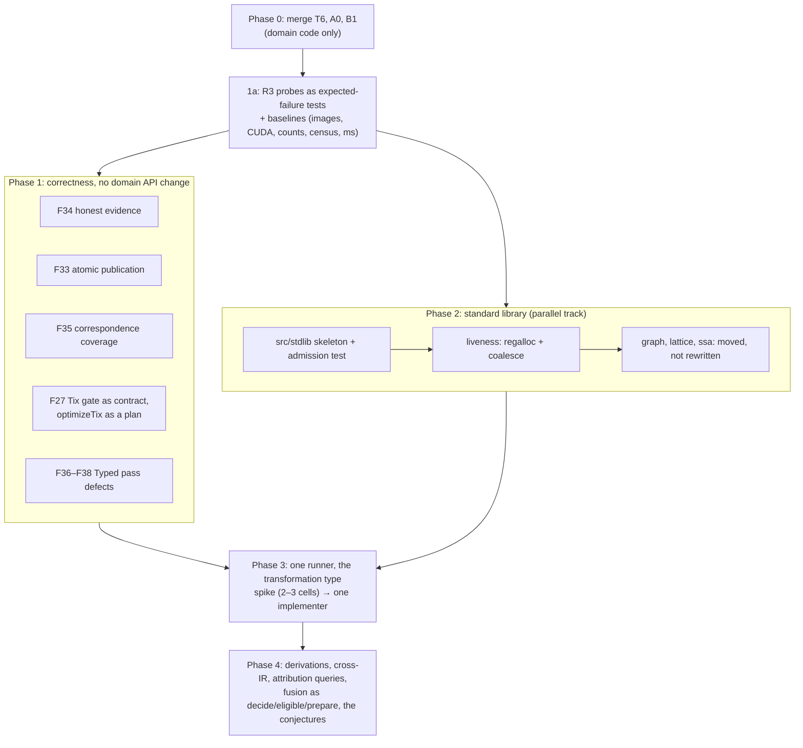

# The v7 refactor plan: phases, decision points and who does what

## Where this comes from

The R3 round (IRWB-038 A–D) put four reviewers on the question of what forty implementations say about the v6 framework. The synthesis is published at https://claude.ai/artifact/GJoGirJU2XaKCR83mvcQAQ, with its probes in `ttmp/2026/11/26/IRWB-019-…/various/r3-synthesis/`. It ends with a fourteen-step migration. This document turns that migration into a working plan. It decides the order, the acceptance check of every step, and which kind of agent should do each step.

The plan follows one principle. **A step is done when an R3 probe that used to show a defect now passes, every recorded baseline is unchanged, and the suites are green.** The probes already exist. Making them tests first gives every later step a mechanical acceptance check, and that check is what lets cheaper agents do most of the work.

## The phases at a glance

Phases 1 and 2 run in parallel on one base, because their file sets are almost disjoint. Phase 3 waits for both, because it changes what every pass sees.

## Phase 0: absorb the pending merges first

T6 (the schedule IR), A0 (the edit classifier) and B1 (the bytecode specializer) are unmerged. They are exactly the code the refactor must serve:

- T6's schedule passes and `legal` are the main client of K6 (decide, eligible, prepare);
- B1's specializer is the client of the `pe` primitives and of `solveFor`;
- A0's classifier is what migration step 9 (attribution and classification as queries) generalizes.

If they are merged before the refactor, the new API is tried against four kinds of client instead of two, and nothing has to be rebased onto the new API later. Merge **domain code only**:

- no second strategy interpreter (`executeSync`, F32);
- T6's `legal` stays inside the domain until phase 4;
- framework edits from T6 cells only where the merged domain code needs them.

New stages (T4, T10, …) wait until phase 3 has landed.

## Phase 1: correctness without an API change

### 1a. Probes as tests, and baselines

The R3 synthesis probes become `tests/framework/r3-*.test.mjs`. A probe that shows a defect is written as the *correct* expectation and marked `todo` with the fix that will flip it:

| Probe | Defect | Flipped by |
|---|---|---|
| 01 assurance of sampled and exact | sampled and exhaustive both record `'checked'`; `assuranceOf(undefined)` is exact | F34 |
| 02 Tix passes in strategy plans | a wrong Tix pass is accepted through the bridge | F27 restated |
| 03 publication before acceptance | a rejected candidate stays the store's head; a fact survives `preserveViolated` | F33 |
| 04 correspondence content | zero groups and a false group are accepted | F35 |
| 08 T6-D order validator | (lands with the T6 merge, as a regression test) | phase 4 |

Baselines, written by one script (`scripts/` of this ticket) into `various/baselines/`:

- RV32 image bytes (SHA-256) per corpus project under r0, O2 and `speed`;
- CUDA source (SHA-256) per Tix example, fused and unfused;
- corpus instruction totals at the agents' seed and the held-out seed (the hidden D1 evaluator);
- the census of edit and correspondence records (probe 09);
- milliseconds per pass application (probe 11).

Every later step reruns the script and must show no difference, except where the step's purpose is to change a number (and then the difference is stated in its report).

### 1b. The five fixes

| Item | Change | Files | Acceptance |
|---|---|---|---|
| **F34** honest evidence | records carry `method` and `scope`; unknown evidence is `unknown`, never exact; Typed's rule strength flows into a pass's evidence | `contracts/analysis-manager.ts` (the constant at :1177), `contracts/differential.ts` (`assuranceOf`), `contracts/types.ts` | probe 01 passes |
| **F33** atomic publication | candidates are prepared on a private view; the contract runs with `deferCommit`; commit only after preservation checks; a stale head is its own outcome | `ir/view.ts` (:190), `passes/define-pass.ts` (:201, :345–389), the manager's commit path | probe 03 passes |
| **F35** correspondence coverage | a declared coverage policy per correspondence requirement (`partial`, `sourceTotal`, `targetTotal`, `bothTotal`); the structural diff audits the declared entries | `contracts/analysis-manager.ts` (:1110–1128), `ir/correspondence.ts` | probe 04 rejects zero and false groups; every existing domain correspondence still passes |
| **F27** Tix on the current framework | the meaning gate becomes an `ensures` contract on the bridge; `optimizeTix` runs a strategy plan; relation declared per pass, not chosen by name | `src/tensor/index.ts`, `src/tensor/passes.ts` | probe 02 rejects the wrong pass; identical revisions on every example |
| **F36–F38** | `bce` compares SSA names; `typed.ranges` keeps an outer counter's lower bound (widen, then narrow); `lvn` is idempotent | `src/typed/` passes | IRWB-037-G's probes 13 and 14; a second `lvn` runs on regex-nfa |

F33, F34 and F35 all touch `analysis-manager.ts`, in different functions. They are merged in the order F34, F35, F33, smallest first.

## Phase 2: the standard library

The library is pure functions over small shape interfaces, so it does not depend on the runner and runs beside phase 1.

- **Admission** (from R3): a named theory, two clients, an executable checker or fixture, pure and synchronous. Promotion test: name both clients, the law, the code it retires, and one input on which a careless extraction changes meaning.
- **2a. Skeleton.** `src/stdlib/` with the layering D proposed (`graph lattice num` use nothing; `ssa flow` use them; `pe affine term` above; `check measure` on top), an index, and a test that fails if a library module imports `src/framework`, `src/typed` or `src/tensor`.
- **2b. Liveness first.** Two clients in one compiler (`backend/regalloc.ts:85`, `backend/coalesce.ts:32`), exact sets to compare, and a known trap: an unreachable predecessor of a reachable join (B's probe 08), so the primitive takes an explicit scope (all blocks, or entry-reachable). Acceptance: byte-identical images.
- **2c. Graph, lattice, ssa,** moved from `typed/analyses.ts`, `typed/ssa.ts`, `typed/sccp.ts` and the framework solver's helpers, not rewritten. Decision point: if an adapter is larger than the algorithm it replaces, keep the domain copy.

## Phase 3: the pass API (K1, K3, K5)

This is the one step that changes what every pass sees, so it runs as a spike and then a single implementation.

- **Spike** (two or three cells on the same base): port Tix `inline` and one Typed pass under `Tx` onto a prototype runner written once as a generator, with a sync and an async driver; the transformation declares `relation`, `eligible`, `prepare` and `obligations`. The question the spike must settle with measurements: can a synchronous `analyseSync` share the manager's cache and records, or do we keep one pass specification with two thin runners?
- **Migration** (one implementer, on the chosen design): every pass moves, the synchronous runner's restriction (`define-pass.ts:231`) is deleted, and `optimizeTix` uses the sync driver.

## Phase 4: the rest, each behind a decision point

As in the synthesis, unchanged: derivations and scoped correspondence (gate: about 2× today's correspondence cost); cross-IR transformations; attribution and classification as queries; fusion as decide/eligible/prepare on the affine library, with the extent-17 counterexample as its test; `solveFor` and `pe` (gate: B1's specializer at most half of its 719 lines); rules over a term signature; keep or delete the rewrite engine, the transaction layer and the 1,237-line core runtime; staged choice.

## Who does what

The question is whether execution agents (Terra low, GLM 5.3 high, GLM Flash, DeepSeek) can carry this, and how much of the stronger models (Opus, Fable, Sol, Astra) it needs. The record so far:

| Agent | Precisely specified fixes | Open design-and-implement tasks |
|---|---|---|
| Terra low | F2–F6 in one review round; F23 in 4 minutes; F24–F26 in 6 | stopped early in D1 and A0; committed nothing in D2; incomplete in B1 |
| GLM 5.3 high | — | mid-pack: D2 −1.8%, B1 76/81 instructions |
| DeepSeek xhigh | — | left work uncommitted (D1); a non-terminating script of its own (B1) |
| Sol, Astra (medium) | — | solid, conservative (D2 −1.0%, −0.9%); found the publication defect in R3 |
| Opus, Fable | — | won D1, D2, T3, T3b; widest R3 reviews |

So execution agents are good when the step names the files, the change and a test that must flip; they are poor when the step needs a design choice. Most of phases 0–2 can be written that way, because the probes already state the expected behaviour. The design choices are concentrated in a few steps:

| Step | Agent | Why |
|---|---|---|
| 0: merges | coordinator | cherry-picks and judgement on which framework edits to keep |
| 1a: probes as tests, baselines | coordinator | the probes and the evaluator are the coordinator's |
| F34 | Terra low | small and fully specified by probe 01 |
| F27 | Terra low | the gate-as-contract code is already written in probe 02 |
| F36, F38 | Terra low | one-line cause stated (SSA names; idempotence) |
| F37 | GLM 5.3 high, or Sol | widening and narrowing on an interval analysis: textbook, but needs care |
| F35 | Sol medium | the coverage policy per existing correspondence is a design choice across both domains |
| F33 | Astra medium | manager commit semantics and the store; Astra found the store half |
| 2a: library skeleton and admission test | Fable | sets the pattern every later extraction copies |
| 2b, 2c: moves | GLM 5.3 high or Terra low, after 2a | mechanical once the pattern and the byte-identical check exist |
| Phase 3 spike | Fable, Opus, Sol | the one real design decision; judged on the tests and baselines |
| Phase 3 migration | the spike's winner | one implementer, no parallel cores |

Roughly: of the eleven items in phases 1 and 2, six go to execution agents, three to medium Codex models, and one (the library skeleton) to Fable; the coordinator does the rest. The stronger models are needed for about a third of the work by count, but for the parts where a wrong choice would be copied by everything after it.

## Risks

- **Three fixes in one file.** F33, F34, F35 all edit `analysis-manager.ts`. Merge order F34, F35, F33; each later one rebases.
- **Baseline drift from the merges.** Phase 0 changes the numbers; baselines are recorded after it.
- **Execution agents stopping early.** Each brief states the acceptance test and requires the agent to commit; the coordinator checks the commit, not the agent's message.
