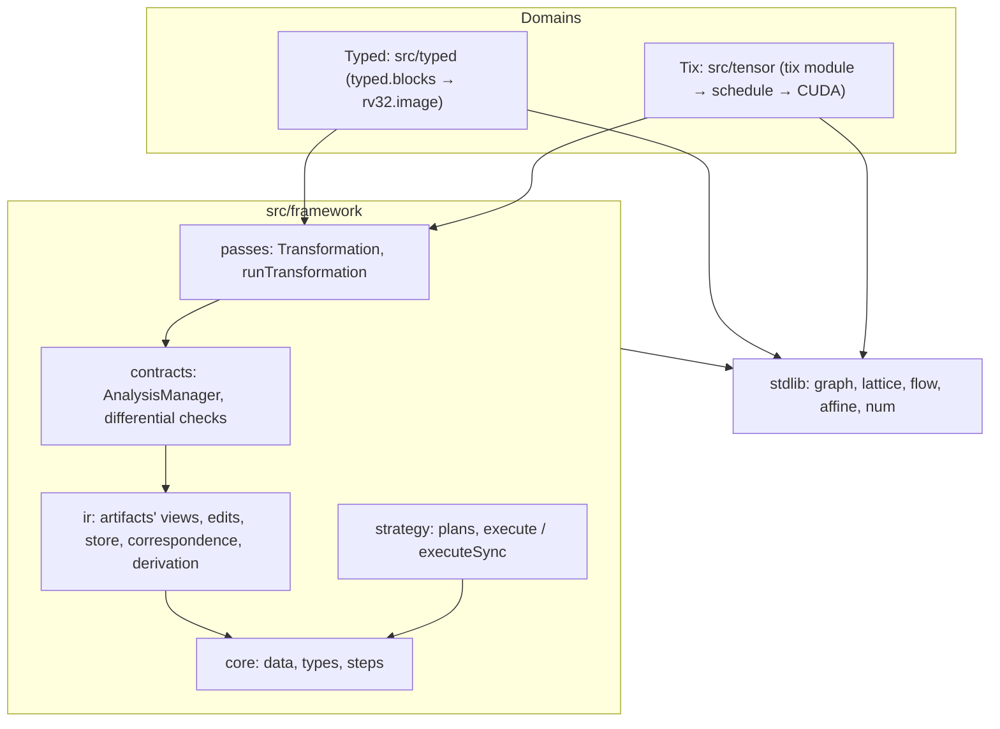
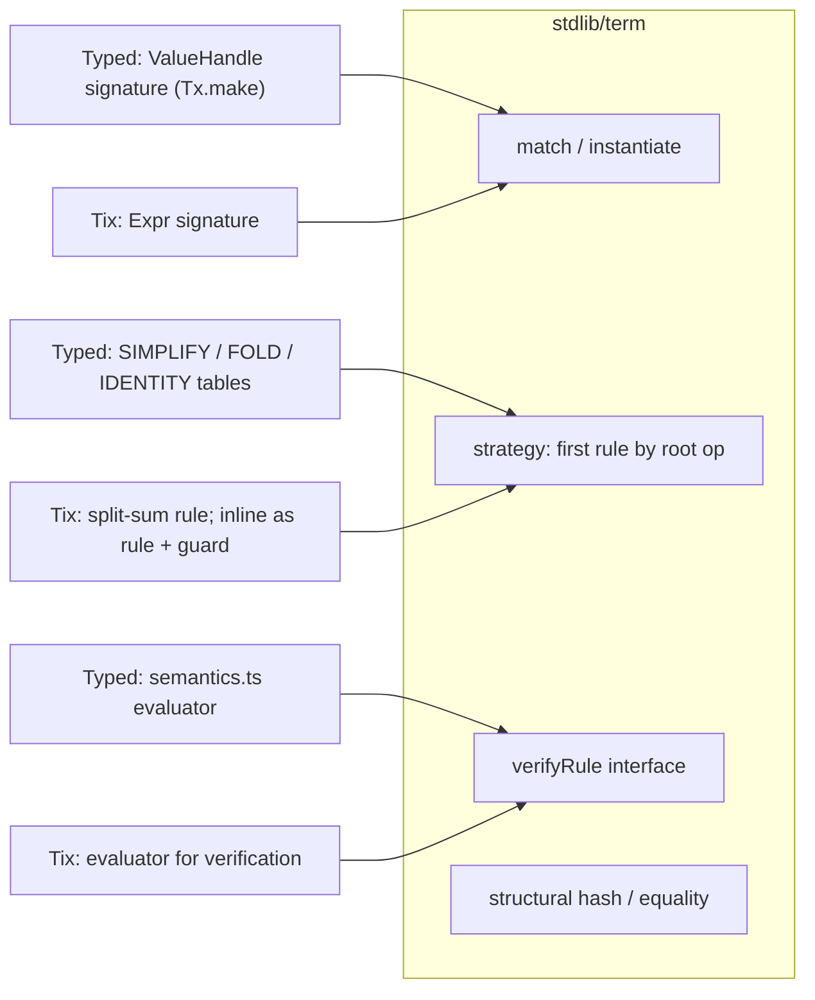
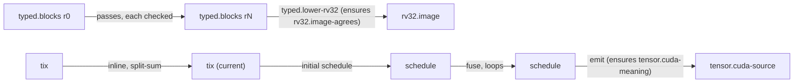
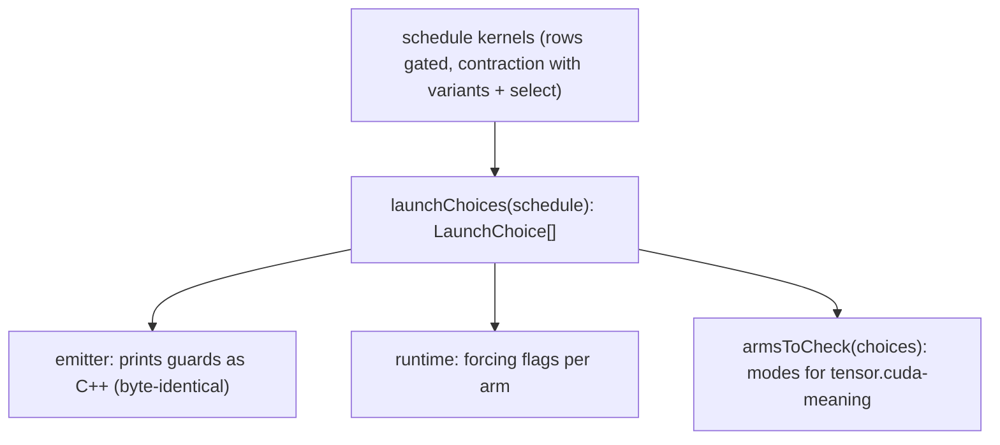

# Intern guide: the IR Workbench, and phase 4b

Some context first. **v7** is the current refactor of the framework, planned in ticket IRWB-039 (`ttmp/2026/11/27/IRWB-039--…/design-doc/01-…md`). It follows **R3**, a review round in which four coding agents each studied the framework after the Typed and Tix experiments. Their merged synthesis, the "R3 synthesis" (`ttmp/2026/11/26/IRWB-019--…/various/r3-synthesis/index.html`), proposed six core concepts, numbered K1 to K6 (K1 a typed transformation, K2 derivations, K3 evidence, K4 staged publication, K5 one runner with two drivers, K6 decisions as data), and a standard library. Phases 0–3 of v7 are done. Phase 4 is eight items, each with a *decision point*: a measurement, fixed in advance, that withdraws the item if it does not pay for itself. Three of the eight are done (derivations, fusion and scheduling as decide/eligible/prepare, and the demand-driven solver).

This guide has two jobs. The first is to teach the system: what the IR Workbench is, how a program travels through it, and which framework concepts every compiler step relies on. The second is to explain the four pieces of work in this round, phase 4b of the v7 refactor, well enough that you can implement or review any of them:

| Lane | One-line summary |
|---|---|
| **4.6** rules over a term signature | one library matcher and rule verifier for Typed's rewrite tables and Tix's rewrites, in `src/stdlib/term/` |
| **4.2** lowering as cross-IR transformations | the two lowerings (Typed → RV32 image, Tix → CUDA) run through the same runner, obligations and correspondence as every optimization pass |
| **4.8** staged choice | the decisions a CUDA program makes at launch time become one schedule-IR construct, so the GPU meaning check derives which variants it must test |
| **F41** one coverage check | the framework checks correspondence coverage in one place instead of two |

Everything stated as current behaviour was read from the source at commit `f341706` on the working branch `irwb-001/import-v6-prototype`. Paths are relative to the repository root, `/home/manuel/code/wesen/2026-11-24--compiler-workbench`. Where the guide proposes something, it says so.

## 1. What the system is

### 1.1 Checked transformations

A compiler is a sequence of transformations: each takes a program and produces another program that should mean the same thing. Most compilers trust each transformation once it is written and tested. The IR Workbench does not. Every transformation is applied under a **check**, and its result is published only after the check accepts it. The check takes three forms, and most transformations use more than one:

- A **meaning contract** compares the output program with the input program (or with the original source revision) on generated inputs. For Typed it runs both programs in an evaluator; for Tix it compares tensors element by element.
- A **correspondence** records, for each entity of the output (a statement, a value, an instruction, a kernel), which entities of the input it came from. It is validated against both programs, so a transformation cannot claim to have produced something that is not there.
- A **derivation** records *why* each step happened: the rewrite rule or decision that licensed it, and the facts it relied on.

The reason for this design is research, not production: the workbench is a place to measure what optimizations do, to compare coding agents that write them, and to find out which framework concepts a compiler actually needs. A transformation that can be wrong silently would make every measurement suspect.

### 1.2 Two compilers on one framework

The framework is written in TypeScript (Node 24) under `src/framework/`. Two compilers are built on it, and they are deliberately different so that the framework cannot quietly specialise to one of them.

**Typed** (`src/typed/`) is a small statically typed language compiled to 32-bit RISC-V (RV32IM with the F extension). Its intermediate representation, `typed.blocks`, is a control-flow graph of basic blocks holding statements over value trees. The optimizer has 22 passes (`PASSES` in `src/typed/passes.ts:1216`) combined into pipelines such as `O1`, `O2` and `speed` (`PIPELINES`, `src/typed/passes.ts:1242`). The corpus is 50 projects in `corpus/projects/`.

**Tix** (`src/tensor/`) is an index-notation tensor language compiled to CUDA, run on an NVIDIA GB10 reached over SSH (`tools/cuda-remote.mjs`). Its IR is a module of functions whose statements define tensors by expressions over indices and reductions. It has two optimization passes (`inline` and `split-sum`) and a lowering that schedules statements into CUDA kernels. The corpus is six programs in `corpus/tensor/` (attention, conv2d, layernorm, matmul, mlp, softmax).

Below the framework sits the **standard library** (`src/stdlib/`): named compiler algorithms (dominators, lattices, the dataflow solver, affine forms, binary32 arithmetic) that both compilers call.



The diagram shows the import direction. Domains use the framework and the library; the framework uses the library; the library uses nothing outside itself. Two tests enforce this: `tests/framework/layering.test.mjs` (the framework imports nothing outside `src/framework/` and `src/stdlib/`; `strategy`, `contracts` and `ir` take only `core/data.js`, `core/types.js` and `core/steps.js` from `core`) and `tests/stdlib/layering.test.mjs`.

### 1.3 One Typed program, from source to instructions

`corpus/projects/first-steps/main.typed` is two small functions:

```text
function scale(x: i32): i32 {
    const k = 2 * 4;
    return x * k + 1;
}
function twice(x: i32): i32 {
    return scale(scale(x));
}
```

The path through the system:

1. **Front end.** `projectSource(id, files)` and `ingestProject(p)` (`src/typed/project.ts:67`, `:85`) parse the project and produce revision r0, an `Artifact<TypedBlocks>`. `Program.fromProject(p)` (`src/typed/program.ts:138`) wraps that revision with the project's inputs and an analysis manager.
2. **Optimization.** `Program.apply(pass)` (`src/typed/program.ts:270`) runs one pass. It calls `applyTransformation(pass, this.head, { manager, ensures: [optimizationContract(...)], inputs: { origin } })`. The optimization contract compares the candidate with r0, the *origin*, on 40 generated cases per function (seed 7). The project's pipeline is `O1` (`cfg, fold, simplify, constprop, fold, simplify, dce, cfg`). For `scale`, the first `fold` turns `2 * 4` into the constant 8, `constprop` replaces `k` with 8, and the second `simplify` rewrites `x * 8` into a left shift by 3 with the rule `mul-pow2` from its rule table (section 4.1). Each pass that changes something adds one revision, and each has one edit here.
3. **Lowering.** `lowerToImage(blocks)` (`src/typed/backend/compile.ts:442`) runs instruction selection, register allocation, coalescing and encoding inside `compileImage`. It returns `{ image, correspondence }`: an `Artifact<Rv32Image>` with id `img:<program>`, and `imageCorrespondence(blocks, image)` (`src/typed/backend/image.ts:333`), which maps each `typed.blocks` entity to the instructions that cover it.
4. **Execution.** `runImage(image, fn, args, memory)` (`src/typed/backend/run.ts:74`) runs a function on an RV32 emulator and counts instructions. The baselines record those counts.
5. **Optional check of the lowering.** `imageAgrees(params)` (`src/typed/backend/run.ts:365`) is a differential invariant, `rv32.image-agrees`, that compares every function of the image with the evaluator on generated cases. Today it is called by tests and workbench views, not by `lowerToImage`.

### 1.4 One Tix program, from source to CUDA

`corpus/tensor/softmax/main.tix`:

```text
fn softmax(x: f32[N,C]): f32[N,C] {
  m[i] = max(j) x[i,j];
  e[i,j] = exp(x[i,j] - m[i]);
  s[i] = sum(j) e[i,j];
  y[i,j] = e[i,j] / s[i];
  return y;
}
```

1. **Front end.** `compileTix(source)` (`src/tensor/index.ts:28`) parses the text into a `Module` and returns `{ origin, current }`, two references to the same `tix` artifact. The model types are in `src/tensor/model.ts`: a `Statement` has `axes` and an `expr`; an `Expr` is a `literal`, `shape`, `load` (with affine `indices`), `op` or `reduce`.
2. **Optimization.** `optimizeTix(program, ['inline', 'split-sum'])` (`src/tensor/index.ts:45`) builds a strategy plan with one `attempt` per pass and runs it with `executeSync`. Each pass carries the Tix meaning gate (`tixMeaning`, `src/tensor/passes.ts`), which compares the candidate with the origin, exactly for `inline` and within a tolerance for `split-sum`.
3. **Scheduling.** `lowerSchedule(fn, fuse)` (`src/tensor/strategy.ts:218`) starts from `initialSchedule(fn)` (`src/tensor/schedule.ts:329`), which puts each statement in its own pointwise kernel. It then runs `schedulePlan`, a four-node strategy plan:
   - decide the fusion grouping;
   - apply `fusePass`;
   - decide the loop nests of contraction kernels;
   - apply `loopsPass`.
4. **Emission.** `emitScheduleProgram(schedule)` (`src/tensor/cuda-source.ts:818`) prints a CUDA translation unit and returns `{ source, kernels }`. `kernels` is the **manifest**: one `CudaKernel` per kernel with `name`, `mapping`, `statements`, and optionally `gated` and `variants`.
5. **Execution.** `runTixCuda(program, fn, inputs)` (`src/tensor/index.ts:96`) and `runCudaBatch` (`src/tensor/cuda-runtime.ts:107`) compile the source with `nvcc` on the GB10 and run it.
6. **Check of the lowering.** `checkLowering(program, fn)` (`src/tensor/index.ts:110`) calls `checkCudaLowering`, built by `createCudaLowering` (`src/tensor/cuda-contract.ts:142`). It runs the lowering as a contract-layer transformation, `tensor.lower-cuda`, whose `ensures` is the differential `tensor.cuda-meaning`: the GPU result must equal the interpreter's bit for bit, with NaN compared as a class.

Both traces end the same way: the optimizations are checked transformations, and the lowering is a function whose check is optional (Typed) or reached through a separate entry point (Tix). Lane 4.2 closes that gap.

## 2. The framework, concept by concept

Each concept below is something you will touch in this round. The order follows the life of one pass application.

### 2.1 Artifacts and revisions

An **artifact** is an immutable, content-addressed IR value (`Artifact<T>`, `src/framework/core/types.ts:10`):

```ts
interface Artifact<T> {
  readonly id: string;           // the lineage, e.g. 'tix' or 'img:first-steps'
  readonly revision: string;     // a hash of kind, schema version and value
  readonly contentHash: string;
  readonly kind: string;         // e.g. 'typed.blocks', 'rv32.image', 'tensor.cuda-source'
  readonly schemaVersion: string;
  readonly value: T;
}
```

The `id` names a lineage: successive revisions of one program share it. The `revision` changes whenever the value changes, so two artifacts with the same revision are the same program, and nothing can claim a revision its value does not hash to. An IR kind is declared with `defineIR` (`src/framework/contracts/definitions.ts:78`), which gives it a validator and an `entities` function listing the entity ids the value contains. Examples are `TixIR`, `ScheduleIR` (`src/tensor/schedule.ts:258`), `ImageIR` (`src/typed/backend/image.ts:236`) and `CudaIR` (`src/tensor/cuda-contract.ts:32`). An **adapter** (`defineAdapter`, used for example as `imageAdapter`, `src/typed/backend/image.ts:296`) presents a native value as entities and relations, so the framework can diff and validate it without knowing the domain. `createIRArtifact(adapter, id, value)` (`src/framework/ir/adapters.ts:128`) builds an artifact.

### 2.2 The store and atomic publication (F33)

An `IRStore` (`src/framework/ir/store.ts:12`) holds the current *head* revision of each lineage. `store.publish(next, { base, generation, acceptance })` replaces the head of `next.id` under compare-and-swap: it fails if the head has moved since `base` was read. If an `acceptance` is given, its `commit()` runs inside the same atomic window, so the new revision and the evidence that justifies it become visible together. A throwing commit leaves the store unchanged.

This is fix F33, made in phase 1. Before it, a rejected candidate could remain the head of a caller's store, and contract evidence was recorded before the decision. The rule now, enforced by the runner: **nothing about a candidate is visible until every obligation has passed.**

### 2.3 Transformations and the one runner

A pass is a `Transformation<S, N, P>` (`src/framework/passes/transformation.ts:108`), built with `transformation(spec)` (`:118`). `S` is the IR's value type, `N` the analyses it needs, `P` its parameters. The fields that matter:

| Field | Meaning |
|---|---|
| `id`, `version`, `description` | identity; the version changes when behaviour changes |
| `ir`, `adapter` | the IR kind it reads and writes, and how to view it |
| `needs` | analyses computed on the input before `prepare` runs; they arrive as `facts` |
| `writes` | the entity and relation kinds it may change; the runner rejects anything else |
| `relation` | `'exact'` or `'tolerance'`: how the output must relate to the input |
| `eligible(ctx)` | a small, trusted legality check of this application, before anything is built |
| `prepare(ctx)` | builds the candidate: either edits on an edit object, or a **native result** `{ native, derivation?, edits, report }` |
| `obligations.requires` | checks on the input |
| `obligations.ensures` | checks on the candidate: an `EnsuresCheck` (a function) or a contract (a `TransformationDefinition`) |
| `obligations.preserves` | analyses the pass claims it does not change |

There is one runner, `runTransformation(t, before, options)` (`src/framework/passes/transformation.ts:218`). It is a generator (section 2.4), and it does the same things in the same order for every pass:

```text
runTransformation(t, before, options):
  facts   ← for each need: manager.analyseSteps(need, before)
  for r in requires: refuse unless r.check(...) is ok          # PassError 'illegal'
  refuse unless t.eligible(...) is ok                          # PassError 'illegal'
  produced ← t.prepare(...)                                    # edits, or a native value
  after, changes, correspondence, derivation ← from produced   # a diff, or the derivation's steps
  if after == before: return unchanged
  enforce t.writes on changes                                  # PassError 'undeclaredWrite'
  try:
    for e in ensures:                                          # at most one contract
      contract: manager.verifyTransformationSteps(..., deferCommit) # PassError 'contractRejected'
      check:    e.check({ before, candidate: after, relation, params, inputs })
    for p in preserves: transfer the analysis, or recompute and compare  # 'preserveViolated'
    publishAccepted(t, store, before, after, contract)         # the one publication point
  finally:
    if not published: discard contract evidence; invalidate analyses of the candidate
  return { changed, artifact: after, correspondence, derivation, edits, preserved, obligations, ... }
```

Three things to notice. First, refusals (`illegal`) happen before anything is built, and rejections (`contractRejected`, `preserveViolated`) happen after, which lets a strategy plan treat them differently. Second, the cleanup is in `finally`, because the synchronous driver abandons a run with `return()`, which skips `catch`. Third, everything here assumes **one IR**: `before` and `after` are both `Artifact<S>`, the correspondence can come from a diff, and `preserves` compares an analysis on both. Lane 4.2 has to change exactly this assumption.

`applyTransformation` and `applyTransformationSync` (`:425`, `:434`) drive the runner asynchronously or synchronously. `applyPass` and `applyNativePassSync` (`:467`, `:484`) are older names kept as thin wrappers for tests and tools.

### 2.4 Steps: one definition, two drivers

Some checks are asynchronous: a GPU run, a worker pool. Some callers need a synchronous answer: `optimizeTix` and the Tix scheduler run inside synchronous code. Before phase 3 there were two runners with different powers. Now there is one, written as a generator over **steps** (`src/framework/core/steps.ts`):

```ts
type Steps<T> = Generator<unknown, T, any>;
function* wait<T>(value: T | PromiseLike<T>): Steps<T>; // `yield* wait(x)` is `await x`
async function driveAsync<T>(steps: Steps<T>): Promise<T>; // awaits each yielded value
function driveSync<T>(steps: Steps<T>, what: string): T;   // refuses a yielded promise
function drive<T>(steps: Steps<T>): T | Promise<T>;        // synchronous until the first promise
```

Where an `async` function would write `await x`, a step function writes `yield* wait(x)`. Generators compose with `yield*`, so the runner delegates to the analysis manager's step functions (`analyseSteps`, `preserveSteps`, `verifyTransformationSteps`) and both drivers serve both. The synchronous driver fails only when something actually answered with a promise. Any new code on the runner's path (lane 4.2's obligations, for example) must be written as steps, not as `async` functions.

### 2.5 Contracts, differential checks and assurance (F34)

The **contracts layer** (`src/framework/contracts/`, see its `README.md`) predates the pass layer. Its definitions are versioned, frozen data: `defineIR`, `defineAnalysis`, `defineInvariant` and `defineTransformation` (`src/framework/contracts/definitions.ts:78–150`). A contract-layer `TransformationDefinition` (`src/framework/contracts/types.ts:133`) has *named ports*: `inputs` and `outputs`, each an IR or a scalar type. That makes it naturally cross-IR: `tensor.lower-cuda` has inputs `{ baseline: TixIR, fn, fuse }` and output `{ subject: CudaIR }`. It also has `requires`, `ensures`, `preserves`, a `correspondence` requirement with a coverage policy, and an optional `run` body.

A **differential check** (`differential(spec)`, `src/framework/contracts/differential.ts:105`) is an invariant over ports that generates cases, runs a baseline and a subject on each, and compares the outcomes. `rv32.image-agrees` and `tensor.cuda-meaning` are both differentials. Its evidence records `method: 'sampled'`.

The **analysis manager** (`AnalysisManager`, `src/framework/contracts/analysis-manager.ts:112`) caches analyses by exact revision and records every check it runs. Its main entry points are `analyseSteps`, `preserveSteps`, `verifyTransformationSteps` (with `deferCommit`, so the runner commits the evidence at publication), `checkInvariant`, `invalidate` and the older, asynchronous `execute`, which runs a contract-layer transformation's `run` body.

**Assurance** says how strong a check was. `assuranceOf(evidence)` (`src/framework/contracts/differential.ts:412`) maps `method: 'sampled'` to `checked-sampled` and `exhaustive` or `exact` to `checked-exact`; anything else is the weaker `checked`. Before F34 every check was stamped `checked`, and an unknown method counted as exact. The rule for new code: **record the method your check actually used.**

### 2.6 Correspondence and coverage (F35)

The framework has two correspondence shapes, and you will meet both:

- **`EntityCorrespondence`** (`src/framework/ir/types.ts:156`) is the IR layer's: `from` and `to` revisions, `sourceEntities`, `targetEntities`, and `entries`, each with `from: string[]`, `to: string[]` and a `relation` (`retained`, `covered-by`, `removed`, a pass's own label). The runner produces this one. `makeCorrespondence`, `composeCorrespondence`, `traceEntity` and `whyEntity` live in `src/framework/ir/correspondence.ts`.
- **`Correspondence`** (`src/framework/contracts/types.ts:53`) is the contracts layer's: `id`, `relation`, `from`, `to`, `sourceEntities`, `targetEntities`, `entities: {from, to}[]`. Contract-layer transformations return this one; `kernelCorrespondence` (`src/tensor/cuda-contract.ts:80`) builds it for CUDA. `semanticCorrespondence(c, id, relation)` (`src/framework/passes/define-pass.ts:164`) converts the first shape into the second.

**Coverage** says how much a correspondence must explain. F35 introduced five policies:

| Policy | Requirement |
|---|---|
| `partial` | none |
| `nonempty` | at least one mapped entry when the revisions differ |
| `source` | every source entity is mapped |
| `target` | every target entity is mapped |
| `both` | both of the above |

The manager checks them in `validateCorrespondence` (`src/framework/contracts/analysis-manager.ts:1180`), together with membership: every listed entity must exist in its artifact. The type is `CorrespondenceCoverage` (`src/framework/contracts/types.ts:123`).

### 2.7 Derivations (K2, merged in IRWB-056-B)

A **derivation** (`src/framework/ir/derivation.ts`) is the producer's own record of why a revision changed: a list of `DerivationStep`s, each with

- `by`: a rule (`{ rule, table }`) or a decision (`{ decision }`);
- `consumes` and `produces`: the site, as entity ids;
- `premises`: the facts and entities relied on, where `guard:` marks a fact the rule's own guard checked;
- `relation`: `modified`, `merged`, `split`, `inserted`, `removed` or `retained`.

A small instance, from a Typed `simplify` application that rewrote `x * 8` (value `v7`) into a shift:

```json
{ "by": { "rule": "mul-pow2", "table": "simplify" },
  "consumes": ["v7", "v5", "v6"], "produces": ["v9", "v10"],
  "premises": ["guard:pow2(v6)", "v6"], "relation": "modified" }
```

The value ids are illustrative; the shape is the real one. `consumes` is the matched tree (the multiplication and its two operands). `produces` is what the rule's template made (the shift and its constant 3). The premises are the guard the rule checked, written by `guardPremises` (`src/typed/rules/compile.ts:73`) as `guard:pow2(<id>)`, and the constant operand that the rule's `because` names. `correspondenceFromDerivation(derivation, from, to, sources, targets, { coverage })` (`:211`) computes the `EntityCorrespondence` from the steps. When a pass returns a derivation, the runner uses it instead of the diff. `locality(step, input, policy)` (`:256`) answers the classification question as a query (`scoped` or `in-place`) instead of storing a class on the step.

Notice the coverage type there: `DerivationCoverage` (`src/framework/ir/derivation.ts:60`) is a copy of `CorrespondenceCoverage`, with its own implementation of the same five policies (`:224–235`). It exists because the derivation lane could not edit the analysis manager. That duplication is F41.

### 2.8 Strategy plans

A **strategy plan** (`src/framework/strategy/`) is a pipeline as data: a tree of nodes built with `plan`, `sequence`, `apply`, `attempt`, `require`, `chooseBest` and others (`src/framework/strategy/builders.ts`). `execute` and `executeSync` (`src/framework/strategy/interpreter.ts:135`, `:149`) run a plan against an `AlgorithmRegistry`. `passAlgorithm(pass, options)` (`src/framework/passes/bridge.ts:42`) wraps a transformation as a strategy algorithm whose steps call `runTransformation`; a contract rejection becomes a recoverable `contract-rejected` that an `attempt` can catch. `passSequence` (`builders.ts:115`) builds the usual "each pass, or keep the input if it is rejected" sequence used by both `optimizeTix` and Typed's `pipelinePlan`.

### 2.9 Decide, eligible, prepare (K6, merged in IRWB-057)

A transformation that makes a choice is split into three parts:

- an untrusted **decide** that returns a plan, which is plain data;
- a small **eligible(plan)** that decides whether the plan is legal on this IR;
- **prepare**, which applies the plan.

Only `eligible` must be trusted, so it is kept small and grounded in standard theory. In Tix, `chooseFusion` and `chooseLoops` (`src/tensor/strategy.ts:77`, `:122`) decide. `fusionEligible` (`src/tensor/fusion.ts:225`) and `loopsEligible` (`src/tensor/schedule.ts:497`) check legality with dependence distance and direction vectors from `src/stdlib/affine/`. `fusePass` and `loopsPass` (`src/tensor/schedule.ts:366`, `:521`) prepare. They are built by `planPass` (`src/tensor/schedule.ts:291`), which gives each one an `ensures` check, `tensor.schedule.conforms`: the candidate is what the plan says. Lane 4.8 builds on this machinery.

## 3. The standard library

`src/stdlib/` holds pure, synchronous implementations of named algorithms over small shape interfaces, never over a domain's types. Its **admission rule** is stated in `src/stdlib/index.ts`: a module needs a named algorithm or law, at least two clients in the repository, and an executable test. Code enters by being **moved**: each client calls the library and its old copy is deleted.

| Module | Contents | Clients |
|---|---|---|
| `flow/` | liveness, `solve` (fixpoint over a graph), `solveFor` (demand-driven equations) | register allocator, coalescer, dataflow analyses, SCCP |
| `graph/` | depth-first orders, dominators (Cooper–Harvey–Kennedy), natural loops | Typed analyses, the dataflow solver |
| `lattice/` | set, flat, interval (with widening) and map lattices | dataflow, SCCP |
| `affine/` | exact affine forms, distance vectors, direction vectors and loop-order legality | Tix model, fusion, scheduling |
| `num/` | binary32 arithmetic, min/max under named IEEE 754-2019 profiles | Typed `f32.ts`, Tix evaluator |

The index lists `term/` among its planned modules: "terms over a signature, matching and substitution". Lane 4.6 creates it.

## 4. The parts of the two compilers this round touches

### 4.1 Typed's rewrite rules

Typed's algebraic simplifications are **data** (since IRWB-006). `src/typed/rules/form.ts` defines the rule language:

- a `Rule` has a `name`, `version`, typed variables, a pattern `lhs`, optional guards `where`, a template `rhs`, and provenance fields;
- patterns (`Pat`) are `{var}`, `{const}`, `{constVar}`, `{same}` (structurally equal to an earlier binding) and `{op, args}`;
- guards (`Guard`) are `{pure}`, `{pow2}`, `{boolean}` and `{noTrap}`;
- templates (`Tpl`) are `{var}`, `{const}` (possibly computed: `{log2}`, `{eval}`) and `{op, args}`.

Three tables use it: `SIMPLIFY_RULES` (`src/typed/rules/simplify.ts:14`), `FOLD_RULES` (`fold.ts:55`) and `IDENTITY_RULES` (`identities.ts:18`).

The tables run through a matcher in `src/typed/rules/compile.ts`. `matchPat(p, h, b)` (`:24`) matches a pattern against a **`ValueHandle`**: Typed's view of one value tree inside a transaction (`Tx`, `src/typed/tx.ts:178`). It exposes `op`, `args`, `isConst`, `imm`, `isPure`, `same(...)` and `isBoolean`. `guardHolds` (`:43`) evaluates guards. `indexRules` (`:133`) groups rules by root operator, and `firstMatch` (`:118`) tries them in table order. `compileRules` (`:149`) turns a table into a `Tx.rewrite` visitor that records derivation steps (`tx.withRule`). `tableBody` (`:183`) makes it a pass body. The verifier, `verifyRule(r)` (`src/typed/rules/verify.ts:179`), checks each rule once for all inputs, by proof, exhaustive enumeration or sampling, with Typed's integer semantics from `src/typed/rules/semantics.ts`. Its evidence is in `src/typed/rules/evidence.ts`.

Two facts matter for lane 4.6. The matcher is generic in shape but written against `ValueHandle`, so only Typed can use it. And there is an older, separate rewrite engine in the framework, `src/framework/ir/patterns.ts` and `src/framework/ir/rewrites.ts` (`NodePattern`, `RewriteRule`, `executeRewrites`). It is used by `src/labs/` and the conformance suite, not by either compiler; `toNodePattern` (`src/typed/rules/form.ts:274`) converts a Typed rule into it for tests. Whether that engine stays is item 4.7, decided later. Lane 4.6 should not build on it without saying why.

### 4.2 Typed's backend

`compileImage(blocks, options, facts)` (`src/typed/backend/compile.ts:334`) compiles every function: selection (`select.ts`), interval register allocation (`regalloc.ts`), copy coalescing (`coalesce.ts`), layout and encoding (`layout.ts`, `encode.ts`). It returns an `Rv32Image`. Each instruction record carries `covers`, the `typed.blocks` ids it implements. `lowerToImage` wraps the image as an artifact and adds `imageCorrespondence`, which turns each `covers` list into a `covered-by` entry and maps each function to itself (`retained`). It fails (`wrongSource`) if the image was lowered from a different revision.

Note one dependency: the baselines script calls `lowerToImage(art)` directly and hashes `image.value` (section 6). Whatever lane 4.2 does, `lowerToImage` must keep its signature and produce byte-identical images.

### 4.3 Tix's passes

`src/tensor/passes.ts` builds both passes with `transformation<Module>`. `split-sum` uses the local helper `pass(name, relation, transform)`: it splits a one-axis `sum` over a dimension into a sum over blocks of a sum over lanes. `inlinePass` substitutes a pointwise statement used exactly once into its consumer and removes it. Since IRWB-056-B it returns a derivation whose steps have relation `merged`. Its correspondence, however, still says `removed` for the substituted statement: that is backlog F40, folded into lane 4.6.

Both passes are hand-written visitors over `Expr` (`mapExpr`, `visit`, `replaceIndices`, `src/tensor/model.ts`). Neither uses a pattern language.

### 4.4 Tix's schedule, emitter, runtime and CUDA contract

The **schedule IR** (`src/tensor/schedule.ts:106`) is `{ fn, kernels }`. A kernel is `pointwise`, `rows` or `contraction`. A `ContractionKernel` (`:80`) has `variants: Variant[]` (loop nests with stages) and `select: Selection[]` (`:97`): at launch, the first entry whose grid has at least `minBlocks` blocks per SM, and whose reduction has at least `minTerms` terms, chooses the variant. The last entry has neither bound.

A `rows` kernel that fuses several statements in block mode is **gated**. At launch a C++ condition built by `gateRule` (`src/tensor/fusion.ts:144`, constants `gate` at `:143`) decides between running it fused and running its statements one by one. The thresholds come from measurements recorded in the comment above `gate`.

So a generated CUDA program makes two kinds of decision at launch time, and both are invisible in the schedule IR as *decisions*:

| Decision | Where the rule lives | How it is forced for testing |
|---|---|---|
| gate: fused or unfused | `gateRule` printed into the source (`cuda-source.ts:611–615`) | `--gate=fused` or `--gate=unfused` forces every gate (`cuda-source.ts:135–143`) |
| variant of a contraction kernel | `select` entries printed into the source | `--variant=N` forces every contraction kernel to variant N where it can launch (`cuda-source.ts:151–156`) |

The **manifest** (`CudaKernel`, `src/tensor/cuda-source.ts:169`) tells the host which kernels are gated and how many variants each has. `runCudaBatch` reads the gate choices each run reports from it.

The **CUDA contract** (`src/tensor/cuda-contract.ts`) defines `CudaIR`, whose entities are kernel names, and `kernelCorrespondence`, which maps Tix statements to kernels. `createCudaLowering(profile)` builds the contract-layer transformation `tensor.lower-cuda` with the differential `tensor.cuda-meaning` as its `ensures`. The differential's cases come from `cudaCases` (`src/tensor/contract.ts:88`) multiplied by **modes** from `modesOf(kernels)` (`cuda-contract.ts:130`):

```ts
function modesOf(kernels: readonly CudaKernel[]): Mode[] {
  const gate = kernels.some(k => k.gated),
    variants = Math.max(0, ...kernels.map(k => k.variants ?? 0));
  if (variants)
    return Array.from({ length: variants }, (_, variant) => ({
      variant,
      ...(gate && { gate: variant % 2 ? 'unfused' : 'fused' }),
    }));
  return gate ? [{ gate: 'fused' }, { gate: 'unfused' }] : [{}];
}
```

Read it closely, because lane 4.8 is about it. The modes are a hand-made covering of the launch-time choices. Every variant index is forced once. The two gate sides alternate by variant parity, so every side of every gate is exercised when there are at least two variants. Choices are global: one `--gate` flag for all gated kernels, one `--variant` for all contraction kernels. Nothing ties this covering to the rules that make the choices. If a third arm or a per-kernel guard were added, `modesOf` would silently stop covering it.

`createCudaLowering` returns an asynchronous function `(baseline, fn, candidate?, options)`. Without a candidate it calls `manager.execute(pass, ...)`, which runs the contract's `run` body (schedule, then emit) and checks it. With a candidate it calls `manager.verifyTransformation`. Neither path goes through `runTransformation`, and `cudaSource()` (`src/tensor/index.ts:92`), the function the compiler and the baselines use, calls `lowerSchedule` and `emitSchedule` with no check at all.

## 5. The four lanes

Each lane below states the problem, the proposed design (a proposal, open to the implementer's judgement where marked), the files, the acceptance and the decision point. The decision points come from the R3 synthesis's migration section (`ttmp/2026/11/26/IRWB-019--…/various/r3-synthesis/index.html`).

### 5.1 Lane 4.6: rules over a term signature (`stdlib/term`)

**Problem.** Rewriting by rules is a standard technique (term rewriting; rule validation in the style of Alive). Here it exists once, in Typed, written against Typed's value handles. Tix's two passes are hand-written tree walks. Several other places compare or hash trees structurally on their own: `sameTree`, the keys of local value numbering (LVN) and loop-invariant code motion (LICM), and copies of the matcher in A0, an earlier experiment that classified the optimizer's edits. R3 lists them under the `terms` row of its library table. The library should hold the domain-independent part once: terms over a **signature**, structural equality and hashing, matching, instantiation, a rewrite strategy, and a rule-verification interface. Each domain then supplies its signature and its semantics.

**What a signature is.** A signature tells the library how to read a domain's terms without knowing their types: the operator of a term, its arguments, whether it is a constant and with what value, and how to build a new term. Proposed shape:

```ts
// proposal: src/stdlib/term/signature.ts
interface Signature<T> {
  op(t: T): string;                     // root operator ('add', 'load', 'reduce:sum', ...)
  args(t: T): readonly T[];             // ordered children
  constant?(t: T): number | undefined;  // the immediate, if t is a constant
  make(op: string, args: readonly T[], attrs?: unknown): T; // build (Typed: through Tx)
}
type Pattern = { var: string } | { const: number } | { constVar: string } | { same: string }
             | { op: string; args: readonly Pattern[] };
type Template = { var: string } | { const: number } | { op: string; args: readonly Template[] };
interface Rule<G> { name: string; version: string; lhs: Pattern; where?: readonly G[]; rhs: Template; }

function match<T>(sig: Signature<T>, p: Pattern, t: T, b: Map<string, T>, same: (a: T, b: T) => boolean): boolean;
function instantiate<T>(sig: Signature<T>, tpl: Template, b: Map<string, T>): T;
function firstMatch<T, G>(index: RuleIndex<G>, sig: Signature<T>, t: T, guard: (g: G, b) => boolean): Match<T, G> | undefined;
function structuralHash<T>(sig: Signature<T>, t: T): string;
function verifyRule<V, G>(rule: Rule<G>, semantics: Semantics<V, G>, options): RuleEvidence; // interface; domain supplies eval
```

The names follow Typed's existing functions (`matchPat`, `firstMatch`, `indexRules`, `instantiate` in `compile.ts`, and `verifyRule`), so the move is recognisable. Guards stay domain-specific and are passed in as a function. `isPure` is a Typed fact, and Tix's "used exactly once" is a fact about a statement list.

**How the clients use it.**



- **Typed** keeps its rule tables and `Tx`, and its signature is the `ValueHandle` view. `compileRules` becomes a thin adapter over the library's `firstMatch` and `instantiate`. It must keep recording the same derivation steps and allocate ids in the same order: children first, left to right, as the comment in `compile.ts` requires. Otherwise revisions change.
- **Tix** gets a signature over `Expr`.
  - `split-sum` becomes a rule: the pattern is `reduce:sum` over one `dim` axis, and the template is the nested blocks-and-tail reduction. Index substitution in the body is a template function the domain supplies, since the library knows nothing of binders.
  - `inline` is a rule whose guard is the single-use, pointwise condition and whose template substitutes the producer's expression with its indices replaced.

  Whether the Tix rules gain verification (evaluating both sides on sampled tensors) or keep only the meaning gate is the implementer's choice; say which.
- **F40,** folded in: when `inline` removes a statement because it was merged into its consumer, the correspondence entry for it should say `merged`, not `removed`. IRWB-056-A did this in its `src/tensor/passes.ts`; read it with `git show v7-derivations-g-h/irwb-056-a:src/tensor/passes.ts`. The test that pins today's `removed` entry, "Tix inline records which statement was merged into which, and its correspondence is unchanged" (`tests/typed/derivations.test.mjs:182`), must then assert the truthful entry instead; say so in the report.

**Files.** New `src/stdlib/term/`, `src/stdlib/index.ts`, `src/typed/rules/compile.ts` (and `verify.ts` for the verifier interface), `src/tensor/passes.ts`, and tests in `tests/stdlib/`, `tests/typed/` and `tests/tensor/`. Not touched: `src/framework/`, `src/typed/backend/`, and `src/tensor/schedule.ts` and `cuda-*.ts`, which other lanes own.

**Acceptance.**
- The baselines are unchanged: Typed revisions, edit records and images are byte-identical, and so are Tix revisions and CUDA.
- The rule-citing count stays at 183 on the O2 corpus.
- Library tests cover matching (including `same`), instantiation, the strategy, and hashing.
- Tix `inline` and `split-sum` give the same revisions as today.

**Decision point.** Measure the rule path against the compiled visitor: the O2 corpus compile time, and Tix's `optimizeTix` per application. If the rule path is materially slower (the brief sets this at about 10% of the O2 corpus compile time), share only the matcher and the verifier, keep the compiled visitors, and report the numbers.

### 5.2 Lane 4.2: lowering as cross-IR transformations

**Problem.** Optimizations are checked, published, traced and recorded; lowerings are not. `lowerToImage` is a plain function with an optional, separately invoked check. The CUDA lowering has a contract-layer transformation, but the compiler's own path (`cudaSource`) bypasses it, and its checked path uses the asynchronous `manager.execute`, the one path phase 3 did not convert to steps. As a result a backend bug is caught only if someone runs the separate check, and the chain of correspondences from source to machine code breaks exactly at the lowering. Lowering is where most compilers stop checking. R3's concept K1 ("ports in, ports out; an endomorphic pass is the special case") asks for one transformation type that covers both.

**Proposed design.** Generalise the runner's transformation from one IR to two:

```ts
// proposal: src/framework/passes/transformation.ts
interface CrossSpec<In, Out, N, P> {
  id: string; version: string; description: string;
  from: { ir: IRType<In>; adapter: IRAdapter<In> };
  to:   { ir: IRType<Out>; adapter: IRAdapter<Out> };
  needs?: N;
  relation: Relation;
  eligible?(ctx): CheckResult;
  // the producer must supply the correspondence or a derivation: no diff exists across IRs
  prepare(ctx): { output: Out; outputId: string; correspondence?: EntityCorrespondence;
                  derivation?: Derivation; report?: unknown };
  obligations?: { requires?: Requires[]; ensures?: CrossEnsures<In, Out, P>[] }; // no `preserves`
}
// the endomorphic Transformation<S, N, P> stays as it is: In = Out = S, plus `writes` and `preserves`
```

What changes in the runner for a cross-IR transformation:

| Runner step | Endomorphic (today) | Cross-IR (proposed) |
|---|---|---|
| input view | `openIR(before, adapter)` | the same, on `from` |
| candidate | edits or a native value of the same IR | a value of `to`, wrapped with `createIRArtifact(to.adapter, outputId, output)` |
| correspondence | a diff, or the derivation's steps | required from `prepare` (or its derivation), then validated against both IRs' entity lists with a declared coverage |
| `writes` | enforced | not applicable |
| `ensures` | checks on `{ before, candidate }` | the same context, with `before: Artifact<In>` and `candidate: Artifact<Out>`; a contract binds them to its ports (`program`/`image`, `baseline`/`subject`) |
| `preserves` | transfer or recompute | refused: an analysis of one IR says nothing about another |
| publication | `store.publish(after, { base: before })` | `store.publish(after)` opens or advances the output's own lineage, with the contract's acceptance in the same window |

The two clients:

1. **Typed: `typed.lower-rv32`.** `from` is `typed.blocks`, `to` is `rv32.image`. `prepare` calls `compileImage` and returns `imageCorrespondence`. `ensures` is `imageAgrees(params)`, bound with `program ← before` and `image ← candidate`; its assurance is `checked-sampled`. `lowerToImage` keeps its signature, so the baselines, `strategies.ts`, `workbench/programs.ts` and the tests keep working. It becomes the unchecked fast path, or a call to the new transformation with the check off. Say which, and keep the image bytes identical either way.
2. **Tix: `tensor.lower-cuda` on the runner.** `from` is the Tix module, with the function name and `fuse` as parameters; `to` is `CudaIR`. `prepare` runs `lowerSchedule` and `emitScheduleProgram` and returns the unit with its manifest. `ensures` is the `tensor.cuda-meaning` differential. It answers asynchronously, from the GPU, so this transformation runs under the asynchronous driver. `checkLowering` and `createCudaLowering` route through the runner. `cudaSource` stays the unchecked text path the baselines hash. Passing the manifest to `runTixCuda`, so that the source-hash side table `emittedKernels` (`cuda-source.ts:187`) can go, is a natural part of this lane.

**Composed correspondence.** The check R3 named is that "the composed correspondence equals today's". For Tix that means: compose `tix → schedule` (each statement maps to its initial pointwise kernel), the `fuse` and `loops` applications on the schedule (their runner correspondences), and `schedule → CUDA` (kernel to kernel) with `composeCorrespondence` (`src/framework/ir/correspondence.ts:149`). The result must give the same statement-to-kernel mapping as `kernelCorrespondence` gives directly today. For Typed, the lowering's correspondence must equal `imageCorrespondence`, and `traceEntity` from r0 through the optimization revisions into the image must reach the same instructions as today.



The diagram shows the chain this lane completes. Every arrow is then a transformation with a correspondence. The two lowering arrows also carry an `ensures` that runs the output (the emulator, the GPU) against the input's meaning.

**A choice the implementer must make, and justify:** extend the pass-layer runner to cross-IR (the proposal above, and R3's K1), or make the contract-layer `TransformationDefinition` (already port-based) runnable through the runner. The first unifies on the type every pass already uses. The second reuses the existing port binding. Either way, the asynchronous `manager.execute` should no longer be on the lowering's path.

**Files.** `src/framework/passes/transformation.ts` (the cross-IR form and its runner path), `src/framework/contracts/` only where binding ports requires it, `src/typed/backend/compile.ts`, `image.ts` and `run.ts`, `src/tensor/cuda-contract.ts` (except `modesOf`, which lane 4.8 owns), `src/tensor/index.ts` (`cudaSource`, `checkLowering`, `runTixCuda`), callers in `src/typed/` and `src/workbench/`, and tests. Not touched: `src/typed/rules/`, `src/tensor/passes.ts`, `schedule.ts` and `cuda-source.ts`.

**Acceptance.**
- The baselines are unchanged: image hashes and CUDA source are byte-identical.
- The composed correspondence equals today's, for every corpus program in both domains.
- A planted backend bug is rejected by the Typed lowering's `ensures`, with the failing function in the evidence. One example: drop one spill reload in a copy of the allocator inside a test.
- The GPU suite passes. The coordinator runs it at merge; this lane does not run it.

**Decision point.** R3 gives this item no withdrawal gate. Its check, the composed correspondence and unchanged image bytes, is the acceptance itself. If the cross-IR form forces a change to the endomorphic runner path that the suites or baselines notice, stop and report rather than adjusting tests.

### 5.3 Lane 4.8: staged choice

**Problem.** A generated CUDA program decides two things at launch: whether each gated kernel runs fused, and which variant each contraction kernel runs. These decisions belong to a later *stage* than compilation: they depend on the shapes known only at launch. Today they are encoded three times, in three forms that nothing ties together:

- as C++ in the emitted source (`gateRule`, the `select` table);
- as flags (`--gate`, `--variant`);
- as the hand-written covering in `modesOf`.

R3 proposed **staged choice**: "the fusion gate as a launch-time `select`, with differential arms derived". In other words, represent each launch-time decision once, as data with a guard and arms, and derive everything else from it, including which modes the meaning check must run.

**Proposed design.** One schedule-IR construct for a launch-time choice. The names are proposals:

```ts
// proposal: in src/tensor/schedule.ts
interface LaunchChoice {
  id: string;                         // kernel name + '/gate' or '/variant'
  kernel: string;
  arms: readonly Arm[];               // in priority order; the last arm has no guard
}
interface Arm {
  name: string;                       // 'fused' | 'unfused' | 'variant:0' ...
  guard?: Guard;                      // data: thresholds over launch values (grid, rows, terms, lanes)
}
// the gate: arms [{ name: 'fused', guard: gateGuard(...) }, { name: 'unfused' }]
// a contraction: arms from `select`: [{ name: 'variant:2', guard: { minBlocks: 8, minTerms: 512 } }, ..., { name: 'variant:0' }]
function launchChoices(s: Schedule): LaunchChoice[];        // derived from the kernels
function armsToCheck(choices: LaunchChoice[]): Mode[];      // replaces modesOf
```

What follows from it:

1. **The emitter prints the guard from the data.** `gateRule` and the `select` printing become functions of the `LaunchChoice`. CUDA source must stay byte-identical, so the printed C++ must be exactly today's.
2. **Forcing flags are derived.** Each arm can be forced by name, so the test harness never relies on knowing which kernels have which choices.
3. **The check's arms are derived.** `armsToCheck` computes the modes from the choices under a stated coverage rule. The proposed rule is "every arm of every choice is exercised in at least one mode", which today's `modesOf` satisfies whenever there are at least two variants. With a single global `--gate` and `--variant`, as the program takes today, the derived modes must equal today's `modesOf` output for every corpus program. Per-kernel forcing is a possible later extension; leave it out unless the coverage rule needs it, and say why.
4. **Legality of a choice.** `loopsEligible` already requires the last `select` entry to accept every grid (`schedule.ts:512`). The same rule, "the last arm has no guard", becomes a property of every `LaunchChoice`, checked once.



The diagram shows the single source: the kernels define the choices; the emitter, the runtime and the meaning check all read the choices instead of re-deriving them.

The theory behind it is binding-time analysis and multi-versioning. The value a choice depends on (a shape) becomes known at a later stage than compilation, so the compiler emits every version and a guard, and correctness requires every version reachable by the guard to be checked. This lane makes "every version" a computed set.

**Files.** `src/tensor/schedule.ts` (the construct and `launchChoices`), `src/tensor/cuda-source.ts` (printing from it), `src/tensor/cuda-runtime.ts` (forcing), `src/tensor/fusion.ts` (`gateRule` as data), and in `src/tensor/cuda-contract.ts` only `modesOf`. The rest of that file belongs to lane 4.2. Plus tests. Optionally, move `planPass` into the framework as a generic `decision({ eligible, prepare, conforms })` constructor (a K6 follow-up). It is domain-local machinery today, and staged choice is another decision of the same shape.

**Acceptance.**
- CUDA source is byte-identical (the baselines).
- The derived modes equal `modesOf`'s output on every corpus program and on the GPU tests' programs.
- A test adds a third arm to one choice and shows that the derived modes cover it without code changes.
- The GPU suite passes at merge.

### 5.4 Lane F41: one coverage check

**Problem.** The five coverage policies are implemented twice: in `AnalysisManager.validateCorrespondence` over the contract layer's `Correspondence`, and in `correspondenceFromDerivation` over the IR layer's `EntityCorrespondence`. There are also two types, `CorrespondenceCoverage` and `DerivationCoverage`. Two implementations of one rule drift apart.

**Proposed design.** One function in the IR layer, which both callers can import without breaking the layering (contracts already imports from `ir`, for example `diffGraphs`):

```ts
// proposal: src/framework/ir/correspondence.ts
type Coverage = 'partial' | 'nonempty' | 'source' | 'target' | 'both';
function checkCoverage(
  sides: { source: readonly string[]; target: readonly string[] },
  mapped: readonly { from: readonly string[]; to: readonly string[] }[],
  coverage: Coverage,
): CheckResult;     // the reason names the policy and the first unmapped entity
```

Then:
- `CorrespondenceCoverage` becomes `Coverage`, kept as an alias if renaming churns too much;
- `DerivationCoverage` is deleted;
- both validators call `checkCoverage` and turn its result into their own error type (`ContractError`, `IRError`).

**Files.** `src/framework/ir/correspondence.ts`, `src/framework/ir/derivation.ts`, `src/framework/contracts/types.ts`, and only `validateCorrespondence` in `src/framework/contracts/analysis-manager.ts`. Lane 4.2 may touch other parts of that file; keep the change inside the one method.

**Acceptance.** The suites pass unchanged, and the baselines are unchanged. The existing coverage tests from F35 (`tests/framework/r3-defects.test.mjs`) and the derivation tests (`tests/framework/derivation.test.mjs`) pass.

### 5.5 How the lanes fit together

| Lane | Owns | Must not touch |
|---|---|---|
| 4.6 | `src/stdlib/term/`, `src/typed/rules/`, `src/tensor/passes.ts` | framework, `typed/backend`, the Tix lowering |
| 4.2 | the runner's cross-IR form, `typed/backend`, `cuda-contract.ts` (not `modesOf`), `tensor/index.ts` | `typed/rules`, `tensor/passes.ts`, `schedule.ts`, `cuda-source.ts` |
| 4.8 | `schedule.ts`, `cuda-source.ts`, `cuda-runtime.ts`, `fusion.ts`, `modesOf` | the runner, `typed/`, `tensor/passes.ts` |
| F41 | `ir/correspondence.ts`, `ir/derivation.ts`, `contracts/types.ts`, `validateCorrespondence` | everything else |

Two files are shared by design and need care at merge: `src/stdlib/index.ts` (an export union) and `src/tensor/cuda-contract.ts` (4.2 owns the transformation, 4.8 owns `modesOf`). After this round, item 4.3 turns attribution and classification into queries over derivations, and 4.7 decides whether the framework's older rewrite engine, its transaction layer and its 1,237-line core runtime stay.

## 6. How work is validated

Every lane's result is judged on its last commit by the same checks:

1. **Build and types.** Run `npm run build` (`tsc` into `dist/`), then `npm run check`.
2. **Formatting.** Prettier, 110 columns, single quotes. Run it on the files you change; seven files in `src/` are known to be unformatted and are not yours to fix.
3. **Suites.** Run each directory as `node --test tests/<dir>/*.test.mjs` for `typed`, `framework`, `workbench`, `stdlib`, and `tensor` without the `*-gpu.test.mjs` files. Tests import from `../../dist/`, so build first. Do not run `npm test`, and do not run the GPU tests unless your brief gives you the GPU.
4. **Baselines.** Run `node ttmp/2026/11/27/IRWB-039--framework-v7-honest-evidence-atomic-publication-one-runner-and-a-standard-library/scripts/02-baselines.mjs check`. It recomputes the following and compares them with `various/baselines/main.json`:
   - for every Typed corpus project under r0, O2 and `speed`: the SHA-256 of the RV32 image, its size, instruction counts at two seeds, and the per-pass edit census;
   - for every Tix program: the CUDA source hash, fused and unfused, and the `optimizeTix` revisions.

   It must print `no differences`. The file belongs to the coordinator: never re-record it, and report any difference instead.
5. **Site.** If you change `src/framework/`, `src/stdlib/` or `src/workbench/`, run `node tools/build-site.mjs`.
6. **GPU.** The coordinator runs `node --test tests/tensor/*-gpu.test.mjs` at merge. The GPU is shared, and one job runs at a time.

The coordinator's scorer (`IRWB-039/scripts/04-score-cell.sh`, through `07-score-lanes.sh`) runs all of this on your commit. It also checks that you did not touch the coordinator's ticket. How a round is briefed, launched, scored, reviewed and merged is in `ttmp/2026/11/27/IRWB-039--…/reference/02-handoff.md`, section 5.

## 7. API and file reference

| Name | File | Role |
|---|---|---|
| `Artifact` | `src/framework/core/types.ts:10` | immutable, content-addressed IR value |
| `defineIR`, `defineTransformation`, `defineAnalysis`, `defineInvariant` | `src/framework/contracts/definitions.ts:78–150` | contract-layer definitions |
| `createIRArtifact`, `defineAdapter` | `src/framework/ir/adapters.ts` | build artifacts; view a native value as entities |
| `IRStore.publish`, `retain` | `src/framework/ir/store.ts:12` | heads under compare-and-swap; atomic acceptance (F33) |
| `Transformation`, `transformation`, `runTransformation` | `src/framework/passes/transformation.ts:108`, `:118`, `:218` | the pass type and the one runner |
| `applyTransformation`, `applyTransformationSync` | `…/transformation.ts:425`, `:434` | the two drivers of the runner |
| `Steps`, `wait`, `driveAsync`, `driveSync`, `drive` | `src/framework/core/steps.ts` | one definition, two drivers |
| `AnalysisManager` (`analyseSteps`, `preserveSteps`, `verifyTransformationSteps`, `execute`, `validateCorrespondence`) | `src/framework/contracts/analysis-manager.ts` | analyses, checks, records |
| `differential`, `assuranceOf` | `src/framework/contracts/differential.ts:105`, `:412` | sampled checks and their assurance |
| `EntityCorrespondence`, `CorrespondenceEntry` | `src/framework/ir/types.ts:150–163` | the IR layer's correspondence |
| `Correspondence`, `CorrespondenceCoverage` | `src/framework/contracts/types.ts:53`, `:123` | the contract layer's correspondence and coverage |
| `makeCorrespondence`, `composeCorrespondence`, `traceEntity`, `whyEntity` | `src/framework/ir/correspondence.ts` | build, compose and trace correspondences |
| `semanticCorrespondence` | `src/framework/passes/define-pass.ts:164` | IR-layer to contract-layer correspondence |
| `DerivationStep`, `correspondenceFromDerivation`, `locality`, `DerivationCoverage` | `src/framework/ir/derivation.ts` | derivations (K2) |
| `plan`, `sequence`, `attempt`, `passSequence`, `identityAlgorithm` | `src/framework/strategy/builders.ts` | strategy plans as data |
| `execute`, `executeSync` | `src/framework/strategy/interpreter.ts:135`, `:149` | run a plan |
| `passAlgorithm` | `src/framework/passes/bridge.ts:42` | a transformation as a strategy algorithm |
| `PASSES`, `PIPELINES`, `typedPass`, `optimizationContract` | `src/typed/passes.ts` | Typed's passes, pipelines and meaning contract |
| `Program.fromProject`, `Program.apply` | `src/typed/program.ts:138`, `:270` | a Typed program and one checked pass |
| `Tx`, `ValueHandle` | `src/typed/tx.ts:178`, `:82` | Typed's edit transaction and value view |
| `Rule`, `Pat`, `Guard`, `Tpl` | `src/typed/rules/form.ts` | the rule language |
| `SIMPLIFY_RULES`, `FOLD_RULES`, `IDENTITY_RULES` | `src/typed/rules/simplify.ts`, `fold.ts`, `identities.ts` | rule tables |
| `matchPat`, `firstMatch`, `indexRules`, `compileRules`, `tableBody` | `src/typed/rules/compile.ts` | the matcher and the table compiler |
| `verifyRule` | `src/typed/rules/verify.ts:179` | rule verification |
| `compileImage`, `lowerToImage` | `src/typed/backend/compile.ts:334`, `:442` | Typed lowering |
| `ImageIR`, `imageCorrespondence` | `src/typed/backend/image.ts:236`, `:333` | RV32 image IR and its correspondence |
| `runImage`, `imageAgrees` | `src/typed/backend/run.ts:74`, `:365` | emulator; `rv32.image-agrees` |
| `compileTix`, `optimizeTix`, `cudaSource`, `runTixCuda`, `checkLowering` | `src/tensor/index.ts` | Tix entry points |
| `inlinePass`, `splitPass`, `tixMeaning`, `mergedInto` | `src/tensor/passes.ts` | Tix passes and meaning gate |
| `Expr`, `Statement`, `Fn`, `mapExpr`, `visit` | `src/tensor/model.ts` | Tix model |
| `Schedule`, `ContractionKernel`, `Selection`, `initialSchedule`, `fusePass`, `loopsPass`, `loopsEligible` | `src/tensor/schedule.ts` | schedule IR and its passes |
| `chooseFusion`, `chooseLoops`, `schedulePlan`, `lowerSchedule` | `src/tensor/strategy.ts` | the scheduling plan |
| `gate`, `gateRule`, `fusionEligible`, `decideFusion` | `src/tensor/fusion.ts` | fusion and its launch gate |
| `CudaKernel`, `emitScheduleProgram`, `emittedKernels` | `src/tensor/cuda-source.ts` | emitter and manifest |
| `runCudaBatch` | `src/tensor/cuda-runtime.ts:107` | run a CUDA program remotely |
| `CudaIR`, `kernelCorrespondence`, `createCudaLowering`, `modesOf` | `src/tensor/cuda-contract.ts` | CUDA lowering and its check |
| `NodePattern`, `RewriteRule`, `executeRewrites` | `src/framework/ir/patterns.ts`, `rewrites.ts` | the older framework rewrite engine (item 4.7) |
| baselines script | `ttmp/2026/11/27/IRWB-039--…/scripts/02-baselines.mjs` | the oracle every lane must leave unchanged |

## 8. Open questions

These are real decisions. None blocks starting a lane, but each must be answered, with a reason, in the lane's report.

1. **4.2: which transformation type carries the lowering.** Extend the pass-layer `Transformation` to cross-IR, or run the contract-layer `TransformationDefinition` through the runner (section 5.2). The proposal favours the first, but the implementer decides.
2. **4.2: what `lowerToImage` becomes.** Either it stays as the unchecked fast path beside the checked transformation, or it becomes a call to the transformation with the check off. Both must keep images byte-identical.
3. **4.6: Tix rules and verification.** Whether Tix's rules are verified like Typed's (both sides evaluated on sampled tensors) or rely on the meaning gate alone.
4. **4.6: the decision point's threshold.** "Materially slower" is not a number in R3. Report the measured ratio. The lane's brief fixes it at about 10% of the O2 corpus compile time, measured with both paths interleaved in one process; the lane reports the ratio either way.
5. **4.8: per-kernel forcing.** Today the program takes one `--gate` and one `--variant` for all kernels. A coverage rule over individual choices could require per-kernel flags. That would change the CUDA source, so it is out of scope unless the lane shows it is needed.
6. **Shared files.** `src/stdlib/index.ts` and `src/tensor/cuda-contract.ts` will conflict mechanically at merge. The coordinator resolves them by union; lanes should keep their edits there small.
