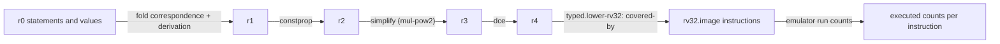
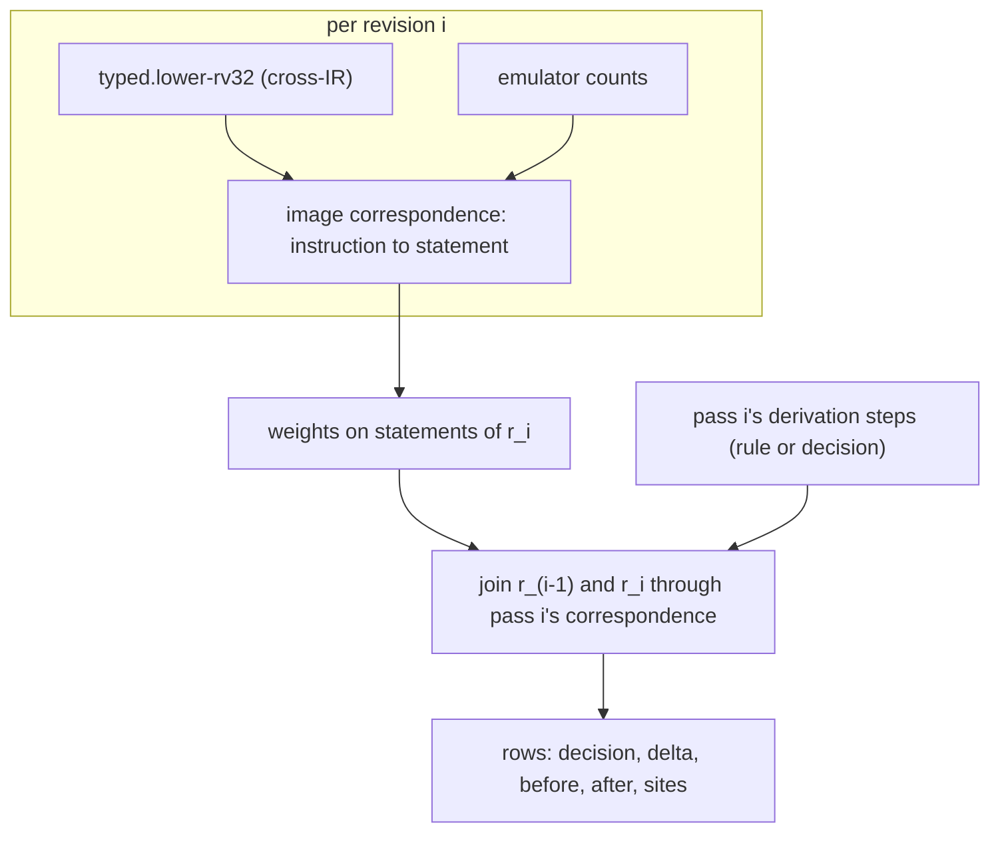

# Intern guide: attribution and classification as queries, the E1 benchmark and the unused engines

This guide prepares you to work on the last round of the v7 refactor of the IR Workbench, or to review it. The round has three lanes:

- **Lane 4.3** (ticket IRWB-065) turns three explanation tools into queries over records the passes already write.
- **Lane 4.7** (IRWB-066) measures whether an unused piece of the framework, the core runtime, earns its place, and then keeps, moves or deletes it together with two other unused parts.
- **Lane F42** (IRWB-067) fixes two loose ends from the previous round.

Every claim about the code was read on the working branch `irwb-001/import-v6-prototype` at `f4f8a96` and `cf88804`. Proposals are labelled as such. Where the guide reports a run, it gives the command.

A few names recur:
- **v7** is the current refactor of the framework.
- **R3** is the review round of four agents whose synthesis designed v7, in `ttmp/2026/11/26/IRWB-019--*/various/r3-synthesis/index.html`.
- R3 split the design into six concepts, **K1–K6**.
- A **decision point** is a measurement agreed in advance that can withdraw a change if the change does not pay for itself.

## 1. The system in one page

The IR Workbench is a compiler research framework written in TypeScript. Two compilers are built on it:
- **Typed** compiles a small statically typed language to 32-bit RISC-V (`src/typed/`);
- **Tix** compiles an index-notation tensor language to CUDA (`src/tensor/`).

Both compilers are made of *transformations*. A transformation takes an IR revision, produces a candidate revision, and must pass its *obligations* before the candidate is published to the IR store:
- a meaning check that runs both revisions on generated cases;
- preservation claims;
- correspondence coverage.

One runner, `runTransformation` in `src/framework/passes/transformation.ts`, executes every transformation under either a synchronous or an asynchronous driver (`src/framework/core/steps.ts`).

The previous intern guide, IRWB-059 (`ttmp/2026/11/28/IRWB-059--*/design-doc/01-*.md`), teaches all of this from the beginning: artifacts, the store, transformations, the drivers, contracts, correspondence, derivations, strategy plans and decide/eligible/prepare. Read its sections 1 and 2 first if any of those words is new. This guide assumes them and teaches what phase 4c needs.

### 1.1 What the previous round (phase 4b) left behind

Four results of phase 4b matter here:

1. **Lowering is a transformation** (4.2). `lowerToImage` (`src/typed/backend/compile.ts`) now runs the cross-IR transformation `typed.lower-rv32` from `typed.blocks` to `rv32.image`. Its result carries a correspondence from statements and values to RV32 instructions.
   - The Tix lowering `tensor.lower-cuda` (`src/tensor/cuda-contract.ts`) does the same for CUDA kernels.
   - Lane 4.3 can now follow one record chain from a source statement to the instruction that implements it.
2. **Rules match through a library** (4.6). `src/stdlib/term/` (`terms.ts`, `types.ts`, `verify.ts`) holds signatures, `match`, `firstMatch`, `instantiate` and `verifyRule`. Typed's rule tables match through it (`src/typed/rules/compile.ts`). One copy of the matcher did not move: the one in `src/typed/edit-classes.ts`. Lane 4.3 moves it.
3. **Staged choice** (4.8) made the CUDA gates and variants one launch-time `select`. Nothing in this round depends on it, but lane F42 edits the same file, `cuda-contract.ts`, outside `modesOf`.
4. **F40 and F41.** A `merged` derivation step now maps the consumed statement to the one that absorbed it (`stepEntries`), and there is one coverage vocabulary, `Coverage` in `src/framework/ir/correspondence.ts`.

## 2. The records a pass leaves behind

Lane 4.3 is about reading records instead of recomputing them, so first see what the records are. A Typed program, after the passes of a pipeline, is a chain of revisions. `Program.revisions` (`src/typed/program.ts`, interface `Revision`) holds one entry per pass application that changed something. Each entry carries four things:

- **`edits`:** the edit records (`Edit`, `src/typed/tx.ts`). Each has an id, the pass, the function, a `kind` (`replace`, `insert`, `remove`, `retarget`, …), the fields of that kind, and since IRWB-056-B `steps`: indices into the derivation that licensed it.
- **`correspondence`:** an `EntityCorrespondence` (`src/framework/ir/types.ts`). Its entries say which entities of the revision before became which entities of the revision after, with a relation name and the reasons.
- **`derivation`:** the producer's record of *why* (`Derivation`, `src/framework/ir/derivation.ts`). Each `DerivationStep` has:
  - the rule or decision that licensed it (`by`);
  - the entities it read (`consumes`, the first being the antecedent);
  - the entities it made (`produces`);
  - the premises it relied on;
  - a relation (`modified`, `merged`, `split`, `inserted`, `removed`, `retained`).
- **`artifact`:** the revision itself, with every statement and value carrying an `origin` (`from`, `via`, `because`, `note`). This older, per-entity provenance predates derivations.

Here are the records for one real rewrite. Running the Typed project `first-steps` under the `O1` pipeline gives revisions `r0 ingest, r1 fold, r2 constprop, r3 simplify, r4 dce`. At r3, `simplify` rewrites `x * 8` into `x << 3` with the rule `mul-pow2`. These three records were printed from that run, using a probe like `tests/typed/derivations.test.mjs`'s `corpus()` helper:

```json
derivation step  {"by":{"rule":"mul-pow2","table":"simplify"},
                  "consumes":["v:scale.10","v:scale.3","v:scale.9"],
                  "premises":["guard:pow2(v:scale.9)","v:scale.9"],
                  "produces":["v:scale.12"], "relation":"modified", "note":"x * 8 = x << 3"}
edit record      {"id":"edit:r3.0","rev":3,"pass":"simplify","fn":"scale","kind":"replace",
                  "stmt":"s:scale.1","field":"value","from":"v:scale.11","to":"v:scale.14",
                  "text":"((x << 3) + 1)","because":[],"steps":[0,1,2]}
correspondence   {"from":["v:scale.10"],"to":["v:scale.12","v:scale.13"],
                  "relation":"simplify","because":["v:scale.9"],"note":"x * 8 = x << 3"}
```

Three details in these records matter for the rest of this guide:
- **The derivation names the rule:** `mul-pow2` from table `simplify`. Its premise `guard:pow2(v:scale.9)` says which guard held on which entity, and `v:scale.9` is the constant operand the guard read.
- **The edit record points at its steps,** `[0, 1, 2]`. One edit, replacing a statement's value tree, is licensed by three steps. Steps 0 and 1 cite `mul-pow2`: one produces the constant 3, `v:scale.12`, the other the shift `v:scale.13` (`shl v:scale.3, v:scale.12`). In the lowering the constant folds into the `slli` immediate, so the image correspondence records `v:scale.12` as `removed` and `v:scale.13` as `covered-by` the `slli` (checked with `scripts/01-first-steps-chain.mjs`). Step 2 is `{"decision":"rebuild"}`: it makes the `+` above the changed operand again (`v:scale.11` → `v:scale.14`, note "rebuilt around a changed argument"). Any query that names an edit's cause must therefore tell rule steps from rebuild steps.
- **The correspondence is computed from the derivation** (`correspondenceFromDerivation`), and the runner checks it against the diff.

Since 4.2, the lowering adds one more link to this chain. `imageCorrespondence(blocks, image)` (`src/typed/backend/image.ts`) maps typed.blocks entities to image instructions. Its entries come from each instruction's `covers` list, the ids it implements, through `coverEntries`. Strung together, the chain from r0 to an executed instruction is:



Read the diagram right to left to answer an attribution question. The emulator says how often each instruction ran. The lowering's correspondence says which statement each instruction implements. Each pass's correspondence says which statement of the revision before each statement came from. Each derivation step says which rule or decision made the change.

The framework already has the generic machinery for walking such chains, in `src/framework/ir/correspondence.ts`:
- `composeCorrespondence(first, second)` is relational composition; Tix's lowering uses it in `cuda-contract.ts`;
- `traceEntity` follows one entity forward through a chain;
- `whyEntity` walks backwards from an entity and collects relations and reasons.

## 3. Lane 4.3: attribution and classification as queries (IRWB-065)

### 3.1 The three tools, as they work today

Three tools answer "what did the optimizer do, and what did it cost or save?". Each was written before derivations existed, so each reconstructs the answer from the IR trees and the older `origin` fields.

**D1: instruction attribution** (`attributeSteps`, `src/typed/attribute.ts`; ticket IRWB-034-G). Given a revision chain and one concrete call, D1 credits every change in executed instructions to the pass decision that caused it. The command line is `tools/attribute.mjs`. This is its output on the working branch today, for the bytecode VM's Fibonacci entry under `speed`:

```text
$ node tools/attribute.mjs bytecode-vm speed runVm --input '{"entry":0,"n":12,"seed":8}' --coalesce
runVm(1024, 0, 12, 8): r0 7678 -> r10 6301 instructions (-1377)
revision       instructions   step
r0 ingest              7678
r1 cfg                 7055   -623
r2 fold                6871   -184
...
r6 licm                6349   -339
r7 guards              6301   -48
   delta    after  groups  decision
    +256     1272       4  subst-mem: replace
     -48        0       3  guards: replaceStmt (always false: geu([0, 2], [4, 4]))
    -341     1060      15  licm: replace
    -439     1353      46  cfg: retarget
...
```

The algorithm has three parts:
1. **Measure each revision.** `measureSites` lowers each revision with `lowerToImage`, runs the image on the emulator (`runImage`) and sums the per-instruction counts per *site*. A site is the first statement in the instruction's `covers` list. An instruction that covers entities but no statement (its function: prologue, saved registers, return) is `frame`, and one that covers nothing is `backend`.
2. **Join the sites of two revisions into groups.** `stepRows`'s `groupOf` joins a site to the same statement id in the revision before. A statement that is new in the revision after joins the statement named by its `origin[0].from`.
3. **Name each group's decision.** The decision comes from the edit records that name the group's statements: their kinds, `note` and `because`. A group whose count changed without any edit naming it is `indirect`: the same statement, compiled differently.

The rows of each step sum to the emulator's difference for that step, so every instruction of the difference is credited exactly once.

**D2: provenance of hot code** (`hotShapes`, `src/typed/missed.ts`; IRWB-037-G). D2 asks the opposite question about a single revision: of the instructions that still run, which implement code no pass has touched? It credits each executed instruction through `covers` to its statement and its value node, abstracted to a *shape* (`eq(load, #)`). Each site's provenance is the set of passes named by the `origin.via` fields of the statement and every value under it. A shape whose provenance is `ingest` alone is "untouched". This found D2's missed optimizations.

**A0: edit classification** (`classifyApplication`, `src/typed/edit-classes.ts`; IRWB-035-G). A0 classifies each edit record of one application as:
- `local`: a value rewrite whose result reads only locals the input already defines;
- `structural`: a control-flow or placement change;
- `other`.

It recognises a rule-licensed rewrite by *re-deriving* it, in three steps:
1. `treeOf` turns both value trees into plain `Tree`s.
2. `normalize` rewrites the before-tree bottom-up with each verified rule table (`VERIFIED_TABLES`: simplify, fold, identities), and `rederive` keeps the first table whose result is `sameTree`-equal to the after-tree.
3. The match becomes `local/rule` with the rules it fired.

On the `mul-pow2` edit above, A0 prints `{"class":"local","sub":"rule","rule":{"table":"simplify","fired":["mul-pow2"],"weakest":"proof"}}`. It re-discovered, by rewriting trees, the rule name the derivation step already records.

### 3.2 Why re-deriving is the problem

Each tool holds a second account of what the passes did, computed from different evidence than the passes' own records:
- D1 joins statements through `origin[0].from` and credits decisions from edit fields;
- D2 reads `origin.via`;
- A0 re-runs the rule tables.

Since phases 4.1 and 4.2, the producer writes down the answer:
- the rule that licensed each step;
- the site it read;
- the correspondence from each revision to the next;
- the correspondence from blocks to instructions.

Two accounts of the same facts can disagree. When they do, it is not clear which one is wrong. IRWB-056-B's two queries over the records already disagree with A0 on two edits (393 against 395, section 3.4). R3's K2 concept states the goal: classification and attribution are *queries* over the producer's records, not fields and not reconstructions.

There is a second, practical reason. A0's matcher copy (`edit-classes.ts`: its own `TreeHandle`, `instantiate` and `normalize`) is the one rule matcher left outside `src/stdlib/term` after phase 4.6.

### 3.3 Proposed design: credit through the record chain

The following is a proposal; the lane may choose differently and say why. Split the work into a domain-independent query and thin domain adapters.

**The query** (proposed home: a new module next to `derivation.ts`, such as `src/framework/ir/attribution.ts`; the lane's brief allows "a query module in `src/framework/ir/` next to `derivation.ts`"). Given a chain of correspondences, the derivations of the transformation steps in it, and a weight on each entity of the last revision, it distributes the weight backwards and reports it per source entity and per step:

```ts
// Proposal, not code. Weights are executed-instruction counts on the image's entities.
interface Credit {
  readonly step: number;          // index in the chain
  readonly by: DerivationBy | 'indirect';
  readonly sites: readonly string[]; // entities of the revision before and after that the step joined
  readonly before: number;
  readonly after: number;
}
function creditThrough(
  chain: readonly { correspondence: EntityCorrespondence; derivation?: Derivation }[],
  weightsAt: (revisionIndex: number) => ReadonlyMap<string, number>, // e.g. counts lowered per revision
): Credit[];
```

D1 needs one thing beyond a single chain walk. It measures *every* revision of the chain, lowering and running each one, so each step has a before count and an after count. The query therefore takes the weights per revision. For revision *i* they are obtained in three steps:
1. lower revision *i* with `typed.lower-rv32`;
2. run the image;
3. push the counts through the lowering's correspondence onto statements (`covered-by` entries; an instruction whose sources include no statement is `frame`, and one with no source entity at all is `backend`, as in `measureSites`).

The join that `groupOf` makes from `origin[0].from` then comes from step *i*'s correspondence entries, and the decision name from the derivation steps those entries' edits cite (`Edit.steps`). A group with a change but no step is `indirect`, as today.



D1's `attributeSteps` keeps its signature and output format (`formatAttribution`) and becomes an adapter: it supplies the Typed lowering and the emulator, and calls the query. D2's provenance label (the passes in a site's history) is a query over the same chain: the labels of the steps whose correspondence entries lead to the site. It replaces the walk over `origin.via`.

**The check** is exact reproduction. The brief says to run D1's script (`ttmp/2026/11/27/IRWB-034-G--*/scripts/04-attribution-tables.sh`, which calls `tools/attribute.mjs` for entries 0 and 34) before and after the change, and the outputs must be identical. Note what "the D1 tables" means. The tables in IRWB-034-G's report were made when D1 merged, and the `speed` pipeline has changed since:
- the report's Fibonacci run ended at r6 with 6,349 instructions;
- today's run, above, ends at r10 with 6,301, after `copies`, `dce`, `guards` and `subst-mem` joined the pipeline.

The reference is therefore today's tool output, captured before the change.

**A likely difficulty.** `groupOf` uses only the *first* origin (`origin[0].from`) and only when that statement exists in the revision before. A correspondence entry can map one statement to several, or several to one: a `merged` step after F40, or a `split`. The query must group these the way `groupOf` does, or the rows will differ. Expect to spend time here, and record each case you meet in the diary.

### 3.4 Settling 203 against 395

R3 recorded two counts of local edits over the O2 corpus's edit records, from two implementations of A0's classifier:

| Policy | Count | What it accepts as local |
|---|---|---|
| **scoped** (A0-B) | 203 | a rewrite that needs nothing outside its own site |
| **in-place** (G's `classifyApplication`) | 395 | a rewrite that needs nothing the application itself put into the program |

IRWB-056-B wrote both as queries over the derivation records (`locality(step, input, policy)` in `derivation.ts`; the test is `tests/typed/derivations.test.mjs`, "both policies as queries over the same records"):
- **scoped** gives 203 (simplify 140, fold 43, strength 20) and agrees;
- **in-place** gives **393**: simplify 140, fold 41, strength 20, constprop 141, subst 51.

The difference is two `fold` records, on the projects `constants` and `orders`. In each, `fold-add` folds a constant tree that `fold-shl` computed earlier in the *same* application. The `in-place` query sees a premise that is an entity this application made, so it answers `structural`. G's classifier answers `local`.

The decision for the lane is which reading A0 meant, and then making the query and its test say so. The evidence for the reading is in `edit-classes.ts`'s header, which defines `local` as a `replace` where "B reads only locals the input revision already defines: B reads no local this application created and no local this application inserted a `set` for." That definition is about **locals** (variables and the statements that set them). It is not about intermediate value nodes made within one chain of rewrites; such a chain is classified by its net change, according to the same header ("Several `replace` edits of one statement field in one application form a chain").

A proposal that follows from this, to be confirmed by the lane:
- restrict the `in-place` test to premises that are locals or statements the application created or inserted;
- treat value nodes produced by earlier steps of the same edit chain as part of the chain.

Under that reading the two `fold-add` records are local and the count is 395. If the lane finds the opposite reading is right, the test should state 393 and the reason. Either way, the number in the test comes with the sentence that justifies it.

### 3.5 One matcher

`edit-classes.ts` keeps its own matching layer over plain trees:
- the `TreeHandle` interface and `handle`;
- `instantiate`, a rule right-hand side built as a `Tree`;
- `normalize`, a bottom-up rewrite.

It calls `firstMatch` and `indexRules` from `rules/compile.ts`, which delegate to `src/stdlib/term` since phase 4.6. Its template instantiation, however, is a second copy of the rules' semantics.

The library's `instantiate(sig, template, bindings, build)` (`src/stdlib/term/terms.ts`) builds through a domain-supplied `Build`, which A0 can implement over `Tree`.

The brief points at IRWB-060-B's port (`git show v7-terms-ds-x/irwb-060-b:src/typed/edit-classes.ts`). That branch was *not* merged, and it targets its own library API (`stdlib/term/pattern.ts`, `rules.ts`), which does not exist on the working branch. Use it to see what changes, then write the port against `terms.ts`.

If the queries in sections 3.3 and 3.4 replace A0's re-derivation entirely, `normalize` and `rederive` may become unnecessary for classification. They may still be wanted as an *audit*: a check that the derivation's rule names agree with what the rule tables would do. The brief asks you to "delete what the queries replace … and say what remains and why". Keeping an audit is a legitimate answer if you say so.

### 3.6 Scope, acceptance and what can go wrong

- **Owns:**
  - `src/typed/attribute.ts`, `src/typed/missed.ts`, `src/typed/edit-classes.ts`;
  - one new query module in `src/framework/ir/` next to `derivation.ts`;
  - tests.
- **Does not touch:** `src/framework/core/`, `src/framework/ir/{patterns,rewrites,traversal,transactions}.ts`, `src/labs/`, `src/conformance/` (lane 4.7), `src/typed/rules/` or `src/tensor/` (lane F42).
- **Acceptance:**
  - the D1 outputs before and after are identical, with both outputs attached;
  - both A0 policies are queries, with the settled numbers and their justification;
  - D2's hot-shape output is unchanged on the programs it was run on;
  - the baselines print `no differences`;
  - all suites pass.
- **Cells:** GLM 5.3 high and DeepSeek 4.1 Flash xhigh, compared by review.

## 4. Lane 4.7: the E1 benchmark and the unused engines (IRWB-066)

### 4.1 Three parts of the framework that no compiler uses

R3's probes counted, for every framework module, the importers in each domain. Three groups of modules have no importer in Typed, Tix or the workbench. The table shows who does import them today (re-checked on the working branch with `grep` over `src/`):

| Part | Files | Lines | Importers outside the part itself |
|---|---|---|---|
| **core runtime** | `src/framework/core/runtime.ts`, `query.ts`, `records.ts` | 914 + 220 + 103 = 1,237 | `src/labs/lab.ts`, `src/labs/types.ts` (records), `src/conformance/01-runtime.ts`, `core/index.ts` |
| **rewrite engine** | `src/framework/ir/patterns.ts`, `rewrites.ts`, `traversal.ts` | 921 + 855 + 252 | `src/labs/{lab,rules,types}.ts`, `src/conformance/03-strategy-contracts.ts`, `src/typed/rules/form.ts` (patterns, for `toNodePattern`), `ir/index.ts`, and `ir/view.ts` (traversal) |
| **transaction layer** | `src/framework/ir/transactions.ts` | 429 | `ir/view.ts` only |

Framework tests also use them: `core.test.mjs`, `core-review.test.mjs`, `pass-policy.test.mjs`, `run-extensions.test.mjs`, `ir-examples.test.mjs`, `ir-review.test.mjs`, among others. `src/labs/` (2,990 lines) is a test domain of four small native representations, run by `runIRLab`. Its README says the workbench uses it. A search of `src/workbench/`, `site-src/` and `tools/` found no caller, so treat that README sentence as outdated.

**The `view.ts` dependency.** `src/framework/ir/view.ts`, the class behind every `IRView`, imports `Edit` from `transactions.ts` (its `edit()` method) and `traversal` (its `walk()` and `subgraph()` methods). No domain and no other framework layer calls `view.edit`, `walk` or `subgraph`: a search of `src/typed`, `src/tensor`, `src/workbench`, `src/framework/{passes,contracts,strategy}` found none. But `view.ts` is not in lane 4.7's scope list. Moving `transactions.ts` and `traversal.ts` out of the framework therefore needs either a scope change, so that `IRView` loses those three methods, or a decision to keep the two modules where they are. The lane should raise this rather than quietly widen its scope.

### 4.2 What the core runtime does

The core runtime is a demand-driven incremental compiler engine, in the style of build systems and query-based compilers (Salsa, Adapton). Its unit of work is a *task*: a logical id, a pass id and parameters (`Task`, `src/framework/core/types.ts`). A *pass* in this older API (`Pass`, the same file) is `{ id, version, kind, run(context, params) }`, where `kind` names the IR kind of its output.

The flow, read from `runtime.ts`:

1. A `Compiler` registers IR kinds (`registerKind`: an id, a schema version and `validate`) and passes (`register`, `replacePass`; a changed algorithm needs a new version).
2. A `CompilationRun` resolves a task with `require(task)`:
   - it detects dependency cycles;
   - it reuses a task already completed in the run;
   - otherwise it executes the task (`resolve`, `execute`).
3. While a pass runs, every input it reads (`context.read(key)`) and every task it requires is recorded as a `Dependency` of the invocation.
4. The output becomes an artifact whose `revision` is `fingerprint({ kind, schemaVersion, value })`, a hash of the content.
5. **Cache check.** On a later run, a cache entry for the same pass, version and parameters is reused only if every recorded dependency still matches:
   - each read input has the same value;
   - each required task resolves again to the *same revision*.

   Because revisions are content hashes, a required task that re-executes but produces the same value has the same revision, and its dependents hit the cache. This is **early cutoff**: a change stops propagating where it stops changing values.
6. Every invocation leaves an `InvocationRecord` (`records.ts`): status `executed`, `cached` or `failed`, its dependencies, and a cache explanation such as `Required artifact revision changed`. `Queries` (`query.ts`) is a read-only view over those records.

`src/conformance/01-runtime.ts` is the smallest working example: one kind `guide.scalar`, a pass `guide.read` that reads a tracked input, and a second run that hits the cache.

### 4.3 What the framework does instead today, and what E1 must measure

The domains do not use the runtime. They use the analysis manager (`src/framework/contracts/analysis-manager.ts`) and the transformation runner. They are incremental in two ways:

- **Analyses** (dominators, liveness, ranges) are cached as records keyed by the analysis definition and the *subject artifact revision*, with dependency checks (`validDependencies`, `reusable`) and invalidation epochs. A Typed program is one artifact. Any edit gives a new revision of the whole program, so a cached analysis of the old revision does not serve the new one.

  Deduction from the code, to be measured: an edit to one function recomputes per-function analyses for *every* function, unless the analysis itself reuses something internally.
- **The meaning check** `typed.meaning-kept` (`meaningKept`, `src/typed/evaluate.ts`) generates cases for every function (`roots ?? [...st.fns.keys()]`) on every check. It is already incremental per call closure, though:
  - with `baselineKey` (the origin's revision) the origin's outcomes are computed once;
  - with `subjectKey`, `closureKey(candidate, fn)`, a hash of the code a case can reach, a verdict already decided for the same closure is replayed instead of evaluated (IRWB-004 D1, `src/framework/contracts/differential.ts`).

  So an edit to one function re-evaluates only the cases whose closure changed, but still walks every case.

BACKLOG item E1 ("incremental checking per function", `BACKLOG.md`) states the question. Typed's functions could be keyed separately, so an edit to one function should not require checking the others. What does each edit cost today, as a function of program size, and how much would queries with early cutoff, keyed by function part, reduce it?

The benchmark the lane writes (in its ticket's `scripts/`) should:
1. **Choose programs of increasing size.** The corpus has `corpus/projects/chess-search` and `corpus/candela-gallery`. Smaller corpus projects give the small end; if Candela takes too long to load, say so and use what loads.
2. **Generate an edit stream.** Apply small, meaning-preserving edits one at a time, each confined to one function: a pass application on one function, or a source-level change that leaves other functions' code unchanged.
3. **Measure the checking cost per edit.** That is the time to bring analyses and checks up to date after the edit, in two configurations:
   - **today:** the analysis manager and the meaning check with replay;
   - **the runtime:** the same analyses and checks as runtime tasks keyed by function part (one task per function and analysis), so unchanged functions hit the cache through early cutoff.
4. **Report cost per edit against program size** for both, with repetitions and the spread, interleaved in one process, because the machine is shared.

**The decision point** in R3's words: "adopt the runtime only if its per-edit checking cost falls with program size". The reading this guide suggests, as a proposal: the runtime earns its place if its cost per edit stays roughly flat as programs grow while today's grows. A falling *ratio* of runtime to today with size is the signature of incrementality working. If both grow alike, the runtime adds nothing the manager lacks. State the reading in the report, with the numbers.

Do not build the whole of Typed on the runtime to answer this. A faithful model of the per-function analyses and the meaning check as runtime tasks is enough, with Typed's real analysis functions and evaluator doing the work.

### 4.4 Keep, move or delete

The lane's possible outcomes:

| Outcome | What it means | When |
|---|---|---|
| **adopt** | the runtime serves the path the benchmark measured (a real caller in a domain or the framework), and stays in `src/framework/core/` | the decision point is met |
| **move** | the module goes to `src/labs/` (the test domain that uses it), with its conformance example and tests; `src/framework/` stops exporting it | it is unused by any compiler, but the labs and their tests still exercise it |
| **delete** | the module and its tests are removed; git keeps the history | nothing worth keeping uses it |

The rewrite engine and transaction layer have no measurement to decide them. R3's evidence is that no compiler uses them. Its reasons are recorded in the synthesis's terms row:
- pattern identity is entity identity, so `x - x` cannot be matched on a tree IR;
- callback rewrites cannot be verified, because their right-hand side is code.

`src/stdlib/term` replaced them for rules. `form.ts`'s `toNodePattern` (used only by `tests/typed/rules.test.mjs`) is the one domain use. The brief says to move it onto `src/stdlib/term`, then move the engine with the labs, unless you find a domain use. Remember the `view.ts` dependency from section 4.1.

Record the framework's line count before and after: `wc -l src/framework/**/*.ts` (in bash, enable globstar first; zsh expands `**` itself).

### 4.5 Scope and acceptance

- **Owns:**
  - `src/framework/core/{runtime,query,records,index}.ts`;
  - `src/framework/ir/{patterns,rewrites,traversal,transactions,index}.ts`;
  - `src/labs/`, `src/conformance/`, `src/typed/rules/form.ts`;
  - the framework tests of those modules, and the benchmark.
- **Does not touch:** `src/framework/ir/derivation.ts`, `correspondence.ts`, `src/framework/passes/`, the lane-4.3 files, and `src/tensor/`.
- **Acceptance:**
  - the benchmark script and its output for both configurations;
  - the decision with its numbers;
  - moved tests pass in their new place;
  - the baselines print `no differences`;
  - all suites pass.
- **Cell:** Codex Sol at low effort. It measures and recommends, and moves code only as far as the measurement and the evidence support.

## 5. Lane F42: two lowering follow-ups (IRWB-067)

### 5.1 One schedule registry, and the lost memo

The Tix lowering runs the scheduling plan twice, for two different callers:

- `scheduleFunction(fn, fuse)` (`src/tensor/strategy.ts`) runs `schedulePlan` under `executeSync` on the module-level `scheduleRegistry`. It memoizes the result per `JSON.stringify([fn, fuse])`, and returns `{ schedule, execution }`. It does not return the correspondences of the passes it ran.
- `tensor.lower-cuda` needs those correspondences, to compose the statements-to-kernels correspondence. Its local `schedule(initial, fuse)` (`src/tensor/cuda-contract.ts`) builds a *second* `AlgorithmRegistry` whose pass algorithms collect each changed result's correspondence through `passAlgorithm(pass, { onResult })`, and runs `schedulePlan` again, without a memo.

That second run is why `cudaSource()` went from 0.29 ms to 4.7 ms per lowering in phase 4b (IRWB-061's measurement).

The fix is to make `scheduleFunction` return the pass results (or their correspondences) and have `cuda-contract.ts` use it. That deletes the second registry and restores the memo in one move. One detail to settle: `onResult` is a closure per registration, while `scheduleRegistry` is shared across calls. Collecting per-call results needs one of:
- a registry per call (cheap);
- results read from the execution record, if `StrategyExecution` carries them (check `src/framework/strategy/interpreter.ts`; this guide did not confirm it does);
- a collector passed per execution.

Measure `cudaSource()` per lowering before and after, and keep the composed correspondence equal to `kernelCorrespondence` (`tests/tensor/lowering.test.mjs`).

- **Owns:** `src/tensor/strategy.ts`, `src/tensor/cuda-contract.ts`, `src/tensor/index.ts`, and tests.
- **Acceptance:**
  - the composed correspondence is unchanged;
  - `cudaSource()` output is byte-identical;
  - the cost per lowering before and after is in the report;
  - the baselines and suites pass.
- **Cell:** Codex Terra at low effort. GPU tests are not run by the agent; the coordinator runs the GPU suite at merge, because `cuda-contract.ts` changes.

### 5.2 An open decision: the default lowering paths are not checked

This is not a lane; it is a decision for the coordinator and the user, and it is explained here because it shapes what "checked compilation" means at the end of v7.

Since phase 4.2, `lowerToImage` and `cudaSource()` are *pending* applications of their lowering transformations:
- `applyTransformationSync(…, { pending: { reason } })` produces the output;
- records each `ensures` obligation as owed (`ObligationEvidence.status: 'pending'`);
- refuses a store, because a candidate is visible only after every obligation has passed (F33).

The checked path exists. `lowerImageChecked` (`src/typed/backend/compile.ts`) runs `typed.lower-rv32` with `rv32.image-agrees` as its `ensures`, through an analysis manager and a store. But only a test calls it (`tests/typed/lowering.test.mjs`). The Tix equivalent is `checkLowering`, which needs the GPU.

The open choice is where the checked lowering runs by default: for example, at the end of `Program`'s O2 path, or in the workbench's image view. The cost is one more meaning check per compile. The baselines would not change.

## 6. How the round is validated, and what closes v7

Every lane is checked the same way, on its last commit:
- `node ttmp/2026/11/27/IRWB-039--*/scripts/02-baselines.mjs check` prints `no differences`: RV32 image hashes, instruction counts and edit records for every corpus project under r0, O2 and `speed`, plus CUDA source and `optimizeTix` revisions;
- the five suites pass: `node --test tests/<dir>/*.test.mjs` for `typed`, `framework`, `workbench`, `stdlib`, and `tensor` without `*-gpu`;
- `npm run check` (tsc) is clean, and the site builds.

The coordinator scores each cell with `scripts/07-score-lanes.sh`, which also checks that no agent edited the coordinator's tickets. It reviews the diffs, merges by cherry-pick, and runs the GPU suite at merge.

Phase 4 had eight items:

| Item | State |
|---|---|
| 4.1 derivations | merged |
| 4.2 cross-IR lowering | merged |
| 4.4 decide/eligible/prepare | merged |
| 4.5 `solveFor` and `pe` | `solveFor` merged; `pe` and `unfold` withdrawn at their decision point |
| 4.6 term rules | merged |
| 4.8 staged choice | merged |
| 4.3 attribution and classification as queries | this round |
| 4.7 keep, move or delete the engines | this round |

When 4.3 and 4.7 are merged or withdrawn at their decision points, v7 is done. The user asked for a pull request at that point, from `irwb-001/import-v6-prototype` into `main` (pushed once, at `c07a1e4`), and for a project report in the vault.

## 7. API and file reference

| Name | File | What it is |
|---|---|---|
| `Revision` (`edits`, `correspondence`, `derivation`) | `src/typed/program.ts` | one pass application's records |
| `Edit` (`kind`, `steps`) | `src/typed/tx.ts` | an edit record; `steps` index the derivation |
| `DerivationStep`, `Derivation`, `locality`, `correspondenceFromDerivation`, `stepEntries` | `src/framework/ir/derivation.ts` | the producer's record of why; classification queries |
| `composeCorrespondence`, `traceEntity`, `whyEntity`, `checkCoverage`, `Coverage` | `src/framework/ir/correspondence.ts` | composing and walking correspondence chains |
| `imageCorrespondence`, `coverEntries` | `src/typed/backend/image.ts` | blocks to RV32 instructions |
| `lowerToImage`, `imageLowering`, `lowerImageChecked` (`typed.lower-rv32`) | `src/typed/backend/compile.ts` | Typed lowering, pending and checked |
| `runImage` | `src/typed/backend/index.ts` | the RV32 emulator, with per-instruction counts |
| `attributeSteps`, `formatAttribution` | `src/typed/attribute.ts` | D1 |
| `hotShapes`, `formatHotShapes` | `src/typed/missed.ts` | D2 |
| `classifyApplication`, `rederive`, `normalize`, `sameTree`, `VERIFIED_TABLES` | `src/typed/edit-classes.ts` | A0 |
| `Signature`, `match`, `firstMatch`, `instantiate`, `Build` | `src/stdlib/term/terms.ts` | the term library |
| `Compiler`, `CompilationRun` | `src/framework/core/runtime.ts` | the core runtime |
| `Queries`; `InvocationRecord`, `Dependency` | `src/framework/core/query.ts`, `records.ts` | its record queries and records |
| `meaningKept` (`baselineKey`, `subjectKey`, `closureKey`) | `src/typed/evaluate.ts` | Typed's meaning check with verdict replay |
| `AnalysisManager` | `src/framework/contracts/analysis-manager.ts` | analysis cache and contracts |
| `NodePattern`, `searchPattern`; `RewriteDefinition`; `Edit` (IR) | `src/framework/ir/patterns.ts`, `rewrites.ts`, `transactions.ts` | the unused engines |
| `toNodePattern` | `src/typed/rules/form.ts` | the one domain use of `patterns.ts` |
| `scheduleFunction`, `scheduleRegistry`, `schedulePlan` | `src/tensor/strategy.ts` | Tix scheduling and its memo |
| `schedule` (local), `createCudaLowering`, `modesOf` | `src/tensor/cuda-contract.ts` | the second registry |
| `lowerTixCuda`, `cudaSource`, `runTixCuda` | `src/tensor/index.ts` | Tix lowering entry points |
| `tools/attribute.mjs`, `tools/missed.mjs` | `tools/` | D1 and D2 on the command line |
| `02-baselines.mjs`, `07-score-lanes.sh` | `ttmp/2026/11/27/IRWB-039--*/scripts/` | the oracle and the scorer |

## 8. Open questions

1. **4.3:** Which reading of "local" did A0 mean, 393 or 395? Section 3.4 gives the evidence for 395 and a proposal; the lane decides and justifies it in the test.
2. **4.3:** Should `rederive` survive as an audit, checking that the derivation's rule names agree with the rule tables? It is a choice to state, not a requirement.
3. **4.7:** Can the lane move `transactions.ts` and `traversal.ts` without editing `view.ts`, which is outside its scope? Probably not; raise it.
4. **4.7:** Does "falls with program size" hold under the reading in section 4.3? The lane reports its reading with the numbers.
5. **F42:** Does `StrategyExecution` carry each pass's result, or does collecting the correspondences need a per-call registry or collector?
6. **After v7:** Where should the checked lowering run by default (section 5.2)?
